# 箭塔 HYPERTOWER：I–∞ 全程超详细图文攻略

从第一台引擎开始，逐步走过晶格、超限、序数谜题、归一、群星建设与无限循环。

本攻略围绕实际操作编排。每到一个新纪元，先按“初入顺序”完成第一轮，再根据当前进度查研究、谜题、挑战、自动化和离开条件。遇到按钮不可用，按卡点表检查具体条件。想先理解整体玩法，可以同时阅读《I–∞ 纪元完整介绍》；本页负责把这些机制变成可以执行、可以复查的步骤。

## 出发之前：选好路线，保存你的真实进度

### 本攻略对应哪个版本

规则核对日期为 2026 年 11 月 1 日，依据当前 v7 联调版本、数学验证内核、实际界面和现有回归用例。正文会区分三种信息：**硬条件**是程序检查的解锁、费用、目标与合法性；**建议**是便于第一次游玩的顺序，可以按自己的经济状况调整；**演示**用于看清按钮和结果，有些截图预先补足了货币或研究。

截图中的高额资源、全部研究、几十万次归一和百万圈属于隔离演示存档，不是新手进入某个纪元的要求。普通路线与高进度示例分开说明。截图展示一次操作后的真实状态，也不等于已经验证整部游戏的自然通关时长。

P1 通常指 I–X，P2 指 XI–XX，P3 指 XXI–XXIV 与 ∞。进入群星纪后，P1、P2 还会成为界面两侧持续运行的历史窗口。阅读时要把“旅程的三个阶段”与“群星纪同时运行的三个窗”联系起来，但操作时始终先确认自己正在控制哪一窗。

### 第一次玩，按这条主路线走

| 目前的位置 | 第一目标 | 完成以后再考虑 | 暂时不要用来判断是否卡住 |
| --- | --- | --- | --- |
| I | 买到第一台引擎，形成稳定产出 | 更高阶采购、超频与第一次折叠 | 后期截图中的天文数字 |
| II–V | 学会每种重置并把新运算放进晶格 | 星图、悖论、尖塔、箭能和自动化 | 是否已经复刻别人最终晶格 |
| VI–X | 稳定研究层级，取得永久研究货币 | 吞噬、公理、λ 排布与自动推进 | 当前显示的数有多少位 |
| X→XI | 检查 ε 与九头入口 | 保存 P1 阶段备份 | 是否达到演示图的 ε_300000 |
| XI–XX | 每纪元先做一份有效设计，再推进研究 | 24 题星级、挑战、蓝图库与工坊 | 单纯等待会不会自动补齐设计 |
| XX 归一 | 确认遗产、归一条件与保留项目 | 重建、更多归一和 720 星收集 | 只到 XX 是否已经等于满足 XXI 门槛 |
| XXI–XXIV | 按能级待办逐条建设与观测 | 研究、微扰、三窗协作与核树 | 主窗货币很高但待办仍未完成 |
| ∞ | 手动跑通第一圈四劫 | 预算、回声、八音树、自动化和塔 | 圈号大是否就代表本圈环阶一定大 |

主线并不要求你在每个中间节点立刻穷尽所有可选挑战。第一次遇到一个系统，先做一次成功操作、确认反馈，再把长期收集加入后续路线。需要收集时，正文会说明这是进入下一阶段的硬门槛，还是为了长期收益的建议。

### 老玩家回归，先定位自己的存档

不要仅看主页的大数字。P1 查看当前纪元、研究层级、ε、当前层稳定度和已经买下的永久研究。P2 查看当前纪元、序数层级、归一轮数、太一遗产、每纪元 24 题的星级，以及当前是否有匹配挑战的有效蓝图。P3 查看已开纪元、各能级待办、正在使用的研究与微扰、观测队列和黑洞阶段。

如果存档打开到一个比记忆中早得多的界面，先核对页面地址、浏览器与登录环境。网页站点、下载的本地 HTML、另一个浏览器和隐私窗口通常使用不同的浏览器存储空间。同名游戏文件也不能证明它们读的是同一个存档。

先找已有导出文件，再尝试导入。不要用新的空档覆盖唯一备份。导入后核对几个彼此独立的读数：纪元是否正确、归一轮数是否正确、成就是否保留、题目星级是否存在、P3 是否已开启。只看到其中一个高数字不足以确认整个存档恢复完整。

### 如何保存一份可恢复的备份

1. 打开游戏中的设置或存档页，先执行立即保存，确认页面没有提示本地存档不可用。
2. 使用导出存档，把完整导出内容保存为文本文件。文件名建议包含纪元、归一轮数或圈号，例如“XX-归一前-第10轮”。
3. 保留刚导出的完整文本，不手动删除开头标记、末尾字符或换行中的有效内容。
4. 需要检验备份时，用独立浏览器环境或已经另存当前档的页面导入，不在唯一真实进度上反复试错。
5. 导入后等待界面完成刷新，再核对纪元、货币、成就、星级和长期记录。确认成功后，才把这个文件当作可恢复备份。

建议在以下节点分别留档：第一次进入 VI、进入 XI 之前、第一次 XX 归一之前、关闭 XIX 的选择公理之前、满足 XXI 门槛之后、开启新的 DLC 纪元之前、第一次进入 ∞ 之前，以及第一次完整回环之后。保留节点备份比每次重置都另存更容易管理。

云存档是否可用取决于当前页面实际提供的连接能力。不要因为看到介绍文字就假定本机已经开启云同步；以游戏显示的连接状态与成功反馈为准。攻略页自己的阅读记录也与游戏存档完全分开，勾选“已读”不会替你完成纪元或保存游戏。

### 一次购买、研究或提交以后，应该看什么

每次操作至少核对“扣除了什么”和“新增了什么”。购买引擎时看数量与秒产；购买研究时看等级、下次费用和效果；折叠时看折痕与次数；提交谜题时看验证通过、星级、蓝图和实际产出；航行时看当前宇宙、航线与发现数；观测时看目标信息量和星级；回环时看圈号和新天空。

按钮变色只是界面反馈，不能代替结果核对。如果点击后看不出变化，不要立刻连点十次。先看货币是否扣除、状态是否改变、是否存在正在计算的任务或弹窗。复杂验证会经过计算任务；重复发起可能被占用规则拒绝，任务取消与换档也会影响结果是否允许写回。

有些操作只改变草稿，有些会登记长期结果。编辑 XXII 局面、修改 XXIV 的字、切换旧题档案，都可能只是准备输入；按下登记、提交或验证并取得成功反馈，才代表实际改变了相应记录。正文在每个例子后都会列出应当出现的读数。

### 怎样用攻略里的解题答案

主线正文先讲解题的做法与原因，附录提供 XI–XX 全部 240 题的可复现参考步骤。建议先读题目目标并尝试一遍，确实卡住时再展开对应答案。照着参考步骤手动完成与在游戏里直接点击辅助求解是不同的操作，具体星级规则也因纪元而异。

XI 的星级取决于该题的刀数、奖励或题型判定，不能直接套用后九纪元“辅助两星”的说法。XII–XX 则要注意辅助标记：参考解按钮可帮助理解，但当前实现中辅助提交与手工提交的星级不同。要补三星，应按正文列出的正常输入、导入与提交路径处理，不修改存档里的辅助标记。

答案中的坐标、树路径、机器状态和自由群字各有自己的约定。读到“第 1 行第 2 列”先在小例题里确认界面位置；读到九头路径时，每一刀都以当时的新树为准；读到机器表时，按状态与读入符号逐项填写；读到闭路时，正号和负号表示方向，不是普通数的加减。

如果一个参考设计已经通过内核验证，但当前图形编辑器缺少相应输入控件，攻略会说明具体缺口和受支持的备用入口。不要把“内核有合法解”误认为“当前每一种界面都已提供所有编辑按钮”。

### 自动化的正确打开顺序

先手动跑通一次可重复的循环，再开启对应自动化。手动成功一次能确认资源足够、设计有效、门槛理解正确；自动化则用于省去重复点击。若还不知道为什么一次行动成功，就很难判断自动机后来停在哪里。

建议先启用低风险的采购与基础循环，再启用会改变阶段、触发重置或消耗稀缺资源的动作。打开自动归一、自动改度或自动坍缩前，先确认你正在收集的目标不会因此被中断。做挑战、补题目星级或观察某个特定结果时，可以先暂停会改变当前环境的自动化。

自动化已解锁、按钮已勾选、当前动作能执行，是三个分别检查的条件。永久能力没解锁时，勾选位置并不能代替购买；能力已解锁但资源不足时，自动机也会等待；当前微扰禁用某项操作时，正常模式下的成功顺序可能不再适用。

离线回来后先看变化，再调整策略。收益、研究与事件推进可能经过专门的离线结算；不要把多开页面、反复导入或修改系统时间当作常规加速方案。不同阶段的精确模式、近似模式和计算预算边界，会在相应章节单独说明。

### 如何区分“需要等”“需要改设计”和“还没解锁”

| 现象 | 先检查 | 下一步 |
| --- | --- | --- |
| 货币在增加，按钮价格仍高 | 本次购买收益与当前秒产 | 继续积累或换更划算的生产投资 |
| 研究条完全不动 | 是否已完成本纪元、是否等待稳定或对角化、是否有挑战限制 | 先处理推进边界；XII–XX 缺蓝图仍有保底研究速度，完成后普通主线研究停止 |
| 进度到 100% 却不去下一层 | 是否需要手动稳定、对角化或晋级 | 检查当前纪元的推进按钮 |
| 资源很多但下一纪元未亮 | 非货币待办、等级、观测、收集、历史条件 | 按硬条件逐条补齐 |
| 蓝图看得到但没有质量收益 | 蓝图纪元与挑战编号是否匹配当前状态 | 激活对应蓝图或重新验证 |
| 观测队列排了目标却不涨信息 | 星等、仪器、模式、任务可用性 | 升口径、换合适目标或调整模式 |
| 周天未完成 | 每个齿轮的覆盖与整环整数条件 | 补缺的亮齿并检查稳定链 |
| 已经坍缩却不能回环 | 四劫阶段、供给开关、黑洞剩余质量 | 断供、等真实蒸发并复查周天 |

### 关于攻略中的配图与操作演示

正文会同时使用完整界面图和局部步骤图。完整图用于找页面区域；局部图用于看清一次输入、一个验证结果或一组按钮。可以点开放大、切换原尺寸，并用前后翻图比较同一操作的前后状态。

新档购买示例从真实初始状态开始。中后期动作图使用独立演示存档补齐前提，以便展示关键按钮；图注会说清预置条件。示例中的内核操作、登记与验证结果仍按当前程序执行。为了同时展示所有面板，部分完整图展开了原本可滚动的内容，所以截图的页面高度可能比你当前浏览器窗口更长。

普通玩家不需要照抄任何演示存档的巨额货币。先找正文写出的最低条件，再看自己的实际读数。只要目标条件成立，就可以继续主线；等到全部研究、全部星级或几十万次循环才行动，常常只是把可选的长期目标误当成了门槛。

## 全程里程碑：每跨过一道门，都知道自己得到了什么

### P1 的检查顺序

I 的成果是可持续的引擎产出；II 的成果是能通过折叠投资晶格；III 的成果是幂与星图进入增长链；IV 的成果是尖塔和更高运算；V 的成果是箭能与 Ω；VI–X 的成果是研究层级、永久货币与 ε。每个成果都要能在下一轮重建中派上用场。

每次准备重置，先确认新获得的永久货币足以买一项有意义的升级。等太久会拖慢循环，太早重置又可能只换来几乎不改变下一轮的微小收入。正文给出的第一轮顺序是一套便于观察反馈的起点，后续可以用自己的重建时间与每轮收益来调整。

### P2 的检查顺序

进入新纪元后先打开沙盒，完成一份符合目标的设计；确认有效蓝图带来产出，再用研究、挑战与层级推进把本纪元做完。随后在蓝图库中保留有用途的代表设计，记录哪些题仍未三星。不要让“已到下一纪元”掩盖了需要以后补齐的档案。

XX 的归一把一轮旅程变成历史。归一之前核对遗产组合与有效条件，归一之后核对轮数、永久记录和重建状态。准备进入 XXI 时，再独立检查至少十次归一和全部 240 题三星等条件；它们属于跨阶段门槛，不是只到 XX 就自动获得的奖励。

### P3 的检查顺序

先处理能级待办，再处理提高效率的投资。建设生成可观察来源，观测带来星级、属性与宿的进展，简并和核树连接跨纪元收益，新的工具又反过来帮助建设。把每个待办拆成“先造出什么—用什么观测—取得哪个证明或属性—回到哪里晋级”，比盯着主货币等待更有效。

进入 ∞ 以后，第一目标是亲手完成一次完整回环。第二目标是看懂新圈号对应的圈型变化。第三目标才是用长期投资降低重复工作。微扰塔、百万圈、极高 ε 与大量归一属于更长的记录线，不能代替本圈的合法性、覆盖和蒸发条件。


## P1 路线总控：先认清十个纪元中的三种循环

这一部分从全新存档开始，覆盖 I–X 的实际操作，并在达到 ε₁₀ 后接入 XI。图中的后期数字只帮助辨认界面，不能当成新档必须达到的门槛。攻略把“硬条件”和“操作建议”分开：硬条件是当前程序拒绝或允许某个动作的依据；建议是便于学习和减少重建的路线，允许按自己的在线时间调整。

P1 需要先理解三种不同循环。I 是购买引擎、等待生产、再采购；II–V 是把一轮星尘换成另一种永久资源，改善算式后再运行；VI–X 则以研究层级、稳定进度和阶段转生为主。三种循环的“看起来变慢”有不同原因。I 先看生产链，II–V 先看晶格与 λ，VI–X 先看研究是否已满、当前阶梯是否到本纪元上限。

| 路段 | 主要操作 | 当前硬门槛 | 一轮结束时先看什么 |
| --- | --- | --- | --- |
| I→II | 第一次折叠 | 当前星尘至少 10²⁵ | 折叠预览是否已有正收益 |
| II→III | 第一次升幂 | 当前星尘至少 2¹⁰²⁴ | 幂晶预览、结晶程度、折叠自动化是否会抢先重置 |
| III→IV | 第一次塔化 | 当前星尘至少 10↑↑5 | 塔砖预览和第一层尖塔预算 |
| IV→V | 第一次超越 | 当前星尘至少 10↑↑↑3 | 箭能预览与新箭符 |
| V→VI | 第一次坍缩 | 已抵达 Ω＝10{10}10 | 超限页的坍缩入口 |
| VI→VII | 延展 | 研究阶至少 3，相关计时至少 60 秒 | 延展收益是否为正 |
| VII→VIII | 铺阵 | 研究阶至少 6，相关计时至少 60 秒 | 铺阵收益是否为正 |
| VIII→IX | 升维 | 研究阶至少 9，相关计时至少 60 秒 | 升维收益是否为正 |
| IX→X | 超限 | 研究阶至少 12，相关计时至少 60 秒 | 超限光收益是否为正 |
| X→XI | 开启九头 | 当前在 X、超限已开启、最佳研究阶 15、最佳 ε 下标至少 10 | 九头页的开启按钮 |

### 开档后的第一项设置与每次复盘

先确认自己打开的是准备游玩的游戏文件或网站。浏览器把存档保存在对应来源中：本地不同文件路径、不同域名以及站点页面不一定共享同一个存储空间。看到“新档”时，先核对入口，再考虑导入自己的备份；不要把“清除全部进度”当作修复按钮。

建议每次跨过新纪元后导出一次文本备份，文件名包含纪元和关键记录。备份应记录“当前进度”和“最高进度”两者：前者决定眼下能不能点击重置，后者能帮助辨认曾经到达哪里。比如折叠后当前星尘回落，并不意味着最高星尘记录消失；但过去曾达到 10²⁵，不能代替本轮再积累到门槛。

亮色主题、数学记法和适合自己的界面缩放可以先设好。换记法只改变显示，不会改变门槛。在塔与箭头出现后，保留一种自己看得懂的记法比频繁切换更有利。遇到 `e`、`ee`、箭头或层级坐标时，不要只比较屏幕上最后几个数字；先比较表达式所在的运算层次。

每次回到游戏可做同一组检查：一，看当前纪元；二，看本轮主资源和实际每秒产量；三，看下一动作的条件；四，看能买的关键升级；五，看自动化开关是否与当前目标冲突。把这五步做完，再决定继续等待还是重置。这个顺序能排除很多“看上去停住，实际上只是等确认”的情况。

## I · 引擎：从 10 点星尘建立八阶生产链

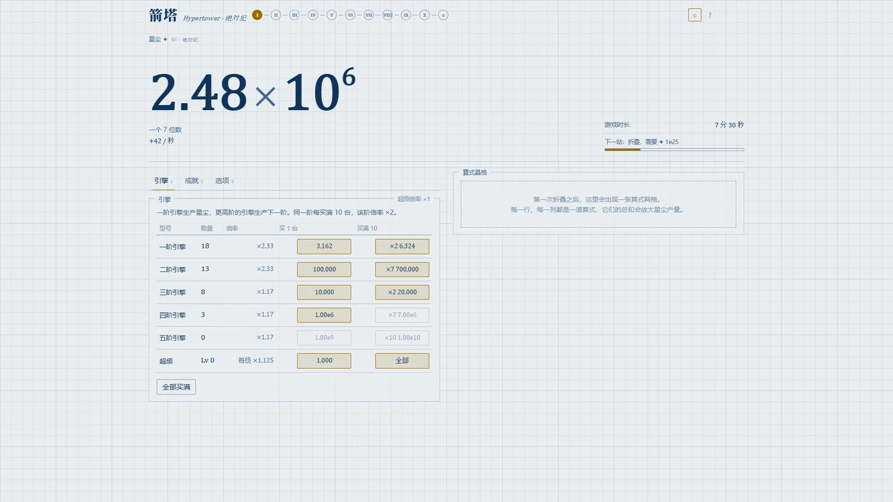

完整亮色界面用于辨认本纪元布局；下方局部配图分别对应具体操作。 [查看原图](箭塔-全程攻略配图-20261101/原图/intro-1.png)


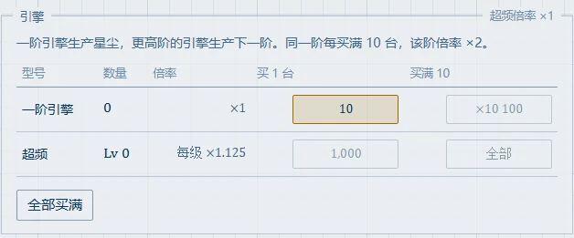

独立新档的真实初始状态，先确认星尘、第一阶价格和采购按钮。 [查看原图](箭塔-全程攻略配图-20261101/原图/action-fresh-before-0.png)


### 进入条件、界面和第一笔钱

全新存档从第 I 纪元开始，初始星尘是 10。最便宜的一阶引擎也正好花费 10，所以第一步是买下一台一阶引擎。此时余额变成 0 是正常情况；一阶引擎开始直接生产星尘，余额随后重新增长。若什么都不买而一直等，空生产链不会自行启动。

界面里的“购买数量”和“当前持有量”不是同一个概念。购买数量决定每十台的共振倍率和下一组售价；当前持有量还会被上层引擎持续生产，因此可能远远超过购买数。不要看见持有量巨大，就认为下一次采购应该按这个数重新计价。采购只增加已购买台数和对应持有量，生产只增加持有量。

八阶链的方向是从高往低：二阶产一阶，三阶产二阶，一直延伸到八阶产七阶；只有一阶直接产星尘。新买一台高阶引擎后，收益需要沿链向下传播，所以“刚买完的一秒”通常不足以代表整段采购价值。高阶的价值在持续运转中体现，低阶也仍然需要足够的起步购买和整十倍率。

### 从第一台到第一阶梯：按这个顺序操作

1. 在一阶行买一台，确认星尘开始增加。
2. 积累到下一笔能改善速度的预算时，比较一阶的整十节点与二阶首次购入。不要为了“把第一行买满”而长期拒绝解锁更高一阶。
3. 购买第一台二阶后，观察一阶持有量增长；这验证了上层生产下层的方向。
4. 按相同逻辑逐步开放三至八阶。哪一阶刚刚解锁、哪一阶离整十最近、哪些采购要等很久，都是当下可以比较的信息。
5. 超频可购买时先买少量，再观察整条链增长。它作用于生产速度，而不是额外生成一台引擎。
6. 如果本轮已达到 10²⁵，打开折叠预览，确认会获得折痕，然后进入 II。不要把“拥有八阶”误当成折叠必需的独立成就前置。

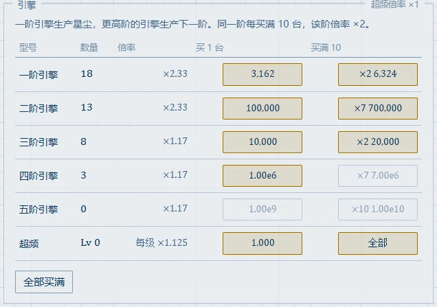

观察各阶数量、产量和价格，再比较购买与超频的时机。 [查看原图](箭塔-全程攻略配图-20261101/原图/intro-2.png)


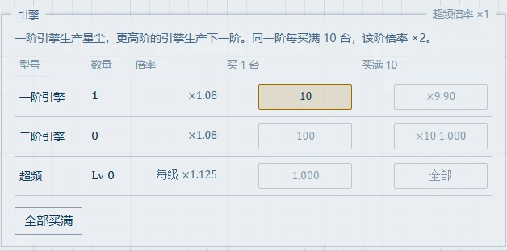

在新档实际购买第一阶引擎后推进十秒，观察数量、产量和星尘变化。 [查看原图](箭塔-全程攻略配图-20261101/原图/action-fresh-after-0.png)


### 八阶价格表、整十节点和预算边界

下表是每阶购买数为 0 时的单台价格，以及跨过一组十台后，单台价格的十进制指数增加量。每组十台内价格不变；买到第 10、20、30 台等节点又会改善这一阶的生产倍率。因此“再买几台凑整十”具有明确意义，但不能忽略新阶刚开放的效果。

| 阶数 | 第一组单台价格 | 每跨一组十台的价格指数增量 | 工作方向 |
| --- | --- | --- | --- |
| 一阶 | 10¹ | 2.5 | 直接产星尘 |
| 二阶 | 10² | 3 | 产一阶引擎 |
| 三阶 | 10⁴ | 3.5 | 产二阶引擎 |
| 四阶 | 10⁶ | 4 | 产三阶引擎 |
| 五阶 | 10⁹ | 4.5 | 产四阶引擎 |
| 六阶 | 10¹³ | 5 | 产五阶引擎 |
| 七阶 | 10¹⁸ | 6 | 产六阶引擎 |
| 八阶 | 10²⁴ | 7 | 产七阶引擎 |

普通共振起点为每十台倍率 ×2。II 的引擎共振升级能够提高这个底数。购买台数的当前上限是每阶 2000，超频上限 600；这些是程序边界，不是 I 必须采购到的目标。第一轮通常远早于这些边界就已经有理由折叠。

批量购买按钮解决的是重复点击，而不是替你判断下一步路线。手动时可以先用单买解锁一个新阶，再用批量补齐已经认准的阶。要检验某次采购，记下采购前的每秒产量与几秒后产量；高阶影响沿链传播，因此不要把瞬时变化与持续变化混为一谈。

### 超频为什么有价值，又为什么不能只买超频

超频第 0 级的下一次购买价格是 10³，之后每级价格的十进制指数加 1。普通超频乘数为 1.125 的级数次方；III 的“引擎狂热”会改善底数，但新档尚未拥有它。超频影响整条生产链，因此与只加一台低阶引擎相比，它可能在多层传播中表现出更明显的加速。

实际操作时，把“凑整十”“首次购买高阶”“买一档超频”放在同一预算框架比较。若下一档超频要等很长，而一台高阶已经买得起，就没有必要把钱一直锁在超频目标上；反过来，若许多阶都在工作且超频十分便宜，也不必只盯着一阶行。攻略不给固定万能购买序列，因为每次重置后的永久投资会改变这些比较。

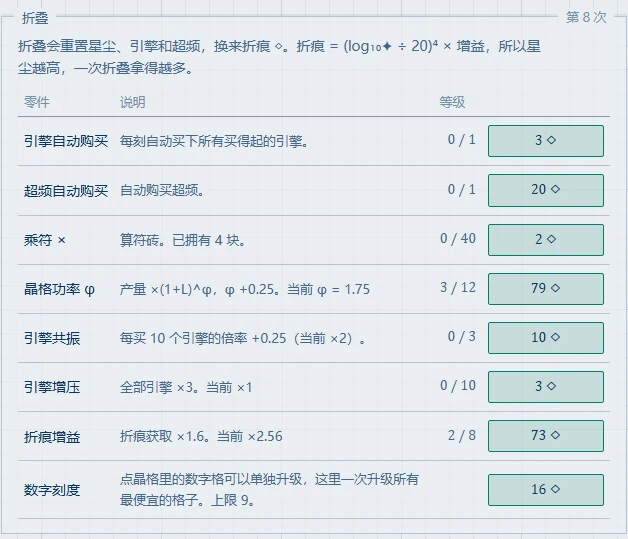

为演示重置按钮预置了资源；先看本次收益与重置后保留的长期项目。 [查看原图](箭塔-全程攻略配图-20261101/原图/action-fold-ready-0.png)


### I 的重置判断：第一次折叠不等于失败

折叠是这段路线的主动终点。它把当轮的星尘增长换成折痕，随后重建生产链。硬条件是当前星尘至少 10²⁵；当条件满足时，预览会给出本轮折痕数量。初次刚过门槛即可开启 II，从而使用全新的算式经营，不需要把 I 的每个成就都做完。

折叠收益大体由 `floor((log₁₀星尘/20)^4 × 折痕倍率)` 决定，至少为 1。若没有倍率且刚好 10²⁵，结果为 floor(1.25⁴)＝2。它意味着“过门槛后再多推一点”可能多给折痕，但也说明应比较增长成本：为一小笔额外折痕等得过久，可能不如先开启新系统，再借晶格更快取得下一轮收益。

建议第一次折叠前记住两个观测值：星尘到达 10²⁵ 的过程和预览折痕数量。折叠之后，不用拿重置后的一瞬间与之前满链产量比较；真正有价值的是第二次到达门槛所需的过程是否缩短、折痕能否购买新的永久能力。

### 一个不需要预置资源的复现实验

从 10 星尘买一阶，等到有 100 星尘时买一台二阶。记下此时一阶“买入数”和“持有量”，再运行一会儿。买入数不变，持有量增加；这就是二阶正在产一阶。随后再看星尘每秒收益如何变化。这个小实验比死记“高阶更强”更能帮助理解后面的整条链。

第二个实验是观察整十：把同一阶从已买 9 台推进到 10 台。新增一台之外，这一阶还跨过共振节点。下组采购价格会升高，所以不要把“第十台很有效”误读成“第十一台也一定同样划算”。两者处在不同价格组。

### I 卡关排查表

| 现象 | 先检查 | 对应动作 |
| --- | --- | --- |
| 星尘一直为 10 | 是否买过第一台一阶 | 手动购买，不依赖尚未解锁的自动采购 |
| 只增加低阶持有量，星尘增长不明显 | 一阶是否启动、链是否刚建立 | 让生产传播，并补一阶整十节点 |
| 高阶可以买却始终没买 | 是否只重复点最便宜的一行 | 比较首次解锁高阶与旧行采购 |
| 自动购买开关开着却没有动作 | 尚无对应永久升级 | I 先手动，II 再买自动采购 |
| 已过门槛还认为必须等到八阶满配 | 把建议当成硬条件 | 看折叠预览即可决定是否进入 II |
| 数字变成科学计数法后不会比较 | 只看尾数 | 先比指数，再比同指数下的尾数 |

离开 I 前不需要满引擎、满超频或完成所有早期成就。需要的是已经学会启动生产链、识别高阶向低阶传播，并理解第一次折叠会开新的永久成长线。

## II · 折叠：把折痕花在能改变下一轮的地方

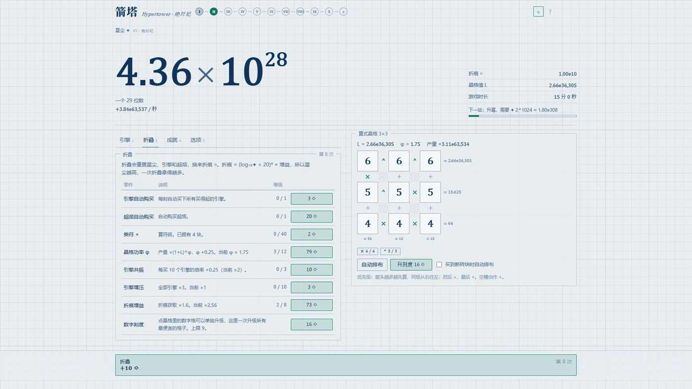

完整亮色界面用于辨认本纪元布局；下方局部配图分别对应具体操作。 [查看原图](箭塔-全程攻略配图-20261101/原图/intro-3.png)


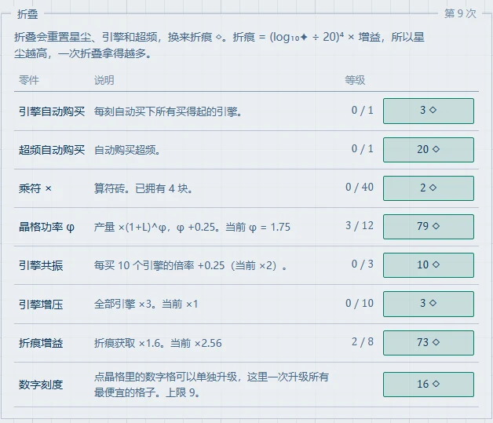

从上一张相同演示状态实际执行折叠，重新确认货币、次数与本轮生产线。 [查看原图](箭塔-全程攻略配图-20261101/原图/action-fold-done-0.png)


### 第一次折叠之后，哪些数回去了，哪些数留下来

折叠会重置当前星尘、全部引擎持有与购买数、超频和本轮时间。星尘回到 10，新的生产链需要重新启动。已经获得的折痕、折叠升级、数字刻度和算符库存保留；它们正是下一轮可以更快的原因。不要因为引擎归零就重复导入折叠前的旧备份，那样会撤掉刚取得的进展。

此时你拥有的是 2×2 算式晶格，四个数字格和横竖算符槽。每一行与每一列各形成一条表达式，这些表达式的总和是 L。当前星尘产量乘以 `(1+L)^φ`，φ 初始为 1。因此晶格没有只算第一行；普通模式需要考虑行列合计。后面“独行”悖论才会把规则改成只计第一行。

数字格初始为 1，空算符槽当作加号。数字可以用折痕升级；算符砖从升级表采购，放入任意可用的横竖槽。已购买的算符是有限库存，同一块不能同时摆在多个位置。取下算符会释放占用，不代表必须再次购买一块。

### 第一批折痕的花法：把“能马上买”和“值得先买”分开

刚好 10²⁵ 折叠时通常只有 2 折痕。乘符第一块恰好花 2，自动引擎花 3。你可以先买乘符探索晶格，也可以再运行一轮积累到自动引擎；两条路线都合法。若自己准备长时间离开，自动采购的便利价值较高；若正在主动学习排布，先买一块乘符更容易看见算式的作用。不要把这种使用场景选择写成唯一的最优解。

折痕升级里最容易混淆的是“买数字”“买算符”“提高 φ”“提高引擎”。买数字改善格子内容，买算符改变计算，φ 对整体晶格乘数作幂，引擎增压改善全链基础生产。它们作用在不同层次，应该根据当前主链比较，而不是机械地轮流点所有升级。

建议的学习次序是：先放下一块真正能增加 L 的乘符；确保能重建生产链；再拿引擎自动购买减少重复劳动；折痕积累上来后取得 3×3、φ 和适量增压；超频自动购买则让另一个手动采购项目自动化。这里的“建议”并不意味着必须一次凑齐全部升级才允许继续升幂。

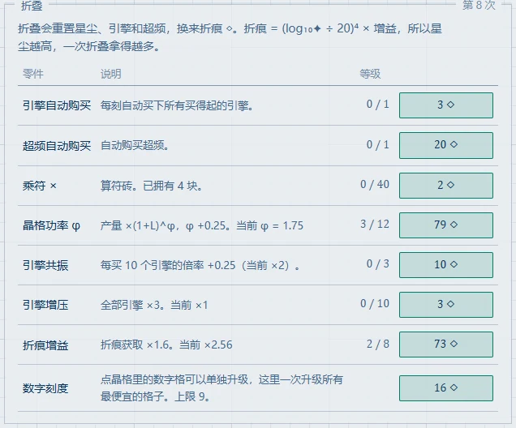

折叠把当轮积累换成长线投资，升级表同时展示采购与自动化方向。 [查看原图](箭塔-全程攻略配图-20261101/原图/intro-5.png)


### 采购表：先看成本、上限和实际效果

| 项目 | 首次价格与成长 | 当前作用 | 操作提醒 |
| --- | --- | --- | --- |
| 引擎自动购买 | 3 折痕，1 次 | 自动买得起的引擎 | 购买能力后还应保持对应开关开启 |
| 3×3 晶格 | 10 折痕，1 次 | 扩大行列与槽位 | 扩容后重新排布，不要让新空间全闲置 |
| 超频自动购买 | 20 折痕，1 次 | 自动买超频 | 解决手动采购，并不替代折叠策略 |
| 乘符 | 首块 2，价格约每级 ×1.8 | 增加一块 × 库存 | 买到了还须放入晶格 |
| 晶格功率 φ | 首级 5，之后约 ×2.5 | 每级 φ＋0.25 | 当前 v7 前期上限 12 级，φ 可达 4 |
| 引擎共振 | 首级 10，之后 ×5 | 整十倍率底数每级＋0.25 | 当前最多 3 级 |
| 引擎增压 | 首级 3，之后约 ×2.8 | 全部引擎每级 ×3 | 适合改善整条链的基础速度 |
| 折痕增益 | 首级 8，之后 ×3 | 折叠所得每级 ×1.6 | 改善后续投资能力 |

以上价格由当前等级决定并向上取整。遇到显示价格与心算小数不一致，以按钮显示为准；不要把 `2×1.8` 当成一定扣 3.6，游戏使用整数化的采购成本。更重要的是看下一轮能改变什么：一项升级完成后，回到主界面确认它确实作用，而不是仅因为按过按钮就继续等待。

### 晶格操作：数字、算符、λ 的三种选择不要混用

点击数字格会打开该格的操作菜单，可以提高刻度；再点另一格，可以交换这两个位置。算符槽有独立的可选库存。自动排布是帮你寻找强链的工具，买到新算符或扩容后值得使用一次；若正在手动做对照实验，先关闭自动排布，防止界面把你的实验布局立即换掉。

普通数字的刻度上限初始为 9。买数字的成本取决于该格原刻度，低刻度更便宜，“购买最便宜数字”会先补最低的格。它便于均衡铺底，但不保证与当前最强表达式的局部需求完全一致。比如只差一个关键底数就能让主链更强时，单独升级那个格更容易验证效果。

λ 要到 III 星图才开放。II 看到说明提到 λ，不等于当前已能把它放下。不要为不存在的砖反复点击普通数字格；先用当前真实拥有的数字与乘符完成基本排布。

### 两个可以用手工算出的晶格实验

实验一：2×2 所有数字都为 3、算符全空。两行各为 3＋3＝6，两列也各为 6，合计 L＝24。把第一行唯一横槽换为乘号，这一行变为 9，其他三条线不变，L＝27。这个实验说明：只改变一条线，整体 L 会按该线的差额改变；算符并不是自动把整个晶格全部相乘。

实验二：3×3 所有数字为 3，算符全空。每条线为 9，共六条线，L＝54。只把第一行的两个横槽都放为 ×，第一行变成 27，整体变为 72。两块乘符集中到同一条线，比把它们随意分散到不产生大增量的位置更容易形成强主链。这是一个教学示例，不是对所有库存与数字都成立的全局最优排法。

还有一个容易误判的边界：2＋2＝2×2＝4。若数字只有 2，放乘符后某条两格线可能看不出提升；数字为 1 时，1×1 反而小于 1＋1。先把数字与运算放在一起评估，再断定“买了乘符却没效果是不是 Bug”。

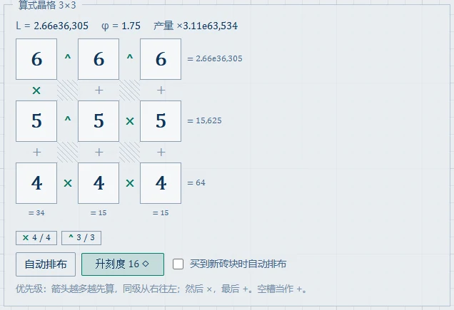

数字槽、乘符槽与行列结果共同组成晶格；这是已排布的示例。 [查看原图](箭塔-全程攻略配图-20261101/原图/intro-4.png)


### 折叠节奏：为什么收益预览比固定次数更可靠

折叠所得按本轮当前星尘计算，最高历史星尘不能替代本轮数值。每次折叠前先看：我现在已有多少折痕，预览还能拿多少，合起来能否买一个关键升级。若再推一小段能跨过 3×3 或自动采购的价格，通常值得比较；若下一项很远，则先让当前收益变成投资，可能使后续运行更顺。

固定“每隔某秒点一次”的方法忽略了当前永久升级、晶格和设备运行节奏。更可复用的判断是：“这次重置是否能马上改变下一轮？”若当前折痕已经够买项目，就先买而不是再无目的地重置；若刚重置后只会拿很少，而当前链仍在快速增长，可以再观察收益增长趋势。

自动折叠在 III 的星图里解锁，因此 II 不应该把看见开关等同于已具备能力。已有自动化的旧档回到 II 会与第一次开档不同，攻略需要按首次解锁路线理解。第一次玩到这里，折叠本身仍是手动决策。

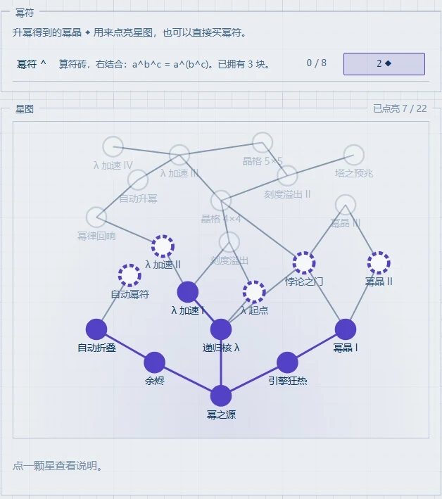

为演示重置按钮预置了资源；先看本次收益与重置后保留的长期项目。 [查看原图](箭塔-全程攻略配图-20261101/原图/action-ascend-ready-0.png)


### 走向 III：升幂门槛不是普通的 10³⁰⁸

下一段硬门槛是 2¹⁰²⁴，约为 1.797693×10³⁰⁸。它略高于 10³⁰⁸；如果显示刚到 `1e308` 而升幂还不能点，可能只是尚未达到精确阈值，不需要修复存档。继续增长并以升幂预览为准。

到达门槛之后，升幂会产生幂晶。升幂收益还受本轮结晶影响，完整结晶基准为 30 秒。早期刚完成低层重置就立刻点击更高重置，可能把尚未成熟的收益拿走。应先看界面预览，而不是只看到按钮亮了就无条件立即点击。

升幂会清掉当前折痕并重置 λ，以及尚未取得保留节点时的大部分折叠升级。数字、算符、已买的乘符和 3×3 这类基础结构有保留逻辑。进入 III 之后应尽快了解星图“余烬”的意义，它会减少以后升幂重建的负担。

### II 常见故障式卡关

第一种是买了算符却没有摆。库存增加不是晶格自动升级，需放置或执行自动排布。第二种是所有数字仍为 1，误以为乘法一定比加法大。第三种是自动采购能力与开关混淆。第四种是升幂前把门槛读为恰好 10³⁰⁸。第五种是手动布局与自动排布相互覆盖，导致记不清自己最后摆了什么。

复盘时打开晶格，读取行列结果与 L，确认改变前后。再检查 φ、引擎共振、超频等级和下一次折叠预览。这条检查链把“算式问题”和“生产链问题”分开，可以避免在无效排布下连续重置许多轮。

## III · 升幂：先建立保留，再让 λ 进入指数链

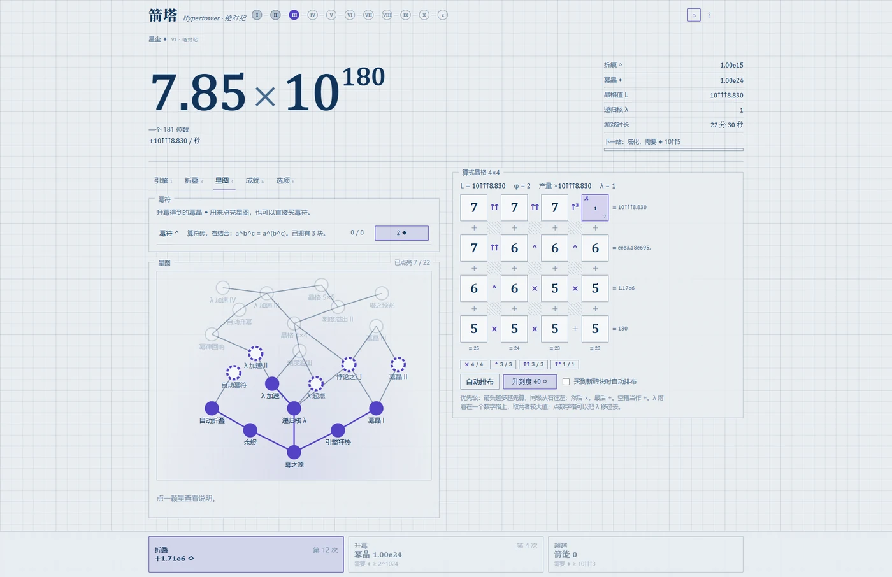

完整亮色界面用于辨认本纪元布局；下方局部配图分别对应具体操作。 [查看原图](箭塔-全程攻略配图-20261101/原图/intro-6.png)


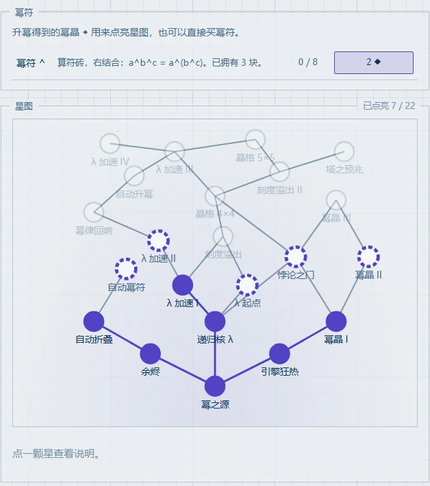

从上一张相同演示状态实际执行升幂，重新确认货币、次数与本轮生产线。 [查看原图](箭塔-全程攻略配图-20261101/原图/action-ascend-done-0.png)


### 第一颗幂晶：为什么优先认识星图

首次升幂后进入 III，幂晶 ◆ 成为新的永久投资。星图不是一列只看价格的商店，而是带依赖关系的节点图：上游节点未买，下游即使有钱也不会开放。先找“幂之源”，它花 1 幂晶，给一块幂符，同时把折痕所得乘以 100。它同时提供新运算和更强的低层重建能力，是这段路线非常明确的起点。

接着看“余烬”和“引擎狂热”：余烬花 2，要求已买幂之源，使升幂时保留折叠升级和晶格；引擎狂热花 3，同样依赖幂之源，使引擎产量大幅提高并改善超频底数。若你很不喜欢每轮重建，先取余烬更省操作；若本轮正卡在星尘生产，狂热直接改善全链。二者都很便宜，区别主要是先解决哪一种阻碍。

不要一拿到幂晶就把全部预算投入额外幂符商店，而忘了星图中的依赖节点。额外幂符确实强，但星图的保留、λ、扩容和自动化让它更有施展空间。每次采购之后看剩余预算是否足以连接到下一颗关键星，而不是只追求当前有多少块 ^。

### 星图路线：一条容易理解的主干与分支

| 节点 | 价格 | 依赖 | 建议认识它的理由 |
| --- | --- | --- | --- |
| 幂之源 | 1 ◆ | 无 | 第一块幂符，折痕所得 ×100 |
| 余烬 | 2 ◆ | 幂之源 | 升幂保留折叠升级，减少重建 |
| 引擎狂热 | 3 ◆ | 幂之源 | 引擎 ×10⁶，超频底数改善 |
| 自动折叠 | 5 ◆ | 余烬 | 让低层重置可自动执行 |
| 递归核 λ | 6 ◆ | 幂之源 | 一块随时间长大的数字 |
| 幂晶 I | 12 ◆ | 引擎狂热 | 幂晶所得 ×2 |
| λ 加速 I | 30 ◆ | 递归核 λ | 加快线性成长 |
| λ 起点 | 70 ◆ | 递归核 λ | 新一轮 λ 从 5 开始 |
| 悖论之门 | 50 ◆ | 幂晶 I、递归核 λ | 开放六种特殊规则 |
| 自动幂符 | 90 ◆ | 自动折叠 | 自动采购折叠升级与幂符 |
| λ 加速 II | 350 ◆ | λ 加速 I | 加强 λ 线性成长 |
| 刻度溢出 | 600 ◆ | λ 加速 I、λ 起点 | 普通数字上限增至 10 |
| 幂律回响 | 1500 ◆ | λ 加速 II | 让幂晶库存参与 λ 加速 |
| 自动升幂 | 6000 ◆ | 幂律回响 | 允许自动执行升幂 |
| 晶格 4×4 | 10⁵ ◆ | 刻度溢出、悖论之门 | 主链多一个位置 |

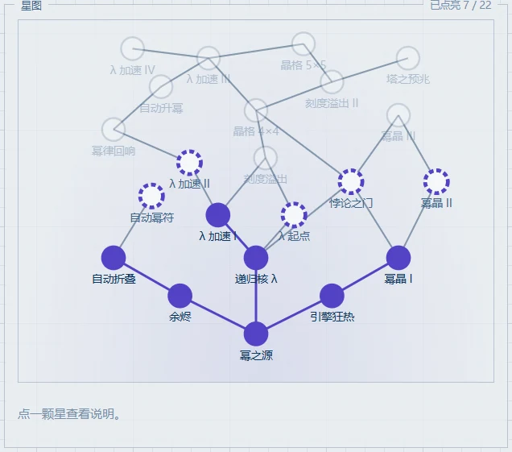

永久节点通过依赖关系逐步开放，路线选择影响速度与重建。 [查看原图](箭塔-全程攻略配图-20261101/原图/intro-8.png)


这张表不是“一次存够全部购买”的清单。建议按“幂之源→保留与基础生产→λ→收益和速度→挑战与扩容”的方向理解，再看当前最便宜的可达节点。节点解锁后，回到晶格检查 ^ 与 λ 有没有真实落位；对增长系统来说，已开放但没使用的能力和没买到相差不大。

后期还有刻度溢出 II、λ 加速 III/IV、塔之预兆和 5×5 晶格，价格会跨越非常大的层次。它们并不是 III 进入 IV 前需要逐项买满的额外清单。只要塔化硬门槛已达到，你可以先进入下一纪元，再借新增长方式取得更远的星图节点。

### 幂符的结合方向：用一次小实验真正学会

幂是右结合：`2^3^2` 按 `2^(3^2)` 得到 512，不是 `(2^3)^2` 的 64。晶格同一行有多个 ^ 时，最右侧数字影响更内层的指数。将随时间增长的 λ 放在指数链右端，往往更容易把时间积累转成极快增长。

但“λ 永远放右边”也需要前提：这是普通读取方向、有效数字与足够幂符下的建议。镜像悖论会反向读取整条线；自动排布会针对规则调整。普通模式下一行形如 `a ^ b ^ λ`，其时间效应与把 λ 放作最左底数差别巨大。先看计算方向，再看 λ 的位置。

λ 实际附着在一个数字格上，取 λ 与该格有效数字的较大值。刚解锁且 λ 很小时，它可能还没超过该格数字，于是短时间内看不出效果。不要因此认为 λ 没启动。查看 λ 本身的增长与普通刻度的关系，等它跨过静态数字后再比较主链的变化。

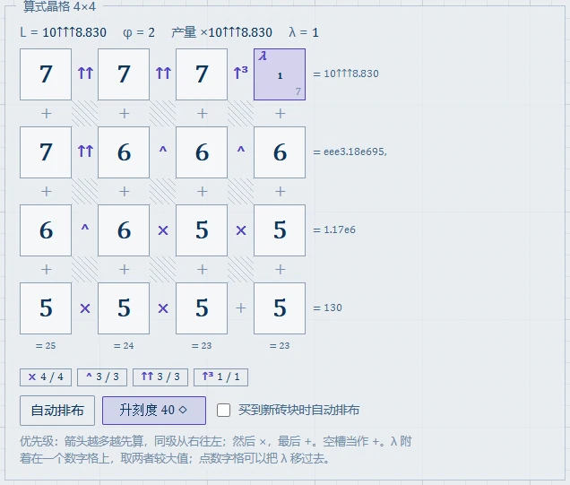

对照幂链与行列输出，理解 λ 所在位置为何会改变结果。 [查看原图](箭塔-全程攻略配图-20261101/原图/intro-7.png)


### 从解锁 λ 到稳定运转的一轮

1. 购买递归核 λ，确认晶格出现 λ 标记。
2. 用自动排布建立一条主链，然后查看 λ 是否处在强幂链的有效端点。
3. 运行一段，记录 λ 数值、L、星尘与幂晶预览的共同变化。
4. 若低层重建仍需大量点击，优先补余烬、自动折叠或自动采购，而不是靠频繁手动救场。
5. 若重建很快，但长轮停滞，检查 λ 加速、幂符数量和主链长度。
6. 在本轮收益足以买到关键节点时升幂；若只差很少便能扩容或开启新能力，可以再比较等待成本。
7. 每次升幂后检查 λ 已按起点重置，晶格与永久节点按保留规则仍在。

一次小而可验证的改善比同时改十项更容易学习。例如只增加一块 ^ 后重新排布，再比较收益预览增长；或者只买 λ 加速 I，记录 λ 数值增长是否约为之前两倍。在挑战规则之外，这样的单变量对照能看清真正的瓶颈。

### 升幂收益与“结晶”：不要用瞬间重置代替积累

幂晶收益基于当前星尘的双重对数、幂晶倍率和结晶比例。程序的基础形式为 `floor((log₁₀log₁₀星尘 / 2.4885)^1.5 × 倍率 × 结晶)`，满足门槛后至少给 1。完整结晶所需的本轮时间基准为 30 秒，因此刚重置后再立刻升幂，不会无成本地复制长轮收益。

幂晶倍率来源包括星图三颗幂晶节点，以及引擎熄火、冻结悖论的层数。库存不仅用于采购，还可能通过幂律回响参与 λ 加速；如果临近一个节点，花光还是留一点需要看效果，不能只按“有钱就全点”处理。

自动升幂解锁后，也不是每一刻必重置。自动策略会查看可买目标、累计总收益比例以及收益速率是否已从峰值回落。手动学习阶段可先用预览和目标成本做几次判断，再开启自动；这样看到自动动作发生时，更容易知道它在解决什么。

### 六种悖论：先读条件，再用对应布局

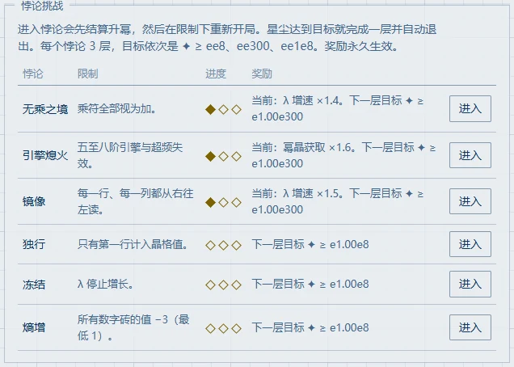

悖论页集中列出六种规则、目标与奖励，适合对照阅读挑战说明。 [查看原图](箭塔-全程攻略配图-20261101/原图/intro-9.png)


六悖论属于 III 的有限大数系统；不要和 VI–X 的四条公理混为一谈。每类悖论当前有三层，目标依层数提高。进入会重置本轮，并在正常状态下先结算可获得的升幂收益；挑战中不能靠普通升幂预览取幂晶，完成后会自动退出并重建本轮。

| 悖论 | 限制 | 先做的布局调整 | 每层永久奖励 |
| --- | --- | --- | --- |
| 无乘之境 | × 被当作＋ | 不把乘法链当核心，利用有效幂符与 λ | λ 线性增速 ×1.4 |
| 引擎熄火 | 五至八阶及超频失效 | 检查前四阶采购与晶格能否承担生产 | 幂晶所得 ×1.6 |
| 镜像 | 行列反向读取 | 把强链按实际读取方向翻转，观察 λ 位置 | λ 线性增速 ×1.5 |
| 独行 | 只计第一行 | 把关键数字、λ 与强算符集中第一行 | λ 起点每层＋2 |
| 冻结 | λ 不再增长 | 使用更高静态数字、已有 λ 起点及强算符 | 幂晶所得每层 ×2 |
| 熵增 | 数字有效值－3，最低 1 | 优先观察有效值而非购买刻度；避免以 1 作关键底数 | 所有数字有效值每层＋1 |

第一层目标是 `10^(10^8)`，第二层是 `10^(10^300)`，第三层是 `10^(10^100000000)`；看起来夸张的目标可以用对应运算层次来比较，没必要手写全部十进制数字。当前挑战目标会显示在页内；以实际层数与预览为准，不拿后期满配图反推第一次挑战要准备多少。

建议先做对现有布局破坏较小的一层，再用奖励改善其他挑战。卡在冻结时，继续等 λ 不会解决；卡在独行时，把算符塞进第二行也不会增加有效 L；卡在镜像时，照搬普通模式 λ 在右端的布局可能完全反了。挑战真正要测试的是限制后的机制，采购越多也不能抵消“这部分根本不计入”的规则。

### 悖论复盘与星图补齐的操作表

进入前记下普通模式的布局与下一目标；进入后立刻检查规则是否已经作用。尽量一次只解决一种悖论，完成或退出后确认旗标消失，再进行普通主线。退出并不等于清档，也不退回永久节点；它只是结束当前受限轮并重置该轮。

若一项挑战在当前配置下明显不顺，先退出并推进星图、晶格或下一纪元是合理选择。悖论不是塔化的统一硬前置，没有必要为“本纪元必须全清”的自定条件牺牲后面新机制。更强的增长方式会反过来缩短补挑战的成本。


为演示重置按钮预置了资源；先看本次收益与重置后保留的长期项目。 [查看原图](箭塔-全程攻略配图-20261101/原图/action-tower-ready-0.png)


### III→IV 的最后检查

硬门槛为当前星尘达到 10↑↑5。它指以 10 为底、高度 5 的幂塔，不是 `10^5`，也不是 `10^10^5` 的某个随意简写。查看塔化按钮与塔砖预览，确认本轮结晶已纳入收益。

塔化首次给予迭幂符，清掉当前折痕、幂晶与生产链，但保留长期已购能力、星图和晶格。进入后先建设第一层尖塔，λ 的增长方式将改变。离开 III 前带走的真正能力是：会读星图依赖、会用保留节点减少重建、会理解右结合，并知道挑战需要在自己的规则下重新布置。

## IV · 塔化：先拿到指数成长，再决定尖塔投资节奏

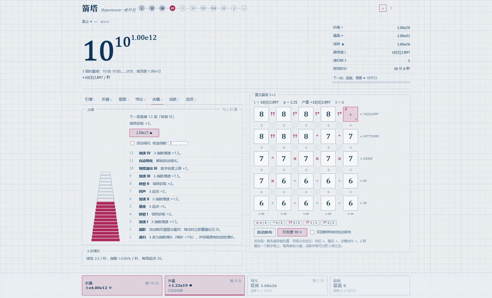

完整亮色界面用于辨认本纪元布局；下方局部配图分别对应具体操作。 [查看原图](箭塔-全程攻略配图-20261101/原图/intro-10.png)


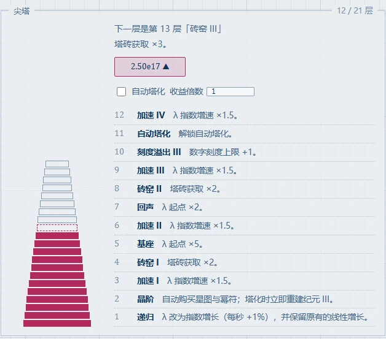

从上一张相同演示状态实际执行塔化，重新确认货币、次数与本轮生产线。 [查看原图](箭塔-全程攻略配图-20261101/原图/action-tower-done-0.png)


### 第一次塔化的落点与第一层尖塔

首次塔化让纪元变为 IV，并给予一块迭幂符 ↑↑。当前星尘、引擎、超频、折痕、幂晶和 λ 按本轮规则重置，塔砖 ▲ 则进入库存。已购买的星图节点、折叠升级、算符库存与晶格结构没有因此变成未解锁。先确认新的 ↑↑ 在库存里，再重新排布主链。

第一层尖塔“递归”只需 1 塔砖。它使 λ 在原线性增长之外，获得每秒 1% 的指数增长。这是机制改变：III 主要依靠线性增长与更好的指数链，IV 开始让 λ 自身随时间呈指数成长，再把它放进迭幂。若第一笔塔砖够购买它，先体验这一层，通常比继续用旧的线性成长直觉盲等更容易理解后续变化。

查看 λ 数值时，应区分“每秒百分比”和“每秒固定增加”。指数部分在同样时间里会把较大的 λ 继续放大，线性部分仍提供额外增量；这也是短轮起点与长轮增速要分别投资的原因。普通界面上的大数形态改变，不是数据出错，而是表达层次提高。

### 迭幂主链怎样搭：先做可读布局，再尝试叠加

先用一块 ↑↑ 把 λ 放到塔高位置，例如 `a ↑↑ λ`。普通模式中右端 λ 会随时间改变塔高；如果把 λ 放成左侧底数，增长意义不同。此时仍可用已有 ^ 或 × 与它组成更长的行，但先确认主表达式能读懂，再追求所有库存全部摆下。

只有一块 ↑↑ 时，不要寻找第二个同样符号槽一直点击：库存有限，第二块要到尖塔第 21 层才获得。若自动排布把最强符号放在靠右位置，它是在组织主链，不是丢掉其他行；其余可用算符仍可改善别的行列。普通模式 L 仍为行列总和，强链只是其中极大的部分。

一个容易验证的实验是保留所有数字与 λ 不变，只在同一条线把某个 ^ 换成已拥有的 ↑↑，比较行结果的表达层次。不要只比较尾部显示的小数。比如一边是普通指数，另一边已出现高层幂塔，它们不能靠“后面的 5 比 8 小”来判断大小。

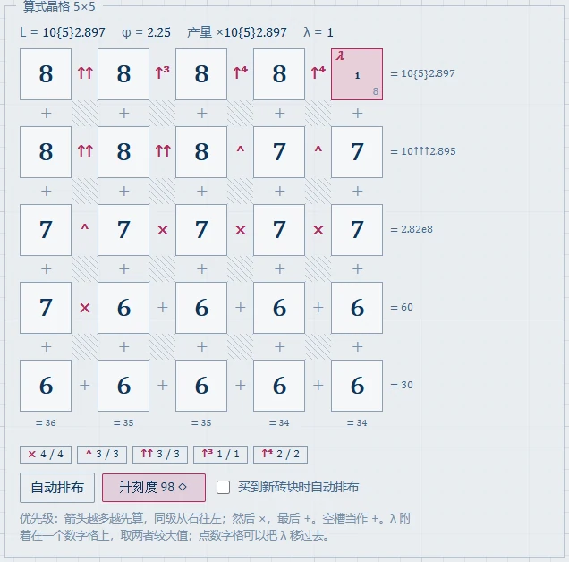

λ 与迭幂符在同一排布中承担新的作用，注意行列的计算位置。 [查看原图](箭塔-全程攻略配图-20261101/原图/intro-11.png)


### 尖塔 21 层：哪些层改变玩法，哪些层叠加数值

尖塔按顺序建设，不能跳过中间层直接购买第 21 层。每次只会买当前下一层，所以预算判断较清楚：看现有塔砖与下一层成本，决定这轮收益是否能跨过它。下表列出全部层数，帮助区分长期目标和眼前动作。

| 层 | 名称 | 价格（塔砖） | 实际用途 |
| --- | --- | --- | --- |
| 1 | 递归 | 1 | λ 开始指数成长，保留线性部分 |
| 2 | 晶阶 | 28 | 自动购买星图与幂符，减少塔化后重建操作 |
| 3 | 加速 I | 790 | λ 指数增速 ×1.5 |
| 4 | 砖窑 I | 22000 | 塔砖所得 ×2 |
| 5 | 基座 | 630000 | λ 起点 ×5 |
| 6 | 加速 II | 18000000 | λ 指数增速 ×1.5 |
| 7 | 回声 | 500000000 | λ 起点 ×2 |
| 8 | 砖窑 II | 14000000000 | 塔砖所得 ×2 |
| 9 | 加速 III | 400000000000 | λ 指数增速 ×1.5 |
| 10 | 刻度溢出 III | 11000000000000 | 普通数字上限再＋1 |
| 11 | 自动塔化 | 320000000000000 | 开放 IV 自动塔化 |
| 12 | 加速 IV | 8900000000000000 | λ 指数增速 ×1.5 |
| 13 | 砖窑 III | 2.5×10¹⁷ | 塔砖所得 ×3 |
| 14 | 加速 V | 7.1×10¹⁸ | λ 指数增速 ×1.5 |
| 15 | 回声 II | 2×10²⁰ | λ 起点 ×3 |
| 16 | 加速 VI | 5.6×10²¹ | λ 指数增速 ×1.5 |
| 17 | 砖窑 IV | 1.6×10²³ | 塔砖所得 ×3 |
| 18 | 加速 VII | 4.5×10²⁴ | λ 指数增速 ×1.5 |
| 19 | 共鸣 | 1.3×10²⁶ | λ 指数增速再受塔砖库存影响 |
| 20 | 加速 VIII | 3.5×10²⁷ | λ 指数增速 ×1.5 |
| 21 | 第二迭幂 | 10²⁹ | 获得第二块 ↑↑ |

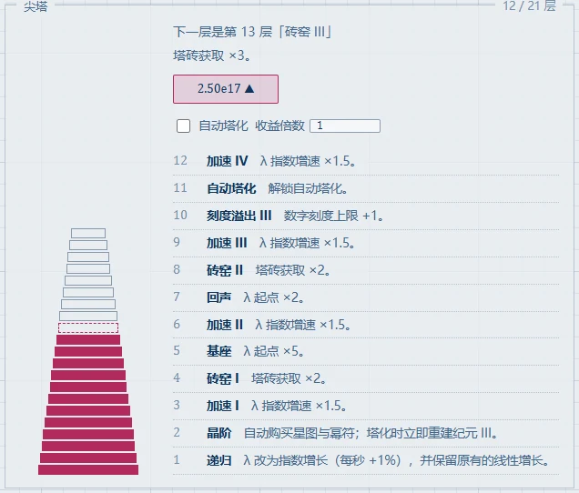

逐层查看尖塔提供的永久能力，选择当前最需要的成长方向。 [查看原图](箭塔-全程攻略配图-20261101/原图/intro-12.png)


第一、二层解决增长方式和操作负担；第五、七、十五层偏向短轮起点；多个加速层改善长轮；砖窑改善之后的投资速度；第十一层开放自动塔化；最后一层让主链拥有第二个迭幂符。理解这些角色后，不必把每一层都当成同类百分比提升。

### IV 的一轮：把下一层尖塔当成预算目标

1. 开局后先确认引擎与超频自动购买在工作，主链没有因新 ↑↑ 到手而仍停留旧布局。
2. 查看下一层尖塔成本，写下它与现有塔砖的差额。
3. 运行时同时观察 λ 和塔砖预览，而不是只盯星尘英雄数。
4. 若预览加库存已经够下一层，比较现在塔化采购与继续等到再下一层的成本；无需统一规定“每轮只买一层”。
5. 塔化后立刻建设已负担得起的下一层，重新检查 λ 起点、增速或收益倍率是否变化。
6. 买到第二层后，确认自动购买星图与幂符真正启动；已经保留的节点不需要重新手点。
7. 买到第十一层后再考虑开自动塔化，先看它是否符合自己的在线或离线节奏。

塔砖所得大体按 `floor((slog₁₀星尘/5)^2.5 × 塔砖倍率 × 结晶)` 计算。这里的 slog 是用幂塔高度刻画规模，不能拿普通 log₁₀替换。完整结晶时间基准是 60 秒，因此非常短的轮有收益折减。若刚塔化就再次点塔化，只比较按钮可点而不看收益，会损失本可积累的有效回报。

### 短轮与长轮如何选择

如果重建占用大部分操作时间，优先改善自动采购、λ 起点与保留链；如果重建很快但后一半越来越难推进，关注指数增速与主链中的运算层次。用两轮做比较时，选择同一个终点，例如“都在预览够下一层尖塔时重置”，这样比较才有意义。不能把一轮刷小收益、另一轮冲到大门槛的耗时直接当作升级效果。

第 19 层共鸣与塔砖库存有关，采购掉一大笔库存后，相关临时速度可能回落。它不是购买失败，而是“已经买到的永久层”和“手里剩多少塔砖带来的库存加成”共同作用。遇到这种情况，先读 λ 增速和库存，而不是重新加载上一档。

第二块 ↑↑ 到手后，可以尝试一条含两个迭幂符的强链，例如 `a ↑↑ b ↑↑ λ`。同级运算按右结合解析，因此其结构是 `a ↑↑ (b ↑↑ λ)`。它与先算左边不同，位置会影响结果。请用一条线的结果作对照，再看整个 L；不要把展示式自动当成所有数值都适用的唯一布局。

### 自动塔化和手动冲 V 的关系

自动塔化只在 IV 符合条件时动作。它根据目标和收益策略帮助积累塔砖，但你临近超越门槛时，也可以暂时关闭它，手动冲一次长轮。频繁在门槛之前塔化会让英雄数不断回落，看起来像“再也上不去”，实质是你持续主动结束本轮。

关闭自动塔化不会删除已购买能力，也不影响引擎采购。建议在冲关前只关闭会结束本轮的自动重置，保留采购与排布；冲关完成或决定继续刷塔砖时再恢复。区分采购自动化与重置自动化，是 IV 之后更重要的一项操作习惯。

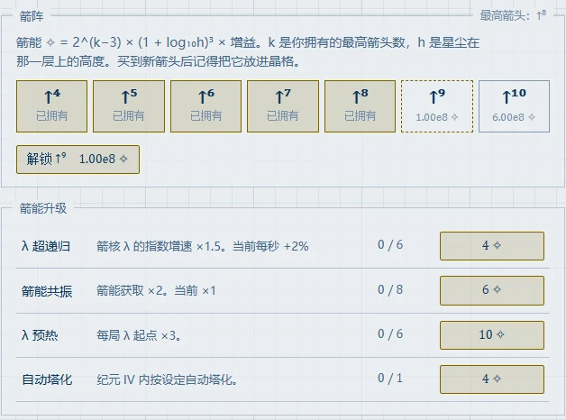

为演示重置按钮预置了资源；先看本次收益与重置后保留的长期项目。 [查看原图](箭塔-全程攻略配图-20261101/原图/action-transcend-ready-0.png)


### IV→V 的硬条件与离开前的复盘

当前星尘达到 10↑↑↑3，即可进行第一次超越并取得箭能。V 的入口不要求把尖塔 21 层全部建完，也不要求六悖论全部三层。若你已经满足硬门槛，可以进入 V，之后用新箭符改善表达层次，而不必为自加的“本章毕业清单”停留。

第一次超越会清掉当前塔砖、幂晶、折痕和生产链，保留已建尖塔、星图、算符库存与晶格。进 V 后 λ 的成长规则会有自己的分支，所以别拿 IV 的 λ 起点和线性增速机械推断 V。离开前最好导出一份塔化阶段的备份，用于自己回看，不需要用它回滚已达成的新进度。

## V · 超越：逐阶取得箭符，抵达 Ω 后切换研究系统

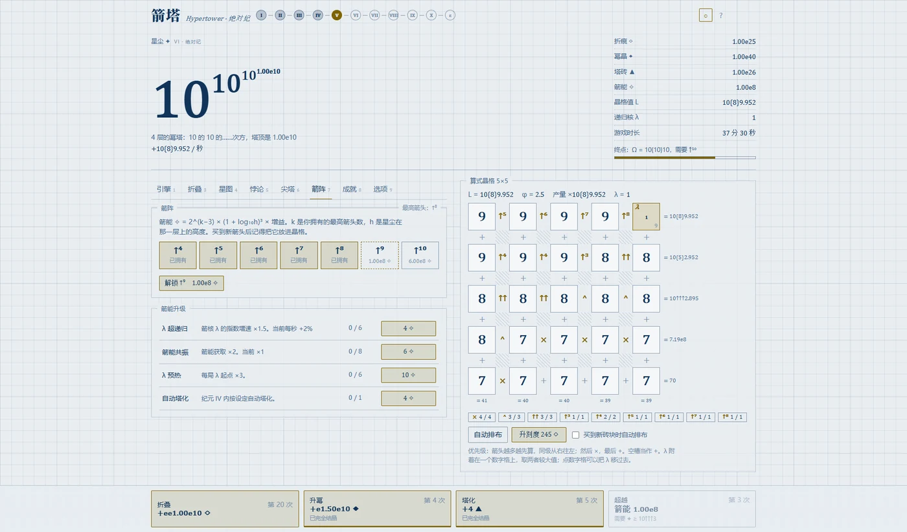

完整亮色界面用于辨认本纪元布局；下方局部配图分别对应具体操作。 [查看原图](箭塔-全程攻略配图-20261101/原图/intro-13.png)


从上一张相同演示状态实际执行超越，重新确认货币、次数与本轮生产线。 [查看原图](箭塔-全程攻略配图-20261101/原图/action-transcend-done-0.png)


### 第一块更高阶箭符与 λ 的新规则

首次超越进入 V，给一块三箭头对应的 ↑³ 运算符，箭能 ✧ 成为新货币。它不同于 IV 的塔砖：你既要投资 λ 与收益，也要按顺序取得更高阶箭符。下一块箭符的解锁会改变当前表达式能够达到的运算层，常常比在旧层反复等更关键。

V 中 λ 进入专门的增长分支：不再继续普通线性加速，基础指数增速是每秒 2%，由“λ 超递归”继续放大；新一轮起点主要由“λ 预热”的 3 的等级次方决定。III–IV 里买过的一些 λ 增长与起点能力仍作为已购历史保留，但 V 当前分支不会简单把所有旧文字的增幅逐项相乘。读当前界面实际数值，比把旧商店说明叠算更可靠。

普通晶格仍可使用 ^、↑↑ 与更高箭符。拿到更高阶运算之后，先执行一次自动排布，查看最强符号是否进入主链，再决定是否手动调整。只买不摆，会让库存与实际算式脱节。

### 箭能的采购路线：把阶数升级和数值升级放在一起比较

| 项目 | 首次价格 | 每级主要作用 | 采购前看什么 |
| --- | --- | --- | --- |
| λ 超递归 | 4 ✧ | 指数增速每级 ×1.5，最多 6 级 | 长轮 λ 是否是瓶颈 |
| 箭能共振 | 6 ✧ | 超越所得每级 ×2，最多 8 级 | 下一块箭符需要多少轮 |
| λ 预热 | 10 ✧ | 新轮起点每级 ×3，最多 6 级 | 短轮重建是否占比过大 |
| 自动塔化能力 | 4 ✧ | IV 阶段的自动塔化许可 | 不要误认为自动超越 |
| 下一阶箭符 | 依下表 | 提高表达式的运算阶 | 新阶是否已经可负担 |

| 新获得箭符 | 顺序价格（箭能） |
| --- | --- |
| ↑⁴ | 20 |
| ↑⁵ | 500 |
| ↑⁶ | 12000 |
| ↑⁷ | 300000 |
| ↑⁸ | 5000000 |
| ↑⁹ | 100000000 |
| ↑¹⁰ | 600000000 |

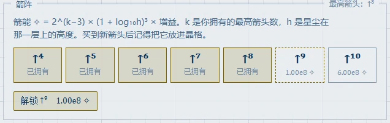

箭符采购改变可用运算阶数，取得新符号后应重新检查主链。 [查看原图](箭塔-全程攻略配图-20261101/原图/intro-14.png)


下一阶箭符按缺失顺序购买，不会因为拥有足够后期价格就跳过前面的箭。采购前把“存到新阶”和“先买一两级收益倍率”作比较：如果新阶只差一点，过度分散预算会推迟结构突破；若新阶还很远，便宜的共振或超递归可能先改善积累。最终以你本轮预览与库存为依据，不把价格表本身当成固定最优路径。

### 一个新箭符到手后的标准动作

先记录英雄数当前的运算层次与超越预览。买到箭符后，查看库存是否确实增加；执行排布，确认新符号在主链里；运行一段让 λ 成长；再比较超越预览和大数表达层次。这个过程能区分“买符号没有变强”和“符号根本还没参与计算”。

如果你手动组织主链，遵循同级右结合、强运算优先的规则。把最强符号集中进有效链通常便于跨层，但不要把强运算硬塞在底数为 1 的位置：许多超运算在这种边界上不会产生你想象的增长。静态数字、λ 与最强算符必须一起检查。

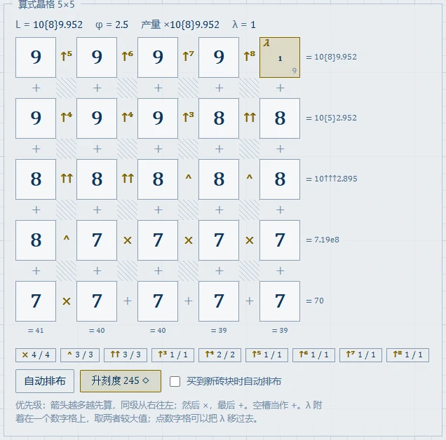

同一套数字进入更高阶的运算位置，增长方式随之改变。 [查看原图](箭塔-全程攻略配图-20261101/原图/intro-15.png)


### 箭能预览与最高箭头层的关系

箭能所得含有“当前拥有的最高箭头阶”的因素。程序按最高阶 k 给基础 `2^(k−3)` 倍数，再根据该层的高度读数、本轮结晶和箭能共振计算收益。完整结晶基准为 60 秒。这解释了为什么“取得新阶，再运行”有可能比“在旧阶很久”更能改善下一笔箭能。

同时，最高阶库存不是越多越好这个普通数量关系：购买表一阶一块，结构改变发生在跨阶。你需要让新阶进入有效算式，再把它带来的规模转为下一轮收益。若预览没有变化，先检查当前星尘是否已经被新算式推进，别只看商店里最高符号亮了。

在 V 没有必要持续刷普通折痕或幂晶到任意自定天文数字。低层货币的作用是支撑已购能力与排布；当前主目标是通过箭能升级、λ 和新阶箭符跨过 Ω。若某项低层升级已经不改变当前瓶颈，就把注意力移回箭能系统。

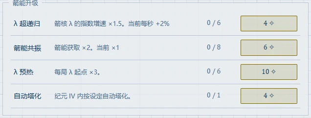

箭能用于长期倍率与 λ 能力，和直接购买新箭符形成取舍。 [查看原图](箭塔-全程攻略配图-20261101/原图/intro-16.png)


### 超越的一轮：如何避免总在起点反复打转

1. 确认引擎与超频自动采购有效，让新轮能启动。
2. 查看 λ 当前起点和增速，以及最强箭符所在的主链。
3. 选择本轮目的：攒下一块箭符、买一个关键 λ/共振等级，或直接冲 Ω。
4. 前两种目的可围绕预览加库存能否达到目标做重置判断；冲 Ω 时则避免不必要地结束本轮。
5. 超越后先采购目标，再重新排布；不要不停点超越却把所得箭能一直闲置。
6. 每次获得新阶，在导出备份的名称里记录最高箭阶；这比只写“后期存档”更有用。

若开始一次长轮冲 Ω，保持采购与排布，暂停会中断这轮的手动重置习惯。看见其他重置按钮可用，并不意味着当前目标要求你点击。更高阶门槛需要这轮实际增长到位，而不是只累计过许多次低收益重置。

### Ω 是什么，达到后究竟点哪里

这里的 Ω 是前五纪元约定的大数边界 `10{10}10`，表示十箭头层的表达式。它不是 VI–X 研究里的普通数值倍率，也不是 ∞ 圈号。当前星尘达到该边界后，游戏会记录前五纪元完成，并允许进入超限研究的第一次坍缩。

到达 Ω 后，不要在原箭能页寻找“第六纪元自动出现的新货币”。打开超限相关页，检查坍缩入口。第一次坍缩的预览是 1 坍缩核，它负责正式开启 VI。它保留既有的有限阶段投资，给你新的箭数符和研究状态；之后主要进度由研究条承担，原引擎增长不再是 VI 当前主线的推进方式。

### V 的常见误读

第一，买了“自动塔化”就期待自动超越。该能力只对应塔化场景，不能把动作名称互换。第二，λ 在新分支的读数与 IV 不同，就当成旧投资丢失。应先检查当前纪元规则，不能把“仍有历史记录”理解为“每项旧效果都永远直接参与当前公式”。第三，拿到 ↑¹⁰ 后不排布，导致仍在旧层算式里等。

第四，在冲 Ω 的长轮中反复超越，自己不断重置当前星尘。第五，把大数显示末尾的数与前层数直接比大小。第六，过去最高值已达 Ω，但当前页面没操作坍缩，误以为后五纪元损坏。按“确认完成记录→打开超限页→确认第一次坍缩”这三步处理即可。

## VI–X 共同操作手册：研究条、转生、定理和公理

### 两个数字组成进度，不要只看英雄数

进入 VI 后，主要进度是当前研究阶 rank 与该阶稳定度 progress。稳定度从 0 推到 100%，再点击“稳定下一层”前进到下一阶。没有自动稳定时，100% 会停住，继续离线不会自动跳过确认。研究阶是独立层级标签，不是用普通星尘生产把所有超限对象实际展开。

当前纪元还决定这一轮能研究到的上限：VI 为阶 3，VII 为阶 6，VIII 为阶 9，IX 为阶 12，X 可以抵达阶 15 并进入 ε 序列。到达上限后当前研究速率为 0，需要下一阶段转生，不是再堆引擎或无限等待就能跨过。攻略里的“到阶 3”指 rank＝3，不是这页恰好有第三条进度条。

研究条有自己的百分比速率。VI–X 里更大的晶格表达式不会直接变成无限倍率；排布转成受限的效率加成，让你通过有限操作改善研究。读界面时优先看研究速度、当前阶段和转生预览，再看符号大数作为结构说明。

### 六项研究的价格、上限与采购时机

| 项目 | 首级成本 | 后续价格基数 | 上限 | 你应观察的变化 |
| --- | --- | --- | --- | --- |
| 层深引流 | 1 | 每级约 ×1.7，向上取整 | 20 | 当前阶段研究速度，每级＋20% 的本地项 |
| 货币回响 | 3 | 每级 ×2 | 12 | 被动货币每级＋35%，转生收益每级＋8% |
| 吞噬共鸣 | 4 | 每级约 ×2.2 | 12 | 吞噬间隔和回响积累 |
| 复制超限算符 | 7 | 每级 ×3 | 5 | 增加当前纪元特殊算符库存 |
| 研究自动化 | 5 | 一次性 | 1 | 解锁本纪元自动动作的权限 |
| 谱系记忆 | 10 | 每级约 ×2.2 | 10 | φ、旧阶段重建与长期支持 |

每个纪元各有一组等级与对应货币，不能用 VII 的延展尘直接替 VI 买某一级。当前阶段的引流效果更直接，其他阶段已购引流也提供较小的累计支持。先确认瓶颈，再决定把哪个阶段的被动货币花在哪里。

一个容易复现的起步方案：第一次 VI 的 1 坍缩核买层深引流 1；后续通过被动货币和转生继续积累。引流升到 3 级时会完成本纪元引流定理，给额外 2 个对应货币，并永久改善研究。这个回馈不是无中生有循环：每条定理只奖励一次，不能靠反复重置重复领取。

### 三种专注：研究、收获与 λ

研究专注使研究速度乘 1.15；收获专注让研究速度为普通的 0.9，同时提高被动货币与转生所得；λ 专注主要改善吞噬产生的回响积累。你应把专注当作当前一段时间的目标选择，不能认为某一项始终适合所有阶段。

正在冲最后一阶、而资金已经足够关键研究时，研究专注较容易理解；准备攒币采购时，收获专注能改善经济，但代价是研究较慢；想观察吞噬反馈时可使用 λ 专注。更换后看速度与货币读数发生了什么，不要只看按钮样式。

收获专注的转生增益与被动增益不是同一个百分比：当前代码分别使用转生 ×1.25、被动 ×1.5。若你打算临近转生才切换，请以切换后的实际预览判断；不要把两项相乘后误算同一次收益。研究速度也不会因为货币更快就同步变快。

### 晶格效率：先连接 λ，再谈大量复制

VI–X 的布局加成由特殊算符数量、非零算符种类、平均数字刻度，以及 λ 左侧是否紧接特殊算符等项共同组成。各项有封顶，不能把符号层级更高理解为研究速度无限增长。普通布局理论上这些项合计最多到 1.93 左右，但具体挑战会取消其中一些项，且实际库存未必能同时达到全部上限。

最容易验证的一步是让 λ 左侧紧邻一个已拥有的超限特殊算符，观察“已连接”一类状态或效率读数。随后补充算符种类与数字基础，再决定复制当前特殊算符。把同一符号无限堆到数量超过效率封顶的部分，不会继续给同等研究收益；不应为“画面更满”挤掉更紧要的研究。

数字刻度的购买货币也变了：VI–X 用当前已开最高纪元的货币，而不是继续扣前面的折痕。数字上限从 VI 的 12 开始，每开放一纪元增加 1，到 X 为 16。买数字前看货币图标，避免把稀缺新纪元资源在尚未弄清作用时全部消耗掉。

### 吞噬和回响：有效但有边界

λ 定期吞噬不含 λ 的其他行中较强的一行。包含 λ 的行不作为自身吞噬目标；因此只把所有强算符集中到 λ 行，会与让其他行提供吞噬目标形成取舍。自动排布会给出可用起点，手动调整要看实际行值和当前反馈。

基础吞噬间隔为 30 秒，吞噬共鸣逐步缩短，但最低为 6 秒。回响研究倍率也有最高 40% 的边界；当前回响值本身还会限制在有限区间。把吞噬当成长期支持，不要因为看到次数增加就以为当前研究速度必然持续按次数线性增长。

稳定下一层时回响减半，转生或进出公理挑战会重置本轮研究与回响。若你刚前进后速度有一点回落，先看回响变化，这可能是正常机制。吞噬累计次数则是长期定理的一部分，不会因为一轮回响清空就等同于所有历史计数丢失。

### 转生会清什么：当前研究与货币库存要分开

VI–X 的阶段转生会把本轮 rank、progress、ε 当前下标、回响和运行计时重置，但永久研究、特殊算符库存、最佳记录、定理、挑战完成层数继续保留。更高阶转生还会清空比目标阶段更低的当前货币库存；低阶段已经花掉的永久升级不被撤销。

例如从 VII 向 VIII 铺阵时，获得阵列元并开启 VIII，VI 的坍缩核与 VII 的延展尘当前库存会被清空。若某笔低层货币已足以购买有用的便宜研究，先投资再铺阵可能减少闲置库存损失；但也不要为耗尽每一分余额而无限拖延新纪元。已经开放的旧货币仍有被动来源，之后可以再积累。

普通后续转生还要求本轮总计时与目标货币的相关计时都至少 60 秒，同时达到该动作所需 rank。看见 rank 到了而预览仍为 0，先查计时，不要急着判定失败。第一次从 Ω 开启 VI 是专门的初始入口，不套用后续必须先研究 rank 1 的普通坍缩判断。

### 自动化有两层许可，开关打开不等于全段已自动

购买某纪元的研究自动化后，才允许它的自动采购；自动稳定还看当前研究阶对应阶段是否买过自动化。因为高阶段转生会从 rank 0 重走，若低阶段没解锁稳定权限，拥有 X 的自动化并不等于一路所有旧研究条都能自动确认。

三个总开关分别是自动稳定、自动购买、自动跨纪元转生。自动采购对具有许可的纪元按顺序尝试各研究项目；它能省操作，但会影响你手动攒新算符或记忆的预算。正在对照采购路线时可以关掉自动购买，保留自动稳定；正在冲新门槛时则检查跨纪元转生是否就是你当前想做的动作。

自动跨纪元转生只处理尚未达到最终 ε 循环的阶段上限，并且公理挑战期间不会自动转生把挑战打断。它不是“自动重复刷每种货币”的万能控制器。若想在某纪元多刷一轮，手动决定；若想继续主线，就检查下一动作是否已经可预览。

### 每纪元三条定理：白拿的奖励仍需要真实条件

五个纪元各有三条定理，共十五条。引流定理要求该纪元层深引流达到 3 级；吞噬定理依次要求累计吞噬 25、50、75、100、125 次；稳定定理依次要求最佳研究阶达到 2、5、8、11、14。完成一条会给 2 个本纪元货币，并在全局研究因子里增加 8% 的支持。

查看这些目标可以让采购更有目的。例如差最后一级引流就能拿定理回馈，与把同样的钱花在暂时不需要的第三块特殊算符上，收益结构不同。但定理数量是有限的，完成后不会按转生次数重新发奖。当前奖励是全局累积项，不要把十五条各自“＋8%”误算成十五次独立相乘。

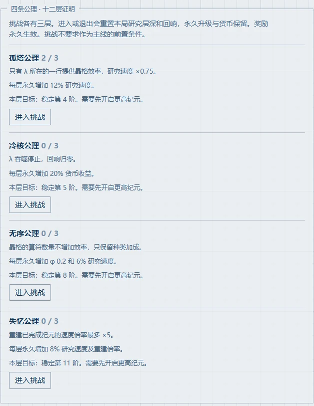

嵌套公理已完成两层；第三层目标是稳定第4阶，VI的研究上限尚未满足，VII才可进入。 [查看原图](箭塔-全程攻略配图-20261101/原图/action-trial-third-locked-0.png)


嵌套公理已完成两层；第三层目标是稳定第4阶，VI的研究上限尚未满足，VII才可进入。 [查看原图](箭塔-全程攻略配图-20261101/原图/action-trial-third-open-0.png)


### 四公理的三层解锁：这一处要特别纠正旧说法

当前四公理每类确实有三层，合计十二层。刚在对应纪元解锁时，通常只允许完成前两层，因为第三层的目标超出了当纪元研究上限；进入下一纪元后就能补第三层。不能把“此时第三层按钮锁着”写成“这项永久只有两层”。

| 公理 | 最早纪元 | 三层目标研究阶 | 第三层最早可进入 |
| --- | --- | --- | --- |
| 孤塔公理 | VI | 2、3、4 | VII |
| 冷核公理 | VII | 5、6、7 | VIII |
| 无序公理 | VIII | 8、9、10 | IX |
| 失忆公理 | IX | 11、12、13 | X |

进入公理前先看挑战会重置本轮研究和回响，货币与永久研究保留；退出也重置本轮。没有必须全部挑战完成才能走向下一纪元的统一主线前置。你可以先推进主线，再用更好的旧阶段重建能力补难层。

## VI · 嵌套：把第一枚坍缩核变成能持续研究的起点

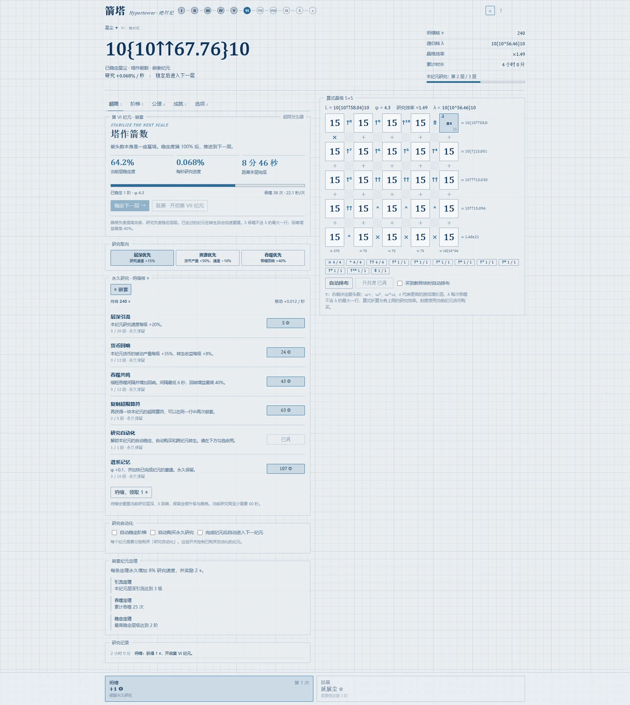

完整亮色界面用于辨认本纪元布局；下方局部配图分别对应具体操作。 [查看原图](箭塔-全程攻略配图-20261101/原图/intro-17.png)


### 初入 VI 的五个动作

第一次坍缩之后，纪元变为 VI，晶格至少扩到 5×5，并获得箭数符 ⇑。先到当前研究页，确认已处于“Ω 之外”而不是还在旧星尘生产页。研究进度从 0% 开始，旧系统的钱和已购能力仍在，但此刻不要用“继续买一阶引擎”来解决研究条慢。

建议按以下顺序做第一轮：一，确认已得到 1 坍缩核；二，买本纪元层深引流第 1 级；三，把 ⇑ 放进有效布局，确认 λ 左侧链接；四，使用研究专注先观察速率；五，研究条满后稳定下一层。只有做完这些，你才有一个可观察、可复盘的研究循环。

当前货币有被动增长，因此即便初始币花完，也不是整个系统没法继续。不要因为眼下没钱又没有预览坍缩收益，就误以为必须导入高配存档。普通坍缩的后续收益要达到至少 rank 1，并满足计时，而你现在仍在最初 rank 0；先完成一条研究。

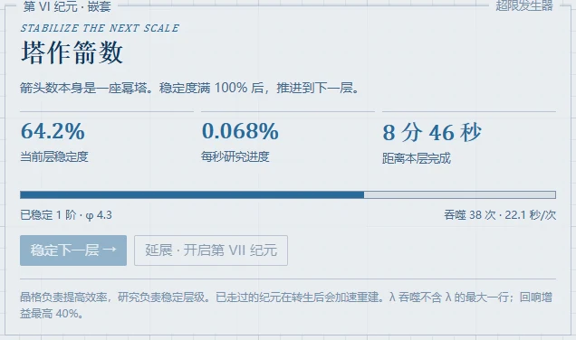

读出当前层、进度和下一步操作；研究层级与普通资源余额需要分别判断。 [查看原图](箭塔-全程攻略配图-20261101/原图/intro-18.png)


### VI 的阶梯怎么走：三次确认而非一次大等待

本段依次经历 Ω 之外、塔作箭数、箭数再嵌套三个研究主题。rank 0 的条满后，稳定到 rank 1；再完成 rank 1 的条到 rank 2；再完成 rank 2 的条到 rank 3。此时 VI 达到自己的上限，继续研究的速率为 0，需要延展进入 VII。

过程中的词语描述增长结构，不是“已经把一个无限对象算成十进制”。每次点击稳定都更新当前研究层与最佳记录，也使回响有正常变化。若第一条满后一直没点确认，离线很久仍在同一层是合乎规则的；不要把离线累计时长直接当成会自动跨过所有阶梯。

### 坍缩核研究：先把最便宜的收益看清

第一枚币买引流后，当前本地研究因子从 1 变为 1.2。接下来引流第 2 级价格为 2，第 3 级为 3；三次累计支付 6，达到三级还会拿一次定理的 2 币回馈。你可以据此比较“继续引流”与“先解锁自动化”的目标：主动在线时引流更直接，准备离开时稳定自动化更省确认。

货币回响首级 3，改善被动币和转生预览；吞噬共鸣首级 4，改善反馈；自动化首级 5，复制特殊算符首级 7，记忆首级 10。先确认哪一项解决自己的当前阻碍。不要把全部币都投入数字刻度，导致自动化与关键引流迟迟买不到；新晶格中每一格都升满也不是进入 VII 的硬条件。

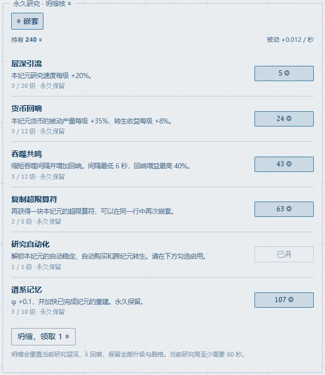

本纪元货币对应六项长期投资，升级作用与费用都可在此对照。 [查看原图](箭塔-全程攻略配图-20261101/原图/intro-19.png)


### 可复现排布检查：一次只改 λ 的连接

先关闭自动排布，记下当前布局效率。确保自己已拥有 ⇑，把它放到 λ 左侧紧邻的横槽，比较布局状态与研究速率。若本来已经连接，先找一块不影响该条件的位置作对照，而不是用“刚好没变化”得出没有加成的结论。恢复自动排布后确认布局仍合法，没有超过算符库存。

特殊算符的数量项有封顶，第一块连接的价值与后面第十几块堆数量不同。在 VI 只有有限库存时，优先保证主链可读和链接条件成立；等复制到手，再观察其他行如何给吞噬提供候选。这比要求每条线都画满更实际。

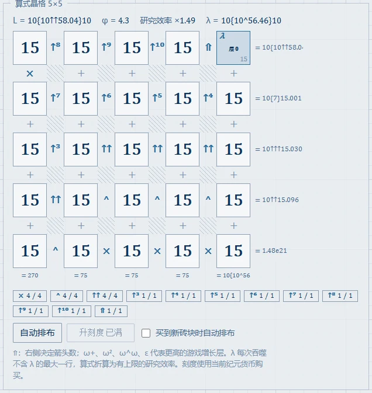

晶格在更高研究阶段继续工作，排布示例用于说明当前可用空间与符号。 [查看原图](箭塔-全程攻略配图-20261101/原图/intro-20.png)


### 孤塔公理的前两层与延展前的决策

孤塔把提供布局效率的范围限制为 λ 所在行，并额外使研究速度 ×0.75。进入前将关键特殊算符和种类集中到该行，不能指望其他行原本很多算符继续给同样的布局效率。普通主线中的最优排布未必是此规则下最合适的起点。

第一层目标 rank 2，第二层 rank 3；每完成一层，为全局研究因子加 12%。第三层目标 rank 4，此时 VI 上限只有 3，所以需要下一纪元。你可以选择 VI 做前两层再延展，也可以先延展、获得更好重建后回头做；它不是 VII 的强制入口要求。

### 延展：让新纪元出现的动作不是“继续稳定”

达到 rank 3 后，打开延展预览。相关计时都达到 60 秒且收益为正时，点击延展，获得延展尘 ✶，进入 VII 并扩到 6×6。转生会从 rank 0 重走；VI 当前坍缩核库存被清空，但已购 VI 研究、已有符号、定理与最佳记录保留。

延展前最后检查一遍是否有便宜且有用的 VI 研究可买，把确定有价值的币先转为永久投资。不要为了花光小数余额而等待很久；更高纪元会给旧路重建加速，旧货币之后仍能被动积累。跨阶段后当前 rank 回到 0 是正常动作结果，不是倒档。

### VI 卡点快速定位

研究满了但没升级，查稳定确认；研究速率显示 0 而 rank 是 3，查延展；延展预览为 0，查计时；第三层孤塔不可进，查目标 4 超过 VI 上限；买了自动化还没动，查自动稳定开关；⇑ 在库存但布局不变，查实际是否放置、是否连接 λ。把这六项逐一查完，再考虑是否真有程序异常。

## VII · 扩张：利用旧路重建，别把每次从 0 开始看成丢进度

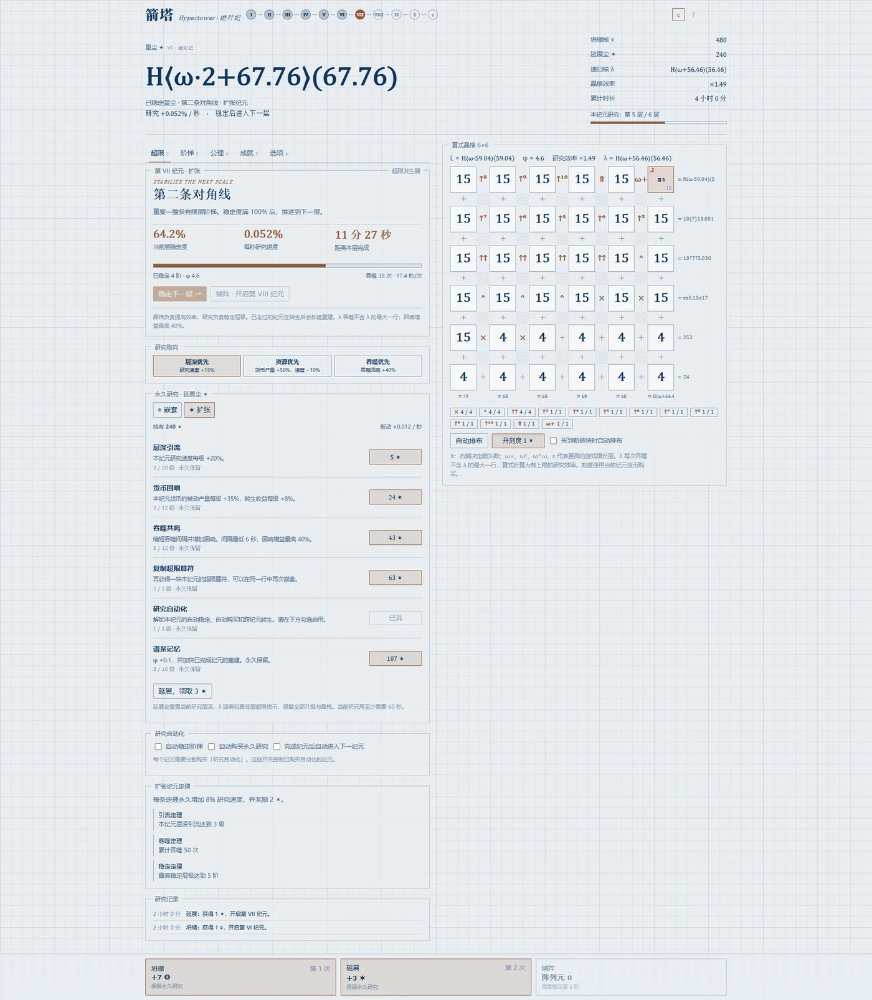

完整亮色界面用于辨认本纪元布局；下方局部配图分别对应具体操作。 [查看原图](箭塔-全程攻略配图-20261101/原图/intro-21.png)


### 6×6 之后先重排，再看重建与新研究

延展后新增对角线算符 ω+，晶格变为 6×6。旧布局会被扩容保留，但新行列和新符号需要重新组织。先执行一次自动排布，确认 λ 链、算符种类和新增数字槽，再检查 VII 的六项研究。当前新币延展尘还少，先把最便宜的引流、自动化或收益研究纳入预算。

你会先重走 VI 的 rank 0–2，再进入 VII 负责的 rank 3–5。这时旧路明显加快，是“已完成阶段重建”的机制。若旧路仍反复停在 100%，先检查 VI 的自动稳定许可，不要只买 VII 自动化就以为覆盖全部阶段。

### 扩张段的三步目标

本纪元研究主题是对角线、第二条对角线和对角线之塔，对应 rank 3、4、5 的研究条。先重建到 rank 3，再逐条稳定到 4、5、6。rank 6 是 VII 上限，也是铺阵的条件；它并不要求新一轮还保持满回响或完成全部公理。

正在 rank 0–2 时，VI 的本地引流影响更直接；到 rank 3–5 时，VII 引流成为本地项。这解释了为什么同一个升级在不同研究段看起来作用大小不同。采购前看当前研究主题属于哪一段，能避免把“永久升级没作用”与“当前不在它本地阶段”混为一谈。

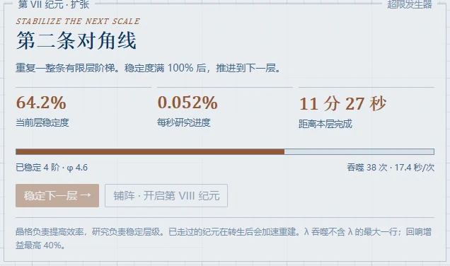

读出当前层、进度和下一步操作；研究层级与普通资源余额需要分别判断。 [查看原图](箭塔-全程攻略配图-20261101/原图/intro-22.png)


### 一轮资金路线：分开“刷延展尘”和“冲铺阵”

如果你决定先刷一轮延展尘，就把目标设为下次可取得的延展收益与一项具体研究成本；若决定冲 VIII，就把 rank 6 当终点，避免中途反复做低阶转生。两种路线都能成立，但需要知道当前在做哪一种。不断临时改目的，会让你误以为游戏没有前进。

延展尘的货币回响改善它的被动与转生收益，而 VI 的同名升级作用于坍缩核，不是一个全币种通用按钮。现有全部阶段的记忆、引流支持和公理奖励又会参与全局，因此应把当前币本地投资与旧币长期投资分别处理。


本纪元货币对应六项长期投资，升级作用与费用都可在此对照。 [查看原图](箭塔-全程攻略配图-20261101/原图/intro-24.png)


### 冷核公理：停止吞噬后不要等回响自己长回来

冷核使 λ 吞噬停止，回响归零。在挑战里盯着吞噬次数等待，并不能恢复被规则停掉的反馈。主推进依靠已有引流、布局、定理、重建和专注，先确认这些项目有足够基础再进入，通常更容易理解挑战成本。

冷核第一层目标 rank 5，第二层 rank 6，第三层 rank 7 需要 VIII。每层永久改善货币收益 20%，当前实现同时影响超限阶段被动收入与转生所得。它主要是经济奖励，不是直接给研究速度再乘一个独立 1.2。

现在也可以补 VI 孤塔第三层：VII 上限 6 已经允许目标 rank 4。建议分开做，先确认一个挑战已完成或退出，再进入另一个，避免把两种规则当成可同时叠加。P1 这里使用一个当前挑战索引，不是 P3 那种能叠三个微扰的系统。

### 一个具体的重建排查例

你已经买 VII 自动化并打开总开关，却发现新一轮总停在最初 rank 0 的 100%。先不动布局与引流，检查 VI 自动化是否购买。自动稳定权限按当前研究阶段识别，缺少 VI 许可会让最初几条研究需要手点；给旧阶段补上它之后，再观察是否能连续走到 rank 3。

如果能顺利到 rank 3，却在新段明显慢下来，说明旧阶段重建与新段正常研究的速度差体现出来了，不是权限仍没修好。此时再看 VII 引流、布局效率与回响。把两个问题分开，才能知道该花币还是该点按钮。

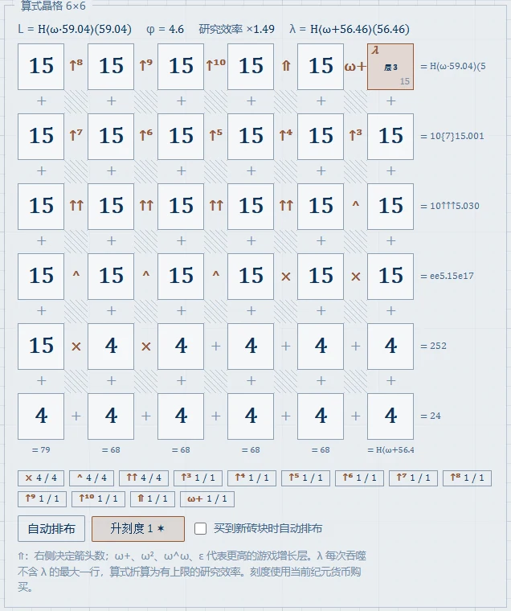

晶格在更高研究阶段继续工作，排布示例用于说明当前可用空间与符号。 [查看原图](箭塔-全程攻略配图-20261101/原图/intro-23.png)


### 铺阵前检查

达到 rank 6，计时满足，铺阵预览为正，就可进入 VIII。你可以先购买有用的旧币研究，尤其会在更高转生中清掉的当前库存；但无需把每个项目全部买满。铺阵后会扩到 7×7，并新增阵列算符，下一段应再做一次布局审视。

离开 VII 前带走的操作习惯是：用“当前研究属于哪个阶段”解释升级作用，用“这一轮目标是什么”决定是否转生，用自动化的阶段许可解释停顿。学会这些，比机械背下某套采购等级更能适应自己的进度。

## VIII · 阵列：在 7×7 上把结构收益与数量收益分开

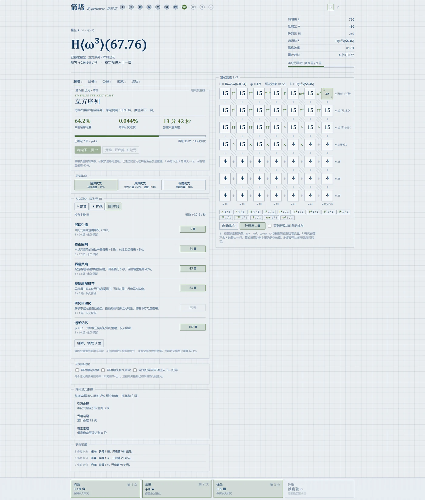

完整亮色界面用于辨认本纪元布局；下方局部配图分别对应具体操作。 [查看原图](箭塔-全程攻略配图-20261101/原图/intro-25.png)


### 新阶段的第一轮不先填满 49 格

铺阵进入 VIII，获得阵列元 ▦ 与阵列算符 ω²，晶格达到 7×7。先看新主链和 λ 链接，再看阵列元预算。格子多了不意味着先把每一个数字升满才允许研究；数字花的是当前最高已开纪元货币，会与新研究竞争。

建议先用原数字与新增特殊算符排布，记录效率；买一个你判断有用的便宜研究，再看变化；有余量时补低刻度数字。这样能理解钱花在哪，而不是把阵列元全部投入数字后发现自动化与引流还没起步。

当前研究 rank 6、7、8 对应平方序列、立方序列、幂次阵列。重建完前六阶后，逐条稳定到 rank 9，即达到 VIII 上限。若 rank 9 速率为 0，说明到了升维入口，不需要为“还有49格没满”继续原地等。

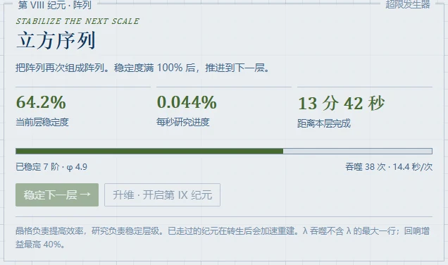

读出当前层、进度和下一步操作；研究层级与普通资源余额需要分别判断。 [查看原图](箭塔-全程攻略配图-20261101/原图/intro-27.png)


### 怎么理解布局里的种类、数量与平均数字

普通模式特殊算符数量提供一部分布局加成，非零算符种类提供另一部分，平均数字又是独立项。比如增加一块已经很多的 ω²，可能仍在数量封顶之外；保留一种之前未出现的符号，可能改变种类项。不要拿“更新阶的符号一定全面替代旧符号”来决定清空全部旧库存。

平均数字项也有封顶，且成本随刻度提高。把所有预算用来补一个已经很高的格，未必优于用在当前引流或自动化。最佳做法仍是改一项、看效率与速率，确认它是否解决眼下瓶颈。当前符号表达值和实际研究效率不是同一个数字，单看英雄数的层级不能证明布局收益更高。

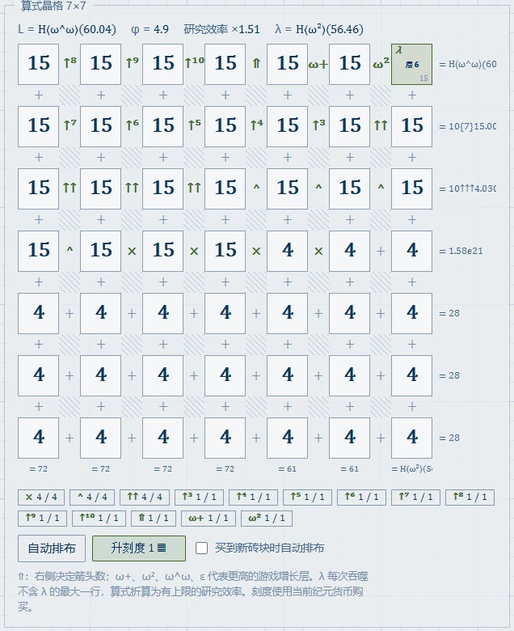

晶格在更高研究阶段继续工作，排布示例用于说明当前可用空间与符号。 [查看原图](箭塔-全程攻略配图-20261101/原图/intro-26.png)


### 无序公理：亲手拆开两个加成来源

无序去掉“特殊算符数量”的效率项，保留种类项。因此它适合作为教学实验：进入前把普通布局的数量、种类、λ 链接和数字读数记下来，进入后观察总效率减少在哪里。多买同种符号并不能恢复被规则取消的那一项。

无序第一层目标 rank 8，第二层 rank 9，第三层 rank 10 需要 IX。每层奖励 φ＋0.2 和全局研究项＋6%。φ 在当前系统有说明与长期意义，但普通 VI–X 研究并不按有限阶段的 `(1+L)^φ` 直接无限放大；不要把 φ 文案与实际受限布局公式混算。

现在可以补 VII 冷核第三层，目标 rank 7。若你主要目标是尽快进入 IX，可先只做一层易完成的公理或完全先推主线，再回来补。挑战收益确实永久，但挑战本身也要重走研究；拿“所有奖励都永久”作理由强制当下全清，忽略了这段时间成本。

### 阵列元、旧币和更高转生前的整理

升维会清掉比维度弦更低的当前超限货币库存，但不会删除已经购买的研究。先检查 VIII 可买的关键项目，也顺便看 VI/VII 被动攒下来的货币能否买记忆或自动化。花钱的目标是留住确定有用的长期收益，而不是为了让余额都变成 0。

谱系记忆会改进旧阶段重建，因此在即将需要从 rank 0 重走更多段时更值得关注；当前 VIII 引流则改善眼前 rank 6–8。若旧路已非常快而新段慢，优先本地引流；若你频繁转生，重建耗时仍很显著，记忆可能更有吸引力。这里没有一条不看实际速率的固定比例采购法。


本纪元货币对应六项长期投资，升级作用与费用都可在此对照。 [查看原图](箭塔-全程攻略配图-20261101/原图/intro-28.png)


### VIII 的复现实验与升维检查

用当前合法布局复制一份手工观察表：第一列记录特殊符号数量，第二列记录种类数，第三列记录总效率。只把一个重复符号换成你已拥有的其他种类，再看是否改变种类项；恢复后进入无序挑战，再做同一对照。这样可以看到“数量项被关掉，种类项还在”，而不必盲猜哪个符号更高级。

离开时确认 rank 9、相关计时和升维预览。进入 IX 后晶格仍为 7×7，增长不会再靠本次扩容。不要因为格子数没有变化，就以为升维没有成功；应检查纪元标签、维度弦、新算符与新的研究上限。

## IX · 维度：晶格不再扩容，重点转向研究与重建节奏

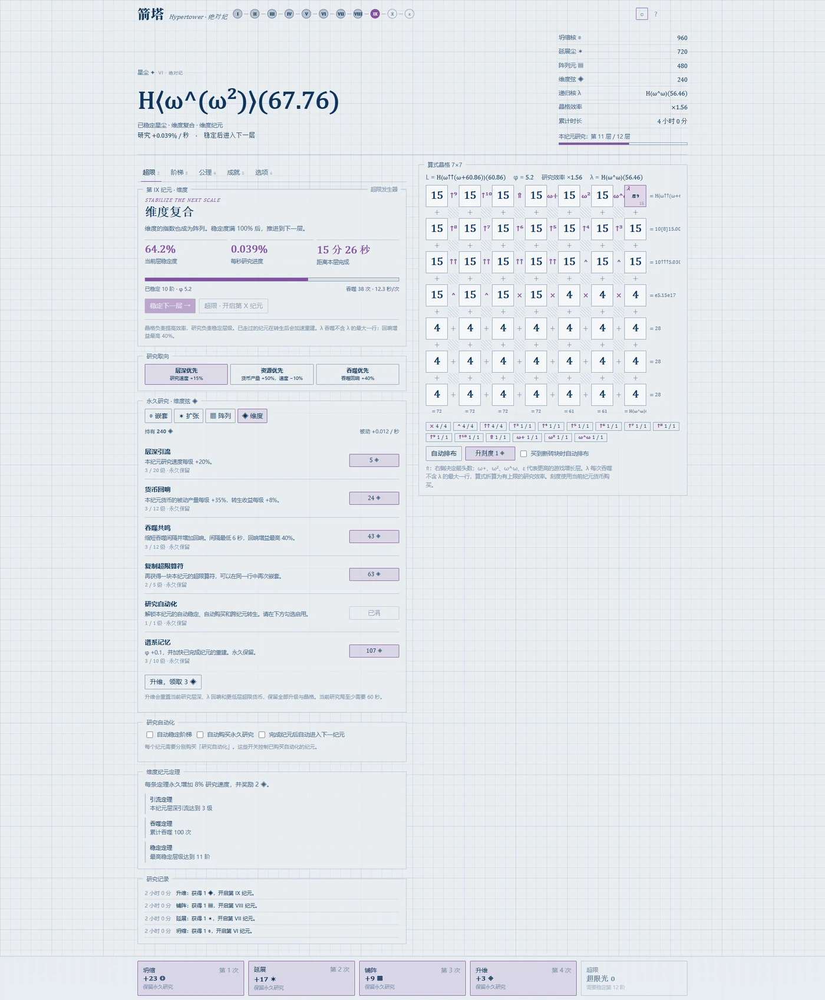

完整亮色界面用于辨认本纪元布局；下方局部配图分别对应具体操作。 [查看原图](箭塔-全程攻略配图-20261101/原图/intro-29.png)


### 升维后先核对四个变化

IX 使用维度弦 ◈，获得维度算符 ω^ω，研究上限提高到 rank 12，普通数字上限继续提高。晶格仍是 7×7，所以没有新的面积提示你成功进入；请用纪元名、货币图标、库存和研究上限确认，而不是只数格子。

新一轮从 rank 0 重建到 rank 9，之后 IX 的三条研究分别是无尽维度、维度复合、维度之塔，对应 rank 9–11。逐条稳定后到 rank 12，才能做进入 X 的“超限”。这里的动作名“超限”和页面总系统名相同，注意按当前预览看它是开启 X 的转生。

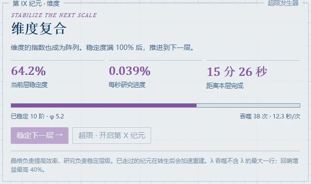

读出当前层、进度和下一步操作；研究层级与普通资源余额需要分别判断。 [查看原图](箭塔-全程攻略配图-20261101/原图/intro-31.png)


### 研究投资不要只按新旧标签判断

维度弦的引流影响当前 IX 段，其他阶段引流提供小一些的全局支持；记忆改善旧路，收益研究改变攒币。你可以先做一个明确诊断：记录从 rank 0 回到 rank 9 的过程和 rank 9 研究一条的过程，看看时间主要花在哪里。若你没有计时，也至少用观察记录辨认“前面总卡确认”还是“新段缓慢”。

前者先查自动化许可和记忆；后者先查 IX 引流、专注、布局与定理。把维度弦全部花在旧段已经封顶的布局数量项上，不一定能解决新段慢。采购能力很强时，自动买会让目标预算分散；临时关自动采购并不损失研究，你可以先攒一个指定目标再打开。


本纪元货币对应六项长期投资，升级作用与费用都可在此对照。 [查看原图](箭塔-全程攻略配图-20261101/原图/intro-30.png)


### 失忆公理：重建倍率被限制，但永久研究没有被删除

失忆把已完成阶段的重建倍率最多限制为 ×5。进入后前面许多条研究明显变慢是规则本身，不是记忆等级被清空。查看升级等级仍在，再看挑战横幅，能确认二者区别。退出后限制解除，但退出也重置本轮研究与回响，不应把它当作无成本地临时跳过慢段。

第一层目标 rank 11，第二层 rank 12，第三层 rank 13，需要 X。每层奖励全局研究项＋8%，并参与之后的旧阶段重建计算。普通模式中的“前面几阶几乎瞬间完成”不能用作挑战运行速度承诺，挑战故意削弱这项便利。

现在也可补 VIII 无序第三层，目标 rank 10。由于已开 IX 上限是 12，这层在规则上可进。若无序按钮仍锁，检查是否已做前两层、当前是否选中了正确挑战、是否超限系统已开启，而不是继续买数字试图解锁按钮。

### 一个“慢得合理”的对照

先在普通模式观察 rank 0–2 的重建速度，再进入失忆，保持布局和引流不变，观察同样几阶。两者差异来自重建限制与回响重置，而不是英雄数表达式是否更好看。再退出确认挑战消失，下一次普通重建会恢复原规则。

这个对照不要求你真的等待整段挑战完成，也不把演示截图上的高配速率当成新档参考。目的是学会用规则解释变化。若退出后仍异常，先检查自动稳定权限与进度条是否已满，最后才考虑导出复现存档做程序排查。

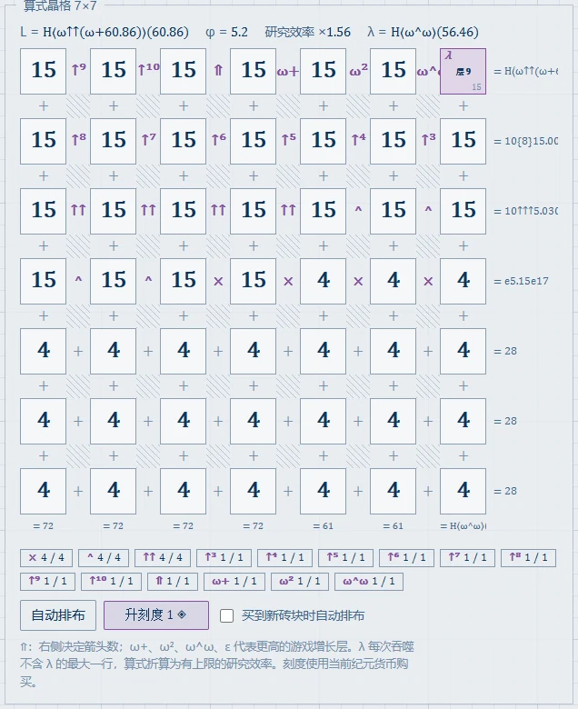

晶格在更高研究阶段继续工作，排布示例用于说明当前可用空间与符号。 [查看原图](箭塔-全程攻略配图-20261101/原图/intro-32.png)


### IX→X：别把最后一个阶段当作必须全满毕业

rank 12、计时满足且超限光预览为正，就可以进入 X。四条公理第三层中还有失忆目标 13，IX 根本到不了，强行要求九纪元时全公理三层会形成自己制造的死结。先到 X 再补最后一层，才符合当前阶梯结构。

进入 X 会清掉前面几种超限货币的当前库存，保留已购研究和记录，并新增 ε 算符。此后最高目标从有限段终点延续到 ε 序列，下一章节要特别区分“研究阶15”“ε下标”和“当前层百分比”。

## X · 超限：稳定 ε₀，再把最佳 ε 下标推进到 10

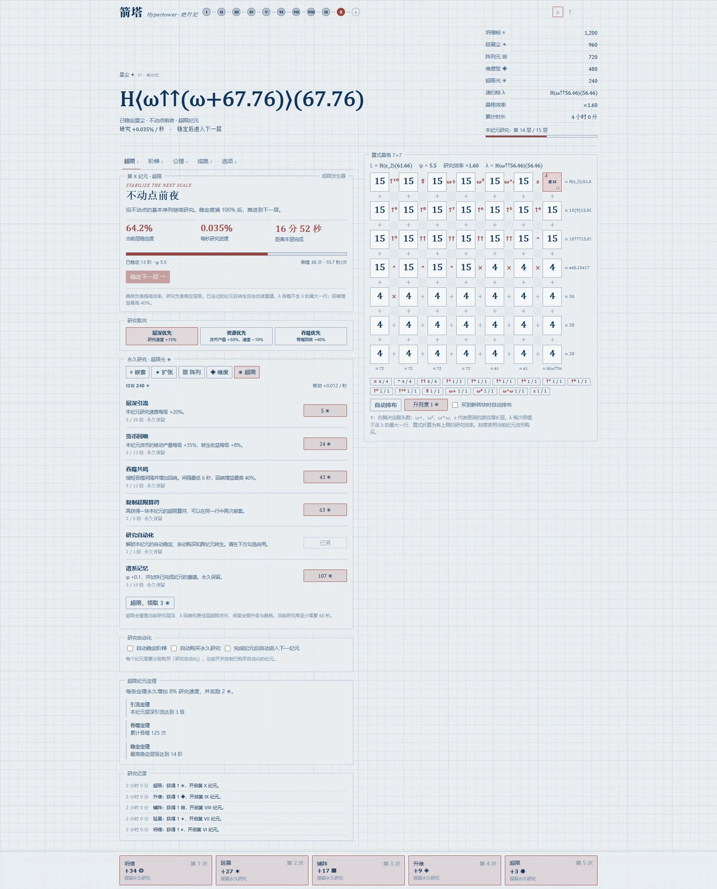

完整亮色界面用于辨认本纪元布局；下方局部配图分别对应具体操作。 [查看原图](箭塔-全程攻略配图-20261101/原图/intro-33.png)


### X 的三组读数各自管什么

X 依次研究序数幂塔、不动点前夜和第一不动点，对应 rank 12、13、14。完成这三条研究并逐次稳定后，rank 到 15，进入 ε₀。之后研究条继续从 0 到 100%，每次稳定使 ε 下标增加 1。rank 仍是 15，不会因为 ε 从 0 到 1 就变成 rank 16。

因此请同时读取：当前研究阶是否为15，当前 ε 下标是多少，当前条完成百分比是多少。达到 ε₉ 的 100% 但尚未点击稳定，并不等于已经稳定 ε₁₀；完成动作才更新下标。若已有 ε₁₀ 的最佳记录但当前因转生回到低层，最佳与当前也会不同，入口使用的是最佳记录，但仍要求当前处于 X 且超限系统开启。

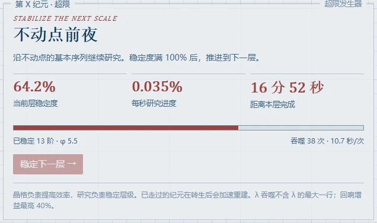

读出当前层、进度和下一步操作；研究层级与普通资源余额需要分别判断。 [查看原图](箭塔-全程攻略配图-20261101/原图/intro-35.png)


### 从 rank 12 到 ε₀ 的操作流程

先让旧阶段重建至 rank 12。检查 X 层深引流与自动稳定许可，保证新段能持续推进。每次条满确认下一层，依次到13、14、15；最后一次到15时，界面会显示 ε₀ 已稳定的相关信息。保存一次备份，名称可写“X-ε0”，便于和仍在不动点前夜的档区分。

如果当前自动化只覆盖前面阶段，手动完成 X 许可或每条自己确认。进入 ε 循环后，不要期待自动跨纪元转生直接打开 XI；该开关处理的是后五纪元内的阶段边界，XI 有自己的入口。即便自动稳定已经能推进 ε，也仍应自己检查九头页的开启条件。

### X 的超限光与长期升级怎么花

X 的货币是超限光 ✺，六项研究与前四阶段同类，但具体币种和等级独立。眼前要到 ε₁₀，优先保证 X 本地研究、自动稳定与合法布局工作；旧币投资则以能否缩短重建、补定理与长期支持为依据。没有必要为进入 XI 先把所有五套研究升满。

若你打算留在 X 长线研究，再考虑更多记忆、收益研究、定理和公理。当前最高 ε 下标使用十进制字符串保存，超过普通安全整数不会因此自动变成无法显示的数；但游戏仍有输入与存档预算，不要从“可远超常见范围”推导成“所有任意长度都无限支持”。实际游玩先看当前界面正常记录即可。


本纪元货币对应六项长期投资，升级作用与费用都可在此对照。 [查看原图](箭塔-全程攻略配图-20261101/原图/intro-38.png)


### ε₀→ε₁₀：一条可以逐次核对的清单

1. 确认 rank 已为15，当前显示 ε₀。
2. 等当前条到100%，点击稳定，显示 ε₁。
3. 检查下一条回到0%并继续研究，而不是还停留在满条。
4. 同样重复，做到 ε₂、ε₃，逐次看下标变化。
5. 若开启自动稳定，留意它正在处理 X 的研究，而不是只有开关外观打开。
6. 到 ε₉ 时，最后一条仍要完成并稳定；读到 ε₁₀ 后再核对最佳记录。
7. 打开九头入口页，查看开启 XI 的按钮与条件。
8. 若暂时不想进 XI，可以继续留在 X，但没有入口要求迫使你先到 ε₁₀₀₀₀。

研究速度会随着 ε 下标通过对数项逐步增加难度。它不是每升一个下标都按同样巨大倍数变难，也不是完全恒速。用当前显示速率做计划，不用 ε₅₀₀₀₀ 或 ε₃₀₀₀₀₀ 的演示图承诺新档十层应花多长时间。

### 第三层失忆与其余公理的补清顺序

X 上限允许 rank 13，因此可以进入并完成失忆第三层。四类第三层的目标分别是4、7、10、13，全部在 X 的阶梯能力内。若你希望补全十二层，可以按缺失项目逐个做；因为每次进入都会重置本轮，建议先确认哪一项未完成，再考虑当前升级对其限制的适应程度。

补挑战和冲 ε₁₀ 是两个目标，不能在进挑战重置后又用“我的 ε 怎么回0了”判断丢档。最佳记录、已完层数和永久研究仍在，当前研究重走是挑战动作的预期结果。若刚好已完成入口要求，也可以先进入 XI，之后按新的历史系统组织旧进度；不必为本篇建议清单当下全满。

### X→XI 的准确入口条件

当前程序的 gate 判断为：纪元正好是 X；超限引擎已开启；最佳研究阶是15；最佳 ε 下标至少10。它没有“ε 至少一万”“全公理十二层”“超限光全部研究满级”这些附加项。满足条件时，九头页提供开启 XI 的按钮。

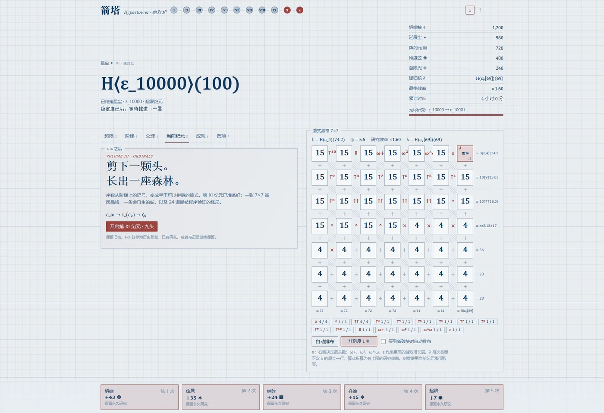

示例存档的 ε 下标高于入门要求；实际入口门槛为最佳 ε 下标至少 10。 [查看原图](箭塔-全程攻略配图-20261101/原图/intro-36.png)

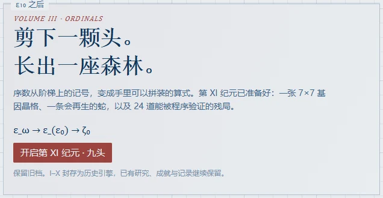

这张示例显示按钮的位置；ε10000 是截图存档进度，进入 XI 只需达到 ε₁₀ 等入口条件。 [查看原图](箭塔-全程攻略配图-20261101/原图/intro-37.png)


若看不见入口，按此顺序排查：当前是否仍在 X；是否只是把旧有限阶段英雄数记法看作 ε；最佳阶是否到15；最佳下标是否真正稳定到10；有没有点到对应九头页而不是继续停在超限商店。截图中的 ε10000 是演示档进度，不是按钮要求。不能从图片里的数字反推硬门槛。

开启 XI 会初始化九头系统、序数晶格和一份可用的入门生产蓝图，I–X 接入历史引擎。它不是把已有前十纪元成就清空后再开始另一款游戏。程序还会设置前五纪元的一些完成能力，以便旧系统作为历史基础运行；新主线从九头沙盒与已验证设计开始。

### 进入 XI 前后，怎样确认自己没有走错路

点击前先导出一份“X-ε10可开XI”备份；点击后看纪元标题是否变为 XI，是否出现九头相关页、序数层级和新的蛇鳞货币。然后确认旧成就与蓝图功能按当前版本仍可读取，保存一次“XI-刚开启”备份。两个档的角色不同：前者保存入口前状态，后者保存新系统初始化结果。

不要在刚进 XI 后继续用 P1 的有限星尘阈值当下一纪元门槛。P2 的推进来自九头设计、蓝图生产、序数研究和对角化。你已经完成 P1 最重要的学习：通过重置取得永久能力，识别算式结构，区分研究确认与阶段转生，并让自动化服务于明确目标。

## P1 复盘手册：从操作现象反查当前需要做什么

### 一张按症状查动作的表

| 症状 | 适用路段 | 首要判断 | 建议动作 |
| --- | --- | --- | --- |
| 什么都没增长 | I | 首台一阶是否买过 | 用初始10星尘启动链 |
| 自动开关打开仍要手买 | II起 | 能力是否已购买 | 区分解锁与启用 |
| 新算符买了没改变输出 | II–X | 是否放置、有效底数是否为1 | 排布并检查单线结果 |
| 数字升级很贵却没明显变快 | II–X | 钱是否花在非瓶颈格、效率是否封顶 | 比较当前研究或主链需求 |
| 升幂按钮未亮 | II | 是否真正到2¹⁰²⁴ | 看精确预览而非只读1e308 |
| 进挑战后普通布局变弱 | III、VI–X | 当前限制改变了什么 | 按规则重新布局 |
| λ 不增长 | III–V | 是否在冻结、是否读了当前分支 | 退出冻结或核对本纪元增长规则 |
| 冲关总回到起点 | II–V | 自动重置或手动频繁重置 | 保留采购，暂缓会结束长轮的动作 |
| 研究100%不往前 | VI–X | 稳定按钮和阶段权限 | 手点或补对应自动化 |
| 研究速率为0 | VI–IX | 是否已到3/6/9/12阶上限 | 检查下一阶段转生 |
| 转生收益0 | VI–X | rank和两个60秒计时 | 条件满足再转生 |
| 第三层公理不能进 | VI–IX | 目标是否超过本纪元上限 | 下纪元补第三层 |
| 延展后货币少了 | VII起 | 是否更高转生清了低币库存 | 检查已购升级仍在，区分库存与永久投资 |
| 到ε9满条但XI未开 | X | 最后一次是否稳定 | 完成ε10并看最佳记录 |
| 看见图片ε10000就继续猛刷 | X | 把演示数字误当门槛 | ε10后即可核对XI入口 |

### 自动化的安全使用习惯

所有自动化先手动观察一次完整流程，再打开对应开关。观察不是为了每次都自己点，而是为了知道它何时会花钱、何时会结束本轮、何时不会行动。看到系统停住时，先问“权限没买、开关没开、条件没到、还是动作被当前规则禁止”，而不是立刻连点所有按钮。

做布局实验时关闭自动排布；手动攒指定采购目标时暂时关闭自动购买；准备冲一个长轮门槛时暂停会中断本轮的自动重置；离开实验后再恢复需要的功能。这三种临时关闭各自有目的，不代表把整个游戏自动化全关掉。

自动化不能替你确认所有跨系统入口。P1 的自动研究能帮助推进 ε，X→XI 仍是独立开启动作；P3 以后历史窗的工作也会被新的全局规则组织。把入口当作一次需要核对的新阶段，而不是期待所有新页面在旧开关下自行完成。

### 采购优先级的通用比较法

先选一个可验证目标，如“下一层尖塔”“下一阶箭符”“自动稳定许可”“本纪元引流定理”。记下成本与当前库存，再看某个便宜升级能否显著缩短达到目标的过程。这样比较的是具体收益，不是看见“永久”二字就认为现在一定该买。

同名升级在不同阶段可能扣不同币、作用范围也不同。买之前先看图标，买之后看等级和当前读数。把每次重要采购记一行简短观察，能避免长时间后忘记“我当时为什么关了自动购买”或“哪次转生清空了哪种库存”。

不必把每个已经到手的系统都维持在最大库存。重置本来就把短期积累变成长期成长；进度快不快，应该看下一个有意义节点是否更容易抵达。用仓库里存着多少币当成唯一成功指标，反而可能让你忽视没有投入的永久提升。

### 截图怎么作为攻略证据来读

全景用于找页面与操作区，局部图用于辨认规则、预览和变化。图中的库存、引擎数量与层级可能来自隔离演示档，不能当成新档一模一样的采购清单。真正应跟随的是图注里指出的动作、硬条件与结果，例如“放入乘符之后L改变”“条满再稳定”“下一纪元上限允许第三层”。

当图里是已完成状态，回到正文找进入前提；当图里是前后对照，先确认只改变了哪一项。不要把一个高配结果图误认作证明任何新档都能立刻做到；也不要因自己的数字较小，就跳过已经满足硬条件的入口。

### P1 结束时建议保留的五份节点备份

如果只想少量保留阶段档，可选择：首次折叠后、首次 λ 解锁后、首次塔化后、Ω已达且可坍缩、ε₁₀可开XI。各文件名带节点，附一句当前自动化状态。它们用于自己回看与故障定位，不需要每次进度前进就导入旧档。

比五份节点更重要的是一份当前有效备份。每次跨过大入口后先确认保存成功，再继续玩法。若换浏览器或本地路径，先把当前导出文本带走；看到另一来源的新档，先导入对应备份，别用“清除全部进度”尝试找回旧存储。

## P1 速查附表：重置、永久投资与下一步

| 动作 | 当前轮主要回落 | 长期继续有用的内容 | 新手最先核对 |
| --- | --- | --- | --- |
| 折叠 | 星尘、引擎、超频 | 折痕与已购能力、晶格 | 新增折痕能买什么 |
| 升幂 | 上述及当前折痕、λ；余烬前会丢大部分折叠升级 | 幂晶、星图、数字与算符结构 | 幂之源、余烬、λ路线 |
| 塔化 | 上述及当前幂晶 | 塔砖、尖塔、星图与库存 | 第一层递归、下一尖塔成本 |
| 超越 | 上述及当前塔砖 | 箭能、已建尖塔和已购能力 | 新箭符、当前λ分支 |
| 第一次坍缩 | 开始新的超限研究轮 | 有限阶段能力、研究状态 | 引流1、⇑链接、研究稳定 |
| VI–X阶段转生 | 当前研究、回响、相关计时，以及低于目标阶段的当前超限币 | 永久研究、算符、定理、公理、最佳记录 | 新阶段许可和下一轮目的 |
| 开启XI | 主线转向九头与序数设计 | I–X历史、旧成就与全局记录 | 新纪元标题、入门蓝图与备份 |

最终，P1 的全程路线不是“等足够久就自动到十纪元”，而是多次改变你正在经营的对象。第一轮管理生产链，折叠后管理算式，升幂后管理时间进入指数的位置，塔化与超越后管理运算层次，坍缩后管理研究阶梯和重建。到 ε₁₀ 时，这套习惯已经足以支撑后面更复杂的蓝图与验证流程。


## P2 开始前：从“买资源”转向“保存一份能重放的答案”

本段攻略从 X→XI 的入口接起，一直带到 XX 的归一、全 720 星和 XXI 的入口。主线有两条并行轨道：研究坐标推动英雄数经过当前纪元的各个标签；实际沙盒把有限、可验证的设计保存成生产蓝图。只看英雄数而不保存蓝图，会错过产出、星级和后续入口；只在沙盒里反复运行而不提交，也不会自动把实验变成永久记录。

### 先分清四个按钮，再开始第一道题

“运行实验”或“运行机器”用于看当前方案实际发生什么；“验证设计”按当前题目及挑战条件检查是否合格；“提交并保存蓝图”才会正式记录题目星级、生产方案和相关状态；“用于生产”决定当前真正启用哪张蓝图。运行成功不等于提交成功，验证通过也不等于方案已经生产。每完成一题，都应回主线核对活动蓝图名称、质量、预算每秒产出和谜题档案中的星级。

XII–XX 的新手通用顺序是：先保留入门蓝图生产，打开 24 道谜题，选当前要解的一题，去谜题沙盒读本题条件，输入方案，验证，提交，再回主线检查活动蓝图。初入纪元时系统会提供可验证的入门方案，所以不要因为空沙盒还没有设计就以为生产必须完全从零启动。入门蓝图是保底生产来源，手动解题则提供更好的质量和星级。

### 研究坐标、十档和对角化怎样前进

每个标签内有十档。第一档坐标从 1 起，后面的档从 2 起，到 10 时进入下一档；第十档到达 10 后，需要对角化才换到下一标签。开启自动对角化可以代替重复点击，完成后进入下一纪元则是另一个独立开关。把两者混在一起，会导致“自动明明开了却不换纪元”的误会。

XII–XX 在对角化到本纪元最后一个标签时便标为完成。不要再等最后标签又跑满十档才去寻找下一纪元按钮。XIX 还有 V=L 与 AC 两种额外阻挡，XVIII→XIX 另查宇宙条件；这几处即使坐标满了也不能用等待解决。

### 收益与采购的实际判断方法

XII–XX 六项研究的每项上限均为 6 级，下一等级费用是 `8 × 2.3^当前等级` 的内部预算。初级研究便宜、每次研究都会给整体研究速度增益，所以“先低级铺开，再升昂贵等级”通常比只堆一项平滑。但这是一种起步建议，不是所有存档下的严格最优解：某项研究还会影响本纪元编辑预算或确定性执行等功能，遇到需要它才能操作的关口应优先满足功能条件。

蓝图持续收益取决于当前是否开启蓝图生产、当前活动方案是否与挑战匹配、质量和收益研究等。没有合规活动蓝图时，主线仍有保底研究质量，但结晶收益可能变成零；这时反复购买、等更久都不是第一步，先恢复正确蓝图。星级对当前纪元研究加成只计算前 24 星，超过 24 星继续收集主要为全星目标和后续入口，而不是让当前速度无限线性增加。

“领取结晶”在进入本纪元或上次领取后累计至少 60 秒时可用，只重置这次可领取的积累时间，不回退英雄数、不清空已经保存的蓝图。若正在手动购买而差一点预算，可以查看这个按钮。不要为了领取结晶点归一或重开题目；它们处于完全不同的重置层级。

### 第一次就应建立的存档与蓝图库习惯

在进入 XI、关闭 AC、第一次归一、首次进入 XXI 前各导出一份游戏存档，文件名写清纪元、轮数和用途。游戏存档保存整份进度，HTB5 蓝图只保存某份设计与证明；单独导出蓝图不能替代进度备份。浏览器本地存储又与文件路径或站点有关，换一个预览文件打开时不能据此断定旧存档被删除。

蓝图库最多 64 张，而 XI–XX 一共有 240 题，所以不能永久给每道题各留一张。合理做法是每纪元至少留一张稳定生产代表，再保留正在证明的挑战方案、特殊高质量设计和准备在 AC 关闭后加载的指定蓝图。其余蓝图先导出，再按需要清理。删除蓝图不等于清除题目档案，但若删除了当前活动方案又没有替代品，生产会受影响。

### 三星路线与参考解路线必须分开

XII–XX 中，点“参考解”载入的方案带自动辅助标记，提交一般记 2 星，质量为 0.8；从空沙盒按规则亲自输入并验证的合法设计可记 3 星。攻略中的坐标、种子和转移表可用于手动复现，但不要在参考解已经载入后以为再点一次提交就自然变成三星。XI 的残局是例外：其星级按刀数、题型和收获门槛计算，辅助主要影响蓝图质量，不统一套用后九纪元的二星规则。

当前 XII 调色板还存在一个具体界面缺口：内核支持数字砖 3，第 17–24 题的构型可能需要它，但图形调色板只显示 1 与 2。攻略会给出外部共享蓝图的正式导入路径，也会保留目标、设计和限制说明。不能把“内核有合法解”直接写成“所有题均能只靠当前调色板从空盘画出”。

## XI · 九头：先做一条短而可靠的证明生产线

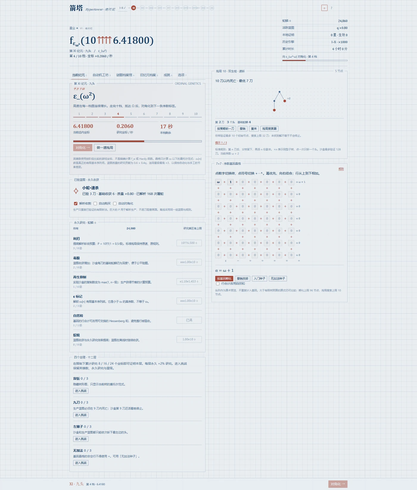

完整亮色界面用于辨认本纪元布局；下方局部配图分别对应具体操作。 [查看原图](箭塔-全程攻略配图-20261101/原图/intro-42.png)


### XI 的入口核对与第一轮顺序

从 X 开启 XI，硬条件是当前在 X、超限研究已经开始、历史最佳阶达到第 15 阶，并且历史最佳 ε 下标至少为 10。ε_50000、ε_300000 都只是后期演示值，不是入口门槛。满足条件后使用开启九头纪元的按钮，不必为了“数越大越保险”额外刷数万层。

进入后先确认“九头”主线、残局与 7×7 基因晶格都已出现。系统会把 I–X 接入历史生产，并安排一张入门蓝图。先保持解析收割开启，随后去残局列表做前几道短题。第一轮推荐先学会最简单的三颗根头和第一次再生，再看自己的生产质量是否改善，最后开启自动购买与自动对角化；不要一上来就孵化接近 96 节点的复杂树。

### 每一刀到底改变什么

叶子才是可斩的头，根节点留在树里。斩根下的一颗叶子只会删除这颗头；斩更深的叶子，则在删除后保留父枝，并额外添上与当前刀数有关的副本。第 n 刀在标准规则下增加 n 份复制，副本不是把整棵树重开一次。树形上显示的 ×n 是同型子树的压缩显示，一次点击仍只斩一个头。

因此，先把根上的简单头全部清完不一定省刀。若把会再生的深枝拖到较晚才斩，当前刀号更大，副本可能更多。可靠的起步思路是先比较深枝会带来多少复制，再清剩余根头；每斩一刀查看当前树、刀数和基础蛇鳞，必要时点撤销。蛇看上去长大不等于序数变大，标准规则的有限树序数仍应下降。

### 实例 A：三颗根头，建立第一张完整蓝图

在第 01 题“三颗头·速斩”中，初始结构是根上三颗独立叶子。连续三次点击当前最左边的叶子即可；每刀都是深度 1，奖励各为 1，最终共 3 刀、基础蛇鳞 3。只有树上不再有头时，提交区域才出现。给蓝图命名为“XI-01三头手解”，点提交，回主线检查它是否成为活动生产方案。

第 02 题使用相同树，但要求恰好指定刀数，第 03 题则检查收获门槛。不要只记“同一棵树同一种目标”，应先看标题后的速斩、定刀或收获标签。定刀题早杀和晚杀都可能不合格，收获题则需要同时满足收获和最终死亡，而不是只斩出足够蛇鳞就提交。

### 实例 B：第一次再生，理解为什么三刀能结束

第 04 题的起始树是一条根—中间枝—叶子的小链。第一刀斩最深叶子，深度为 2，基础蛇鳞得到 4；删除后留下的父枝变成根上的叶子，并添 1 份同型副本，所以现在有两颗根头。第二、第三刀分别清掉它们，最终 3 刀、基础蛇鳞 6。

这个例子应亲自斩一次，再点重来复盘。它能解释为什么看似“多生了一颗头”仍是有用进展，也能解释深度平方奖励。之后遇到“双生枝”“先斩哪枝”等题，先看深枝位置，再按当前树重新编号；旧路径在重排后不一定仍指向同一个头。后附答案中的 1.1 表示当前根的第 1 枝里第 1 个子节点，不是屏幕固定坐标。

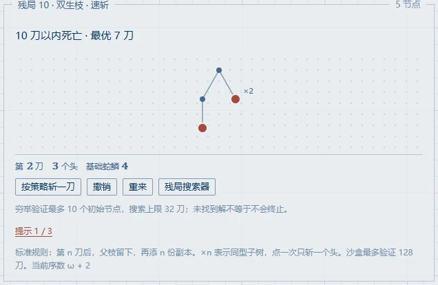

已载入的有效设计示例；对照本纪元规则阅读编辑区、参数和验证入口。 [查看原图](箭塔-全程攻略配图-20261101/原图/intro-44.png)


### 基因晶格：先控制顺序，再控制规模

7×7 晶格的数字砖是 0、1、2、3、ω 及 ε₀ 的有限基本序列砖；横向和纵向算符可切换加、乘、幂。幂优先并向右结合，七行再从上往下相加。列值是预览，不把同一块内容重复计入基因。普通序数算术中 `1+ω=ω`，而 `ω+1>ω`，所以把小行放在大行前面可能整个被吸收。

一个可复现实验是只在第一行放 1、第二行放 ω，其余行为零，比较总和；再交换两行看差异。解锁“自然和”后开启行合计自然和，同样两行可得到 ω+1，顺序不再丢掉小项。这是理解自然和的操作例，不是要求把所有空格都塞满高阶砖。

“按基因孵化”会把总序数变成有限树，最多允许 96 节点；残局搜索器更严格，只穷举最多 10 个初始节点。可比较的公式并不都适合实际孵化。碰到“超过树预算”应缩小系数、深度或行数，不应反复点击等待。再生抑制实验使用修改规则，能观察研究效果，但不能作为标准残局与正式生产证明提交。

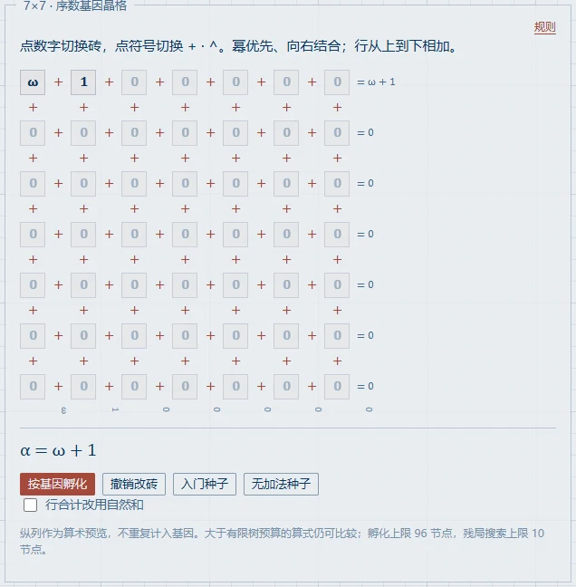

行序、加乘幂与有限 ε 标记共同决定序数输出，不能只按普通数值相加。 [查看原图](箭塔-全程攻略配图-20261101/原图/intro-45.png)


### XI 的采购、生产与自动化

六项研究分别是利刃、毒腺、再生抑制、ε 标记、自然和、蛇蜕，上限不相同：8、8、6、3、1、8。自然和只需一级即可开放对应合计方式；ε 标记开放的是 ε₀[n] 的有限砖，不是把 ε₀ 本体塞进任意有限树。利刃与其他生产研究影响解析生产预算，不会悄悄改变标准残局的判题规则。

先保存一份能完整重放的短斩法，确认其质量与生产，再买便宜的低级研究。想提高永久研究速度，可积累题目星和研究级数；想观察沙盒奖励，则继续比较刀的深度与总斩数。蓝图是按已验斩法解析收割，离线也可继续收获，不需要真的在屏幕上每秒点死成千上万条蛇。

工坊卡的简单组合是“当前可对角化≥1→对角化”和“本纪元秒数≥1→购买最便宜研究”，放不同规则组。解析收割关闭后，空等不会替你执行完整蓝图。若要确认自己改的是生产方案而非沙盒草稿，回主线看活动蓝图名称，不要只看侧边树。

### XI 的挑战、星级与离开检查

四挑战为盲斩、九刀、左撇子、无加法，各三层，累计合规研究分别需要 8、16、24 坐标。挑战不是进场立刻领奖，必须有符合限制的生产蓝图并保持解析收割。九刀挑战要求生产证明 9 刀以内；左撇子要求每一步都是当时最左头；无加法要求非空基因行没有加号，可直接从无加法种子开始。

盲斩只隐藏树形，应通过康托尔范式与策略按钮理解变化，不能因为看不见图就假设头不再生。九刀优先选已知 3–9 刀的小题。左撇子先用根头或简单链，验证整条路径，不是只让第一刀靠左。无加法检查整条非空行里的符号，零块旁边的加号也可能属于行规则的一部分。

XI 标签顺序为 ε_ω、ε_(ω+1)、ε_(ω²)、ε_(ω^ω)、ε_(ε₀)、ε_(ε_(ε₀))、ζ₀。六次对角化到 ζ₀ 后主线完成，XII 入口出现。离开前可以做题补星，但不要求本纪元已全星才能开启 XII；全星会在进 XXI 前成为总门槛。确认活动蓝图、档案星级和备份，再继续下一纪元。

## XII · 定点：用 8×8 布线把目标做出来

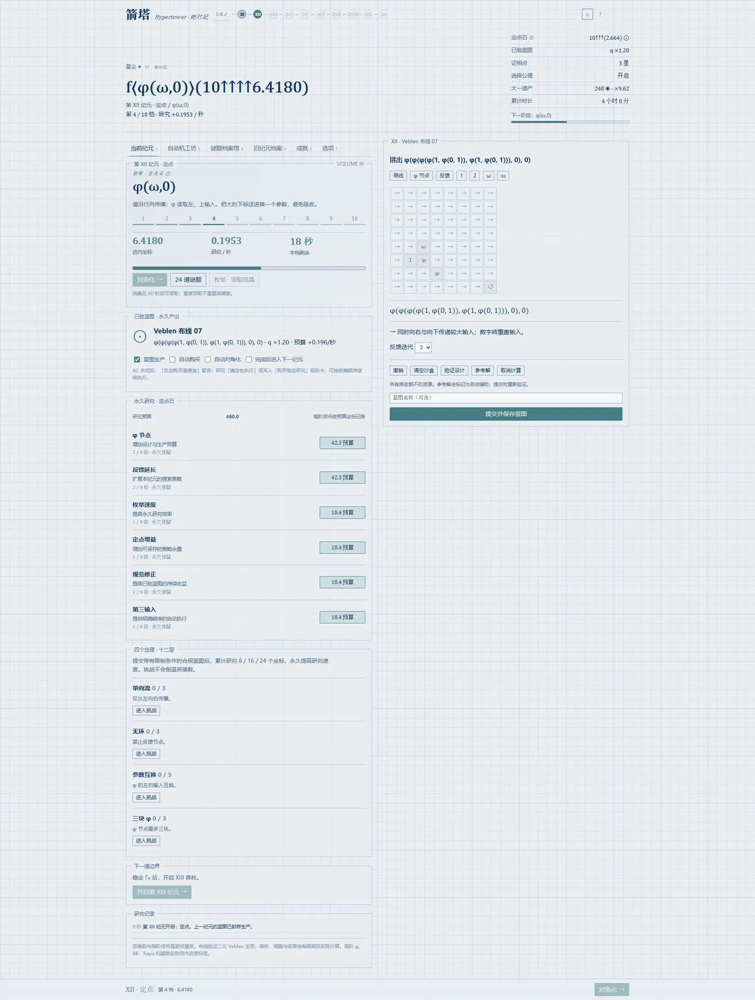

完整亮色界面用于辨认本纪元布局；下方局部配图分别对应具体操作。 [查看原图](箭塔-全程攻略配图-20261101/原图/intro-48.png)


### 刚进 XII 要先看哪三处

先看主线标签是否由 ζ₀ 开始，入门生产是否有效，再去谜题列表读“拼出……”的目标。XII 的布线不是把越大越好当唯一目标，而是要求最终右下输出与本题目标相等。超出目标的巨大公式同样会失败。先从第 01、02 题开始，理解参数方向后再处理嵌套与反馈。

8×8 的行列编号在本攻略都从 1 开始。普通导线同时把左和上两个输入中较大的一个传下去；数字砖直接覆盖输入，φ 节点读取左与上两个参数，默认先左再上。先点调色板选砖，再点网格位置放置；想清除一块时选择导线再覆盖该格，不需要重做整盘。

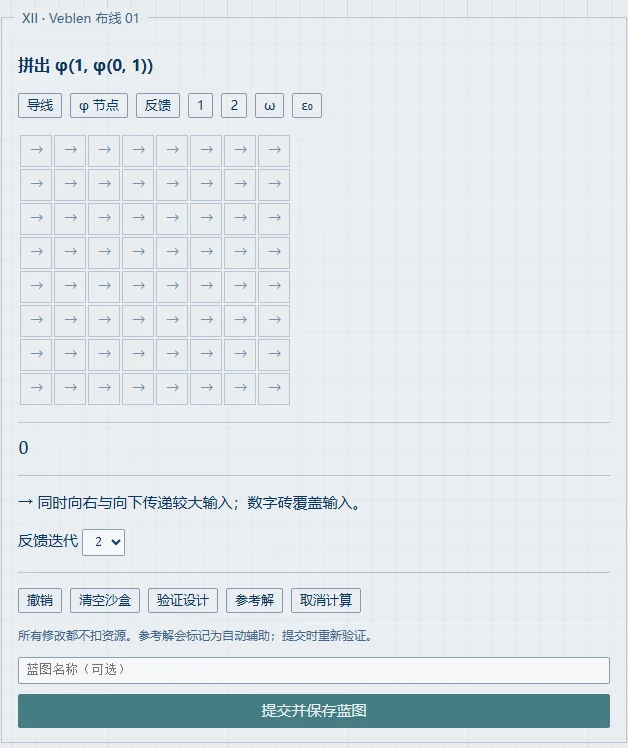

独立演示状态载入本纪元第1题的空白模板，观察目标与输入结构；具体填写步骤见正文。 [查看原图](箭塔-全程攻略配图-20261101/原图/action-puzzle-12-draft-0.png)


### 实例 A：第 01 题的三块布线

从空盘开始，在 r5c3 放 ω，在 r6c2 放 1，在 r6c3 放 φ，其余格保持导线。r6c3 的左输入是 1，上输入是 ω，所以这里产生 φ(1,ω)，即题目显示的 φ(1,φ(0,1))。后续导线把这个结果一直传到 r8c8，点验证设计，应得到目标一致的报告，再提交。

若结果还是 ω，常见原因是 φ 放错格，或在它的下游放了会覆盖输入的数字砖。若结果变成别的嵌套，查看每个 φ 是否同时读到了自己上游的大值。不要只看最近一格的预览，要确认最后输出的位置和本题目标。

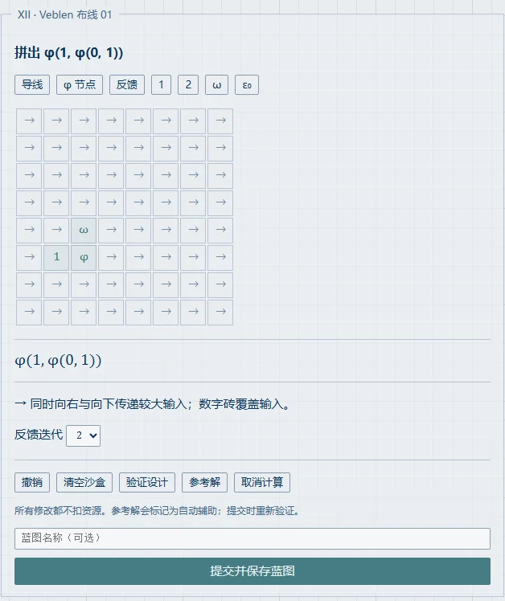

使用本题公开参考构造手动填入并调用标准提交验证；未使用辅助求解标记。 [查看原图](箭塔-全程攻略配图-20261101/原图/action-puzzle-12-submitted-0.png)


### 实例 B：第 02 题只换上输入，不换左右方向

第 02 题可在 r4c4 放 ε₀，在 r5c3 放 1，在 r5c4 放 φ，其余保持导线。这里左参数仍是 1，上参数换为 ε₀，最终为 φ(1,φ(1,0))。两题对照可以练习：决定外层下标的是左侧输入，决定第二个参数的是上侧输入。把两块输入交换不是等价操作。

遇到“φ 被上方不动点吸收”的提示，表示某处节点没有产生你以为的新层级。先检查上方不动点是否已吸收该下标，再尝试调整参数位置。盲目增加更多 φ 往往只会使线路更复杂，并不保证输出更强；本题又是等式目标，先保留最少需要的砖最容易排错。

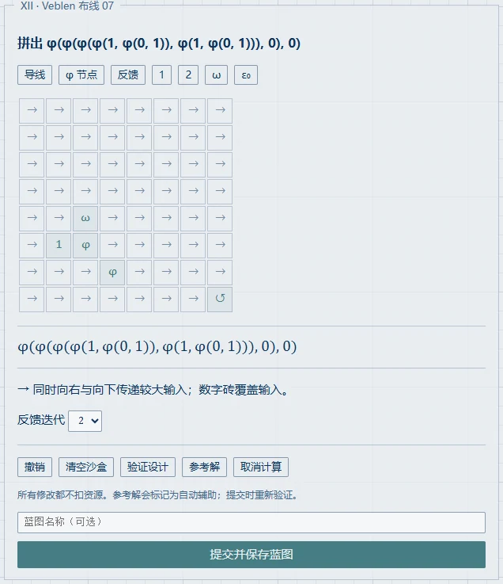

已载入的有效设计示例；对照本纪元规则阅读编辑区、参数和验证入口。 [查看原图](箭塔-全程攻略配图-20261101/原图/intro-50.png)


### 更长布线、反馈与三星的安排

24 题由八组结构和三种变体构成，后面的题会需要不同常数、双 φ 或反馈。反馈迭代可选 1–6，题目参考结构通常用 2；改这个值前先确认目标变化。反馈并不是真正任意循环求定点，而是当前有限模型执行指定次数的变换，攻略不把它当作一般 Veblen 理论的完整求解器。

本纪元的设计得分偏好较少非导线砖并惩罚吸收；减少无用砖可能提高蓝图质量，但先过题比优化质量更重要。手工输入的基准解通常已有可用生产质量。先完成前几题到 24 星附近，随后主线继续推进，空闲时按逐题清单补全。不要为了刷某一张极端质量蓝图而长时间停在零星档案。

### 第 17–24 题的数字 3 缺口与正式共享蓝图路径

当前版本内核允许 `3`，图形调色板却没有对应按钮。因此这些题的本攻略会同时列出数学构型和外部共享答案；不能宣称读者一定能在当前图形编辑器从空盘逐砖手绘。若你希望只用现有按钮，先完成可画出的题，保留该缺口记录；若接受使用攻略共享方案，可以走游戏原有蓝图导入功能。

操作顺序是：先导出自己的当前存档，在工坊蓝图库点“导入蓝图”，粘贴本攻略附带的对应 `HTB5:` 字符串，点“验证并导入”；在 XII 的蓝图库找到“攻略外部共享布线17”等名称，点“载入沙盒”，核对题号、输出和输入构型，再点“验证设计”和“提交并保存蓝图”。只点“用于生产”不会自动补谜题星。

这些文件是攻略作者另行写出的、经过正式内核验证的外部共享设计，并不是把玩家的辅助标记改掉。当前版本导入非自动辅助的共享设计后正常提交会按其来源记录星级，实测该路径可得三星；这不表示读者独立找到了答案。应把“可核验共享答案”和“从空盘独立手解”分开记录。导入时会重算设计，不会导入作者的资源、轮数或成就。

### 四挑战和离开 XII

单向流把导线限制为只读左输入；无环拒绝反馈；参数互换调换 φ 的左、上参数；三块 φ 限制 φ 数量。每次进挑战都先核对题目和实际限制，按限制重新验证、提交挑战蓝图。普通蓝图即使在外面生产很好，也不能自动拿去累计带条件的研究。

研究项目是 φ 节点、反馈延长、枚举速度、定点增益、规范修正、第三输入，全部 6 级上限。初期仍可先便宜铺开，准备无环挑战时不应把希望全放在反馈；参数互换时手动交换输入的位置比增加研究更直接。到 Γ₀ 标记完成后可开启 XIII，线路、蓝图和档案保留为历史。

## XIII · 森林：延长序列靠“避免旧树嵌入新树”

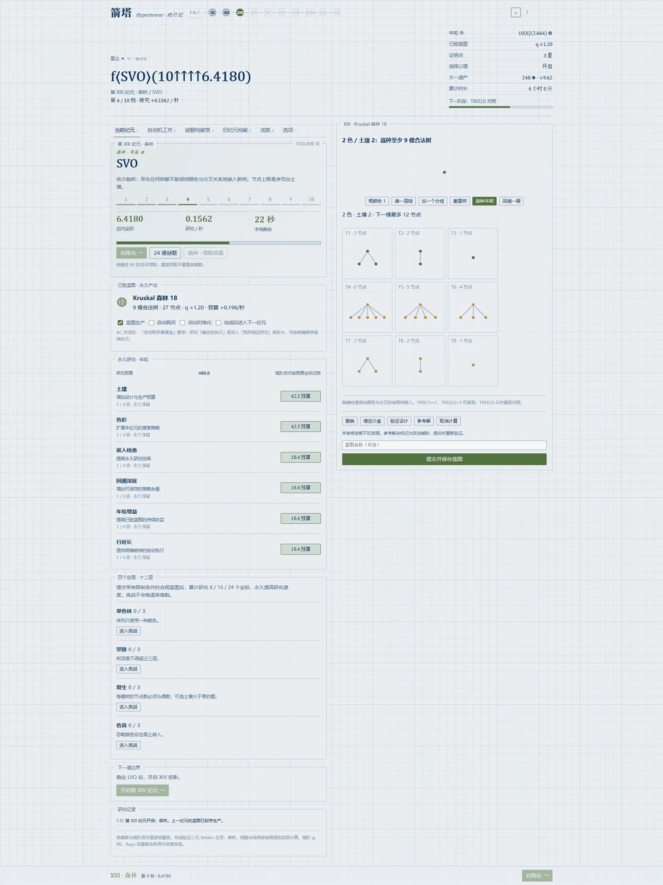

完整亮色界面用于辨认本纪元布局；下方局部配图分别对应具体操作。 [查看原图](箭塔-全程攻略配图-20261101/原图/intro-53.png)


### 不要把树越大误当作森林越强

XIII 的目标是依次栽种一串合法有色树。第 i 棵树的节点上限为 i 加土壤，且任意较早的树都不能按保持颜色与分叉关系的方式嵌入新树。颜色不只是外观；同色的一个叶子通常可以嵌入后面任何含该色的节点。第一次放下一颗某色叶子，实际上可能封死后续同色树的很多选择。

进入后先看本题颜色数、土壤和要求的树数，再设计第一棵。树编辑器的“根颜色”只改根，不会把既有子孙一并染色；想造整棵同色链，先重置为单叶、选好颜色，再接链。已经栽下的树是序列的一部分，编辑器里另做一棵树不会自动替换它；修改错误可用回溯一棵。


独立演示状态载入本纪元第1题的空白模板，观察目标与输入结构；具体填写步骤见正文。 [查看原图](箭塔-全程攻略配图-20261101/原图/action-puzzle-13-draft-0.png)


### 实例 A：一色、土壤 0 的第 01 题

第一棵最多 1 节点，所以只能放一颗色 1 的叶子。栽种后便达到本题要求的一棵树，可以验证、提交。试着再放同色更大的树，会因为第一棵叶子嵌入它而被拒绝；这个失败本身解释了 TREE(1)=1 的有限例子。不要把拒绝理解成土壤不足，节点够也不能违反嵌入限制。


使用本题公开参考构造手动填入并调用标准提交验证；未使用辅助求解标记。 [查看原图](箭塔-全程攻略配图-20261101/原图/action-puzzle-13-submitted-0.png)


### 实例 B：两色、土壤 0 的第 02 题

依次放“色 1 叶子→色 2 的二节点链→色 2 叶子”。具体点击是：重置树后保留色 1 单叶并栽种；重置树、把根颜色切到色 2、点一次接一层链，再栽种；再次重置、把根颜色切到色 2，保留单叶并栽种。总计三棵。

第一棵色 1 叶子不能嵌入后两棵全色 2 树；第二棵二节点链不能嵌入最后只有一个节点的叶子，所以序列合法。反过来先放色 2 叶子再放色 2 链就不合法。这是一个应按顺序亲自操作的例子，不能只比较最终三棵树的集合。

### 三色题和土壤题的扩展方法

三色起步可以按分段降规模的思路：先处理色 1，再处理色 2 的长到短序列，最后处理色 3 的更长到短序列。后附 24 题清单会给出每一棵的颜色、链或分枝形状。土壤改变每一步允许的节点数，但并不免除全历史嵌入检查；同一组颜色在不同土壤下的合法起始树不同，应先读题再复用方案。

对于全同色树，链和星形分枝的嵌入关系不同，不能只用节点数判断等价。报错“第 j 棵可嵌入第 i 棵”时，先找到旧树 j，检查颜色和分叉，再决定缩短当前树、换颜色还是回溯旧步骤。删除当前最后一棵通常比清空整段森林节省时间。


已载入的有效设计示例；对照本纪元规则阅读编辑区、参数和验证入口。 [查看原图](箭塔-全程攻略配图-20261101/原图/intro-55.png)


### 实际编辑、得分与生产优化

森林每次栽种都会即时验证，所以非法树不会悄悄进到序列里。当前树上限 40 节点，完整验证有 96 棵、累计 4096 节点等有限预算；这些是计算范围，不能靠多等一会绕过。TREE(3) 的名称只是量级对照，不表示界面会实际穷举真实 TREE(3) 的全部序列。

本纪元得分主要看合法树数。达到题目目标后继续延长可能改善蓝图质量，但应先确认新增树合法，再提交一个可复现的更长版本。不要把颜色和土壤改成别题参数来提高分数；验证器要求与当前题目的参数一致。生产方面先确保活动蓝图是本纪元且符合当前挑战，再使用年轮购买研究。

### XIII 挑战怎样挑题

单色林要求整段实际使用一种颜色，优先选择本来就是一色的题。禁链挑战限制树深不超过 3，长链方案需要换成适当的浅分枝结构，不能把“链这个按钮不准按”当作准确规则。双生要求每棵都是偶数节点，并且特殊目标至少一棵；土壤 0 的第一棵最多一节点，天然不适合这个目标，应选土壤至少 1 的题。

色盲挑战忽略颜色后做嵌入检查，所以普通的“换一种颜色重新开始”策略会失效。此时先按无色形状重新规划，若给定参考结构不合规，换题比不断点参考解更有效。四挑战每项三层，取得合规方案后还要累计对应的 8/16/24 研究坐标才结算。

研究名称为土壤、色彩、嵌入检查、回溯深度、年轮增益、行延长。不要把研究名当作可以修改固定谜题条件的许可证；本题颜色、土壤仍按题目检查。到 LVO 完成后开启 XIV，森林历史成为投影基底的一部分。

## XIV · 投影：先把有限多项式排对，再做标签树实验


完整亮色界面用于辨认本纪元布局；下方局部配图分别对应具体操作。 [查看原图](箭塔-全程攻略配图-20261101/原图/intro-58.png)


### 这关首先是在比什么

XIV 主要谜题比较投影之前的有限 Ω 多项式。每张牌可以按最高 Ω 次数、该次数系数、下一低次数系数依次比较。这与比较任意 Buchholz ψ 表达式不是同一个任务；当前界面明确没有实现一般 ψ 规范形算法。策略应针对实际六张牌排序，不要依靠某个“看起来更高级”的符号名称猜顺序。

进入本题先把六张牌从上到下临时记为原位 1–6，读完整多项式，再用上移、下移改变当前次序。攻略答案里的“3→5→4…”指原始牌身份，而不是每点一次后重新把最上牌叫 1。要么手写一列原位编号，要么直接按多项式值核对。


独立演示状态载入本纪元第1题的空白模板，观察目标与输入结构；具体填写步骤见正文。 [查看原图](箭塔-全程攻略配图-20261101/原图/action-puzzle-14-draft-0.png)


### 实例 A：第 01 题的完整顺序

六张牌的正确值顺序是 `1 < 2 < Ω < Ω·2 < Ω² < Ω²·2`，对应原位 `3→5→4→2→1→6`。先把常数 1 移到最前，再放常数 2，接着排 Ω 的两个系数，最后排 Ω² 的两个系数。点验证设计，应显示顺序正确、得分 6；再提交才能记录星级。

若提示“第 2 对顺序颠倒”，它指相邻检查中的某一对，不是第二张牌必定错。回到相邻两张，找最高不同次数进行比较。不能因为 Ω² 的系数只有 1 就把它放在 Ω·2 之前；最高次数先于较低次数系数。


使用本题公开参考构造手动填入并调用标准提交验证；未使用辅助求解标记。 [查看原图](箭塔-全程攻略配图-20261101/原图/action-puzzle-14-submitted-0.png)


### 实例 B：第 02 题把同一比较法抬高一阶

第 02 题的正确原位顺序是 `6→2→4→3→5→1`，对应 `Ω < Ω·2 < Ω² < Ω²·2 < Ω³ < Ω³·2`。这里没有常数 1 与 2 独立当牌，比较方法却完全相同。先分最高次数，再排同次系数，避免把第 01 题的牌编号照抄到新题。

24 道当前排序题的牌值均明确，正常从小到大排序得到唯一的排列；不能把对同一组不同牌顺序的失败尝试当作不同合法解刷简并。后续群星纪档案中 XIV 的不同解计数应遵守这一事实，而不是因为存在 6! 种排列就声称有 720 份正确构型。


已载入的有效设计示例；对照本纪元规则阅读编辑区、参数和验证入口。 [查看原图](箭塔-全程攻略配图-20261101/原图/intro-60.png)


### 标签斩首实验的正确使用

展开“有限标签斩首实验”，先读树上的先序标签。点“斩最右叶”时，正整数标签先减一；ω 标签按当前刀数展开为 n+1；零标签才按当前有限树再生规则删除与复制，副本最多八份。这是一个独立的有限实验，不会自动替你完成六张牌的排序目标。

可先重置实验，看初始标签 0、1、0。每按一次只观察最右叶发生的变化，记录标签和节点数；不要连续乱点后再猜发生了什么。若已经没有头，按钮会报告结束；这不是当前多项式排序题自动提交的信号。把“标签实验运行成功”和“谜题验证通过”分开检查。

### 投影基底、研究与四挑战

普通情况下 XI–XIII 已提交证明会给主线有限的基底速度增益，最多约 20%；无根基挑战取消这部分。若你之前每纪元只保留入门方案也能继续推进，但补做一些实际提交会留下可利用的历史。不要为了刷提交次数无限重复同一题：攻略更建议先补不同题目和全星目标。

六研究是 Ω 下标、投影效率、基底共振、标签抑制、碎片增益、比较器。挑战为无根基、单下标、ω 禁令、倒读；倒读实际把排序方向改为从大到小，普通正确序列需要完整反转。当前排序提交未把单下标、ω 禁令的文案完整接入额外核验；正确普通排序仍可通过这两项。不要在固定六牌编辑器里寻找不存在的删牌功能；后面的挑战实操会区分规则描述与已执行检查。

验证器对有限多项式比较是精确的，输出“顺序错误”时先检查当前六牌身份；对未实现的一般 ψ 算法则不提供假精确答案。到 TFBO 完成后开启 XV。离开前记录一张正常排序蓝图，之后要做倒读挑战再专门保留对应挑战方案。

## XV · 元胞：把“看起来稳定”换成完整配置证据


完整亮色界面用于辨认本纪元布局；下方局部配图分别对应具体操作。 [查看原图](箭塔-全程攻略配图-20261101/原图/intro-64.png)


### 先读规则、初始预算、验证代数和目标

每道生命题同时规定生命规则、最多初始细胞数、检查的代数以及结果要求。有些要求留下足够细胞，有些要求全部消亡，另一些同时要求周期。题目目标不是“随便活得久”。同一个滑翔机在不同规则或不同检查代数下可能不能直接交题。

编辑网格中行列从左上开始；点空格点亮，点活细胞熄灭，活细胞数不能超过本题初始预算。种子框研究达到不同等级会把可视编辑区由 9 扩到 12 或 16，但模拟本身使用稀疏无限平面，普通题不是让边界把细胞吃掉的有限棋盘。环面挑战才切到 32×32 环面规则。


独立演示状态载入本纪元第1题的空白模板，观察目标与输入结构；具体填写步骤见正文。 [查看原图](箭塔-全程攻略配图-20261101/原图/action-puzzle-15-draft-0.png)


### 实例 A：方块与闪烁，分别验证周期 1 和 2

第 01 题在 r1c1、r1c2、r2c1、r2c2 放四细胞方块，规则 B3/S23，提交代数保持 40。方块每代相同，最后存活 4、周期 1、平移 0。可先点“运行实验”看结果，再点“验证设计”，确认本题要求，最后提交。

第 02 题用 r1c1、r1c2、r1c3 三细胞横线，40 代后仍有 3 个细胞，完整形状在水平和垂直间切换，周期 2、平移 0。不要因为它每代变化就判为“不稳定”，本题要的是周期。也不要把方块复制进第二题：细胞数上限是 3，四细胞方案会在编辑或验证时被拒绝。


使用本题公开参考构造手动填入并调用标准提交验证；未使用辅助求解标记。 [查看原图](箭塔-全程攻略配图-20261101/原图/action-puzzle-15-submitted-0.png)


### 实例 B：滑翔机的周期与平移是两件事

第 03 题可点亮 r1c2、r2c3、r3c1、r3c2、r3c3 五格，B3/S23、40 代。滑翔机在归一到相对坐标后每 4 代重复，平移向量为 (1,1)。因此报告会同时显示周期 4 和非零平移。只看绝对屏幕位置会觉得它一直变，正确比较方式应包括整体平移。

“运行实验”输入框可以临时用 32 代做展示，32 代后这只滑翔机仍是 5 细胞并验证周期与平移；但正式第 03 题提交所需代数仍是题目规定的 40。运行按钮的临时观察参数与保存在设计里的题目验证参数不要混淆。


实际运行 32 代后，结果记录为 5 细胞、周期 4、平移 (1,1)。 [查看原图](箭塔-全程攻略配图-20261101/原图/intro-67.png)


### R 五格、橡子、顽固者和 HighLife 怎么安排

先做可预测的方块、闪烁、滑翔机，再研究 R 五格、橡子和顽固者。后几种种子会经历较长暂态；报告“尚未证明稳定”不等于模拟没有执行，只表示预算内尚未得到完整归一配置重复的证据。只看到某个局部振荡器不能推断整张无限平面已经稳定。

顽固者题可能要求 140 代后全部消亡，不能凭前几十代仍活着就断定失败；也不能把全灭目标当作“细胞越多越好”。HighLife 复制种子使用 B36/S23，在普通 B3/S23 下运行不是同一道实验。当前快捷按钮列出多种常见种子，但不是所有题的所有变换都在快捷按钮中，必要时按逐题坐标手动摆放。

### 实验预算与常见误会

普通细胞实验最多 8192 代、活细胞预算 20000。超过预算是未完成该次有限模拟，不是证明不存在更长行为。周期检测对完整归一配置进行比对，并在可处理的细胞规模内保存历史，不能把局部截图相似当作已经证明周期。

随机汤搜索会保留一次实验结果，并不自动把最佳种子替换成已提交生产蓝图。若正在追求某题三星，先把固定种子复现准确，再考虑汤搜索。每次搜索都要看当前题目的初始细胞预算，找到一个很热闹但超预算的汤并没有帮你过题。

### XV 挑战与离开前检查

无滑翔机要求没有平移型周期，方块和闪烁通常更适合作为起步题；环面按 32×32 处理邻居；对称要求种子关于左右轴对称，普通滑翔机不满足；限时要求在前 100 代内得到完整周期证据。四项各三层，选择题目时让本来结构就契合挑战，不要对任何题都强行用同一只滑翔机。

研究为种子框、细胞预算、代速、滑翔收集、稳定检测、HighLife。先满足编辑需求和基础研究，再比较生产收益。到 Loader 对照完成后进入 XVI，细胞实验留在历史。离开前至少能解释自己的报告中 population、period、shift、extinct 分别指什么，之后简并整数签名也会重新用到这些实际记录。

## XVI · 图灵：先重放一台六步机器，再碰枚举与长程序


完整亮色界面用于辨认本纪元布局；下方局部配图分别对应具体操作。 [查看原图](箭塔-全程攻略配图-20261101/原图/intro-70.png)


### 正确读一格转移表

`1RB` 表示写入 1、读写头向右移动、下一状态 B；`0LA` 表示写入 0、向左移动、回到 A；末字符 H 表示停机。表按状态逐行、读入符号逐列，不能把“下一状态”当作这格正在读取的符号。普通谜题指定二符号和状态数，必须与题目匹配。

机器从空白纸带、A 态开始运行。合法表要求恰好一个 H 转移格，其余跳转必须落在现有状态内。界面对每次单格编辑即时校验，所以想把唯一的 H 从一个格搬去另一格时，可能在中途触发“0 个 H”或“2 个 H”的拒绝。比较安全的操作是先用整张冠军预设载入合法表，再改方向等不改变 H 数量的字段。


独立演示状态载入本纪元第1题的空白模板，观察目标与输入结构；具体填写步骤见正文。 [查看原图](箭塔-全程攻略配图-20261101/原图/action-puzzle-16-draft-0.png)


### 实例 A：BB(2) 的六步四个 1

选第 01 题，点 BB(2) 冠军，核对 A读0=1RB、A读1=1LB、B读0=1LA、B读1=1RH。运行预算至少为 6，第一次可保留 100 或 1000 的宽裕预算；点运行机器，应看到实际停机 6 步、纸带有 4 个 1。

若想手动跟踪，第一步从 A读0 写 1 向右到 B，第二步 B读0 写 1 向左到 A；之后必须按当前读到的纸带值选列，不能每步都用读0列。六步停机后先看结果，再做题目验证与提交。纪录墙显示一次实跑，不会自动替代谜题星级提交。


实际运行得到 6 步停机、4 个 1；停机证据来自模拟结果。 [查看原图](箭塔-全程攻略配图-20261101/原图/intro-73.png)


使用本题公开参考构造手动填入并调用标准提交验证；未使用辅助求解标记。 [查看原图](箭塔-全程攻略配图-20261101/原图/action-puzzle-16-submitted-0.png)


### 实例 B：BB(3) 与镜像方向

第 02 题使用三状态表，点 BB(3) 冠军载入，核对 `1RB / 1RH / 1LB / 0RC / 1LC / 1LA`。这台机器从空白纸带跑 21 步停机、留下 5 个 1。这里不要从默认空表逐格搬 H；整表预设同时满足状态数、唯一停机格和正确表长。

在镜像变体中，把所有 L 与 R 交换而保留写入和下一状态，得到左右镜像程序。每个转移都要交换，不能只把第一格改成向左。镜像不改变该实跑的步数与 1 数，但对应纸带位置会镜像。普通题是否要求镜像看当前题目/挑战，不能把方向不同自动认作程序错误。

### BB(4)、BB(5) 与预算分层

给定四状态冠军可实际重放为 107 步、13 个 1，五状态给定程序是 47,176,870 步、4098 个 1。长程序运行需要较大步数预算，可能持续占用计算任务；先用短程序确认功能，再决定是否运行五状态演示。实际重放给定程序的结果，不等于解决任意程序的停机性。

机器达到预算仍未停机时，报告是“预算内未判定”，不会自动判为不终止，也不会产生停机证明的正收益。可按需要提高预算、留入未判定池，或者在 XVII 用适当证书判定。对一个未知程序反复给更大预算也可能一直未知，攻略不提供“任何机器最多多少步必定出答案”的承诺。

### 有界枚举怎样用才不会空忙

“枚举下一批二状态/三状态”分批测试规范机器，约去状态重命名和左右镜像，显示游标、已测试数、停机数和当前纪录。游标是遍历进展，不是已解决全部程序的数量。未知机器会保留到池中；同样一个机器没有因为出现多次就变成新的数学证明。

先运行一批二状态，查看是否出现实际停机记录与未判定项，然后保存。不要在没有明确目标时连续启动大量三状态批次，忽略主线和资源。计算过程中可取消；取消后的结果不应当作已完成验证提交。若界面显示任务繁忙，先等结束或取消当前任务，再发下一次。

### XVI 四挑战、研究与出口

只写 1 要求所有表格首字符为 1，某些冠军含 0 的转移并不适合；镜像程序要求首步向左，并应完整镜像；盲停的面板描述为隐藏停机提示，当前机器表仍可见 H；真正的合法表规则不变；限步把预算限制到 50，107 步的四状态程序天然不适合，应选 6 步或 21 步题。

研究为状态扩展、符号扩展、步数预算、宏预算、纸带增益、冠军库。三符号遗产或元公理可能提供三符号实验起步，但固定二符号谜题仍检查二符号机器；遇到“状态数或符号数与题目不符”，重新加载当前题或正确冠军预设，而不是继续增大预算。

主线到 BB(h) 完成后开启 XVII，未判定池会作为下一纪元起点的一部分。离开前导出有价值的机器蓝图，记下哪些是实际停机、哪些只是预算耗尽，不能把它们混成同一种纪录。

## XVII · 谕示：把非停机结论装进可重放的证书


完整亮色界面用于辨认本纪元布局；下方局部配图分别对应具体操作。 [查看原图](箭塔-全程攻略配图-20261101/原图/intro-76.png)


### 这关证明什么、不证明什么

XVI 的预算耗尽只说明未判定；XVII 要求一份具体证书，例如完整配置循环或按指定平移量重复。证书比较机器状态、读写头相对位置和全部非零纸带格，不能只看局部纸带窗口重复，也不能只看同一状态再次出现。证书必须对应当前题目给定的机器，不能拿另一台好证机器替换题目。

刚进入先选第 01 题，保留题目转移表，读起点、周期、平移三个输入。起点是先实际运行多少步后取第一份配置；周期是再运行多少步后取第二份；平移是读写头在这两次配置间的位移。最后两份配置相对头位置一致，且位移与填写一致，才是可重放证明。


独立演示状态载入本纪元第1题的空白模板，观察目标与输入结构；具体填写步骤见正文。 [查看原图](箭塔-全程攻略配图-20261101/原图/action-puzzle-17-draft-0.png)


### 实例 A：原地往返，起点 0、周期 2、平移 0

第 01 题表为 `0RB / 1RH / 0LA / 1LB`。从全空纸带开始，A读0向右到B，B读0向左回A，纸带仍全空，头回原处。填起点 0、周期 2、平移 0，然后验证设计。

验证通过后提交，证书存入蓝图并可重放。这里虽然转移表包含 H 格，但从当前空白轨道并未访问到它；“表里有一个 H”不等于所有轨道最终都会停机。反过来，看到 A 再次出现也不够，必须同时核对纸带与头位置。


使用本题公开参考构造手动填入并调用标准提交验证；未使用辅助求解标记。 [查看原图](箭塔-全程攻略配图-20261101/原图/action-puzzle-17-submitted-0.png)


### 实例 B：向右漂移，周期 2、平移 2

第 02 题表为 `0RB / 1RH / 0RA / 1LB`。从 A读0向右到B，再由B读0向右回A，纸带仍全空，头比起点右移两格。正确填写起点 0、周期 2、平移 2。若误填平移 0，完整重放会拒绝；这不是计算太慢，而是证书断言不对。

第 03 题有三状态，类似轨道每 3 步向右平移 3。后续变体把起点改为 1 或 2，仍需从头重放到那个起点，不能把起点字段当作无关装饰。攻略的逐题表会给出每个具体三元组。


已点击验证设计，结果确认非停机证书逐步重放通过。 [查看原图](箭塔-全程攻略配图-20261101/原图/intro-79.png)


### 判定流水线与顺序

静态可达性检查所有符号读入形成的上界图：若连这个图里都到不了 H，就可得到可靠的不可达证据；若图里能到 H，只表示该方法未能判定，不说明实际轨道会到 H。完整配置循环检查绝对位置与整张非零纸带；平移循环允许整体平移；空白漂移适合在空纸带上重复移动；有限实际运行可发现真正停机。

拖动或用上下按钮调整模块顺序，目的是让便宜、适合当前机器的方法先试。对已知空白漂移机，平移循环可能很直接；对显然停机机，有限实际运行有意义。流水线成本与模块、步数有关，不能因为模块更多就保证更强结论。结果仍可能是 unknown。

证书输入的起点为 0–10000、周期为 1–10000、平移为 −10000 到 10000，起点加周期有总重放预算。超出范围应缩小证明或换方法，不应填一个极大数字期待界面替你做无限计算。验证失败时先核对题号和三个输入，再看完整纸带与机器是否一致。

### 未判定池的逐台处理

点“从 XVI 载入未判定池”后，逐台运行当前流水线。只有真实停机或得到已验证非停机证据的机器才移出未知池；仍未知的机器继续保留。判定成功可记录证书与对应资源，但池子的大小变小不等于一般停机问题被解决。

不要在换机器后继续沿用上一题证书。若载入池中机器的表与当前固定谜题不同，可以做分类实验，却不一定能提交当前谜题。实验工具与题目目标仍然分开。长计算可取消，重新导入存档或换纪元后在途旧结果不应应用到新状态。

### XVII 四挑战、研究与离开

无循环禁用零平移证书，所以第 01 题不适合，选平移题更直接；半图的规则文案指向部分纸带预览，当前实际显示以页面为准，完整证据要求不降低；低算力把判定预算降到十分之一；谕示失效限制可用证据方式，仍需用能重放的有限证书。别把“看不见”或“方法禁用”理解成验证器允许较弱的证明。

研究为判定模块、计算预算、证书模板、谕示层数、谕片增益、宏判定。先保存短且可信的证书作生产，再优化流水线。主线到 Rayo 对照完成后开启 XVIII；该标签是游戏进度的量级名，不表示真的枚举了任意 Rayo 定义。离开前应能清楚区分 halted、nonhalting、unknown 三种结果。

## XVIII · 强迫：相容命题和 24 条覆盖条件要一起完成


完整亮色界面用于辨认本纪元布局；下方局部配图分别对应具体操作。 [查看原图](箭塔-全程攻略配图-20261101/原图/intro-82.png)


### 首先把“宇宙”分成两半看

上半部分是命题勾选与蕴含闭包，下半部分是 8×8 的有限条件网与 24 条覆盖约束。命题相容不等于覆盖已经完成，覆盖 24/24 也不能救一组矛盾命题。提交前必须同时通过这两类检查。

普通导向下一纪元的稳妥起步是 MA+¬CH。V=L 可以给当前研究收益，但闭包包含 CH，后面会与可测基数阶段发生冲突；它不是无代价的永久最优预设。PFA 在首次 XVIII 阶段还有后续研究解锁限制，不能仅因为命题框可见就假设已经可用。

### 命题闭包与冲突速查

| 选择或组合 | 当前模型里的结果 | 实际游玩判断 |
| --- | --- | --- |
| V=L | 推出 GCH、◇，进一步推出 CH | 可用于对应题；过 XIX 可测阶段前须处理冲突 |
| ◇ | 推出 CH | 不能再和 ¬CH 直接同选 |
| PFA | 推出 MA、连续统=ℵ₂，继而 ¬CH | 初始有后续研究解锁条件 |
| MA+¬CH | 相容的开放宇宙方案 | 满足 XIX 入口的命题方向 |
| CH+¬CH | 矛盾 | 先改勾选，填更多格子无效 |
| V=L+可测基数 | 矛盾 | 不要把两者一同封存成遗产 |

相容性检查依据的是当前有限游戏模型列出的规则，不是替任意集合论理论提供一致性证明。攻略只用这些已实现规则来指导操作。看闭包时，区分自己勾的显式命题和自动推出的命题；没有直接勾 CH，也可能因 V=L 或 ◇ 而含 CH。


独立演示状态载入本纪元第1题的空白模板，观察目标与输入结构；具体填写步骤见正文。 [查看原图](箭塔-全程攻略配图-20261101/原图/action-puzzle-18-draft-0.png)


### 实例 A：第 01 题，十格覆盖 24 条

先选 MA 与 ¬CH，保持其他命题不选。清空条件网后依次填：r1c5=0、r1c8=1、r2c4=1、r3c4=1、r3c6=1、r3c8=1、r4c8=1、r5c5=0、r6c4=0、r7c1=0。其余格保持未填。每次先选“填 0”或“填 1”模式，再点对应空格。

完成后检查 24 条条件全部打勾、闭包相容，再验证、提交。这里十个填格能覆盖 24 条，不是因为忽略了条件，而是一个格可以同时命中多条“或”约束。全盘填满不是目标；填得少且正确通常更便于检查，也可能提高设计分数。


使用本题公开参考构造手动填入并调用标准提交验证；未使用辅助求解标记。 [查看原图](箭塔-全程攻略配图-20261101/原图/action-puzzle-18-submitted-0.png)


### 实例 B：第 02 题用 V=L，但不要把它当进 XIX 的方案

第 02 题可以选 V=L，并按该题自己的种子网填格：r1c6=0、r2c1=1、r2c2=0、r2c5=1、r2c7=0、r3c3=1、r5c1=1、r6c1=1、r7c4=1、r8c5=0。验证可得到相容和全部覆盖，这是这道题的合法解。

然而想进入 XIX，最终应重新提交一份满足 MA 与 ¬CH 的宇宙，例如回第 01 题按上面的方案提交。换题后只是编辑草稿，真正生效的 universe 要由提交写入。若主线完成却没有入口，先确认最近一次正式提交的宇宙，而不是只看当前勾选框临时草稿。


已载入的有效设计示例；对照本纪元规则阅读编辑区、参数和验证入口。 [查看原图](箭塔-全程攻略配图-20261101/原图/intro-84.png)


### 手动解新覆盖题的方法

读每条约束里列出的“r行c列=位值 或 …”，从当前尚未满足的条件开始，寻找能同时命中较多条件的空格与位值。填一个格后重看打勾数量，不要按上一题网格复制：每道题的 seed 不同，约束也不同。一个格一旦填入便不能直接覆盖，误填用撤销或清空沙盒。

先做最有把握的共享位置，再处理剩余条件；不要在不确定的早期把 64 格全占满，留下互相冲突的选择。攻略逐题清单给出每道题一份实际核验的覆盖方案，读者可以逐格复现并对照完成数。它不是对无限稠密集构造泛型滤子的承诺。

### XVIII 挑战、资源与真正出口

极小宇宙要求只选一条显式命题；相容边缘要求相对当前命题表达到极大相容，不能简单用“勾得越多越好”；盲强迫逐步揭示未满足约束；V=L 囚笼要求闭包含 V=L。挑战有不同目标，先选适配题目与命题，再提交带挑战标记的蓝图。

研究为命题研究、蕴含视图、约束预览、泛型增益、宇宙预设、相容检查。主线完成只是出口的一半：XVIII→XIX 还检查已提交宇宙 coverage≥24、相容，且闭包含 MA 与 ¬CH。最后核对一次 MA+¬CH、24/24、提交成功记录，再点击 XIX 入口。

## XIX · 基数：先准备确定性路线，再关闭 AC 越墙


完整亮色界面用于辨认本纪元布局；下方局部配图分别对应具体操作。 [查看原图](箭塔-全程攻略配图-20261101/原图/intro-87.png)


### 进入 XIX 后的第一份清单

确认 XVIII 已正式提交 MA+¬CH、覆盖 24/24，再进入 XIX。此时会形成来自 XI–XVIII 的八层快照；反射沙盒只能引用本层或更低层来源，不能把后面的层塞到前面制造递归放大。首先完成一些普通反射题、保存明确蓝图，然后安排确定性购买与推进，最后再处理 AC 关闭。

主线标签依次为不可达、Mahlo、弱紧、可测、强、Woodin、超紧、可扩、巨大、I3、I1、I0、Reinhardt、Berkeley。到弱紧以后若宇宙仍含 V=L，会在前往可测方向被阻挡；到 I0 后要进入 Reinhardt，又必须关闭选择公理。这两道墙是不同原因，不能只处理其中一项。


独立演示状态载入本纪元第1题的空白模板，观察目标与输入结构；具体填写步骤见正文。 [查看原图](箭塔-全程攻略配图-20261101/原图/action-puzzle-19-draft-0.png)


### 实例 A：八层各反射自己，临界点 0

第 01 题先让八个反射层依次选本层来源：第 1 层反射第 1 层，……，第 8 层反射第 8 层。临界点 κ 输入 0，AC 保持当前允许状态。基准得分为 61，达到题目要求的 55。点验证，确认没有“只能反射本层或更低层”的错误，再提交。

分数由各来源贡献、临界点以上的放大以及不同来源奖励组成；用八种来源比盲目把所有高层都选成同一种来源更易得到可靠基准。输入 κ 是 0–7 的内部层级值，报告里也可能对应 XI 起的纪元位置，不要把纪元 XIX 的数字 19直接填进去。


使用本题公开参考构造手动填入并调用标准提交验证；未使用辅助求解标记。 [查看原图](箭塔-全程攻略配图-20261101/原图/action-puzzle-19-submitted-0.png)


### 实例 B：只改临界点，观察放大覆盖和倍率的取舍

第 02 题仍用八层各反射自己，κ 改为 1；第 03 题用 κ=2。每次看验证得分怎样变化。较后的临界点放大倍率更高，却覆盖更少楼层，因此不是“κ越大永远越好”。保留达到当前目标的合法方案，再做更多比较，不必在首次推进中寻找全局最优。

后八题明确要求 AC 关闭，前十六题没有硬要求 AC 必须开启；若已越墙，普通题仍可保留 AC=false 手工补做。参考解按钮此时停用是自动选择限制，不表示所有旧题答案都失效。不要为了补普通题贸然使用开发者回退丢掉后续进度。


已载入的有效设计示例；对照本纪元规则阅读编辑区、参数和验证入口。 [查看原图](箭塔-全程攻略配图-20261101/原图/intro-89.png)


### 关闭 AC 前先把自动化写明确

AC 开启时，“购买最便宜研究”、自动求解、自动挑选等选择类动作可以运行。关闭后，这些泛化选择动作会暂停；加载指定蓝图、购买指定研究、对角化等确定性操作仍有可用路径。进入前先在工坊保存至少一组明确规则，逐张写好纪元范围、传感器、阈值、动作、指定研究或蓝图、规则组和冷却。

一个简单起步组合是：当前纪元秒数≥1，购买指定研究第 5 项；可对角化≥1，对角化；当前纪元秒数≥60，进入下一纪元。它是“添加当前纪元固定策略”按钮的基础结构，需要三个空槽。各动作放不同组，避免同组靠前规则截住后面的推进动作。研究第 5 项在编辑器编号是 0–5 中的 5，界面读作第六项。

自动购买在 AC 关闭后还可以通过本纪元确定性执行研究、fixed 遗产或对应元公理获得固定顺序执行。不要因为开关仍勾选就断定“购买最便宜”继续工作；看预算是否被实际消费、研究等级是否变化。先用少量时间验证规则，再开始长离线。

### 显式关闭、越墙与撤回边界

在 I0 之前导出一份存档，确认固定蓝图生产与规则可用，再关闭 AC。主线达到 I0 第十档坐标 10 时，可以对角化进入 Reinhardt；越过后不能在普通流程重新开启 AC。继续到 Berkeley 完成，XX 的入口同时检查 XIX 已完成和 AC 关闭。

开发者工具提供“撤回关闭 AC”或旧档“恢复 AC”。有本机关闭前快照时，会恢复关闭前整份状态；没有快照的旧档则恢复 AC，并把越墙后的阶段退回 XIX·I0，若已到 XX还会清除本轮 XX 状态。它不是在保留全部后续进度的同时免费打开 AC。

快照与开发者回退备份存于当前浏览器，不包含在普通导出的 HT5 存档中；换电脑、清浏览器或换来源打开，不应假定快照还在。回退后会暂停工坊与自动推进，需要读完界面说明再重开。它是纠错与开发辅助，正常攻略优先使用自己导出的明确存档点，不靠回退绕过关卡约束。


隔离演示进度展示选择公理仍开启时的研究面板；关闭前先保存备份。 [查看原图](箭塔-全程攻略配图-20261101/原图/action-ac-before-0.png)


在同一演示前提下执行关闭选择公理；指定研究与有效蓝图仍需按当前规则继续推进。 [查看原图](箭塔-全程攻略配图-20261101/原图/action-ac-after-0.png)


### XIX 四挑战与故障排查

无选择要求 AC 关闭；单反射只许一个非空槽，目标降为 10，第 8 层反射本层并 κ=0 得分 12，可以作为基准；临界锁定要求 κ=0。小宇宙只许前三层而目标为 18，当前规则下确实不可达：穷举全部 192 种合法来源与 κ 组合，最高仅 14.15（前三层各反射本层、κ=1）。这是当前可选挑战的版本缺口，继续等待、换 AC 或堆研究不会改变这份评分上界；不影响普通 24 题、720 星和 XXI 入口。后面的挑战实操给出核验说明。

卡在可测前先查 V=L，卡在 I0 前进先查 AC，资源不花先查选择类规则是否暂停，蓝图不产先查当前挑战匹配。研究为反射槽、嵌入放大、临界微调、阿列夫增益、工坊扩展、确定性执行。到 Berkeley 稳定且 AC 关闭后可开启 XX；到这里仍不等于 XXI 已开放。

## XX · 绝对：把一轮经验封存，再开始下一轮


完整亮色界面用于辨认本纪元布局；下方局部配图分别对应具体操作。 [查看原图](箭塔-全程攻略配图-20261101/原图/intro-93.png)


### 到 XX 后先别急着归一

主线仍有标签推进，从 Berkeley 经遗产封存、元公理、全自动轮回到归一就绪。先看当前累计归一次数、太一遗产点和本轮元公理，再打开遗产沙盒选择准备带走的最多三项相容遗产。勾选只是草稿，提交之后才封存到当前轮回选择。

第一次 XX 的重点是学会“提交遗产蓝图”和“执行归一”两个不同动作。前者用于谜题、生产与保存选择，后者重开本轮资源并增加轮数。若只想补第 17 题三星，不要在提交后顺手点归一把当前编辑环境带走。


独立演示状态载入本纪元第1题的空白模板，观察目标与输入结构；具体填写步骤见正文。 [查看原图](箭塔-全程攻略配图-20261101/原图/action-puzzle-20-draft-0.png)


### 实例 A：一项遗产题的最小合法提交

第 01 题只选 MA，共一项；取消其他遗产，验证相容，再提交即可。第 02 题只选 ¬CH，第 03 题只选 CH。题目要求“封存1项”时，选满3项会失败，不能因为都相容就忽略数量。

MA 在当前界面可增加一次撤销余量，CH 可以影响邻接结算/蓝图持续收益，¬CH有开放宇宙方向。首次过关不必为了抽象名称猜哪条包打天下；先按题目的准确数量与相容性学习流程，再决定真正归一所携带的方案。


使用本题公开参考构造手动填入并调用标准提交验证；未使用辅助求解标记。 [查看原图](箭塔-全程攻略配图-20261101/原图/action-puzzle-20-submitted-0.png)


### 实例 B：三项遗产与实际冲突

第 17 题可封存 MA、natural、fixed，分别对应额外撤销方向、自然和起步与确定性规则。这是一组适合演示自动化重建的相容组合；验证应显示三项相容遗产、得分 10。另一个可用三项例是 ¬CH、highlife、ternary，让新轮在相关实验上采用不同预设。

CH 不能与 ¬CH同时带，◇推出CH，所以◇与¬CH同选也冲突；V=L推出CH，不能与¬CH混带，且V=L与measurable直接冲突。不要只比较自己显式勾的字面词，要让相容性验证器计算闭包。攻略逐题列出的四组遗产配方均经过当前验证器，照做时仍应取消上一题残留选项。


已载入的有效设计示例；对照本纪元规则阅读编辑区、参数和验证入口。 [查看原图](箭塔-全程攻略配图-20261101/原图/intro-95.png)


### 归一前的五项清单

1. 导出一份“XX归一前”完整存档，确认自己能找到文件；若还需要关闭 AC 前精确快照，另记它只在本机浏览器。
2. 核对想带走的最多三项遗产已经实际提交封存，不只是沙盒勾选。
3. 蓝图库留下各纪元代表与 AC 关闭后要用的确定方案；对要删除的蓝图先导出。
4. 核对工坊规则纪元范围、组别、冷却和指定动作，决定是否开启完整轮回自动化。
5. 查看归一后保留与重置项，确认目标是开始下一轮，而不是继续补当前轮三星。

硬条件是当前在 XX、本纪元完成、XIX 的 AC 已关闭。按下归一会用新一轮状态替换当前资源与研究进度，但保留蓝图库、谜题档案、工坊规则、成就、封存遗产和总时间。它不会把所有旧题星级清零，也不会凭空补齐未完成的三星。

### 太一结算、历史重建和元公理轮换

本轮太一收益按实际经过时间计算，使用至少 60 秒的下限，基本式为 `max(1, floor(36000 / 本轮秒数)+1)`。它是当前实现里的结算规则，不是攻略保证某一轮一定能在几分钟内完成。首次完整流程与拥有大量遗产加速的后期轮回有很大差别，应以自己当前记录为准。

归一后 I–X 会由已证明的历史引擎依序重建，重建时长随遗产倍率变化，完成后自动回到 XI。不要以为看到第 I 纪元就需要从零手点第一台引擎；先看“历史重建”的英雄数说明与日志。余下 XI–XX 再按当前已验蓝图、研究和规则推进。

每次归一使元公理按五类轮换：自然和起步、研究加速、HighLife起步、三符号实验、确定性执行。某一轮突然看到不同实验预设，先核对元公理，不一定是存档串档。HighLife 与三符号起步仍不能免除固定题目的规则/符号检查。

### 轮回自动化应先短测再长放

完整轮回自动化会沿用已验蓝图、固定研究顺序和 MA+¬CH 宇宙预设，在 Kunen 墙采用关闭 AC 的固定方案。启用前先观察一次 XI→XII、XVIII宇宙提交和 XIX越墙；确认确实推进，再考虑长离线。仅开启某纪元的自动对角化，不等于开启完整轮回自动化。

若中途停下，先查当前阶段、blocked提示、活动蓝图、AC与确定性条件、auto.next和legacy.auto。不要直接给所有资源写一个大数来掩盖阻挡；那会失去定位能力。攻略里的 25万或50万轮预置图只展示长线界面，不是自动化自然运行时间证明，也不是XXI入口所需轮数。


轮回读数和遗产条件应结合查看，归一会重建历史但保留长期成果。 [查看原图](箭塔-全程攻略配图-20261101/原图/intro-96.png)


隔离状态已达到归一条件；此图用来核对归一按钮、当前遗产和长期记录。 [查看原图](箭塔-全程攻略配图-20261101/原图/action-normalize-before-0.png)


在隔离状态实际归一并推进重建，观察轮数增加与下一轮起点；不代表自然重建耗时。 [查看原图](箭塔-全程攻略配图-20261101/原图/action-normalize-after-0.png)


### XX 的挑战与“绝对无限永不抵达”

不完备隐藏英雄数；零公理要求提交空遗产设计；单手关闭自动机工坊执行；速通要求当前轮在两小时内完成对应提交。零公理的目标由挑战改为0项，不能照普通题要求1–3项来判断失败。速通看本轮时间，不是从第一次玩游戏到现在的总时长。

绝对无限进度条采用渐近显示，不会因为轮数很大突然到100%“结束一切”。当前玩家可以不断归一、累积遗产与记录，并在满足条件后进入群星纪；不能把永不满的装饰/里程碑条当成入口故障。上百万轮也不会取消各纪元的实际验证规则。

## P2 全三星、十次归一与 XX→XXI：把真正入口逐条对照


对照稳定 XX、至少 10 轮归一与 720/720 星的条件，查看入口按钮所在位置。 [查看原图](箭塔-全程攻略配图-20261101/原图/intro-99.png)


从满足门槛的 XX 演示档实际调用进入群星纪，观察 P1/P2 历史窗与新纪元主窗。 [查看原图](箭塔-全程攻略配图-20261101/原图/action-split-entry-0.png)


### 必须同时满足的硬条件

| 检查项 | 当前硬条件 | 最容易混淆的情况 |
| --- | --- | --- |
| 当前纪元 | 处于 XX，且 XX 已完成 | 归一重建途中即使历史完成过XX，也不是当前处于XX |
| 归一计数 | `legacy.round ≥ 10` | 开始第10轮不一定代表已经完成10次归一；看累计计数 |
| XI 档案 | 24题每题都是3星 | 总星数高不能替代漏题三星 |
| XII–XX档案 | 每个纪元24题、每题3星 | 辅助2星也算已解，却仍不满足入口 |
| 尚未进入P3 | 当前还没有p3状态 | 已进入后应看群星纪导航，不再寻找首次入口 |

240题×3星=720星，这个总数是检查完成度的方便算式，但程序实际逐题逐纪元检查，不只读一个总和数字。不要把P1的挑战星、成就数量或群星纪的观测星级加进来凑720。

### 一个不会把自己绕回去的补星流程

先在每个纪元的24题列表标出0/1/2星题，再按题号整理到自己的待办。XII–XX用手工从空盘按攻略方案重建，并验证提交；XI按其速斩、定刀、收获标准优化。蓝图库容量有限，补一组后保留生产代表并导出有价值的答案，不需要留下240张实体蓝图。

若已经到XX但旧纪元界面不允许直接切回重新手画，不要在当前纪元沙盒里改一个era字段。利用之后的正常归一轮回，经过对应纪元时关闭自动进入下一纪元，补完该纪元再继续。规划时先把该轮要补的题列好，避免刚进纪元又被自动推进带走。

AC关闭后的XIX普通题仍可手工做；自动参考解不能选并不意味着必须回退。XII的3砖缺口使用已说明的正式共享导入，或等待编辑器补齐，明确区分完成方式。任何时候遇到参考设计与当前规则不符，先查题号、挑战和版本，别用改星级数组的方式“修入口”。

### 看不到XXI入口时的排查顺序

第一，看当前是不是XX且显示归一就绪。第二，看累计归一数字是否至少10。第三，逐纪元看24题是否全是三颗实星，尤其是参考解留下的两星。第四，确认打开的是包含群星纪接入的当前预览版本或正式发布版，而不是较早只到XX的网页。第五，导出当前存档再重新载入，观察日志与入口；不要先清除浏览器数据。

同时满足后，入口按钮会开启群星纪，旧主线拆为同时工作的P1/P2窗口，P3从XXI开始。进入前再做一份“720星·10归一·XXI前”备份。进入后资源组织与界面都变化，后续应按P3攻略处理，不再用“XX要再归一一次才能解锁XXI”的猜测反复重置。

## P2 工坊、挑战与旧题档案：主线之外的实用工具箱

### 规则卡的分组、优先级与冷却

工坊同组每次只考虑第一张命中的规则，而不是把同组所有满足条件的卡都执行。即使靠前规则暂时无法完成动作，也可能截住后面的规则，因此购买、对角化、进入下一纪元这类不同职责最好用不同组。写规则前先说清一句人话，例如“在XIX，能对角化时就对角化”，再把纪元、传感器、阈值、动作填完整。

每张卡有独立冷却，常用5秒或明确需要的值，不要把所有卡都调到极小期待一定更快。若动作已满级，观察下一次是否仍在空轮询；实际内核会对不可能购买的指定研究做调度处理，但玩家仍应清理无意义规则，让自己看懂当前策略。更高卡槽并不自动生成好策略。

明确指定蓝图适合AC关闭后使用，但必须是当前纪元可用的蓝图。旧纪元蓝图可以留在库中做历史，不等于在当前纪元直接作为active。卡片上的蓝图ID要对应现有条目，删掉蓝图后应检查引用该ID的规则，避免自动加载动作永远不成立。

### 挑战为什么需要另存一张蓝图

挑战记录不是普通题通过次数。进入挑战会改当前验证条件；XII–XX活动蓝图还要携带相同trial标记，才能累计该挑战合规研究。只是在挑战中运行一次普通方案、看见没有报错，却仍用普通蓝图生产，进度可能一直停在0。

推荐操作是进入挑战→选择适配题→按限制设计→验证→提交→确认主线活动蓝图与挑战一致→等待合规研究达到8/16/24→查看层数增加→退出或进入下一层。提前退出不会把未累计够的一层补发。挑战期间主线英雄数不会倒退；已经完成普通主线，也可针对挑战生产继续积累。

### 旧题档案与群星纪简并不要混为一谈

初次XI–XX的archive记录星级，进入群星纪后的旧题不同解档案另外处理规范构型、简并度和整数签名。重复提交同一排序不是新解，规范等价的树或机器也不能只改名字就多计一态。星级满了不表示所有不同解都收齐，简并度大也不自动补旧题三星。

当前群星纪档案入口使用JSON草稿，旧图形沙盒尚未完整移植；有些历史记录只剩哈希，不能凭空恢复原设计。若工具报告unknown或缺少来源，先找自己导出的原蓝图，而不是要求工具从一个哈希还原全题。攻略提供已验证参考设计作为重新构造线索，但不会重写你的历史账本。

### 计算卡住时的最小排查法

先读状态栏是不是“计算中”，看能否取消当前任务；再把题目恢复为最小已知例，例如XVI的6步机器、XV的方块、XVII的2步周期。小例能完成而大例慢，通常应先缩小预算或设计规模；小例也异常，再检查当前版本、存档与浏览器控制台报错。

Worker不可用时会使用合作分片备用计算，性能和反馈节奏可能不同。取消、换档或换纪元后，不应把旧计算的结果直接当作新草稿验证成功。保存好可复现输入、准确步骤与最后一条状态，比只写“按钮没反应”更有助于定位。本文不把此前暂缓的某个离线1.5秒目标说成已全部解决。

## P2 挑战实操：按已核验的最小配方逐层拿取

挑战的“设计通过”和“这一层完成”是两个时点。下面给出的配方已用当前有限验证器检查；XX速通还要满足真实本轮时间，XIX的AC还要服从当前越墙状态，蓝图库也必须有空位。完成设计后保持本纪元，等待合规研究计数达到门槛。每层完成会退出当前挑战；第二层、第三层要重新进入同一个挑战，层门槛依次为8、16、24，而不是第一层结束后在普通模式多等一会就自动得到后两层。

先关闭自动进入下一纪元，避免刚把挑战蓝图提交好就被主线带走。自动购买与自动对角化可按需要保留；它们与自动离开是不同开关。进入挑战后立刻看顶部横幅的挑战名、当前层、研究进度，再去题目页选配方所用题号。切题会清空该题草稿，所以应先选题、后摆答案。蓝图名称建议包含纪元、挑战和题号，例如“XV-对称-方块”，以后才能区分普通生产代表与挑战生产代表。

### XII：四挑战各有三块就能复现的起点

单向流选第01题，清空布线后放r7c3=ω、r8c2=1、r8c3=φ，其余全为导线。与普通解相比，φ整体移到最后一行：单向流的普通导线只读左边，若仍把普通解放在r6，输出不会再自动向下传到r8。这里上方的ω直接贴着φ，上输入仍能进入节点；φ的输出随后沿第8行传到右下。验证应得到φ(1,φ(0,1))、设计分数62。这个方案不需要反馈，更不需要把一整列都画满φ。

无环选第01题，采用普通三块解r5c3=ω、r6c2=1、r6c3=φ，保持反馈节点数量为0。反馈迭代框保留2不代表已经有反馈回路；真正检查的是盘上是否摆了反馈砖。确认整盘没有f节点，再验证、提交，并保持这个带无环挑战标记的蓝图生产。普通解碰巧也合规，仍须在挑战内重新提交，不能只说“我之前那张也没反馈”就跳过挑战标记。

参数互换也选第01题，改放r2c6=1、r3c5=ω、r3c6=φ。此时φ读取参数的方向反过来，实际第一参数从上方1进入，第二参数从左方ω进入，仍得到原题目标。把普通布线按主对角线转置，是对这类交换挑战有用的构造思路；普通导线取最大值，对称交换不会改变其意义。第一次照这三个坐标做成功，再尝试把更长线路整体转置。

三块φ选第01题，普通三块解只有一个φ，直接符合最多三块的限制。注意“最多三块”不等于“必须放三块”，额外补两个反而可能改变等式目标。四挑战都可从很短的已验方案开始，没有必要用第24题证明自己的方案更复杂。等第一层进度真正开始上涨后，再决定是否优化更高分设计。


逐条比较规则限制与挑战目标，常规设计未必能直接适用于所有挑战。 [查看原图](箭塔-全程攻略配图-20261101/原图/intro-52.png)


### XIII：三项用一颗叶，双生另用两节点链

单色林选第01题：颜色数1、土壤0，重置为色1单叶并栽种一次，再验证、提交。只用一种实际颜色且达到一棵树目标，满足挑战。禁链仍选第01题，单叶深度1，明确低于最多3层；色盲也选第01题，序列只有一棵，既没有颜色投机，也没有任何旧树需要嵌入后树，所以能满足当前挑战验证。

这三项看上去都很短，却不代表可以只提交一次替代三个挑战。每一项的trial标记不同，必须进入对应挑战再提交对应蓝图；第一项的活动蓝图不会自动在第三项获得合规资格。若想节省蓝图库空间，可每项挑战三层做完后导出该方案，再只留下仍需生产的代表。

双生选第09题，其颜色数1、土壤1；清空森林，将根设色1，接一层链，得到两个节点，然后栽种这一棵。当前双生目标特化为至少一棵偶数节点树，第一棵允许的节点数是1+土壤=2，因而合法。报告应为“1棵合法树·2节点”。不要选土壤0的第01题硬放两个节点，也不要照第09题普通参考方案末尾再补单叶：单叶节点数为奇数，会被双生规则拒绝。

如果编辑器当前树残留了分枝，先点重置树，再接链；仅把根改色不能删掉旧子孙。栽种后核对森林条目只有那棵两节点树，再提交。遇到“第1棵超过土壤节点上限”先查是不是选错题号，遇到“要求偶数节点”先查有没有额外栽下了单叶。这些都应直接调整输入，等待不会改变结构合法性。


逐条比较规则限制与挑战目标，常规设计未必能直接适用于所有挑战。 [查看原图](箭塔-全程攻略配图-20261101/原图/intro-57.png)


### XIV：普通顺序、倒读顺序和当前限制边界

无根基第01题按原位3→5→4→2→1→6提交。它取消XI–XIII提交历史带来的投影研究基底增益，不要求把历史蓝图删除。速度比普通模式稍慢是预期效果；挑战研究的累计依旧要求活动蓝图携带本挑战标记。不要为了消除基底加速去清空旧存档或旧题档案。

倒读第01题完整反转为原位6→1→2→4→5→3，对应Ω²·2>Ω²>Ω·2>Ω>2>1。这里反转的是整组六牌的顺序；只交换最大和最小、保留中间原顺序会留下相邻逆序错误。按原始牌身份操作后，再从值核对一遍，验证应显示方向正确。

单下标和ω禁令在面板中各有描述，但当前排序提交核验没有对singleOmega、noomega增加额外的牌次数或标签限制；实际检验仍是该题六张牌的正确顺序。第01题普通排序在这两项当前有限核验中均通过。攻略如实记录这个实现状态，不把规则文案当成已经完成的额外玩法；也不要求玩家在六张固定牌里删除Ω²，因为现有排序编辑器没有删牌功能。

标签斩首实验与这组排序题并列，实验变化不自动影响牌顺序。若你按ω禁令的描述自愿保留只含自然数标签的树，可以这样做；它与当前六牌提交能否通过应分别判断。后续版本若把两项完整接入，应重新依据新报告调整挑战配方。当前攻略核验的是现有实现，不能用未来预期补写通过条件。


逐条比较规则限制与挑战目标，常规设计未必能直接适用于所有挑战。 [查看原图](箭塔-全程攻略配图-20261101/原图/intro-63.png)


### XV：四挑战都可用方块把流程学通

选第01题，B3/S23、40代，在r1c1、r1c2、r2c1、r2c2点四细胞方块。无滑翔机挑战中它的平移量为(0,0)，符合非平移要求；环面挑战中这块小方块在32×32环面上也保持不变；对称挑战中它关于左右中轴对称；限时挑战中完整配置在很早就重复，满足100代内证明周期。

四种情境的共同结果是40代后4细胞、周期1、平移(0,0)、设计分数6。每次仍要在对应挑战中验证提交，不能借普通方块蓝图绕过挑战来源。保持设计steps为题目要求的40，临时实验输入框改成100或1000只影响这次运行观察，不能替代提交中要求的代数。

想进一步理解环面，把滑翔机放到边缘附近观察穿越可以作为额外实验，第一层拿取可先用方块。想理解限时，要看完整配置的周期证据。当前报告的firstRepeat保存重复片段的旧起点，不是检测完成那一代；有限挑战实际检查有周期且此字段不大于100。方块的片段起点为0、下一代已重合，可直接满足；不要把其他种子的该字段误读成全部证明耗时。想理解对称，先在纸上画出最左与最右活细胞间的对称轴，再确认每个活细胞都有镜像伙伴。只有画面看着大致均衡仍可能漏一格。

对称题出错时，一次只检查一对位置；无滑翔机失败时检查shift而不是period；环面结果不同先检查自己是否真的处于环面挑战；限时失败先看完整重复证据出现在哪代。这样每一种挑战都有自己的诊断指标，避免全靠“重新运行十次”碰运气。


逐条比较规则限制与挑战目标，常规设计未必能直接适用于所有挑战。 [查看原图](箭塔-全程攻略配图-20261101/原图/intro-69.png)


### XVI：四挑战先围绕六步机器安排

只写1选第01题，BB(2)冠军表1RB/1LB/1LA/1RH的每个转移首字符都是1。核对四格后验证，结果停机6步、4个1，可作为挑战生产代表。不能因为该机器实际轨道只访问某几个转移，就容忍其他格写0；当前挑战会检查整张表。

镜像程序选第09题，先载入BB(2)冠军，再把所有方向反转，四格依次为1LB/1RB/1RA/1LH。写入和下一状态保持不变，唯一H仍留在原格。核对首步向左、实际停机仍为6步、4个1，再验证提交。这里用第09题能直接对应镜像变体，便于把普通与镜像蓝图分开命名。

盲停和限步可选第01题普通BB(2)。前者的规则文案是隐藏停机提示，当前表格仍可见H；真正的合法表仍必须恰好一个H；后者实际模拟最多50步，六步机器在预算内完成。不要选107步的BB(4)再企图通过把输入预算写成1000绕过限步，核验会使用挑战限制后的预算。

四项都先点验证、再提交。单独“运行机器”得到纪录墙，不会自动产生带挑战标记的生产蓝图。实际运行输入预算与设计中预算也应核对；冠军预设通常已给足短程序预算，不必为了六步机器一律设置一亿步。小预算能更清楚地区分“程序真的停机”和“只是运行到了上限”。


逐条比较规则限制与挑战目标，常规设计未必能直接适用于所有挑战。 [查看原图](箭塔-全程攻略配图-20261101/原图/intro-75.png)


### XVII：有平移的证书先做无循环，其余用原地往返

无循环选第02题，保留题目表0RB/1RH/0RA/1LB，填起点0、周期2、平移2。这张证书有非零平移，满足挑战对零平移循环的禁用。不要选第01题填平移2硬凑，第一题机器本身两步回原处，证书重放会拒绝虚填位移。

半图、低算力和谕示失效可从第01题起步，保留0RB/1RH/0LA/1LB，起点0、周期2、平移0。这个有限证书只需很短重放，不依赖把未知机器跑到极大步数。低算力在判定流水线按钮中缩减运行预算，而题目提交仍直接重放证书；不要因此把证书周期也误填成原来的十分之一。

半图的面板描述与预览呈现可能随版本变化，实际证书始终比较完整配置；少显示纸带不能降低验证要求。谕示失效也不允许“我认为它不停机”直接过题，仍要满足可重放证书。当前这些题都能用短、明确的三元组完成，攻略不要求用尚未实现的一般反向推理或自动机归约。

完成一层后若想继续同一挑战，重新进入、重新确认活动蓝图。可以加载刚保存的相同挑战蓝图继续合规生产，不必凭空发明第二份不同机器来解第二层；层数提高的是所需累计研究坐标，而不是题目机器状态数。加载后仍以顶部横幅和实际计数为准。


逐条比较规则限制与挑战目标，常规设计未必能直接适用于所有挑战。 [查看原图](箭塔-全程攻略配图-20261101/原图/intro-81.png)


### XVIII：同一覆盖网配三种命题集合

极小宇宙选第01题，条件网使用本章第01题的十格配方，显式命题只选V=L。它会自动推出GCH、◇、CH，但显式selected仍只有一项，所以符合当前极小宇宙规则。不要把闭包里出现四个名字误当作玩家勾了四项，也不要另外把GCH和CH都勾上求保险。

相容边缘同样可选第01题、同一个十格网，显式选择V=L和MA。其闭包包含V=L、MA、GCH、◇、CH；剩余¬CH、PFA、c2都会与CH冲突，可测基数与V=L冲突，因此在当前九命题表内不能再加入新的相容命题。这个构型不用首次十八纪元尚未开放的PFA，即可达到有限验证器要求的极大相容。

盲强迫第01题选MA+¬CH，按十格覆盖表填写；未满足条件只揭示下一条，不代表其他条件不存在。若按攻略复现，每填一格看当前打勾数量，最终仍必须达到24/24。V=L囚笼可选第02题，选V=L并按其独有的十格网填格，不能把第01题网直接复制过去。

挑战做完后准备离开XVIII，必须再切回正常目标，正式提交MA+¬CH和24/24的宇宙。V=L挑战、极小或相容边缘刚保存的宇宙可能是合法挑战答案，却不满足XIX的入口闭包。当前正在看的草稿与已生效的universe不相同，末次提交应刻意选为后续要用的开放宇宙。


逐条比较规则限制与挑战目标，常规设计未必能直接适用于所有挑战。 [查看原图](箭塔-全程攻略配图-20261101/原图/intro-86.png)


### XIX：三项可取，小宇宙保留为明确版本缺口

无选择选第01题，八层各反射本层、κ=0，显式关闭AC。得分61达到普通目标55，且符合无选择挑战。关闭会建立本机回退快照并影响选择类自动化，先按本章备份和固定规则说明准备；不要把它当成一个只影响这道题、退出后自动恢复的临时勾选。

单反射选第01题，清空前七个槽，只在第8层反射第8层，κ=0，AC保留当前允许状态。来源8的基础贡献8，放大1.25后为10，加一种来源奖励2，总分12，超过挑战目标10。单反射不要求第01题原来的55分；若照原题分数补满八槽，就违反了挑战本身。

临界锁定选第01题，八层各反射本层、κ=0，得到61。若已经越过Kunen墙，继续保持AC=false，前16题并不要求AC开启。不要为这个挑战把无法开启的复选框反复点击。当前κ输入0对应从XI开始放大，不是要求输入11。

小宇宙当前确实无解：只许前三层非空，合法来源分别只能取空/第1层、空/第1/2层、空/第1/2/3层，再乘κ=0–7，全部192种组合已穷举。最佳是前三层各反射本层、κ=1，得分14.15，低于目标18。AC开关不参与这个分数，不会改变上界。该挑战的三层成就目前无法按现有规则正常拿取；它不影响普通24题、720星、十次归一或XXI入口，攻略不提供改档冒领的步骤。


逐条比较规则限制与挑战目标，常规设计未必能直接适用于所有挑战。 [查看原图](箭塔-全程攻略配图-20261101/原图/intro-92.png)


### XX：先确认挑战有没有把最终遗产换掉

不完备第01题只封存MA一项，按题目验证提交即可；英雄数隐藏不影响主线内部推进。单手也可用第01题的MA单项，挑战期间自动机工坊执行暂停，所以需要自己观察主线、按需要操作；不要看到规则卡仍在列表里就认为它们仍执行。主线内置自动开关与工坊不是同一个对象，应分别检查当前版本行为。

零公理在第01题取消所有遗产，提交空设计；当前挑战目标特化为0项，报告“封存0项相容遗产”、分数1。这会把本轮准备携带的legacy.carry也更新为空。挑战做完若仍想带natural或fixed归一，必须退出挑战并重新提交自己的实际遗产组合，不能以为之前的勾选会自动回来。

速通不只是让一份MA设计通过有限核验，还要求提交时本轮已过时间不超过7200秒。若本轮已经超时，在XX等待不会重新开始计时；应安排下一次归一轮，提前使用已验蓝图与自动化，抵达XX后在时间内进入挑战、提交并累计研究。挑战文本写“本轮两小时内到达归一”，当前硬提交检查是在本轮两小时内，攻略按实际检查提醒玩家，不承诺到达后无限等多久都有效。

完成这些挑战后，最终归一前再次核对遗产列表。零公理和其他题会改写携带选择，蓝图名称不等于当前最终carry。做一份“XX挑战结束·实际遗产确认”备份，可以避免下一轮才发现自然和、HighLife或确定性起步没有带上。


逐条比较规则限制与挑战目标，常规设计未必能直接适用于所有挑战。 [查看原图](箭塔-全程攻略配图-20261101/原图/intro-98.png)


## P2 研究与生产细算：什么时候买、什么时候补星、什么时候离开

### 六级费用表怎样指导第一次采购

XII–XX每项研究的六次购买费用依次为8、18.4、42.32、97.336、223.8728、514.90744，合计904.83624内部预算；六项全升满合计5429.01744。界面把资源写成巨数形式是当前显示方式，不改变购买函数实际比较的预算。差一点买不起时，不应把显示式中的箭头数直接当作可花费次数。

从零级铺到六项一级只需48；把一项从零升到三级要68.72，所以相同早期预算能得到的总研究级数不同。每个研究级数都给主线速度部分带来0.012的增量，而某些特定项还解锁编辑区或确定性执行。先便宜铺开是一种在不知道特殊需要时的稳定基线；已经需要扩大种子框或在AC关闭后自动购买时，功能级数可优先于这条平均策略。

研究预算来自活动蓝图的结晶速率，不是从英雄数减去同样的量。买一项不会回退序数坐标；归一才重新开始本轮研究。观察一笔购买时，应看预算减少、该项等级增加、主线速率变化三处。若预算一直涨但研究不动，查自动购买开关、AC、是否满级；若预算完全不涨，先查活动蓝图和解析生产。

### 手动蓝图的收益值得先拿一张，但不必每题都追求极限质量

以XII–XX没有收益研究、没有CH遗产为例，辅助蓝图质量0.8时结晶基础速率为0.13预算/秒，常规手动基准设计质量1.2时为0.17预算/秒；同样运行一分钟，约7.8与10.2。它们是解释差别的基准值，不包括领取结晶、历史或研究等其他变化。实际界面以当前状态为准。

收益研究即六项中的第5项，编辑编号4，每级再乘1+0.15×等级；六级乘1.9。CH遗产还会对当前结晶速率乘1.15。高质量上限进入收益时按3封顶，不能单靠把quality字符串显示得更大就无限加速。对第一次通关，先有一张可靠手动代表通常比在零星零预算时追一个难以复现的极端方案更有意义。

主线研究与结晶收益不是完全相同的公式。主线的质量和星级部分为`min(3,(0.6+0.4×质量)×(1+0.04×min(24,本纪元星)))`；因此前24星改善该纪元推进，超过24星主要服务全星档案和群星纪入口。它没有要求把72星全补完才给前24星收益，逐题积累就能生效。

### 怎样在“推进”和“补三星”间安排时间

若目标是第一次看完XX，可以先每纪元做一张可靠代表，顺路补一些短题，再继续主线；到XVIII和XIX必须亲自处理宇宙与AC。若目标已经明确是XXI，则应更早记录每纪元24题进度，经过时批量补齐，减少归一来回。两种路线最终都要满足720星，区别在于什么时候做，不能把“先看XX”写成免除全星。

每纪元先完成8道手动三星恰好得到24星，可先用短题取得当前主线星级加成的上限，再分批补后16题。这里“8道”只用于解释3×8=24；XI题型不同，个别解法未必一提交就三星，应以实际星为准。当前纪元已完成且不在挑战时，主线研究速率会停下，但结晶生产仍可存在，所以看到主线坐标不涨不等于整份存档卡死。

补全240题时，每做一题在自己的清单记录题号、星、蓝图是否导出、采用手绘还是共享。固定轮回自动化会快速带走旧纪元，补题轮应把auto.next关掉，完成后再开。蓝图库不要同时塞满64张后才想起还要提交：每完成一批，导出并清理不再需要的副本，给下一题留空间。

### 长线轮回中的三种数字不要混读

英雄数上的“第N轮”通常按累计归一计数再加1显示；legacy.round是已经发生的归一次数；本轮经过秒数用于太一结算与速通。三者从同一个轮回过程得到，却不相等。入口写round≥10时，就看已归一计数，而不是标题恰好出现“第10轮”。

遗产点按大整数保存并影响加速，但倍率函数有4000的上限，点数计算中的平方根部分又对64000000封顶。因此6600万遗产之类的大存档主要是长线记录与已累积资本，不应据此期待每再翻一倍遗产点都翻倍提速。轮数本身也不能替代蓝图与当前阶段门槛。

正常归一后旧题星、蓝图、成就和工坊规则保留；研究与当前轮状态重建。群星纪又把历史P1/P2当作并行的影子系统处理，其资源组织与普通未分裂时的轮回不同。抵达XXI后应转到P3章节，不能继续拿本节“普通归一后回XI”的描述解释所有群星纪按钮。

## P2 三条完整行程：按自己的目标直接照着执行

### 行程一：第一次从XI走到XX

XI先做三根头与第一次再生，保存一张短斩法，确认解析收割；晶格先做小公式，了解有限树预算，再开买研究和对角化。XII先用三块布线完成第01题，XIII用单叶与两色三棵序列，XIV按六牌原位顺序排一题，XV用方块，XVI实跑六步BB(2)，XVII填两步往返证书。这样每纪元都有一个可复现代表，而不是整段只靠未知来源预设推进。

XVIII必须提交MA+¬CH、24条全覆盖。XIX先保存本层反射方案、准备确定性执行，再在I0墙前导出备份并关闭AC；随后到Berkeley并进入XX。XX先尝试1项和3项遗产提交，确认哪个已封存，再导出归一前存档，执行首次归一。第一轮不强制把每个可选挑战都做完，小宇宙当前缺口也不阻止这条行程。

一次只在一个环节做新尝试。比如XVIII已经到23/24，先补最后一条，不同时换全部命题；XIX已经卡I0，先检查AC，不回头乱改八层来源；XX只差遗产相容，先取消冲突词，不为此重新走完整轮。按照症状找到负责系统，能显著减少把小错误扩大成整轮重来的次数。

### 行程二：十次归一与全720星

把240题按纪元分为十组，每组24格。开始补题轮前先决定当前最缺哪组，把到该纪元的自动离开关闭。XI根据速斩、定刀、收获检查三星；XII–XX从空草稿手动输入，在当前题验证提交，参考辅助的两星不能留作完成。XII后8题若当前编辑器仍缺3砖，使用已声明的正式共享导入路径，并在自己的完成记录注明。

完成一个纪元后核对24×3=72星，回档案检查，而不是凭自己记忆勾掉。保留生产代表，导出特殊解，清出蓝图空位，再开下一纪元。十次归一可以与补星交错，不必先刷十轮再从头想起240题；但不能在第十轮刚开始就把累计次数当作已满足十次。

最后停在XX完成状态，查十组72星合计720、累计归一≥10、尚未进入P3。满足后导出“XXI前最终检查”档再点群星纪入口。此时如果入口缺失，按本章排障逐条找真实条件，不额外刷到二十万轮替代漏掉的一颗星。

### 行程三：已经有大遗产旧档，只想补全与进入DLC

先导出现状，辨认打开的是当前网页与当前来源存储，再看具体归一计数、档案和当前纪元。大遗产不会自动恢复丢失成就，也不会凭空填写旧题；如果旧档导入后档案缺失，应先确认是否用了恢复包或错误来源，保留原始文件，不要立刻在错误档继续跑大量轮数覆盖判断线索。

已有6600万遗产、22万5千归一之类的进度时，轮数通常远超入口最低线，主要工作转为逐题三星、当前XX完成与正确版本。用240题搜索库按纪元查缺题，普通参考解2星重新手动完成；AC已关闭的XIX前16题仍能手工补，不必为它们撤回关闭步骤。补题时先暂停整轮自动推进，免得新纪元一出现又被自动带走。

若旧档的蓝图库已满，按纪元整理代表与导出，删的是不再需要的蓝图实体，不能把题目档案星级一起重置。确认主线需要的活动ID与工坊指定ID仍存在，再继续轮回。最终入口检查与新档完全相同，大数值只是已有资本；真正通过仍取决于当前可验证记录。

## P2 常见失败现场：从提示反推具体动作

### “验证通过”之后仍没有星

先确认刚才按的是验证而非提交。验证只给报告，提交才保存蓝图与档案；若蓝图库64张已满，提交可能失败，报告通过也不等于已保存。清理前先导出不想丢的设计，留出位置，再提交一次，回谜题列表看该题星。若已有三星，再提交不会把星加成六星；档案取的是该题最佳星数。

如果题号变了，核对报告是不是旧任务结果。当前计算在切换存档或纪元后应取消或丢弃，玩家仍应以新草稿重新验证为准。给蓝图随便改名字不会改变它对应的payload.puzzle，想补另一题必须实际选择另一题并满足新目标。

### “蓝图在库里”但没有生产

先看当前纪元，再看活动蓝图是否同纪元；留在历史库的XII线路不能在XVI当纸带生产。随后看是否处于挑战，活动蓝图trial必须匹配；最后看解析生产开关。三处都对，再看verified.score是否为正与预算计数。不要直接因库中有几十张就判定系统必须全量同时用于当前主线。

加载到沙盒用于编辑、设置用于生产、提交保存是不同动作。想改设计，加载后会得到草稿；想启用已经验证好的代表，选择用于生产即可；想把草稿改动纳入正式记录，还需要验证提交。定位时把动作写清楚，能避免自己重复运行实验却从未更新生产方案。

### “都满了”却进不了下一纪元

先看本纪元complete，而不是六项研究是否满级。研究升级与标签完成不同；最后标签出现即完成，并不是六项36级全满才完成。若本纪元完成又卡XVIII→XIX，查已提交宇宙MA+¬CH、相容和24覆盖；若XIX→XX，查AC关闭；若XX→XXI，查十次归一和240题三星。

若当前还停在某标签的第十档坐标10，看是否需要主动对角化、是否开启相应自动开关、blocked提示写了什么。自动购买能运行不代表自动对角化也勾选，自动对角化能运行又不代表auto.next会离开。把四个开关逐一核对，比一遍遍重载网页更直接。

### “按钮要点几次”或“计算越来越慢”

先区分是按下后正在计算，还是没有触发。状态栏显示计算中时先看进度与取消键，不连续启动多个长任务；高代数生命、五状态冠军、批次枚举比方块和六步机耗时大。用最小例确认一次交互后，再逐步放大输入，能把计算成本与按钮问题分开。

若最小例也无响应，记录当前纪元、题号、挑战、设计、开关和最后一条状态，导出备份再重新打开当前版本。截图应包括主线状态与沙盒整体，而不是只裁一个按钮，让研究坐标、活动蓝图和计算状态一起出现。完整现场能判断是等待、限制、满库、错误草稿还是界面事件故障。


## P3 总路线：先让三个窗口各司其职，再建设群星纪

P3 的主线从 XXI 元绝对开始，经过 XXII 超现实、XXIII 范畴、XXIV 同伦，最后进入 ∞。这一段最容易出现的误解，是把所有按钮理解成“买更大的倍率”。实际推进至少要同时处理五件事：建设提供本征源，观测让本征源发挥作用，不同构型汇入简并谱，恒星与黑洞提供跨纪元资格，激发达到上限后完成本阶要求再跃迁。哪一项没有满足，就去处理哪一项；不要只盯着中央的大数字等待。

这里的路线按当前可玩的 v7 规则写。所列硬门槛来自实际判定；采购顺序和操作顺序属于便于排查、减少浪费的建议，不宣称是所有存档的最短路线。书中的高进度、已买研究或多系统齐备的截图可能使用隔离演示存档，它们帮助辨认面板，并不是新进入本纪元就应有的资产。

### 进入 XXI 前的最后检查

1. 回到 XX 的主线页，确认当前是 XX，且本纪元已经完成。只是打开过 XX、看到其标题或曾经在旧档完成，都不能代替当前完成状态。
2. 查看归一记录，至少需要 10 次。满足以后继续归一不是开启按钮的额外要求；有 25 万轮的演示图，也不代表门槛是 25 万轮。
3. 打开 XI–XX 谜题档案，每个纪元有 24 题，240 题每题都必须是 3 星。总计 720 星只是便于心算的汇总；不能用某处多出的显示分数补另一题缺星。
4. 对着题号逐项补缺。辅助验证得到的较低星级，要按原规则用合格的手动方案完成；归一很多轮不会自动把这些缺星补齐。
5. 导出一份存档，文件名写明“XX、归一轮数、全题满星、进入 XXI 前”。再点击进入群星纪。换路径、换浏览器或换域名打开游戏时，旧的浏览器本地存储不一定跟着走，导出文件才是跨入口的可靠备份。

参见配图：XX → XXI：群星纪入口。


只有当前稳定 XX、归一与全题满星都满足时，入口才具备进入条件。 [查看原图](箭塔-全程攻略配图-20261101/原图/intro-100.png)


**成功标志。** 中央进入 XXI，左右出现天市垣与太微垣，观象台、天球、星表和简并等群星纪页签可用。**失败排查。** 先检查当前纪元和完成标志，再查归一≥10，最后逐题查 3 星；不需要删档，不需要把存档轮数改成演示图的数值。

### 三窗的分工与可以放心做的事

| 窗口 | 继续承担的任务 | 玩家此时应关注的读数 | 容易误操作的想法 |
| --- | --- | --- | --- |
| P1 天市垣 | X 的 ε 序列继续研究，下层引擎成为历史基底 | ε、增长速度、节拍、后续 VLBI 台站贡献 | 以为应在此重新进入 XI |
| P2 太微垣 | XI–XX 自动推进、自动归一，继续积累历史 | 当前纪元、归一轮数、周期、自动化状态 | 把 P2 当作第三份独立手动新档 |
| P3 紫微垣 | 玩家当前经营的建设、观测、研究与跃迁 | 当前纪元、E、条件清单、货币、观测进度 | 只存光子而不生产有效结构 |

进入时引擎把旧状态分别克隆为 P1 与 P2，并建立 P3。P1 保持在 X，不再沿手动主线进入 XI；P2 保持完整自动推进。后期同伦的“拔钉”微扰会暂停 P2，这是有明确原因的规则效果。看到“钉已拔”时，应先退出或完成对应微扰，不要把它当作存档损坏后重置。

如果你要观察一个按钮是否生效，先记住这一项操作的局部读数，例如光子余额、对象数或当前站号，再点击一次并复核。P1/P2 的后台数字会继续变化，不能把背景变化当作刚才点击成功的证据。昂贵的不可逆动作更应如此，尤其是超新星、拆重子、数值湮灭、单值化和黑洞蒸发。


旧 ε 引擎继续工作，为群星纪提供拍点、输入和黑洞电荷来源。 [查看原图](箭塔-全程攻略配图-20261101/原图/intro-102.png)


当前纪元、遗产和归一读数把本体历史接入群星纪。 [查看原图](箭塔-全程攻略配图-20261101/原图/intro-103.png)


### 每进入一个群星纪纪元都重复的六步

第一步，完成开篇演示并做出该纪元的最小有效作品。第二步，到星表找到它产生的本征源，安排至少一星观测。第三步，确认收入从零或很小的基数开始增加，再考虑便宜研究。第四步，读本阶需求清单，把建设条件与天文条件分别列出。第五步，做建设时让观测队列工作，让时间同时完成两类任务。第六步，在 E≥10 且全部条件勾选后跃迁，再读下一阶要求。

“E 满了但不能点”通常不是程序需要多按几次，而是还有独立条件。相反，“条件都绿了但不能跃迁”通常是 E 不足或已经完成该纪元。自动跃迁只会替你执行满足条件的跃迁，不会凭空生成缺少的根、函子、覆盖、成像或遗迹。

### 光子与本纪元货币不要混在一个预算里

四纪元分别有自己的建设货币：XXI 的 ⊛、XXII 的 ⧫、XXIII 的 ⇉、XXIV 的 ∮；光子 γ 是共享资源。核树还会使用中子、胶子、视界熵，∞ 又引入星尘。看到一项按钮禁用时，要看它收取哪一种货币，而不是只看屏幕上最大的余额。

每个纪元有八项研究，每项最多 8 级。第 i 项研究的本地费用不是线性增加，而是按研究表的起始指数与增长指数计价；后两项还要光子。实践上先判断当前瓶颈：卡费太高买卡费研究，观测过慢投仪器，缺对象预算才买对象研究。把全部本地币一次花光，会导致有研究等级却没钱执行本阶必需动作。

**建议的流动资金。** 每次购买前留出接下来一项强制建设和一项必要仪器的预算，再把剩余资金投增益。这个原则比固定“永远先点第一项”可靠，因为多轮存档的基础收入、宿明奖励、共振与简并都可能不同。

### 光子注入能补 E，但不能跳过建设

普通注入每次最多使 E 增加 1，每个能级的手动注入次数最多 5，费用按本阶已注入次数乘以 1.6；核树 D2 会影响费用。E 已到 10、纪元已完成或余额不足都会拒绝。核树 D6 的自动注入是另一条规则，使用每点 1000 γ 的计划，不要把它和普通手动注入的前几次价格混为一谈。

先完成确定能完成的条件，再决定要不要注入。如果还差十几颗暗星精测，你把 E 提前补满也不会立即过关；光子可能更适合先买口径。需要卡在某一阶调试、构造或拍图时，暂时关闭自动跃迁，可以避免刚满足条件界面就切到下一阶。

## P3 观测实操：星表不是收藏页，而是主线工具

### 一星、二星、三星实际需要多少信息

当前代码的通用信息门槛是 **25、400、2500**。一星表示已经编目，二星表示进一步测光，三星表示精测。此处必须以当前攻略的 400 为准，不能把旧文案里出现过的 250 当成二星门槛。望远镜继续工作时，信息量会跨过这些门槛，星级按实际信息重新判断。

| 目标 | 信息量门槛 | 本攻略中的常用用途 | 队列安排建议 |
| --- | --- | --- | --- |
| ★ 编目 | 25 | 初始本征源收入、许多“已观测”条件、宿亮 | 先给多个必需目标各一星 |
| ★★ 测光 | 400 | 模态读数、部分挂画与回声收益 | 有指定二星条件时再集中推进 |
| ★★★ 精测 | 2500 | 宿明、地幔登记、较完整观测收益 | 优先短小且奖励直接解决瓶颈的宿 |

这里的普通 I、光谱信息 Is、VLBI 信息 Iv、时域证据并不都能互相替代。星级取普通信息与 VLBI 信息的相应效果，而光谱属性还要独立的分辨率、证据和历元。三星目标不自动拥有所有徽记，光谱已测也不表示星级必然三星。


同一张星表呈现不同测量深度，对照信息量和 ★ 等级阅读。 [查看原图](箭塔-全程攻略配图-20261101/原图/intro-105.png)


### 新手第一次观测的完整动作链

1. 打开星表，选择当前纪元筛选，找到刚生成的本征源或当前阶要求的宿星。看清名字、类型、星等和已有星级。
2. 打开观象台，选一台已经开放的镜。若队列里有旧任务，先读剩余目标；不要为了添加一个短任务清掉所有长任务。
3. 普通单目标使用“指向”，目标设为该源，目标等级先选一星。确定入队后，在队列里核对目标名称和模式。
4. 观察信息或预计时间是否变化。若始终零，排查目标是否活动、模式是否开放、搭档是否占用、是否需要 VLBI；不要连续重复入队。
5. 达到目标后回星表确认出现一星，再回建设页检查“编目”条件或收入是否改变。
6. 要让整宿变亮，就把该宿所有宿星分别编目，或用合适的巡天任务。只观测天区里一个本征源，不能代替那一宿的固定宿星全部一星。

**完成检查要点。** 队列里有任务仅表示排好了，不等于完成。任务图标在动也不表示目标一定适用。以星表的星级、信息读数和相应徽记为最终确认。


使用初始观测能力，对同一目标排入一星指向任务；先确认目标与队列，尚未以直接赋星方式修改结果。 [查看原图](箭塔-全程攻略配图-20261101/原图/action-obs-queued-0.png)


使用初始观测能力，对同一目标排入一星指向任务；先确认目标与队列，尚未以直接赋星方式修改结果。 [查看原图](箭塔-全程攻略配图-20261101/原图/action-obs-queued-1.png)


使用初始观测能力，对同一目标排入一星指向任务；实际推进观测直到信息量达到25。 [查看原图](箭塔-全程攻略配图-20261101/原图/action-obs-one-star-0.png)


使用初始观测能力，对同一目标排入一星指向任务；实际推进观测直到信息量达到25。 [查看原图](箭塔-全程攻略配图-20261101/原图/action-obs-one-star-1.png)


### “宿亮”和“宿明”是整宿条件

一宿的固定宿星全部至少一星，才是宿亮；全部三星，才是宿明。本征源属于同一宿不等于它能顶替宿星。例如危宿的亮条件只检查危宿对应的固定星；做出了很多落在该宿的宇宙站，也不会自动让危宿亮。

初期适合优先考虑星数少、亮星较易观测、奖励又能解决眼前动作的宿。XXI 的室宿只有两颗，是理解整宿目标的好练习：先各自一星满足宿亮，再分别精测到三星拿宿明。这个建议不要求所有存档都先做室宿；如果当前硬门槛明确写危宿亮，就先处理危宿。


二十八宿的宿亮与宿明分别取决于整宿完成情况。普通目标一星、二星、三星的信息量门槛为25、400、2500，属性证明还需相应模式。 [查看原图](箭塔-全程攻略配图-20261101/原图/intro-108.png)


### 指向、巡天和跟踪如何分工

指向把一台镜用于一个源，适合指定星和单个关键本征源。巡天按宿筛选活动目标，会受到视场相对宿度的效率影响；不是“同一秒给整宿全部相同单目标效率”。视场很小时，给大宿安排巡天可能不如逐一指向。跟踪指向 XXI 的当前宇宙站，适合边航行边积累观测，但换站后跟踪目标也随之改变。

因此，做“当前站三星再采地幔”时，不要一边频繁航行一边只依赖跟踪；跟踪会离开原目标。把需要精测的站单独加入指向队列，等三星完成再切回航海更稳。若你只想让新站各自先有一星，跟踪与短航线组合则能减少反复选目标的次数。

### 四台镜的实际开放顺序

最初一台镜。XXI 达到内部 level≥3 时开放第二台；开启 XXII 再开放一台；开启 XXIII 再开放一台，最多四台。不要以为进入 P3 就已有四台可用，也不要把某个未开放镜的空槽当成队列故障。

有第二台以后，可以分成“任务镜”和“基础镜”：任务镜追主线指定目标，基础镜做固定宿星。XXII 开启时，第三台可承担时域或干涉；XXIII 开启时，第四台可以承担分光。模式需要什么搭档，就明确给它留镜，不要让四台都塞满普通指向后再找干涉按钮。

### 口径、效率、视场和队列的投资顺序

口径面积按 2.25 的等级幂增加；效率从 0.4 起按等级增加；视场决定巡天覆盖效率；队列扩容只增加同时排队的任务数量，不能提高同一台镜当前目标的秒信息。初始每镜队列为 8 格，扩容每级加 2，通常不应在口径明显不足时把队列当成产速研究。

口径同时要求 γ 与当前纪元本地币；普通效率、视场与队列主要看对应光子价格。买不动口径却可以买视场，可能是本地币不够，不要因此判断 γ 显示错误。进入 ∞ 后口径还有超出前期 24 级的路径，但必须按其星尘与预算规则走，不能套用初期价格。

**建议的判断法。** 指定目标估计时间很长，先检查口径和目标亮度；巡天覆盖许多源却每颗都慢，先检查视场；任务结束后镜经常空着，才考虑延长队列。每次只升级一个维度，比较升级前后的预计值，能知道这笔钱实际解决了什么。


仪器升级影响可观测范围；读数表示一小时达到发现信噪比的星等。 [查看原图](箭塔-全程攻略配图-20261101/原图/intro-106.png)


按当前目标分配指向、巡天、时域、分光和干涉等模式。 [查看原图](箭塔-全程攻略配图-20261101/原图/intro-107.png)


### 时域、干涉和光谱：先满足模式资格

XXII 开放时域与双镜干涉，XXIII 开放分光，XXIV 开放 VLBI，∞ 开放视界。双镜干涉需要两台不同的镜，搭档队列必须空闲，也不能已被别的任务预约。界面拒绝预约不意味着其中一台坏了，而是它已经承担另一个角色。

时域的周期证据要在时间上获得，不能用不断重复一次瞬间读数制造多个有效历元。多重星的干涉、周期、速度都可能进入简并相关记录，但必须由适用的天体与完整测量产生。主线没有要求全部属性时，先补当前所缺的一项，不要把所有分辨率和波段一次升满。

### 光谱属性分辨率与信息速查

| 属性 | 最低分辨率 R | 该属性信息/证据门槛 | 常用场景 |
| --- | --- | --- | --- |
| 光谱 | 100 | 100 | XXIII 的多光谱要求、识别来源 |
| 红移 | 300 | 225 | 深空与 ∞ 回声相关年龄证据 |
| 视向速度 | 1000 | 400 | 角宿一速度、相应历元证据 |
| 金属丰度 | 3000 | 2500 | 适用星源的额外测量 |
| 米田谱 | 3000 | 900 | 活动范畴分支的同构登记 |
| 塞曼分裂 | 10000 | 2500 | 磁场相关观测与增益 |

R 的可选级别依次是 100、300、1000，后续 3000、10000、30000 还受 XXIII“光栅”研究 2、4、6 级的开放限制。买了研究只是把选项开放，仍要支付仪器升级费用。对不适用某属性的源，继续提高 R 也不会让那个属性合法。


逐目标查看所需分辨率、测量入口与证据，构造完成不等于已识别其全部属性。 [查看原图](箭塔-全程攻略配图-20261101/原图/intro-151.png)


### VLBI 与“很暗但三星上不去”的区别

紧致源通常需要 VLBI 才能得到完整的高信息结果，普通点测会受到相应上限。看到某源普通信息接近 2500 却一直没有达到精测，先检查它是否是紧致源以及是否需要 VLBI。把同一普通任务再排几十份，不能绕过仪器类型要求。

VLBI 的台站数包括历史窗口和光学侧的等效贡献，再加购买的台站；P2 暂停会影响其一。XXIV 有四台站、三源闭合相位等明确要求，应该看 VLBI 汇总的 N，不要把四台光学镜直接读作四台站。台站费用使用 XXIV 的 ∮，与普通镜口径的预算不同。

### 视宁度与共振会改变你的队列价值

第二相以后，共振状态会影响视宁度：恒纪元较好，部分共振次之，乱纪元更差。条件相同的目标，换一个共振状态可能明显变慢。做指定精测前可以看看周期调谐面板，但不要为了等完美共振让所有镜闲置。

“拔钉”暂停 P2，“乱流”强制乱纪元，都是微扰的明确负担。若正为昴宿明或精测地幔卡关，先考虑暂时不叠这些微扰。VLBI 不受普通光学视宁度的同类限制，后期可根据目标类型分工，而不是要求所有模式同时处于同一种最佳天气。

### 观测队列的五项日常复查

第一，待测目标仍然活动，临时源没有过期。第二，队列模式匹配目标，不把普通点测当成所有光谱属性。第三，等级目标没有写错，不为一星硬要求排成三星长任务。第四，干涉搭档没有被普通任务占用。第五，当前想完成的固定宿星没有被同宿本征源的相似名字混淆。

离线前尤其值得做这五项检查。游戏会按队列和已开放自动化结算，不会离线替你猜下一颗应观察的星。回档后先确认队列与货币再继续，不要把一段无效排队造成的等待归咎为离线功能完全没有推进。

## P3 简并、恒星与核树：为下一纪元准备资格

### 简并的目的不是把列表填满

简并度 g 统计一个能级中已经登记的不同合法构型。再点同一个构型不增加 g；形式上换名字、重新排列但经过规范化属于同一构型的，也可能不会增加。找到“值相同而结构不同”的作品，是这一系统真正的建设任务。

熵使用对数项，不同来源族权重不同。初始基数是 ln12，宇宙站能级、循环字、和乐等还有各自权重；磁场占用、单值化、重子禁闭都会改变它们如何计入。攻略里不建议用“再做十个任何东西，熵就一定增加多少”这种线性估算；应看简并页的来源与登记结果。


g 记录已经接受的不同态，重复或规范化后的同态不重复计数。 [查看原图](箭塔-全程攻略配图-20261101/原图/intro-109.png)


恒星核质量、世代和支撑门槛共同决定下一次物质演化。 [查看原图](箭塔-全程攻略配图-20261101/原图/intro-113.png)


### D7 来源页怎样用来找下一个不同解

先在简并页选择一个能级，看它的来源族、g、容量、签名和状态。若提示已单值化、容量已满或磁场/禁闭占用，先处理这些限制。若它是 XXI 航线，研究 Foata 不同的路线；若是 XXII 值，构造同规范值但不同图；若是旧题，按题目仍然允许的设计自由度调整。

当前的有限数值候选只探索一部分可验证构造，不是“此值的全部解已经列完”。用尽提示候选时，应该理解为当前候选表用完，不能推导“数学上没有其他解”。XIV 的排序题有其唯一性，继续改排列不会凭空产生合法简并。历史只有哈希而没有原设计的记录，也不能从哈希自动还原一张谜题答案。


来源与签名帮助追溯每个能级，不能把提示误读为完备的寻解证明。 [查看原图](箭塔-全程攻略配图-20261101/原图/intro-110.png)


240 题按纪元与题号组织，提交不同解前仍要经过相应验证。 [查看原图](箭塔-全程攻略配图-20261101/原图/intro-111.png)


这是当前档案草稿界面，不是把原来全部图形沙盒移植到了 P3。 [查看原图](箭塔-全程攻略配图-20261101/原图/intro-112.png)


### 旧题多解档案的安全操作链

1. 进旧题档案，选 XI–XX 的纪元与题号。
2. 优先载入仍可核对的旧蓝图，或载入该题的空白 JSON 模板。
3. 每次只改一项设计差异，保持题目基本条件。先验证再提交，不要把错误 JSON 和无效数学方案混为一种失败。
4. 看报告是新的合法构型、已知等价构型、缺少原始设计导致 unknown，还是达到容量。
5. 提交成功后，到对应简并能级看 g 和可提取整数变化。
6. 不要预期这项档案操作会替原 P2 改星级、重写旧蓝图或补发旧成就。这个入口维护的是 P3 的新简并账本。

取消或切换存档后尚在途的计算不应写回旧状态。若验证忙碌，等结果或明确取消，再提交下一份；连点多份设计只会让你难以判断哪个结果属于当前草稿。

### 磁场：暂时拿出熵，换光子生产

一个 g≥2 且未单值化、未被重子禁闭的能级，才有资格进磁场。进入后它不再照原方式贡献熵，但会按简并情况产生 γ，并有来源倍率的改变。这是资源结构的转换，不是对所有能级无代价加速。

退出磁场会留下冷却，通常 600 秒，D9 后缩短为 120 秒。拆出后又立刻装回会被拒绝；切页、重读档或换同名显示不应绕过这个冷却。磁场槽初始 3，D3 后增加 1。优先选择短期不准备用于关键质量或重子组合的能级，避免刚好需要它的时候被占用。

### 恒星质量的增长与三种阈值

恒星核质量 M 是全局建设和历史活动长期积累的结果。Ch、TOV、Q 并非固定三个不变数字：它们会受到熵、遗迹与重子数量等影响。屏幕会给出当前阈值，以当前读数为准。

基础形式中，Ch=1.44×(1+S/12)^1.5；TOV 在同类熵因子之外受中子星遗迹影响；Q 还受重子和 B6 调整。提高熵的同时也可能抬高门槛，因此看到 M 变大但相对进度没有同样增加，先看分母是否变化。

**阶段性目标。** XXI 末阶先要求达到 0.8Ch 的准备质量；整纪元完成并不直接等于已有中子星。要触发超新星，质量还必须达到实际 Ch。XXII→XXIII 需要夸克遗迹；XXIII→XXIV 需要中心黑洞。每次进入下一纪元前都应看核面板的“已拥有遗迹”，而不是只看上一纪元已完成。

### 超新星不要在所有阶段都“够了就按”

点击超新星会把当前恒星质量用于一次事件，增加遗迹、世代、金属丰度与中子等，再把恒星核 M 重置为 0。事件类型取决于已经完成哪些纪元以及当前 M 相对阈值。XXII 完成以后，达到 TOV 才能得到夸克遗迹；XXIII 完成以后，达到 Q 才能形成黑洞类结果。

因此，若你正准备夸克遗迹，却在刚过 Ch 就点掉质量，得到的可能仍是中子星。它并非没有收益，但会让当前资格目标要重新积累。建议动作前读清“预计遗迹类型”和当前阈值，导出备份，再执行一次并核对遗迹数量。


此操作演示预置核质量达到当前Ch；先核对阈值与预期遗迹，再决定何时执行。 [查看原图](箭塔-全程攻略配图-20261101/原图/action-nova-ready-0.png)


独立操作演示先预置恒星核质量达到当前 Ch，再执行标准超新星动作：本次实际生成 ns（中子星）遗迹，世代增加，核质量归零。图中「白矮星」按当前零质量核显示；核树资格请核对已保存的中子星遗迹，不能只看当前核的显示名称。 [查看原图](箭塔-全程攻略配图-20261101/原图/action-nova-done-0.png)


### 四条核树该怎样读

A 支需要至少一个中子星遗迹，花中子；B 支需要夸克遗迹，花胶子；C 支需要中心黑洞，花视界熵；D 支花 γ。每支最多 12 个节点，按顺序买，费用是 10×3^当前已买节点数。它不是一张可以从任意节点跳着点的自由树。

| 分支 | 主要解决的阶段问题 | 采购前先问自己 |
| --- | --- | --- |
| A | 恒星世代、超新星、脉冲与早期核增益 | 这笔中子是否能直接改善当前质量或节拍瓶颈 |
| B | 重子、简并与夸克相关经营 | 我已经有合格的红绿蓝材料和实际胶子来源吗 |
| C | 黑洞、监督、蒸发、单值化与视界 | 现在是想继续吸积，还是准备本次蒸发 |
| D | 光子、窗口、自动注入、来源与长线 | 买完后是否还留得出主线必需仪器的 γ |


同一张 48 节点核树的连续局部，四分支分别服务恒星、色、视界与光子；图中是准备好的演示投资。 [查看原图](箭塔-全程攻略配图-20261101/原图/intro-118.png)


同一张 48 节点核树的连续局部，四分支分别服务恒星、色、视界与光子；图中是准备好的演示投资。 [查看原图](箭塔-全程攻略配图-20261101/原图/intro-119.png)


同一张 48 节点核树的连续局部，四分支分别服务恒星、色、视界与光子；图中是准备好的演示投资。 [查看原图](箭塔-全程攻略配图-20261101/原图/intro-120.png)


同一张 48 节点核树的连续局部，四分支分别服务恒星、色、视界与光子；图中是准备好的演示投资。 [查看原图](箭塔-全程攻略配图-20261101/原图/intro-121.png)


### B7 重子工坊：先看可组装原因再手选

重子需要红、绿、蓝来源与守恒条件共同满足。颜色不只是屏幕外观，三元性也不是三个任意整数随便拼。进入 B7 全量组合页，可以查看所有可组装组合总数、分页和三颗能级的 sig、g、三元性、占用及冷却。

建议先使用只读候选表找一个“可组装”的组合，核对三颗都不是后面马上要单值化的关键作品，再执行。组装以后它们被禁闭，不能同时拿去磁分裂或单值化。若没有候选，先查是哪一颗未满足颜色/三元性/冷却，不要为了凑数盲目生产数百个不匹配的值能级。

拆散会给三颗能级留下 1800 秒组装冷却。冷却期间可以查看或在允许情况下调整森林选色，但不能用“改个颜色”提前组装。组合总数可能很大，分页只展示当前页；第一页没有你想要的材料不代表整个组合空间不存在它。

### B8 森林三元性：零也是有效选择

B8 后，来自 XIII 的红色森林能级可在未单值化、未禁闭、未入磁场的前提下选择三元性 0、1、2。没有显式选择时，使用 sig 模 3 的自然值。选成 0 是有效成功结果，不能把返回零或显示零理解成操作失败。

先看重子候选缺哪一种组合，再去森林页选色，比逐个乱试更省心。更改只影响后续组合守恒与相关倍率，不额外给熵、不赠 g，也不会制造一份新的森林题解。选完回 B7 候选表看条件是否真的变化，再决定是否组装。

### 正负数值介子：一次性换 γ 的动作

数值 v 与 −v 可在满足条件时配对湮灭。界面列出正负能级、g、预览光子和不可操作原因；每对只展示一次。零和非数值自逆局面不能按这条数值配对规则自配。成功会移除两侧的简并谱能级并重算熵，但已登记的局面星、观测和收入记录保留。

因此，这不等于“删了两个天体”，也不等于“无损拿一次 γ”。如果这两个 g 很高，移除后熵或其他需要对应能级的计划可能受影响。先记录预览值和余额，点击一次，确认余额增加与谱中对应项消失。旧按钮带的哈希如果过期，应重新生成列表，不要继续连点旧行。


当前支持的非零数值 v 与 −v 会消耗谱能级，图中展示可检查的实际配对。 [查看原图](箭塔-全程攻略配图-20261101/原图/intro-115.png)


### C8 无毛监督：同时看 M、Q、J 和状态

质量 M、电荷 Q、角动量 J 共同进入监督比。P1 ε 会影响电荷项，XXIV 和乐会影响角动量，质量则在分母中起作用。没有活动黑洞、黑洞为零质量或蒸发结束时，不应拿旧读数当成当前可操作黑洞。

监督面板区分正常吸积、裸奇点暂停和蒸发豁免。蒸发时“有效”不等于原始不等式真的成立，而是该阶段采用豁免。检查阈值时应同时看左右两侧和实际 Penrose 秒产，别只找绿色状态字。

放电花 10 视界熵，使对应电荷系数在一小时内降到 0.8；减旋花指定 ℌ；断供开始蒸发，恢复吸积保留剩余质量。在 ∞ 中，这些供给动作还要同步四劫，因此用无限循环对应控制，不要绕到一个只改旧黑洞布尔值的开发操作。


C8 展开实时监督视图，可据此决定放电、减旋或继续增重。 [查看原图](箭塔-全程攻略配图-20261101/原图/intro-116.png)


质量来自坍缩等过程，电荷联系 P1 的 ε，角动量联系 XXIV 的 ℌ。 [查看原图](箭塔-全程攻略配图-20261101/原图/intro-117.png)


### 共振与窗口的使用策略

跃迁 γ 奖励会看历史节拍窗口，通常窗口内比普通时点更有利；D1 扩大窗口。只为吃一次倍率等窗口可以作为有余裕时的优化，但不应把“必须每次等三窗全重合”写成新手硬条件。若你正缺仪器启动资金，先拿到当前奖励、让观测开始往往更实际。

调谐前要有有效 P1 速度估计。T1 未测时，不应声称已经选到了三锁相。脉冲周期的选项是 60×2^j，不是任意连续数值；A 分支还会影响手动脉冲与调谐冷却。先观察两个真实历史周期，再比较 T1、T2、T3，最后小步调整并看状态稳定性。


P1、P2 与主脉冲星的周期和相位一起影响判定；图中 P1 周期仍为未测，并未展示三锁相成功。 [查看原图](箭塔-全程攻略配图-20261101/原图/intro-114.png)


## XXI 元绝对全程攻略：用航线、根与地幔建设宇宙

### 第一次进入：先做一条真正发生过的航行

进 XXI 后先完成开篇演示，再看当前宇宙站的属性卡。起点 L 的 CH、DIA、按钮、棘轮和可测层不是一排待购买升级，而是站的逻辑属性。选择强迫卡以后，卡会改写一部分属性，再经闭包成为新合法站。合法站总数 732，描述整个有限状态空间，不等于当前根有 732 个可达站。

先用一张会改变当前站的低价卡，例如 Cohen ℵ₂。点击前记下站号与 ⊛，点击后检查站号、路线卡序、余额、发现数。若只按“平凡强迫”，当前站可能不变，但路线构型会改变；它适合后面实验同站不同航线，不能拿来充初期发现六站。新站出现后立刻安排一星观测，让建设与观测并行。


完整亮色界面用于辨认本纪元布局；下方局部配图分别对应具体操作。 [查看原图](箭塔-全程攻略配图-20261101/原图/intro-123.png)


当前站属性、K 层与卡费用共同约束下一步航行。 [查看原图](箭塔-全程攻略配图-20261101/原图/intro-124.png)


演示仅预置航行费用；先记录当前站属性，再比较可用卡的前提和费用。 [查看原图](箭塔-全程攻略配图-20261101/原图/action-travel-before-0.png)


演示仅预置航行费用；实际执行卡1，当前位置与发现记录随内核更新。 [查看原图](箭塔-全程攻略配图-20261101/原图/action-travel-after-0.png)


### 十一种卡怎样分工

| 卡 | 实操用途 | 使用前的检查 |
| --- | --- | --- |
| 平凡强迫 | 同站不同路线实验 | 当前站不变不算新站 |
| Cohen ℵ₂ / ℵ₃ | 连续统开关与部分按钮 | C2 与费用不同 |
| 随机实数 | 提供 B3 方向 | 可与 Cohen 组合补按钮 |
| Laver 迭代 | 提供 B4 方向 | 按钮并非可任意清零 |
| Hechler 强迫 | 同时推动若干按钮 | 选目标属性，不按卡价判断强弱 |
| MA ℵ₂ / ℵ₃ | 改写 MA 与连续统组合 | 闭包会处理 CH 冲突 |
| 坍缩连续统 | 把 CH/DIA 等切回一侧 | 可用于真实 CH 切换 |
| Jensen 迭代 | 提供另一 CH/DIA 组合 | 与连续统坍缩并不等价 |
| Lévy 坍缩 | 推高棘轮 R | 最高 R=4 |

路线越深，同一基础卡费还会乘 1.5^深度，并受研究、ε 和宿奖励影响。发现新站时尽量从合适根走短路线；需要特定历史、同站构型或下钻时再延长路线。不要在一条很深的路线末尾重复昂贵卡，只因它在起点看起来便宜。

### 实例一：B2、B3、B4 同时按下

从可用根出发，依次考虑 Cohen ℵ₂、随机实数、Laver 迭代。这三类动作分别覆盖按钮方向，闭包会保留已经按下的按钮。每走一步就看当前属性，直到三个目标按钮同时为 1。中途 CH 改变不等于所有按钮清空，应该读真实结果。

条件检查你发现过的站中是否有这样的一个站，不要求整个后续阶段停在那里。满足后可以回根继续探索。开着微扰时，先查当前禁止的卡种；普通路线成功过，不代表禁令下照抄仍然合法。

### 实例二：完成三次 CH 切换

起点 CH 为真。先用切到假的卡，再用“坍缩连续统”切回真，再用前一类卡切到假。每次核对前后数值，只有真的变值才计数。在 CH 已为假时重复一张仍保持假的卡，不增加切换。

“使用三种卡”和“切换三次”是两个不同统计。前者看卡种，后者看状态变化。把三张外观不同但结果保持 CH 不变的卡各点一次，不能当作三次切换。

### 回根、搜索和自动航海

回根会重置当前路线，不删除发现记录与观测。手动探索可按根做批次：先走短路发现新站，记下新增量，再换根。最短步数不一定是最低费用，因为卡费与 Lévy 的 R 项不同。路线预算也限制单次卡序，达到上限不代表全纪元已无可玩内容。

第八项研究开放相应自动航海与自动跃迁。自动航海优先找未发现站，之后还可能给旧站补不同构型；发现数暂时不动时，先看 g 和路线是否变化。它不会替你自动凑齐所有根配方、精测地幔或完成每个当前指定宿亮，仍要按阶梯清单管理。


已发现区域和当前站用不同状态显示，单根无法覆盖全部可达世界。 [查看原图](箭塔-全程攻略配图-20261101/原图/intro-125.png)


当前收集口径为 547 个跨根可达站与 14 种地幔，合法站总数另计。 [查看原图](箭塔-全程攻略配图-20261101/原图/intro-126.png)


### 根配方：配置以后等待 P2 归一

根配方最多三项，仍受旧遗产组合的合法性规则约束。配置只记录选择，新 P2 归一事件再按配方登记根，并提供燃料等资源。设完后根数没有立即增加，先看是否已经发生新归一，不要连续点确认。

三根要求可用与默认 L 不同的合法方向来练习，如非 CH 与可测方向。每次生效看根列表实际新增站号；相同根再次出现不累加根数。可测层 K=2 要从合适根方向拓展，不要一直困在 K=0 的根里，假设必有普通卡把它变成 K=2。

给后续自己留一张“配方、生成根号、生效轮数”的小表。这样可判断是配方未生效、配方与已有根相同，还是从新根探索得还不够；这三个问题所需操作完全不同。


配方与 P2 下一轮相连，选择仍需遵守命题相容性。 [查看原图](箭塔-全程攻略配图-20261101/原图/intro-129.png)


### 下钻和地幔的完整动作链

下钻是沿当前根的基础关系移动，地幔登记是把目标站的精测结果提取为集合，两者不能互相替代。下钻初始深度上限 4，“地质锤”每级再加 2，并减费用；要求五层时至少先满足容量。室宿明以后免下钻费，也仍要符合基础关系和深度限制。

登记地幔按这六步做：确定目标站号；确认已发现；到星表选它的本征源；把它精测到三星；核对当前根；回页面执行地幔登记。跟踪当前站会随航行换目标，要精测一颗指定旧站时，用固定指向比一边乱航行一边跟踪稳妥。

相同地幔集合按键去重，并非每个三星站各贡献一种地幔。先成功做出一种，再扩展到八种。总收集数据要区分：732 合法站、547 实际可收集站、14 种地幔；主线末阶只要 160 站与八地幔，不要求全收集。


下钻、换根和登记地幔是不同操作，地幔登记还要求精测。 [查看原图](箭塔-全程攻略配图-20261101/原图/intro-128.png)


### 模态深度不足时，未知就是未知

模态测量要求站源至少二星，也就是通用信息达到 400。显示深度取决于模态透镜研究和壁宿明。深度不足时，□ 或 ◇ 保留未知不是错误，更不是应直接改成假的提示。

先选二星站执行一次测量，查看深度与已知范围。提高研究或获得宿明以后，可以重新测更深证据；同深度反复操作不一定增加内容。四心或收集要求用真实测量记录，单纯看过预览或知道数学答案不代替操作证据。


□、◇ 与未判定读数来自当前站可用的实测深度。 [查看原图](箭塔-全程攻略配图-20261101/原图/intro-127.png)


### XXI 的八次跃迁逐项待办

每行还要求 E≥10，表中仅列额外门槛。观测、航行和质量积累可同时进行。

| 当前阶 | 硬条件 | 实施重点 |
| --- | --- | --- |
| Berkeley 余晖 | 开篇演示、从 L 航行 | 用实际改变或登记路线的卡检查记录 |
| V | 六站、三种卡 | 不用平凡卡充发现数 |
| V[G] | 十六站、危宿亮 | 危宿固定星提前排队 |
| S4.2 | B2/B3/B4 同按、CH 切换三次 | 逐步核对属性是否变值 |
| 按钮与开关 | 三根、六十四站、K=2 八站 | 配方生效后分根探索 |
| 泛型多重宇宙 | 下钻五层、室宿亮 | 下钻容量和合法基础都要满足 |
| 基岩 | 室宿明、八站各三构型、空处样本 | 精测、不同路线与样本并行 |
| 地幔 | 160 站、R=4、八地幔、M≥0.8Ch | 主线收尾不用全图全地幔 |

同站三构型的签名包含根与 Foata 形式，独立卡仅交换次序可能判成同一历史。先把一站从 g1 做到 g2、g3，掌握去重再批量八站。可尝试真实不同卡历史与允许的平凡插入；已经满容量或单值化的站不再加 g，应换目标。


激发之外还需满足当前层的结构、宿星与物理条件。 [查看原图](箭塔-全程攻略配图-20261101/原图/intro-130.png)


本页集中列出本纪元八项研究、当前等级与购买费用。 [查看原图](箭塔-全程攻略配图-20261101/原图/intro-131.png)


### 微扰安排与离开 XXI

坍缩禁令限制三类卡；单根宇宙限制根并压制遗产根产出；迷雾减少航图预览；熵寒压制本纪元航线简并的相应作用。首次路线先单开容易排查的一项，不要在急缺多根、高 g 和下钻时同时叠相冲突限制。微扰研究还看合规观测，不是开着挂机必然完成。

元绝对 𝔐 完成后，去核页确认中子星遗迹。若没有，就让 M 到当前 Ch，再执行超新星并检查 ns 计数。XXII 入口需要遗迹，不能用高 ⊛ 余额替代。进入后 XXI 的站、观测和简并继续作为历史建设发挥作用，不是重新清空整张航图。


每种有三层纪录，同纪元的叠加要遵守最多三个不同微扰的限制。 [查看原图](箭塔-全程攻略配图-20261101/原图/intro-132.png)

## XXII 超现实：从可复现的小局面开始，建立值、热量与观测的流水线

XXII 的第一目标不是把编辑器画满，而是同时打通三个闭环：一个能估值和获胜的绿色局面、一个可控制淬火时机的热局面、一批真正不同的源。有限博弈的「值」、图形的「构型」和天球中的「局面星」是三个相关但不同的计数。重画同一张图不一定增源；不同图可能有相同值，这才可能给值增加简并；有源后仍要实际观测，才会从登记变成编目。把这三件事分开核对，就不会陷在局面数很多却升不了级的状态。


完整亮色界面用于辨认本纪元布局；下方局部配图分别对应具体操作。 [查看原图](箭塔-全程攻略配图-20261101/原图/intro-133.png)


规范值和温度分别回答值是什么、是否具有抢先行动的价值。 [查看原图](箭塔-全程攻略配图-20261101/原图/intro-134.png)


### 入场后的第一轮操作

进入后先记录本纪元余额、E、胃宿星数、望远镜空位和未结束对局数。XXI 已建立的被动收入与观测设备继续存在，别把之前队列全部清掉。给固定星保留一台镜，另一台用于新局面；只有两台时，先保证升阶所需的固定星达到门槛，再批量处理普通源。第一步可在预设中选 Nim 堆 1；它的形式是 ∗，不是数值 1。估值结果应为生日 1、温度 0、均值 0、非数值。登记后记住源编号，随后选择左方先手开局，将唯一一枚取走。对手无合法步时，左方获胜。这里的胜利来自具体规则，而不是估值显示正数。

如果没有可点的 Nim 预设，绿色单边 Hackenbush 也可用于理解先手取尽规则。但不要把任意复杂绿图都称为必胜。每次看当前合法着法与报告；触发「右方先手」微扰后，同一个 ∗ 由对手先走就会改变结果。这也是先做普通局面教学、再挑战微扰的原因。


用最小星局面 *={0|0} 演示有限对弈。当前左方有一步合法着法，点击后对手将无合法着法。 [查看原图](箭塔-全程攻略配图-20261101/原图/action-match-start-0.png)


用最小星局面 *={0|0} 演示有限对弈。执行合法着法0后对手无子可走，内核记录左方胜利；界面回到新局入口。 [查看原图](箭塔-全程攻略配图-20261101/原图/action-match-won-0.png)


蓝、红、绿边和地面连接共同确定局面，边数相同也可有不同值。 [查看原图](箭塔-全程攻略配图-20261101/原图/intro-135.png)


从当前局面开始有限对弈；本图只显示启动入口，着法需要进入对局后查看。 [查看原图](箭塔-全程攻略配图-20261101/原图/intro-137.png)


普通对局最多同时保留八局未结束记录，记录总数还有预算。卡着不结束的复杂局面会占位置。估值或 AI 回「未判定」时，正确做法是缩小局面、减少分量或者完成其他小局面；未判定并不等于平局，更不等于已经证明没有获胜步。当前 AI 会在预算内寻找可证的获胜着法，不能保证任意输入都在一次点击后给出定论。

### 读懂编辑器：有限构造的预算就是策略的一部分

数值构造采用二进有理数，例如 1/2、3/4、−1/8。1/3 不是这个构造器中的合法短博弈数。输入负数时用普通负号更便于检查；报告会规范化显示。分母必须是二的幂，且有明确的位数上限；分子绝对值小于 1024。尝试用极大整数直接冲高生日，会受到输入预算与估值预算双重约束。

Hackenbush 的上限是十六条边，初始登记额度更小，为 12 加相应研究等级，最终封顶十六。地面不是装饰：一条边与地面断开后会随规则掉落；孤立图块不能当作仍在场上的资源。蓝边只允许左方删，红边只允许右方删，绿边双方都可删。颜色不同会改变博弈，给节点改名字通常不会生成新构型。系统会对图做规范标号，所以将节点 1、2 换成 A、B，或者仅交换无关输入顺序，通常不会得到新的源。

Domineering 的有效格数最多十六。版面可以稀疏，但不能把一个巨大的满棋盘当成默认支持规模。左方沿纵向放置，右方沿横向放置；合法步是规则给出的相邻空格对。遇到未知估值时，先缩到小矩形或少量稀疏格，实际对局观察两方可用步，再组合。多局面和最多十二个分量，嵌套形式也有深度与总节点预算。把许多小局面叠加不是绕过有限计算限制的方法。

### 值简并：先做两个真实不同的构型，再扩展十二个值

本纪元中段要求十二个值分别达到 g≥2。目标不是十二个源，也不是某一个值到 g12。推荐先挑一个容易精确判定的数值，在不同合法图形中得到相同报告，再检查简并页该值是否确实从 g1 变成 g2。这个小实验成功后，再扩展其他目标。

可用的思路包括把局面放入含抵消分量的和、改变真实边结构、使用不同但等价的有限构造。关键是两份来源签名不同且值真的相等。单纯换标签、重新登记、把同一源反复送进观测队列，都不会自动增加 g。给一个值登记过多重复构型还会占源预算；本纪元源总数最多 512，主线需要两百，提前保留余量比后期清理更省事。

这一阶段同时检查 D7 与单值化操作。已单值化对象不能继续像普通对象一样堆简并；磁场也会绑定对象。准备十二个双构型值时，不要先把所有候选都绑定到其他系统。推荐留一组主线用值、一组实验值，便于排错。


构造对象、登记对象和完成天体观测属于前后相连的步骤。 [查看原图](箭塔-全程攻略配图-20261101/原图/intro-136.png)


有限值和符号白名单有明确范围，不代表任意超现实数已精确可算。 [查看原图](箭塔-全程攻略配图-20261101/原图/intro-139.png)


### 冷却炉第一课：热局面与非数值不是同义词

∗ 是非数值，但温度为零，不能因为有花括号或星号就送炉。一个适合校准的热局面是 {1 | −1}：左选项是 1，右选项是 −1。精确报告应给温度 1、均值 0、生日 2。先登记，再以返回的源入炉；只在编辑器估值而没有登记，不会产生可选的炉内对象。

炉内变量 τ 随游戏逻辑时间增加，速度是每秒 1/60 乘冷却研究倍率 1.25 的相应幂。淬火收益形式为 Aτ(t−τ)，t 是局面温度。固定 A 与 t 时，最佳点在 τ=t/2。温度 1、冷却研究零级时，对应约三十个逻辑秒；冷却研究升级后，实际所需逻辑时间缩短，不能固定死等三十秒。图中演示必须同时看 τ 与 t，不能只看墙上时钟。


演示热开关{1|-1}：温度t=1、生日2，研究冷却速度为0；刚入炉时τ=0。 [查看原图](箭塔-全程攻略配图-20261101/原图/action-furnace-0-0.png)


演示热开关{1|-1}：温度t=1、生日2，研究冷却速度为0；真实推进30秒后τ=0.5，对应收益达到峰值。 [查看原图](箭塔-全程攻略配图-20261101/原图/action-furnace-1-0.png)


演示热开关{1|-1}：温度t=1、生日2，研究冷却速度为0；在τ=0.5执行淬火，内核返回fraction=1并进入600秒冷却。 [查看原图](箭塔-全程攻略配图-20261101/原图/action-furnace-2-0.png)


炉位显示当前冷却进度及收益比，择时应结合 τ 与温度。 [查看原图](箭塔-全程攻略配图-20261101/原图/intro-138.png)


第一次升阶只要求至少达到最佳收益的一半。τ 正好为 0 时立即淬火，普通收益为零；拖到 τ=t 则进入冻结结算，收益只是对应尺度的一小部分。炉位被占而玩家离开太久，也会错过手动峰值。推荐第一炉使用易读的温度 1，并在 τ 接近 .5 时结算，观察「良好淬火」计数增加；确认流程后再升级冷却速度或自动探索。不要把实验炉与长时间离线混在一起。

同一个源出炉后冷却六百秒，不能立刻重复入炉。初始两个炉位，研究每两级加一个，另有星宿奖励。想完成三十次淬火时，应该轮换多个热源，在足够炉位、冷却研究、观测增益之间分配预算。只做一个热源并反复点入炉按钮，不能绕过冷却。自动淬火会按研究设定的偏早点结算，它的目标是稳定运行，不承诺每一炉达到手动理论峰值。
### 超限茎与旧题导入：界面标签有明确的实现边界

超限茎输入不是任意 Conway 类数的通用化简器。当前有特定受支持的形式，攻略应按这些形式逐个完成目标：`+ -^omega` 对应 1/ω，`+^omega -` 对应 ω−1；ε₀+1/ω 是被登记的超限标签。空格与 ω 字形会被规范化处理，但输入一个长得很像的自创公式，不会因此自动得到完整的超限运算证明。看到「标签」时，表示当前系统记录了标签，不要把它讲成所有同类公式都已经求值。

XI 与 XIII 导入也不是在元数据文本框手打一个数字。应从旧题档案选择实际存在的蓝图，用相应导入功能生成局面，并在源详情核对导入来源。入口需要的是两个来源各至少一份；只复制题目标题或者重新录入一个外形相似的图，不保证带上来源标记。这里正是 P2 历史与 P3 新玩法发生联系的地方，保留真实档案比找一张示意图照画更可靠。

AD 开关受 P2 的十九纪元历史选择制约。只有该历史符合越过 Kunen 之墙的条件时才能开启。开启后若历史状态变化，系统会重新关闭。因此看到 AD 无法保持时，先检查 P2 保存的选择，不要把它当成按钮失灵。它是局部收益与规则开关，不是替代所有前置的万能通行证。

### 逐阶通关清单与每一阶应该解决的问题

本表按当前 level 所对应的「下一次升阶要求」排列。每次还需 E≥10，按钮的实际检查应优先于已看过的截图。

| 当前阶段标识 | 硬性目标 | 推荐操作顺序与核对 |
|---|---|---|
| ω | 非零绿色局面；赢下一局 | 登记 ∗ 并完成左先手对局；确认两项分别亮起 |
| ∗ | 指定 ↑∗ 局面；胃宿亮 | 用受支持构造得到精确目标值，同时补胃宿固定星一星 |
| ↑∗ | 温度至少一；一次达到半最优的淬火 | 先用 {1|−1} 校准，再观察良好淬火计数 |
| ±1 | 1/ω；十二个 g≥2 的值 | 茎登记后核对标签；批量前先验证一个值的双构型 |
| 1/ω | ω−1；毕宿亮 | 茎目标与固定星分两条队列推进 |
| ω−1 | ε₀+1/ω；导入 XI、XIII | 用真实蓝图导入，避免只登记普通相似图 |
| ε | 三十次淬火；参宿亮；对抗航图胜两局 | 炉位轮换与对抗航图分别计数，普通对弈胜利不能替代 |
| √ω | 昴宿明；进入过恒纪元 | 昴宿每颗要求三星；核页核对曾达恒纪元的历史标志 |
| On | 两百局面星；本区五宿亮；M≥0.8TOV | 数源、补固定宿、最后处理质量；不要先超新星清空 M |

「↑∗」容易因字体读成普通 ↑ 或乘法。它有指定的规范值，不能用名字相近的局面代替。可通过受支持的预设或形式 {0,∗ | 0} 构造，再看估值后是否亮起要求。只按源数量推测必然包含目标，通常会多走弯路。

恒纪元历史要求与当前 M 门槛也要分开。曾经进入过恒纪元的记录可以保留；最终阶段却看当时质量是否达到当前 TOV 的八成。TOV 随核心状态变化，不是永远固定 2.17。先读取当前限制，再安排资源。若质量刚够就提前超新星，M 会被重置，最终门槛又要积累一次。


按顺序检查博弈、观测、淬火和 TOV 质量门槛。 [查看原图](箭塔-全程攻略配图-20261101/原图/intro-140.png)


本页集中列出本纪元八项研究、当前等级与购买费用。 [查看原图](箭塔-全程攻略配图-20261101/原图/intro-141.png)


### 二百源的实际生产方法

二百源意味着至少二百个被接受的不同局面图源，不等于二百个不同值。建议按小批次分组记录，例如有限数图、蓝红茎、绿色堆、稀疏棋盘、合法和。每批先登记十几个，核对源数实际增量、估值是否精确、是否有大量规范化重复，再扩大。保存一份编号表：源编号、设计简述、值、生日、温度、所在宿、是否观测。这比在编辑器不停点随机生成更容易发现问题。

需要注意，有些目标看已登记局面数，有些奖励与收入还看源的星级。登记两百以后，仍可按收益与后续观测需求选择一部分补到二星、三星，而不是立即把两百个全部排到最高档。固定宿达到亮或明有独立要求；一批局面星都集中在同一宿，也不会替代本区五个固定宿。

三十次淬火与二百源可以互相配合：在扩充源的过程中挑出温度明确、预算稳定、生日不过大的热局面，形成轮换池。冷源贡献普通流水线，热源贡献淬火，目标值贡献简并。并非所有源都必须承担所有任务。复杂到经常估值未知的设计，放进实验组即可，不宜作为日常产出的唯一支柱。

### 微扰、收益和离开 XXII 的最后检查

「无绿」会直接禁止绿色局面登记与相关玩法；「右方先手」改变先手；「冰点」停用冷却炉；镜像类微扰会加入相应干扰分量。主线正在缺绿色首胜、淬火或指定值时，优先完成这些硬门槛，再开冲突微扰。相同的设计在不同微扰下可能变成不同的实际对局，不要拿普通模式的结论照抄。

对局胜利奖励存在每小时发奖次数约束，连续刷一个最短局并不意味着收益永远线性增加。淬火、被动局面源、观测权重、简并与核页加成都在共同影响收益。觉得进度停住时，检查最近是否只增加了对局次数而没有增加有效发奖、是否炉源全在冷却、是否观测尚未开始，而不是立刻再刷几十局。

完成 No 后，XXIII 的入口另要夸克星遗迹。需要时先积累到当前 TOV，再超新星，并核对 quark 遗迹确实增加。当前规则会根据已经完成的纪元与质量决定产物，不能只看按钮名字。若 M 不够或阶段尚未满足，得到的可能仍是中子星。进入 XXIII 前建议留好一组稳定热源、十二个双构型值记录和关键固定星队列，它们会继续支撑后面的光谱、重子与观测需求。


每种有三层纪录，同纪元的叠加要遵守最多三个不同微扰的限制。 [查看原图](箭塔-全程攻略配图-20261101/原图/intro-142.png)

## XXIII 箭网：把「画箭头」变成可验证的相干网络

XXIII 的主线包含两个相互连接的层面。局部箭网由对象、生成箭与交换胶组成，产生结构源、明纹和暗纹；纪元环上的函子把前面各纪元的偏序节点接进来，产生覆盖、流量、自然变换、伴随与 Kan 扩张。只把局部网络画得很漂亮，不会自动满足纪元覆盖；只铺很多函子，也不会替代本征源编目和同构简并。攻略从一个四对象实验开始，再分别推进这两条线。


完整亮色界面用于辨认本纪元布局；下方局部配图分别对应具体操作。 [查看原图](箭塔-全程攻略配图-20261101/原图/intro-143.png)


对象数、最长路径、交换类与洞是同一张网络的不同性质。 [查看原图](箭塔-全程攻略配图-20261101/原图/intro-144.png)


### 开篇：先编目箭塔，再买一支你能解释的箭

执行开篇演示后，在星源列表寻找箭塔源，将它真正观测到一星。初始塔源会随本纪元能级增长更新亮度，已经观测的记录仍是后续建设的一部分。随后添加两个对象，用一支相位 0 箭连接它们。对象 ID 建议使用 A、B、C、D 之类简短英文、数字、点或连字符；当前编号规则不是任意中文标题输入框。

新对象初始自有额度为六个，加相应研究；生成箭初始十支，加研究每级两支；交换胶初始四份，加研究。跨系统导入件有独立的「自有计数」处理，不要只数画面上所有节点就认定预算错误。更高层的总计算预算也存在，因此研究给了额外槽位，不代表可以无限密集连线。

XXIII 局部网要求无有向环。A→B 后再加 B→A 会被拒绝；这是合法性检查。所谓「纪元环」是另一套函子网络，它可以形成环，不能拿这个名称推断局部生成箭也允许循环。两端相同的箭亦不在普通生成箭输入中支持，恒等态射由范畴本身包含。

### 四对象菱形：最重要的一张教学图

准备 A、B、C、D，依次购买相位 0 的 A→B、B→D、A→C、C→D。此时从 A 到 D 有两条长度二的路径，但它们还是两个不同的态射类。交换胶要明确指定两条路径，让它们成为同一类中的两份实现。路径的起点、终点必须相同，箭 ID 必须真实存在且顺序连续。

粘合成功后，检查结构详情：两份同相路径组成的强度应为 4，而不是 2。这里的平方来自相干振幅相加。图中可以看到相同的起终点、两个中间点，以及胶前后的结构统计；这比只截一个「强度 4」数字更能说明机制。


以 A→B→D 与 A→C→D 的同一方形为例；先建四对象与四条箭，再检查两条路径起终点相同。 [查看原图](箭塔-全程攻略配图-20261101/原图/action-square-free-0.png)


以 A→B→D 与 A→C→D 的同一方形为例；标准交换胶已实际安装。 [查看原图](箭塔-全程攻略配图-20261101/原图/action-square-glued-0.png)


先选择已有对象；生成箭与复合关系见后续操作区。 [查看原图](箭塔-全程攻略配图-20261101/原图/intro-145.png)


局部路径等式会传播到复合网络，也会改变后续可用的洞。 [查看原图](箭塔-全程攻略配图-20261101/原图/intro-146.png)


随后添加相位 0 的直接箭 A→D，再把这条直接路径与已经粘好的路径粘到同一类，三条同相路径应得到强度 9。注意，直接箭加入但尚未粘合时，不一定自动属于同一个相干结构。主线要求的「三路径完全相干」必须在同一结构类里满足，不能把三个分离结构的强度相加冒充。

交换胶会沿前后复合传播等价关系。也就是说，一份局部胶可能影响更长的结构，因此新增胶后，应重新观察整网结构数、明暗纹与源变化。网络越密，路径数增长越快；当前路径枚举有数量上限，复合长度常规上限八，特定奖励可到十。先搭清晰的小网，再有目的地扩张，比把每个对象都连向所有后续对象更稳。

### 暗纹：相消需要相位与粘合一起成立

相位不是颜色皮肤。相位 0 与相位 2 对应相反的振幅方向；同一起终点的两条相反相位路径粘合后，可得到完全相消的暗纹。只是放一支红色外观的箭、或者把两条路径画得交叉，都不等于暗纹。应在结构报告中看到强度归零，同时暗纹历史列表增加记录。

四相位的购买货币不同：相位 0 用 XXIII 货币；相位 1 用 XXIV 货币且需 XXIV 已开；相位 2 用 XXII 货币；相位 3 用 XXI 货币。各自价格还按购买次数增长。首次相位 2 的基础量级是 10⁴，首次相位 3 是 10⁶，对应的是它们各自纪元余额。XXIII 当前余额很多却买不了白虎、玄武箭时，先查看扣款纪元。

早期做暗纹可以用已开放的相位 2，不需要强行等待相位 1。做实验前保留当前明纹路径的记录，避免随手把唯一的三路径相干结构改成暗纹后，还没完成对应门槛。最好用独立的小分支做相消，主产出支路保留同相。删除箭需要先拆引用它的胶；删除有部分返还，但不是完整无损撤销，不宜把频繁乱删当作免费搜索。


箭的类型、相位和费用需要结合相干目标判断。 [查看原图](箭塔-全程攻略配图-20261101/原图/intro-147.png)


### 纪元环第一层：先理解映射表，再谈覆盖

每个纪元节点对应一个有限偏序，大小并不相同。函子的映射表长度必须等于起点偏序的对象数；表中每个整数必须是终点的合法编号；源中的每一条可比关系，都要映成终点的可比关系。不同纪元有链、格、树形或离散分支，不能统一填同一张长度八的表。

最容易解释的起步映射是常值映射：把起点所有对象都送到终点同一个对象。它保序，适合验证接口与连通性，但通常不保反射信息，传输率不一定好。常值映射既不自动构成伴随，也不自动达到高质量流量。攻略用它教学覆盖，不把它称为全局最优方案。

主线较早明确要求一支有效的 XXII→XXIII 函子。此时 XXIII 偏序来自你当前的局部网，因此增加或改变对象、箭后，原来有效的映射可能失效。铺设后看该函子是否启用、有无停用原因。先保留一份稳定的局部网骨架，再集中建设纪元环，可以减少反复修表。

覆盖是「哪些纪元能沿有效路径到达 XXIII」，不是买了多少支函子。假如只有 1→2、2→3，却没有通向 XXIII 的尾段，前两者不会自动计入覆盖。一个容易审计的建设思路，是从 22→23 开始，依次把 21→22、20→21 等相邻段接进来；需要覆盖十、二十纪元时，检查每条链是否连续以及是否被微扰停用。这样的线路便于排错，但不同存档经济条件下，未必最省总资源。

相邻段基础价格较低，跨越多个纪元的弦按正向距离快速变贵。看上去很短的「反向连一格」在环的定向距离里可能是二十三格，费用巨大。计划一对双向函子时，一定先读价格。全网最多九十六支函子，同一有向端点对最多三支，跨距大于一的弦还有槽位限制。不要用三支完全相同的表占满某条边，系统也会拒绝重复表。


同一张构造表的连续局部；生成元映射需要通过实际保序与方向验证。 [查看原图](箭塔-全程攻略配图-20261101/原图/intro-148.png)


同一张构造表的连续局部；生成元映射需要通过实际保序与方向验证。 [查看原图](箭塔-全程攻略配图-20261101/原图/intro-149.png)

### 自然变换：两条路线相同端点还不够

自然变换在能级 4 开放。当前有限偏序实现中，要有同起点、同终点、同协变性质的两条有效函子路线，并且逐对象满足 F(x)≤Q(x)。两份映射都保序，并不意味着它们彼此有自然变换；如果某个对象的像不可比，检查就会失败。反变微扰还会改变比较方向与路线方差，先在普通模式完成一次可解释的例子，再尝试组合条件。

一个便于理解的例子是：终点偏序有明确的最小对象和最大对象，把同一个源分别常值映到二者，逐对象比较就很直观。实际操作时先读终点编号，不要把编号 0 自动当成最小元；有些偏序根本没有全局最小或最大。安装后看工具状态「启用」，只看列表中留着一条历史记录，不能说明它仍在当前网络中生效。

### 伴随桥：验证双条件，并让回流真的到达目标

伴随在能级 5 开放。正向 F 与反向 R 必须连接相反端点，并对所有对象满足 F(x)≤y 当且仅当 x≤R(y)。这比两个保序映射强得多。一个数学上容易验证的例子：八点链映到单点，所有对象都到 0；反向把单点送到八点链的顶端 7，就构成左伴随。它说明「塌缩映射」为什么可能有伴随，也说明反向随便填 0 未必成立。

但教学例子与本阶目标要分开。本阶还要求有效回流；当前回流统计专门检查 XXIII 向 X、XXI、XXII 的桥接路径。只在 I 与 XX 之间建一对数学上正确的伴随，不一定让目标亮起。可以围绕 XXII 与一个有初始对象的 XXIII 网设计：正向把 XXII 全部送到该初始对象，反向把 XXIII 全部送到 XXII 顶端，再验证伴随。该示意成立的前提是局部网确有初始对象，且费用与弦槽足够；反向跨环费用可能很高。它是可核对的构造思路，不是承诺每份存档都该直接买的省钱路线。

装桥后至少让游戏结算一次，再看回流数是否为正、桥是否启用。函子失效、单子改变映射、微扰改变方向都可能使桥暂时不成立。先修当前结构，别继续添加无关函子来掩盖原因。

### 单子：闭包不是任意「把点合并」

能级 6 的当前单子模型是闭包算子 T：它必须保序、扩张 x≤T(x)、幂等 T(T(x))=T(x)。恒等表当然满足这些条件；把某些对象往上合并也可能满足，但往下压通常违反扩张性。建议先用小链手算，再输入大偏序。若表的长度、编号都对却仍拒绝，逐行检查扩张和幂等，往往比猜按钮有问题更快。

主线还要外流损失≤20%，它看的是应用闭包前后实际有效外流传输率，而不是「映射改了不超过两成的格子」。有一半对象合并但外流不受损，可能合格；只改一个关键对象却破坏多条函子，也可能损失过高。安装后读取工具面板中的 before、after、loss，再决定保留或换方案。恒等闭包可用于验证低损失路径，但想获得更强增益仍需结合结构设计。

### Kan 扩张：先预览确界，再实际安装三次

能级 9 后使用的两支输入函子需要同源。设 K:A→B、F:A→C，左 Kan 会为 B 的每个对象收集相应 F 像并求上确界，右 Kan 则取对应下确界。有限偏序不保证每个集合都有所需确界，所以「不存在」可以是正常数学结果。不是所有有效函子对都能扩张成功。

预览显示精确映射后，还需实际购买安装，新增边占同端点三支上限、弦槽与总数预算，并扣钱。计数目标「三次 Kan 扩张」看真实安装次数，不看三次预览。对已经存在的同一张映射重复安装会拒绝；在同一个端点对塞满三支后，新的 Kan 结果也可能无槽位。建议在建设纪元环前留出几条有扩张用途的边。

教学上可选带最小对象的中间偏序，让 K 为常值最小元，F 为可控常值，这样每个对象的待合并集合更容易核对。但不同目标之间的跨距成本不同，且局部 XXIII 偏序会变，仍应先用实际报告验证。不要把一张截图上的扩张结果套到已经重构的箭网。


同一张构造表的连续局部；生成元映射需要通过实际保序与方向验证。 [查看原图](箭塔-全程攻略配图-20261101/原图/intro-150.png)


### 光谱、Yoneda 与同构简并：不要只拍一张图就收工

「五光谱」看五个实际观测记录上带 spectrum 标记，不是把光栅分辨率切五次。普通光谱、红移、速度、金属丰度、Yoneda、Zeeman 的信息与分辨率门槛不同，前面的公共观测表应作为排队依据。角宿一视向速度需要指定固定源的 velocity 标记，别对着一个任意结构源测速度后期待该项亮起。

同构简并依赖 Yoneda 测量触发有效连通分支的规范同构登记。当前 Yoneda 需要 R≥3000、相应信息≥900；先确保光栅研究开放该档位，再排真正活跃的结构源。如果结构在重构后已停用，补测旧源不一定建立想要的当前证据。

要得到 g≥2，必须有两份来源不同但规范同构相同的实际结构；只把同一源测两遍不会增加构型。过大分支的同构搜索可能回未判定，目前规范化对小分支支持更直接。因此可以先用不超过八对象的教学分支验证，再扩展大网产出。编号重命名是否生成新来源，要看真实签名与登记结果，不能把任意两张形似的截图当作已经完成同构证明。

参见配图：XXIII：摄谱仪与属性测量。

### XXIII 全阶段门槛与施工顺序

| 当前能级 | 本次升阶硬目标 | 施工重点 |
|---|---|---|
| 0 | 演示、箭塔编目、买第一支箭 | 三项分别检查，演示不代替观测 |
| 1 | 六对象八箭、三步路径、角宿亮 | 保持 DAG，给长度三路径留箭额 |
| 2 | 三结构、三路径完全相干、暗纹 | 明纹主路与暗纹实验路分开 |
| 3 | XXII→XXIII 函子、覆盖三纪元、相位 2/3 各购买至少两次 | 看实际购买计数与对应货币 |
| 4 | 有效自然变换、五个光谱标记 | 先验逐对象比较，同时排光谱 |
| 5 | 有效伴随桥并正回流、角宿一速度 | 桥存在与回流为正是两项检查 |
| 6 | 单子损失≤20%、覆盖十纪元、函子 g≥2 | 留足同端点映射槽，检查当前 loss |
| 7 | 同构 g≥2、心宿明 | 小分支做 Yoneda，心宿每星三星 |
| 8 | 有初始及终结对象的至少八对象分支、三个重子 | 唯一态射条件要检查胶后的态射类 |
| 9 | 三次实际 Kan 安装、覆盖二十纪元 | 不把预览当安装，留新边额度 |
| 10 | 两百已编目本征源、五宿亮、十重子、M≥0.8Q | 稳定源库与质量一起收尾 |

八对象门槛中的「有界」不是屏幕把对象框在一个矩形里。需要某一连通分支内，存在初始对象到每个对象恰有一个态射类，也存在每个对象到终结对象恰有一个态射类。多条路径没粘合时，可能有多个态射，破坏唯一性；胶过头又可能影响其他实验。因此可以单独保存一份可解释的有界骨架，再在旁边扩展其他结构。

两百本征源看的是 XXIII 结构源实际达到一星的数目。网中现在有多少活跃结构、历史记录里留下多少源、真正编目多少，是三个数字。本纪元对象源预算 384，频繁改动整个网会积累历史源而消耗预算。推荐阶段性保存施工记录，扩展一批后先观察、编目，再重构下一批，避免把大量从未观测的临时源全堆成历史。

三个与十个重子的要求跨到核页。先确认红、绿、蓝来源的可用性、triality 与绑定状态，不要为追求单值化把所有可用三色候选提前消耗。重子合成后还要保留足够原料进行后续阶段。若森林 triality 为零，当前规则中零是有效值，不应把它误读为空；具体合成应以面板验证为准。

最终 M≥0.8Q 看动态 Q。提高重子数本身可能改变 Q，因此顺序建议是先完成本阶段所需的十重子、核研究与关键熵调整，读取更新后的 Q，再积累质量。这样比先把 M 卡在旧的八成线上、再一次性合十个重子更容易稳定达标。


层级门槛把局部建设、全纪元覆盖、光谱与恒星质量联系起来。 [查看原图](箭塔-全程攻略配图-20261101/原图/intro-152.png)


本页集中列出本纪元八项研究、当前等级与购买费用。 [查看原图](箭塔-全程攻略配图-20261101/原图/intro-153.png)


### 微扰与网络维护：每次换规则后都做一次有效性检查

自由范畴微扰禁用交换胶，与明纹、暗纹主线直接冲突；去相干类效果会改变强度计算收益；断环可封闭 X→XI、XX→XXI 的某些环段；反变会改变映射判定方向。开启后不要只看旧的覆盖数字，等实际结算并读停用函子、失效自然变换与桥的原因。

建议保留一份「网络账本」：每支生成箭的端点、相位、付款纪元；每份胶所用的两条路径；每支函子的表与端点；每个工具引用的函子编号。删箭前先查胶与稳定链是否引用它，移除导入件按整体处理。修一处局部网可能影响 XXIV 群胚和 ∞ 上闭链，后期维护尤其需要这份账本。

流量面板可能显示精确值或下界。当前跨环路线搜索有预算；当路径过多时，报告下界不意味着系统证明剩余路径没有贡献，更不意味着所有网络已被全局优化。不要把「加了一支箭后统计暂时不增加」直接归因于前端卡顿；先看状态标记、路线是否通向 XXIII、是否与原来映射归到同一相干类。

完成本纪元最高阶段后，XXIV 另需当前黑洞。按当前 Q 与完成状态准备超新星，确认产物是黑洞，而非只拥有夸克遗迹。别在进入 XXIV 之前立即断供把唯一黑洞蒸发掉，后面还会用到黑洞的极端状态与成像。∽ 级资源多、历史源多、网络复杂都不直接替代这一入口条件。


每种有三层纪录，同纪元的叠加要遵守最多三个不同微扰的限制。 [查看原图](箭塔-全程攻略配图-20261101/原图/intro-154.png)

## XXIV 同伦：先学会读约化字，再把闭路、辫、覆叠和观测接起来

XXIV 不要求玩家靠鼠标精确画一张漂亮的绳圈。核心判定来自绕钉字、自由约化、相应关系和观测证据。电脑上的手绘是一种输入方式，预设与文字输入是另一种；有些微扰才会限定只能手绘。入场后先用最短字验证读法，再做交换子与三钉挂画，最后扩展辫织机、覆叠、群胚和环面。顺序清楚时，大部分「登记了但条件不亮」都能在一两处检查中定位。


完整亮色界面用于辨认本纪元布局；下方局部配图分别对应具体操作。 [查看原图](箭塔-全程攻略配图-20261101/原图/intro-155.png)


### 入场八钉分别代表什么

初始第 1 钉是天市，对应 P1；第 2 钉是太微，对应 P2；第 3、4、5 钉分别接 XXI、XXII、XXIII；第 6 钉对应黑洞；第 7、8 钉是普通钉。数字是生成元编号，不是你在屏幕上拖动后的横坐标。正数表示正向，负数表示逆向，零不是合法生成元。

各钉的流并不相同。天市与 P1 历史规模有关，太微与 P2 归一有关，三个 DLC 钉与相应纪元当前产率相关，黑洞钉随黑洞质量变化。相关微扰或 P2 暂停可以令某些流归零；任何活动闭路若依赖零流钉，都可能没有预期产出。普通钉更便于校准基本公式，历史钉更能体现全程建设的价值。

建议入场先看「各钉流」表，记下哪几钉当前为正，尤其检查唯一黑洞是否还在。不能因为图上还画着黑洞钉，就推断当前有黑洞流。源、历史记录和正在提供资源的实体不是同一个状态。


环流 ∮、储存和乐 ℌ 与闭路数共同描述当前闭路建设。 [查看原图](箭塔-全程攻略配图-20261101/原图/intro-157.png)


### 最短的三个输入：空字、单绕、交换子

输入 `[1,-1]` 会约化为空字。先绕第一钉，再立刻反绕，净结果可收缩；它可以帮助理解约化，但不会产生一条非空绕钉星源。因此开篇要求「首条绕钉闭路编目」时，应该登记 `[1]` 或其他合法非空字，再实际观测到一星。空字被接受不代表目标错误，只是它没有满足这条要求。


实际登记[1,-1]：自由约化为空，不产生独立闭路星。 [查看原图](箭塔-全程攻略配图-20261101/原图/action-loop-cancels-0.png)


输入 `[1,1,-1]` 会约化成 `[1]`。约化后的同伦类别相同，但原始输入不同，可能成为同一类的另一份画法。先登记 `[1]`，再登记这个带可消去往返的字，检查 hom 简并是否真的升到 g2。这是「同类而不同构型」的具体例子；如果开启单笔手绘微扰，直接文字登记会被规则拒绝，需要通过允许的手绘输入完成。

输入 `[1,2,-1,-2]` 是交换子。它的两个方向净绕数都是零，但整体约化后仍非空，深度至少二。这里最容易误判的地方是把绕数零当作可收缩。绕数只记录阿贝尔化信息；交换子的次序仍有内容。登记后看约化字长度、深度、源编号，再安排 VLBI 观测，不要只看净绕数栏。


实际登记[1,2,-1,-2]：相邻不能互消，成为可观察闭路。 [查看原图](箭塔-全程攻略配图-20261101/原图/action-loop-commutator-0.png)


示例 1 2 −1 −2 是交换子，用读字方法辨认绕行。 [查看原图](箭塔-全程攻略配图-20261101/原图/intro-156.png)


原始输入最多 8192 项，约化后常规长度上限为 64 加每级相关研究 32。不能用一条超长字把所有研究预算都绕过。输入还需满足实际钉数：写第 12 钉前先确认它存在并启用。群胚洞钉被填平后，曾经合法的闭路可能引用已停用的洞；此时应修复结构或换用合法钉，而不是只反复点登记。

### 三钉挂画：每拿掉一钉都散，整体却不散

三钉 Brunnian 结构可以用递归交换子构造。对钉 1、2、3，当前挂画工具得到的一个具体字是 `[1,2,3,-2,-3,-1,3,2,-3,-2]`。先检查它整体非空，再分别删除所有 1、所有 2、所有 3，各做一次自由约化；三次都应变为空字。这比只看形状像三环相扣更可靠。

本阶段有两个不同条件：存在至少三钉的 Brunnian 闭路；存在包含第 1 与第 2 钉的 Brunnian 源，且观测达到二星。前者是结构条件，后者兼有指定历史钉与信息量条件。只用 3、4、5 做出挂画，不能替代第二项；只登记 1、2、3 挂画而没观测，也不能完成第二项。

闭路源属于紧致源。普通光学仍可达到二星400，但光学I被限制在略低于2500，三星需要VLBI等合适路径补足。若连二星都没有，先查队列实际曝光目标与信息率；若停在接近2500，才应查VLBI与台站条件。后面三百源只要求编目时可以先铺一星；本条指定源必须达到二星，不能用总观测次数替代。

### 让回路币与和乐各有来源

线性绕数与钉流主要贡献本纪元回路收入；深度≥2 的结构在相关规则允许时贡献和乐。交换子虽然净绕数全零，仍可能通过深层项产生和乐。单绕钉则容易得到回路币，但未必给你所需的深层和乐。看见一种货币增长而另一种不涨，先检查闭路类型是否匹配。

活动闭路额度与登记总数分开。初始同时活动十六条，研究每级增加四条；总登记源最多 512。后面收集三百编目源，不表示三百条都必须同时产出。建议保留一组有效的单绕/混合绕数回路负责普通收入，再选深度高、钉流稳定、观测权重好的结构提供和乐。历史源继续编目，活动名单保持可解释。

此外，手绘奖励、星宿奖励、简并、来源因子与覆叠都会影响收益。选择活动回路时先看真实单位时间产率，不只看字长。长字可能只是重复绕同一条路线，计算负担更大却没有相应收益；深度报告若是下界，也不能把它当成精确最高阶。


普通交换子与布鲁尼安挂画保留为不同闭路对象。 [查看原图](箭塔-全程攻略配图-20261101/原图/intro-158.png)

### 辫织机：先确认一次作用，再看八步估计的搅拌率

辫输入由相邻交换生成元组成，正负代表逆操作。三股辫中，可以尝试 β=`[1,-2]`，选择初始字 `[1]`。一次作用的结果为 `[1,3,-1]`，这提供一个容易核对的起点：如果界面显示完全无关的字，先检查股数、生成元符号与初始字，而不是急着比较增长率。

当前搅拌率 λ 来自连续八次作用后的约化字长相对初始字长的几何估计。它不是完整的拓扑熵求解器，也不是每秒回路收入的直接倍率。主线要求至少有一台 λ≥2 的辫织机，另有辫类 g≥2。第一项看增长结构，第二项看不同辫字是否实现同一规范作用；复制同一输入一般不会变成第二构型。

一种理解同作用的方法是利用真正的辫关系或可消去逆操作，但每次都应让系统规范报告验证。股数必须在当前支持范围内，生成元绝对值不能超出股数减一，零不可用。辫字长度与后续作用字长都有预算；返回未知时，应缩短设计，不能说已经证明 λ 不够。

辫织机的实际生产推进还观察 P2 归一轮次变化。P2 停在旧轮次、被相关微扰暂停、或者长期未跨拍，辫页可能不会像普通秒产那样变化。要排查「织机不动」，先看它保存的 round 与 P2 当前 round，随后确认来源流和预算，而不是重复新建许多相同织机。槽位数量由研究与星宿决定，也要留给后面有意义的构型。

### 覆叠：三叶连通只是合法性，提升多少要看抬升

覆叠表为每一枚当前钉配置一个 k 元置换。k 不是表的行数；每行应恰有 k 个从 0 到 k−1 的不同整数。三叶示例可让第一钉置换为 `[1,2,0]`，其他钉均为 `[0,1,2]`。第一钉的循环使整张覆叠连通，易于校准基本输入。

但连通不意味着每条回路的收益都增加。回路在覆叠中的抬升能否回到原叶、固定点多少，会影响倍率。有些满循环作用没有固定叶，倍率可能只有 .5。主线要求三叶覆叠和十和乐，不要求随便配一张三叶表就让所有活动闭路翻倍。购买前可以分别检查主产出回路与主和乐回路的抬升结果，再决定是否采用。

常规 k 支持 2 至 6，翼宿明后可到 7，费用随 k 很快增加。每增一枚钉、或者群胚导出导致钉总数变化，旧覆叠会被清空，因为置换表已经不再逐钉匹配。先确定近期钉集合，再花大额资源买覆叠，能减少重复支付。想在买完覆叠后继续大改箭网，应预留重建预算。


覆叠、辫、环面与黑洞侧操作各有前置条件，应分别阅读。 [查看原图](箭塔-全程攻略配图-20261101/原图/intro-159.png)


### 群胚：让 XXIII 的孔洞成为 XXIV 可用的钉

群胚操作从 XXIII 的箭网计算一阶同调信息，包括自由秩与扭性。它不是看画面上围出了几个多边形就直接给几个洞。交换胶相当于施加关系，会减少或改变同调，因此上一页刚粘好的相干网络，未必仍有你以为的三个自由孔洞。

主线需要 b₁≥3。做法是有目的地保留若干独立未被关系填平的循环结构，再开启群胚，读报告自由秩。当前导出自由洞钉有数量限制，扭钉还有阶数预算；不要把总箭数减对象数的口算结果直接当最终答案。包含多个连通分支、已有胶关系时，最好以真实 Smith 报告为准。

开启后继续修改 XXIII 网，会触发群胚同步。已导出的洞钉可能停用，依赖它们的活动回路也会受影响。建议把生产主力放在稳定的历史钉与确定保留的洞钉上，把实验洞钉用于可替换回路。若要拆掉网络大块内容，先检查哪些闭路引用这些钉，再安排替补。

「纪元环闭合」另需 XXIV→I 的函子。它来自 XXIII 纪元环系统，不是群胚按钮自动附赠。XXIV 的偏序是单点，映到 I 的表长度为一；具体落点仍要是合法编号并满足当前微扰方向。连接完成后检查相应函子确实存在，别把钉 1 的闭路当成已经连好纪元环。

### 环面绕数：到能级九后再切换对应解释

普通平面自由群中的 `[1,2]` 与环面模式中的同一字，解释不同。环面开放后，选择 torus 选项，建立绕数为 (1,1) 的源，再检查目标。只在普通模式登记同样的两个数字，没有环面标记，不能满足该项。

带穿孔环面还涉及不同关系处理，当前实现支持明确的 puncture 预算。新手主线先完成无穿孔的 (1,1) 校准，再实验其他情形。查看约化字时同时看 options，不要只比较最后显示的数字序列。不同选项可能对应不同类别与来源签名。

### VLBI 与四象成像：目标要覆盖四个纪元

四台站要求看有效 VLBI 台站数 N，包含历史等效站、P2 是否暂停、额外购买站等；它不是「有四台光学镜」的同义词。三源闭合相位是三个不同观测对象拿到 closure 标记。对同一源连测三次不能替代三源。

后续四象成像要求源的真实时代来源分别属于 XXI、XXII、XXIII、XXIV，每类至少一个 image 标记。固定星所在的天区、画面颜色和源的 era 字段不能混为一谈。建议从已培养的高质量源里各挑一个，记录源编号、时代、成像模式与任务完成情况，而不是临时随机找四颗外观不同的星。

紧致源的高信息获取依赖合适模式，成像还有对应门槛。任务完成后看的是标记落在源上，而非只看一个队列进度到百分之百。若源已被删除、停用或被跨圈清理，先检查实际有效性，再重排队。留一台镜维护固定朱雀宿，其他镜轮流做三源闭合与四象成像，通常比所有镜同时抢同一个目标更易管理。


本面板列出星宿一精测、六钉布鲁尼安画 VLBI 成像、监督与单值化的证据条件。 [查看原图](箭塔-全程攻略配图-20261101/原图/intro-160.png)

### 极端黑洞十分钟：连续合规，而非累计随便十分钟

最后门槛里的极端黑洞来自无毛比率。当前要求 ratio≥.9 且 hair.valid 持续六百逻辑秒，期间一旦掉出有效范围，当前连续段归零；历史最长达标段会保留。不能把六次一百秒的断续极端状态，直接加成一次十分钟。

比率受 M、Q、J 与相关研究影响。先读核页 hair 报告，确定接近极端但仍在合法范围；看到 ratio 高于一，并不总是更好。C3 会影响允许上限，断供与放电也可能改变有效性。每次改动电荷、自旋或黑洞质量后，回到计时栏观察当前 streak 是否还在增长。

不要在尚未完成极端十分钟与必要黑洞观测前，就把唯一黑洞断供蒸发。蒸发有其后续用途，但当前主线先需要它存在并合规。一个稳妥的收尾顺序是：完成四象关键成像，校准极端状态，保持连续六百秒，确认历史 longest 达标，再处理最终三百源与单值化。实际顺序可因存档资源调整，但不能让互相消耗的目标在同一时刻争夺唯一实体。

### 八次单值化与三百编目源：收集目标不要求三百条同时产出

单值化是核心页已完成的状态计数，不是给八条闭路各点一次同名按钮就必然算八次。先检查候选是否满足 g、绑定、磁场与其他条件。不要牺牲尚未完成简并门槛的唯一候选；前面各纪元留出的实验组在这里就很有价值。八个不同对象的已单值化状态，应在简并页逐一核对。

三百本征源要求 XXIV 已登记闭路源达到一星。总源上限 512，活动回路额另外计算。可以按结构族整理：单绕、不同混合字、交换子、挂画、合法的等价画法、环面变体等；每批先登记少量，确认新源数与可观测性，再批量扩展。空字不会生成你需要的普通非空闭路星；不可用钉与过长约化字也不计入成功登记。

建议给三百源建简单台账：编号、约化字、用到的钉、深度是否精确、星级、是否当前活动。优先填一星覆盖缺口，最后再选真正有收益或任务需求的源补二、三星。拿三百源全部排三星，会让观测时间大量花在主线并不要求的部分；这是可选收藏目标，应与通关门槛分开说明。


回路持有量、群胚洞、VLBI、单值化与监督时间分别构成阶段条件。 [查看原图](箭塔-全程攻略配图-20261101/原图/intro-161.png)


### XXIV 全阶段检查表

| 当前能级 | 硬目标 | 常见卡点 |
|---|---|---|
| 0 | 演示；一条非空绕钉源编目 | 误把可消去空字算作绕钉星 |
| 1 | 同伦 g≥2；井宿至少四颗星编目 | 两种画法实际上同一签名；固定星没排队 |
| 2 | 余额至少一百回路；累计用到三种钉 | 看成一百条源；三钉不必全在同一条 |
| 3 | 一条深度≥2 源编目 | 只看净绕数；紧致源选错观测模式 |
| 4 | 三钉 Brunnian；含钉 1、2 的 Brunnian 源二星 | 两个条件没有落在合适源上 |
| 5 | λ≥2；辫类 g≥2 | 高增长与同作用双构型混为一项 |
| 6 | 三叶以上覆叠；十和乐 | 置换不连通；改钉后覆叠已清空 |
| 7 | 有效 N≥4；三源 closure | 四镜不等于四台站；只测同一源 |
| 8 | 群胚 b₁≥3；24→1 函子 | 胶填平自由洞；未真正安装环段 |
| 9 | 环面 (1,1)；五百回路、五十和乐 | 未开 torus；余额已被刚才操作花掉 |
| 10 | XXI–XXIV 各一成像源；朱雀五宿亮 | 来源时代搞混；未拿到 image 标记 |
| 11 | 八单值化；极端黑洞连续十分钟；三百编目源 | 合规计时中断；只登记未编目 |

每一阶仍需要 E≥10。所谓「余额至少一百/五百」看当前资金，不是历史赚取总额；在准备升级前花掉购买覆叠的资金，可能让刚亮起的条件再变灰。推荐预算表同时留一列「主线保留」，把即将用于门槛的余额与可自由支出的余额分开。

### 微扰与进入无限之前的收尾

钉流归零类微扰会影响历史钉；交换子压制会影响和乐；单笔限制会要求手绘；其他限制还可能暂停 P2 等效站或改变合作系统。首次完成主线时，每次只引入一项并观察变化，确认收益、观测与状态仍正常，再考虑叠加。三项上限不是建议始终三项全开。

完成最高阶段后，∞ 入口还要求至少发生一次黑洞蒸发、星尘至少一。此时再断供、等待真实黑洞质量归零，检查蒸发记录与星尘。只把状态写成「断供中」、只关掉面板、或者看质量很小，都不等于蒸发完成。若刚才保留的唯一黑洞用于极端计时，先确认这一门槛已经历史达标，再启动蒸发。


本页集中列出本纪元八项研究、当前等级与购买费用。 [查看原图](箭塔-全程攻略配图-20261101/原图/intro-162.png)


每种有三层纪录，同纪元的叠加要遵守最多三个不同微扰的限制。 [查看原图](箭塔-全程攻略配图-20261101/原图/intro-163.png)

## ∞ 无限循环：完整跑通一圈，再谈几十万、上百万圈

∞ 的目标从「完成一套有限阶梯」转为「每圈构造一个可运行的稳定系统」。但圈号增长并非点一个重置按钮：你要配置链、照亮本圈齿轮、达到周天、准备坍缩质量、生成黑洞、断供蒸发，再回环。四劫是实际状态机，顺序不可跳过。下面先逐步跑第一圈，再解释齿轮变化、八音树和自动化。


完整亮色界面用于辨认本纪元布局；下方局部配图分别对应具体操作。 [查看原图](箭塔-全程攻略配图-20261101/原图/intro-164.png)


进入后有限纪元继续保留，主工作台转向当圈的天空与循环。 [查看原图](箭塔-全程攻略配图-20261101/原图/intro-165.png)


### 进入前的备忘：入口一星尘，不等于舒适启动资金

入口最低条件是 XXIV 完成、至少一次黑洞蒸发、星尘≥1。这个门槛说明能进入，不代表只拿一星尘就能随意播种。每颗新星种子至少十星尘，正常当圈补种还可能双倍收费；质量与观测也有成本。建议在旧黑洞蒸发后先保留一份备份，记录星尘、上次释放量、关键核树和各镜观测能力，再进∞。

首次进入会把共享 γ 清零，不能按「我在 XXIV 留了一千 γ」直接预算第一条链。首圈有来自既往释放量的深场回声。观测回声到一星，可获得 γ；更高星级及指定红移证据还可给星尘。先读回声详情，挑当前可测的目标，能理解起步资源从哪里来。图中若为了展示而预置货币，只能说明真实动作怎样变化，不能作为自然经济通关时间的证明。

历史 P1、P2、XXI–XXIV、核树与许多谱仍保留。∞ 每圈清掉的是当前圈专属深场星、相关任务和黑洞等圈内状态，不能把它理解成游戏全清。反过来，历史资料保留也不意味着本圈已经观测：同样位置的新回声，源编号带本圈号，仍要按当前源重新测。


隔离存档预置操作所需货币。本图对应的播种、稳定链、观测或供给操作由当前内核实际执行。 [查看原图](箭塔-全程攻略配图-20261101/原图/action-infinity-step-0-0.png)


隔离存档预置操作所需货币。本图对应的播种、稳定链、观测或供给操作由当前内核实际执行。 [查看原图](箭塔-全程攻略配图-20261101/原图/action-infinity-step-0-1.png)


### 第一步：把四劫和时间看清

成劫是起始配置期，开始时 phaseAge=0；经过五个逻辑秒会转入住劫。住劫允许在达到周天与质量条件后坍缩；坍缩进入坏劫；断供进入空劫；黑洞蒸发到零后才能回环。普通操作可以在成、住进行，但无尽塔的激活窗口只在成劫刚开始，因此后期挑战要先规划。

这五秒是当前逻辑推进规则，不是承诺每台电脑的真实五秒。离线补算、后台调度和暂停都会影响墙上时间与游戏逻辑的对应。攻略截图会标明前后实际 tick 的动作，而不是用两个不同预置存档假装时间流逝。

### 第二步：设置一条最简单可审计的稳定链

稳定和乐公式为 h=d(d₀+⟨γ链,φ⟩)。这里的 γ链是 XXIII 网上的闭合走法数组，与货币 γ 是两个概念。φ 是给箭标整数的上闭链，必须服从现有交换胶关系。先用空走法、空 φ，可把问题简化成 h=d·d₀。取 d₀=1、d=1，就得到 h=1；只要容量允许且支付足够光子，它与任意正模数互素，是很好的入门校准。

初始两值都是零，改成一各贡献一个变化单位，按每单位五十 γ，总计一百 γ。若货币不足，动作返回失败，原链不会替你先改一半。建议先观测回声获得足够 γ，再设置并读报告中的 h、J、coherent。不要只看输入框还显示 1，就认定已经提交成功。

复杂链的第二项必须是闭合走法：每一箭真实存在，方向为±1，相邻端点连续，末端回到起点。φ 中不得重复标同一箭，标数不能超容量；每份交换胶两边的标数和必须相等。后期 XXIII 加胶或删箭后，链可能失效。发现「链无效」时，先回网络检查引用和上闭链条件，增加光子不会修复结构错误。


检查 h、轨道长度、互素状态和容量；这里的 h 不等于 XXIV 的储量 ℌ。 [查看原图](箭塔-全程攻略配图-20261101/原图/intro-172.png)


h=1 与 m=24 互素；增大步长前应重新检查轨道是否打滑。 [查看原图](箭塔-全程攻略配图-20261101/原图/intro-173.png)


### 第三步：先看当前齿轮，再安排新星落点

圈号 n 决定 Im J 的环阶 m，m 分解成互素素数幂齿轮。第一圈 n=1，m=2；第二圈 n=2，m=1；第三圈 n=3，m=24，对应 8 与 3 齿轮；第七圈 n=7，m=240，对应 16、3、5。它不是「每圈齿轮数加一」，也不是 m=n。

每颗达到一星的当前圈天体，会按其整数微度位置点亮每个齿轮的一颗齿。想周天，需要每个齿轮所有齿都被至少一个已观测源覆盖，并且 gcd(h,m)=1。播种只是生成目标；星级仍是零时，不会填入已亮位图。因此先看缺哪几齿，再选能覆盖这些落点的宿与颗数。

每宿播种 k 颗时，落点按宿区间均匀确定，并不是由玩家任意输入一个精确天球角度。两颗种子放在同一个很窄的宿里，可能落在同一半圈，对第一圈二齿轮只点亮一齿。种子多不等于覆盖好。可用覆盖预览或受支持的自动播种方案辅助；手动时从相隔较远的天区选择，实际观测后核对位图增量。


座位来自齿轮的组合，星的发现状态决定能点亮哪些齿。 [查看原图](箭塔-全程攻略配图-20261101/原图/intro-168.png)


### 第四步：播种预算同时满足数量、质量与以后费用

每项播种计划指定宿、k 和单颗投入 s。k 单宿最多六十四，s≥10，计划最多二十八个不同宿；总数另受本圈预算及五百一十二总星表约束，回声也会占位置。不能把每宿都填六十四，当成支持任意数量的新星。

单颗基础质量为 (s/10) 的立方根，再乘匏分支的质量加成。投入翻八倍，质量只翻两倍，因此「把所有钱砸一颗星」与「分布多颗」有不同收益；前者亮且大，后者可能覆盖更好，但占源和观测量。正确预算应同时满足齿轮覆盖、当前 Q 的坍缩质量、可支付星尘，以及下一圈的预留。

首圈第一次教学播种有一次单倍成本待遇；之后成劫、住劫当圈补种通常按列出投入的两倍扣款。空劫为下一圈预播种按一倍支付。不要把输入框里单颗 s 乘颗数的和，永远当成最终扣款。提交前看当时四劫与费用说明，失败后核对余额和新星数，避免误以为种子已经到账。


种子数量、宿位置和每颗投资决定下一圈或补种天空的安排。 [查看原图](箭塔-全程攻略配图-20261101/原图/intro-170.png)


隔离存档预置操作所需货币。本图对应的播种、稳定链、观测或供给操作由当前内核实际执行。 [查看原图](箭塔-全程攻略配图-20261101/原图/action-infinity-step-1-0.png)


隔离存档预置操作所需货币。本图对应的播种、稳定链、观测或供给操作由当前内核实际执行。 [查看原图](箭塔-全程攻略配图-20261101/原图/action-infinity-step-1-1.png)

### 第五步：观测当前圈新星，确认「周天」真的成立

从本圈星表选目标，用适合的镜与模式排到一星。新星编号类似 inf:本圈号:seed:序号；回声编号也带本圈号。队列选到上圈已清理的旧编号、或者只给一个普通历史源补星，都不会点亮当前位图。当前圈的每颗星达到一星后，覆盖立即同步，不需要再点一个「导入亮齿」按钮。

紧急补缺口时可以用注光把一个当前未编目源推到 I=25、一星，但费用按本圈注光次数以 1.6 倍增长，初次二十五 γ。它是救急工具，不能当作任意大圈号下免费照亮几百星的方案。已经一星的对象不会靠再注光升到二、三星，目标也必须属于当前圈。

当所有齿轮都显示满齿，还要核对 h 是否互素、链是否有效、周天标记是否亮。若 h=0，即使位图全亮也无法按预期运行；若 h 与 m 共享因子，运行只走某个子轨道。h=1 的教学链便于排除这一项，之后再研究更高扭矩与收益。


本圈天体列表同时记录种子星和回声，观测收益与来源各不相同。 [查看原图](箭塔-全程攻略配图-20261101/原图/intro-171.png)


隔离存档预置操作所需货币。本图对应的播种、稳定链、观测或供给操作由当前内核实际执行。 [查看原图](箭塔-全程攻略配图-20261101/原图/action-infinity-step-2-0.png)


隔离存档预置操作所需货币。本图对应的播种、稳定链、观测或供给操作由当前内核实际执行。 [查看原图](箭塔-全程攻略配图-20261101/原图/action-infinity-step-2-1.png)


「亮座」是各齿轮亮齿数的乘积，不能单独取代周天判定。尤其第二圈 m=1，没有非平凡齿轮，界面可能显示亮座 1/1，但仍未周天，因为这个特例至少要求一颗当前圈天体已达到一星。实际从第一圈回环后，第二圈的新回声星级为零；先观测至少一颗，再看周天。不要因为没有齿轮要补，就以为完全无需观测。

### 第六步：住劫坍缩前，用真实加权质量做最后检查

只有住劫能执行坍缩。先确认五个逻辑秒已过、周天为真、没有无效链，再读取当前 Q 与种子总可用质量。坍缩算法按「种子质量乘实际观测权重」排序，取足以达到目标的高权重种子；未用种子会按规则返还一部分星尘。回声可帮助覆盖和获取奖励，但不是普通种子质量的直接替代品。

默认目标至少取当前 Q，并且不会低于上一圈记录的坍缩质量。因此上一圈为了演示造了一个极大黑洞，下一圈默认目标可能跟着变大。自然进度中应有意识地控制每圈目标，而不是把一次展示的大质量当作每圈都必须追求的最优数值。C12 有例外规则，但在没有该研究时，不应依赖这些例外跳过质量门槛。

若坍缩按钮点后无变化，按顺序检查：是否住劫、周天是否真、可用质量是否达到当前 Q、是否达到明确填写或默认的目标。单颗星名义质量大，不表示低观测权重下已经够。可以先补关键种子观测，再比较收益与追加播种成本；不必第一反应就是再投一整批种子。

坍缩成功后进入坏劫，中心黑洞实际生成，保存初始质量 M0 与当前质量。种子源会停用，不能继续把它们当普通供给星使用。此时先看黑洞信息与剩余星尘，确认不是仅在输入框修改了目标值。


从住劫调用坍缩后，示例进入坏劫；星尘和下一圈计划仍需继续经营。 [查看原图](箭塔-全程攻略配图-20261101/原图/intro-166.png)


群星已坍缩，接下来选择继续利用黑洞还是断供。 [查看原图](箭塔-全程攻略配图-20261101/原图/intro-174.png)


隔离存档预置操作所需货币。本步骤从成劫实际推进五秒进入住劫，再执行坍缩。 [查看原图](箭塔-全程攻略配图-20261101/原图/action-infinity-step-3-0.png)


隔离存档预置操作所需货币。本步骤从成劫实际推进五秒进入住劫，再执行坍缩。 [查看原图](箭塔-全程攻略配图-20261101/原图/action-infinity-step-3-1.png)


### 第七步：决定先成像还是立即断供

坏劫黑洞可以用于成像、视界或相关历史目标。若还没有关键图像与光子环证据，先安排观测，再断供。自动化后也有「立即断供」与「成像后断供」的模式；选立即模式会更早进入蒸发流程，但可能缩短你手动管理观测的机会。

断供将本圈改为空劫，并让核页黑洞进入蒸发。这里应使用∞供给动作，使圈内镜像与核心黑洞保持同步。恢复供给则回坏劫。不要只根据一个旧页签的文字推测已经开始蒸发，实际看质量是否随逻辑时间下降、phase 是否为空、starving 是否为真。

标准蒸发质量遵循立方时间关系；质量大八倍不意味着只多等八倍，蒸发时间可能增长到相应立方尺度。研究会改变系数，但仍不能无视质量规模。因此高质量黑洞演示应明确是极限展示，不承诺普通玩家第一次自然跑圈就该造同样规模。追求循环吞吐时，质量与收益、成像亮度、等待时间需要共同权衡。


隔离存档预置操作所需货币。本图对应的播种、稳定链、观测或供给操作由当前内核实际执行。 [查看原图](箭塔-全程攻略配图-20261101/原图/action-infinity-step-4-0.png)


隔离存档预置操作所需货币。本图对应的播种、稳定链、观测或供给操作由当前内核实际执行。 [查看原图](箭塔-全程攻略配图-20261101/原图/action-infinity-step-4-1.png)


示例在坍缩后执行断供进入空劫，需完整蒸发后才能满足回环收束条件。 [查看原图](箭塔-全程攻略配图-20261101/原图/intro-175.png)


### 第八步：空劫先布置下一圈，再等黑洞真正归零

空劫的播种计划不会立即变成当前圈的新星，而是存为下一圈种子。它通常按一倍价格支付，适合提前配置。规划时必须预览 n+1 的环阶与齿轮，而不是照抄当前圈的落点数量。第一圈二齿、第二圈无非平凡齿轮、第三圈八齿与三齿；同一份两星计划未必够第三圈覆盖。

播种计划还要留出下一圈回声的位置。当前回声最多八颗，圈数较小时数量随圈号变化；总星表五百一十二与本圈种子额度都应遵守。自动播种能计算一个覆盖方案，但若预算不足每颗最低十星尘，会直接失败，不能以为开着木分支就会无条件补齐。

此时可以购买下一项八音树、准备观察目标或复核历史资料，但要保留计划费用。黑洞质量接近零时，仍需等待真实蒸发结算归零。若显示很小的科学计数值，不能用「肉眼看不见了」替代 M=0。


隔离存档预置操作所需货币。以真实内核推进蒸发并检验回环条件，不是修改黑洞质量为零。 [查看原图](箭塔-全程攻略配图-20261101/原图/action-infinity-step-5-0.png)


隔离存档预置操作所需货币。以真实内核推进蒸发并检验回环条件，不是修改黑洞质量为零。 [查看原图](箭塔-全程攻略配图-20261101/原图/action-infinity-step-5-1.png)


### 第九步：实际回环，核对保留与清理

回环同时要求周天、已经坍缩、当前空劫、核心黑洞质量为零。全部满足后执行，会把圈号加一，重新计算新 m 与齿轮，移除本圈专属星与相关队列，播下预存计划并生成新回声，保留树、许多元记录与历史系统。只改圈号而没有这些配套状态，会形成不合法档案，不能作为攻略的通关方法。

γ 默认在回环时清零；D11 可保留一成。圈内要花的注光、链修改与其他费用，应在回环前后分别预算。不要为了「带着更多光子去下一圈」而放弃已经可完成的一圈，却又没有 D11 的保留能力。星尘与上一圈释放量的作用也不同，读面板时同时记录两者。

回环成功后应看到 n 增加、新四劫从成开始、新源编号改变、黑洞消失。第二圈即便亮座 1/1，也按前述规则先补一个当前源的一星。完成这次核对，才算把整个流程跑通：你已经知道每个按钮改变哪一个实际状态，后面自动化就容易排查。


按钮是否可执行仍由本圈周天、坍缩及蒸发状态共同决定。 [查看原图](箭塔-全程攻略配图-20261101/原图/intro-176.png)


隔离存档预置操作所需货币。以真实内核推进蒸发并检验回环条件，不是修改黑洞质量为零。 [查看原图](箭塔-全程攻略配图-20261101/原图/action-infinity-step-6-0.png)


隔离存档预置操作所需货币。以真实内核推进蒸发并检验回环条件，不是修改黑洞质量为零。 [查看原图](箭塔-全程攻略配图-20261101/原图/action-infinity-step-6-1.png)

### 第三圈与第七圈：第一次真正的覆盖规划练习

第三圈 m=24 的两齿轮为 8、3。至少要让八齿轮的八个区间都亮，同时三齿轮也满。只看最大的八齿轮，并不能在任意落点配置下自动证明三齿轮全满；应让系统分别报告 8/8 与 3/3。回声位置由历史圈号确定，先测能顺手覆盖的回声，再用种子补缺口，可以降低新星数和观测压力。

第七圈 m=240，齿轮为 16、3、5。此时许多新手会误以为要种二百四十颗星；实际上覆盖判定看各素数幂齿轮的齿，不要求每个笛卡尔座位都有一颗独立天体。种子位置同时影响多个齿轮，一个合理分布的源可一并贡献。另一方面，「我有十六颗星」也不证明已覆盖十六齿轮，位置集中时仍有许多暗齿。

建议练习时把每颗已编目星对应的三枚齿编号记下来，按缺口补最有用的宿。每补一批先确认三个位图变化，再追加。这个过程理解后，自动播种的结果就可审计：它给出的数量不是神秘公式，而是一组在当前宿落点规则下能填满位图的方案。


准备的示例天空实际覆盖了 8 与 3 两枚齿轮，步长取 h=1。 [查看原图](箭塔-全程攻略配图-20261101/原图/intro-167.png)


16×3×5 的三枚齿轮把大环分解成可分别检查的有限覆盖问题。 [查看原图](箭塔-全程攻略配图-20261101/原图/intro-169.png)


### 八音树的经济：同一行八个节点全部购买后才能进下一阶

八音树每行八位，对应金、石、土、革、丝、木、匏、竹。购买价格为 1000×256^行号×2^分支编号，行号与编号从零算。第一行金一千、石两千、土四千、革八千、丝一万六、木三万二、匏六万四、竹十二万八；整行合计二十五万五千星尘。下一行同一分支再乘二百五十六。

不能只把木分支连续买三次而跳过其他七种。当前行必须八位齐满，系统才追加下一行。规划木三自动回环时，要同时预算前面整行的成本，不只是算三次木价。高阶截图里几行全满是长线建设状态，不代表一个按钮能直接跳到该等级。

| 分支 | 已接通的实用作用 | 购买时机思路 |
|---|---|---|
| 金 | 无限收益倍率按等级增加 | 与整行奖励一起评估回本，别花掉下一圈计划资金 |
| 石 | 蒸发系数增强 | 黑洞等待成为主要瓶颈时有价值，仍不消除质量立方关系 |
| 土 | 星尘口径与基线成本折扣 | 打算做深场、视界建设时核算总节省 |
| 革 | 缩短璇玑拍点间隔，最低仍四秒 | 周天已稳定后才有完整收益 |
| 丝 | 延长离线结算上限，最高三天 | 先保证自动流程不会卡住，再利用离线时长 |
| 木 | 自动播种、坍缩断供、回环与改度逐步开放 | 每解锁一级先验证实际流程与资金 |
| 匏 | 同投入种子质量增加 | 质量不足时可减少部分追加投入 |
| 竹 | 回声高星奖励相关加成 | 与回声观测策略共同安排 |

金的每级倍率、满行额外倍率、历史章、塔层、光子环、全宿等会共同影响收益，不应只拿一个 ×1.25 就推导长期总产出。当前倍率有缓存与实时依赖，显示值随你的实际记录变化；攻略里的数值示例只对应图中状态。


金石土革丝木匏竹分别解决收益、蒸发、观测、拍长、离线、自动化、质量和回声等问题。 [查看原图](箭塔-全程攻略配图-20261101/原图/intro-177.png)


### 木一：自动播种先解决「下一圈有什么星」

木一级开放自动播种。空劫时它会按下一圈齿轮生成覆盖计划，依据一定比例的释放量或当前星尘预算分摊单颗投入。如果每颗不足最低十星尘，或者计划超过源数/计算预算，它会失败或返回原因。开了木一但下一圈 seed 仍为空，应先看预算与错误提示，别让自动回环把你带进没有计划的状态。

自动播种解决的是合法落点与资金分摊，不会代替观测。新圈生成的星仍要由镜或注光成为一星；镜队列未运行、目标太暗、模式选错都能让自动循环停在住劫。让自动系统第一次跑时，建议观察至少一整圈，从生成到观测、周天都核对一次，再离线。

### 木二：自动坍缩与断供要选模式

木二在住劫且周天时尝试坍缩，成功后按设置决定断供。立即断供适合已经不缺中心成像目标、追求稳定循环的状态；成像后断供适合仍要完成黑洞图像或光子环的建设。选择后者但没有实际成像能力，会停在坏劫等待；这时系统按要求工作，不是失灵。

如果每圈都在住劫卡住，优先查默认坍缩质量、可用种子质量与 Q。上一圈较大的 M0 会推高下圈默认目标；树或观测权重变化也会影响可用质量。木二不会在资金不足时凭空补种到无限质量。修一次计划比手动每圈点十次坍缩更有效。

### 木三与木四：回环和改度是不同层级

木三开放自动回环，条件仍是空劫、已坍缩、周天、黑洞质量零。它不会跳过蒸发，也不会把缺齿状态直接放行。木四才满足当前执行代码的自动改度门槛。界面错误提示历史上可能使用「第三阶木」字样，攻略以真实动作条件为准：自动改度检查木等级至少四。

自动改度是在有限容量、当前网与预算内搜索合适 h，返回 exact 才表示该次搜索完成；unknown 是预算内未判定，不能宣传成找到任意规模网络的全局最优。方案还要有足够 γ 才执行。低余额时不会每次凭空增加能力，到账后再尝试；无需把预算失败当作存档损坏。

高阶木会缩短内部自动检查间隔，但页面仍受逻辑推进与设备性能制约。不能从一个小于一秒的内部间隔，推出实际电脑必定每秒完成几百圈；观测、成劫、蒸发与状态转换仍有各自条件。


自动化分层开放；先确定当前动作已经取得对应永久能力。 [查看原图](箭塔-全程攻略配图-20261101/原图/intro-178.png)

### 回归航线：回到同一站，带回可复核的环记录

∞ 开放后，XXI 可以登记回归航线。起点不是任意站：需要已发现、四个按钮全满、R=4 的站。路径长度一至十二，每张卡在沿途都合法，最终编码必须与起点完全相同。不要只看终点显示的连续统假设与起点一样；根、深度层及其他站字段也需一致。

系统会把循环位移视为同一条环的规范表示，因此从同一环的不同位置开始写卡序列，不一定增加新的航线记录。历史回归记录有数量预算，当前最多三十二条。选几个可解释的不同长度与卡结构，检查登记编号、收入和与当前 m 的共振关系，比盲目收集看似不同却规范相同的循环更有效。

回归航线一方面给 XXI 本地收入，另一方面按上一轮释放量、路线长度及当前 m 的关系贡献无限扩展收入。某条环长整除当前 m 时可能有额外倍率，但下一圈 m 变化，适用性也会变化。应把它视为长期网络资产，而不是「设置一次后所有圈都同样翻倍」。

### 八进制博弈：周期必须有证书，不靠截取一段看着重复

∞ 的八进制功能计算有限 Grundy 序列，并用 Guy–Smith 条件尝试给出周期证书。可从短代码如 0.3 开始校准，查看计算长度、前周期与周期，再登记。有限前缀中看到 0、1、0、1，并不足以自行宣称所有后续都周期二；系统登记会独立重算并验证报告。

代码的最大计算长度当前有限，未在预算内取得证书就进入未判定池。unknown 不是「此博弈已经证明非周期」，也不是「规则不合法」的同义词。区分输入错误、计算超预算、前缀未达到证书条件，可以避免在同一失败代码上重复浪费大量计算。

获得证书后会形成周期变星与相应谱源。相同周期谱可被规范归为同类，不同代码未必就是不同谱；当前注册周期记录最多三十二，未判定池也有上限。先挑真正不同的规则与已验证证书，再考虑收藏。它们还可按周期与当前 m 的整除关系贡献扩展收入，适合在基础循环稳定后建设。

这一功能不同于 XXII 早期的有限无环完美博弈 AI。环形博弈还有另一套有限图 retrograde 判定：胜、负与循环和局必须由具体图和轮流状态求出。不要把超现实茎标签、有限短博弈、八进制周期谱与有环对局混成一个通用求解器；四者有不同支持边界。

### 框架闭路：绕路与带子的扭数分开记

∞ 后可给已保存的 XXIV 闭路增加或减少框架扭数，每次变化±1，当前绝对值限制八，价格随新的扭数绝对值提高。底层约化字仍描述绕钉路径，twist 则是额外框架信息。两条字相同但扭数不同的带子，在这个扩展里不应被当成完全一样。

带子相乘会拼接相应闭路字并相加扭数，仍需遵守范围。两个奇扭数相加得到偶数的情况有特定元记录；不要据此推断任意框架操作都会生成新本征源或相同的经济奖励。先记录两个输入的 word 与 twist，再执行，核对返回源及新扭数，是最稳妥的实验方法。

奇扭框架会参与无限扩展收入，当前计算只选有限数量的此类记录。不要把登记几千条框架当成无上限线性增益；源与存档预算、前述三百编目以及活动产出名单仍要兼顾。追求展示时可以保留几个代表性的单扭、双扭与乘积示例，正文解释它们的差别即可。

### 视界与光子环：口径、台站和基线各负责一件事

∞ 允许用星尘继续升级口径与视界基线。口径影响收集能力，基线影响分辨率条件，VLBI 台站数仍需满足有效要求。单纯把光学 D 拉高，并不自动等价于视界分辨率足够；也不能把视界基线当作尚未明确的普通双镜视直径基线。

当前视界可分辨性判断需要至少四个有效台站，并比较基线分辨率与目标环尺寸、子环阶数。中心黑洞的环尺寸随 M 变化；一些固定深空目标使用明确数据。高阶子环尺度按指数缩小，基线要求更严，不能用阶零已成功推出所有阶都会成功。

开始前先挑当前支持且实际存在的目标，设置合法子环阶数，读「可分辨/等待」状态。视界信息达到相应证据门槛后，光子环或子环标记才会登记；中心黑洞的无毛高信息标记也需实际曝光。把队列拖到最后、截图写个高阶数字，并不是已经拿到证据。

若自动立即断供导致黑洞很快蒸发，可切为成像后断供，在有效观测能力与预算准备好之后再跑一圈。反过来，成像后模式长期不进入空劫，应检查目标是否可分辨、台站是否够、镜是否有正确任务，而不是直接把所有自动化关掉再开。先解决等待条件，再恢复长线运行。

### 无尽塔：一层是一圈完整履约

无尽塔在第九圈起开放，需要在成劫刚开始、phaseAge=0 的窗口激活。塔按层给出确定的微扰组合，规模与强度逐步变化。它不是独立打一关后按「领取」就涨层数，而是带着该组合完成整圈回环，实际 tower.floor 才增加。

如果自动系统在刚回环后迅速推进了成劫，激活窗口可能已经错过；应在准备挑战的上一圈先安排控制，再在新圈开始时操作。别通过修改相位时间来伪造开塔。退出组合也应使用正常放弃动作，观察函子与各系统规则恢复。

塔会把前面各纪元的薄弱环节重新暴露出来：历史钉流、冷却炉、胶、反变、观测台站等都可能受到组合影响。挑战前保留一份常规稳定圈记录，明确每个系统的替代方案；失败时比较是哪项微扰使链、收入、观测或质量失效。塔层加成是长期奖励，但主循环尚不稳定时，强开塔通常只会让排错更复杂。


演示在成劫起点激活了下一层，需要保持组合规则完成整圈回环。 [查看原图](箭塔-全程攻略配图-20261101/原图/intro-179.png)


每圈按新的圈型检查覆盖、改度和收束条件，再安排重复动作。 [查看原图](箭塔-全程攻略配图-20261101/原图/intro-180.png)

### P3 推荐的通关效率路线：按当前瓶颈分配预算

这里的「效率路线」以少做无关操作、减少返工、可靠跨越门槛为目标。当前没有对所有合法存档、所有点击策略与离线组合完成全局最优证明。给出可执行的优先级，比把一条未经穷举的路线命名为唯一最优更有用。

XXI 推荐先得到第一笔站收入、打开固定宿观测，再做两套指定切换与按钮证据，随后扩展站、根与下钻。站收集与星宿观测并行，中段先完成同站 g2/g3 的校准，再批量做八站。地幔留给已三星、有合适下钻层数的站，不要在一个未三星源上反复尝试；主线只需八地幔，剩余收藏等通关后再做。质量门槛放在每次必要超新星前核对。

XXII 推荐 ∗ 首胜、{1|−1} 淬火、胃/毕/参/昴固定宿四线推进。十二双构型值先用小规模精确构造验证，源扩充时顺便挑热局面建立炉池。到三十淬火之前保持足够热源轮换；到两百源之前避免大量未知复杂图。超限茎与真实 XI/XIII 导入尽早做一次并检查标签，别留到所有观测结束后才发现缺历史元数据。

XXIII 推荐四对象菱形校准、独立暗纹分支、稳定骨架、相邻环段覆盖，再逐个工具解锁。先把需要长期引用的对象编号与箭 ID 固定，再做自然变换、伴随和 Kan。高价跨环弦先看预算，反向边不要凭画面距离判断费用。最终两百编目源按批次建设、观测、归档，十重子先做完再追当前 0.8Q。

XXIV 推荐 `[1]` 非空编目、第二画法 g2、交换子、含 1/2 的三钉挂画，再做辫与覆叠。先稳定近期钉集合，再购买高叶数覆叠；先保留自由洞，再接群胚；三源闭合、四象成像与固定朱雀宿尽早分镜推进。极端黑洞十分钟与最终蒸发分两段完成，避免在同一只黑洞上互相打断。三百源按一星目标批量完成，活动产出维持少量高质量回路。

∞ 推荐先手动完整一圈，第二圈验证无齿轮仍需观测，第三圈练习 8×3 覆盖，之后再投入木自动化。自动流程每解锁一层，至少看一整圈；在种子质量、默认目标、镜队列和下一圈计划都稳定后，再追高吞吐、视界和塔。越往后，稳定策略比不停开新开关更能减少停机。

### 升级陷阱速查：有钱可以买，不代表现在买最省总时间

| 选择 | 什么时候容易亏 | 更可靠的判断方法 |
|---|---|---|
| 提前耗尽 γ 手动注 E | 当前实际缺的是观测或数学证据 | 先让所有硬条件亮起，再补最后一点 E |
| 全镜队三星 | 主线只缺大量一星编目 | 先一星覆盖，单独培养指定二、三星源 |
| 口径一路买满 | 瓶颈是谱线分辨率、台站或模式 | 读任务实际需求，再决定仪器方向 |
| 所有微扰同时开 | 限制与当前主线冲突 | 单项验证，再组合 |
| 所有 g 高对象都单值化 | 后面还缺同值、重子或磁场候选 | 留一组未绑定实验对象 |
| 只买一个高温炉源 | 六百秒冷却造成空转 | 多源轮换与炉位一起配置 |
| 极密箭网 | 复合路径爆炸，失去小分支同构判定 | 保留可解释的稳定骨架 |
| 随手增钉 | 刚买的覆叠被清空 | 先定钉，再定逐钉置换 |
| 每圈都造超大黑洞 | 默认目标继承、蒸发变慢 | 先满足真实质量目标，再算额外收益 |
| 先把星尘全买树 | 没有下一圈种子资金 | 先保留计划成本与最低流动资金 |
| 自动成像后断供 | 镜和基线根本不能完成目标 | 先验证一次真实图像 |
| 自动改度未知后继续加预算 | 网与容量太复杂，钱也不够 | 先简化稳定链，读未知原因 |

### 时间尺：哪些是硬时长，哪些只能按当前状态估算

P3 的 14、16、18、20 小时是激发基础标尺参数，分别对应 XXI–XXIV。它们不是承诺自然通关所需的固定墙钟时长。当前一次升阶所需的激发，按已实现公式可写为：tE≈(10−当前E)/当前激发速率。这个近似只适用于等待期间研究、观测、核状态、共振和微扰保持不变；数学与观测门槛还没完成时，要取各条并行工作的实际完成时间。

若把完整倍率乘积记为 F，则每个从 E0 到 E10 的基准等待约为 H×3600×1.6/(阶数×F)。XXI 有八次升阶，系数约 10080/F 秒；XXII 九次，约 10240/F 秒；XXIII 十一次，约 9425.45/F 秒；XXIV 十二次，约 9600/F 秒。F 包含 merit、研究速度、三窗耦合、金属丰度、共振、微扰折减与特定核树效果，不是固定一。此表用于复核当前速率，不应把整页时间简单相加成自然通关承诺。

观测到下一星的当前尺是「剩余该模式信息量 ÷ 当前该任务信息率」。一星、二星、三星阈值为 25、400、2500，二星到三星的差是 2100。光学 I、VLBI Iv、分光 Is、时域与干涉证据独立；不能拿光学累计除以另一模式速率。如果当前速率为零、目标寿命不足、台站或分辨率不够，预计时间应标为未知/等待条件，不写一个虚假的很大秒数。

冷却炉 t 温度局面的理论半温点需 30t/1.25^冷却研究等级 个逻辑秒，前提是入炉 τ=0 且没有自动提前结算；同源出炉冷却六百秒。XXIV 极端黑洞是连续六百逻辑秒。∞ 成劫到住劫至少五逻辑秒；普通璇玑拍点间隔为 max(4,60×.85^革等级) 秒。它们是规则时长，仍可能与真实电脑等待有调度差别。

黑洞断供后的理想蒸发尺为 M³/(3k)，k 基础 5.8，C4 与石等级按当前规则乘进去。例如基础 k 下 M=1 约 .0575 逻辑秒，但共享一秒格会影响可见结算；M=10 约 57.47 秒；M=100 约 57471.26 秒，即约 15.96 小时。后两者质量只差十倍，时间差一千倍。这些是公式核算，不是声明已经分别挂机测满每个时长。

长期一日、一周、一月、一年、十年、百年的结果必须另外用真实内核逐步或事件推进记录。不能拿前一小时产率乘以八千七百六十，就称为一年实测；自动跨圈、m 变化、种子、观测、默认质量与物价都会改变进度。本攻略的极限截图只展示给定合法状态中的读数，长期实测章节应逐项列出基线、固定策略、exact/拟合模式、实际已推进时长与计算限制。
## P3 故障定位：先找不满足的条件，再决定补什么

下面的排查按「看到的现象→实际检查→下一步」组织，可在游玩时直接搜索关键词。它不要求玩家理解所有内核术语，但保留了足够明确的数值和状态，避免把任何等待都当作按钮问题。

### 入口和升级类

**XX 已完成却没有 XXI。** 先确认是当前运行的预览/DLC 版本，其次检查根存档当前纪元确为 XX、XX 完成、归一至少十轮，以及 XI–XX 的二百四十题每题三星。只是使用一个「备用通关档」名称，不保证正文所有数据正确。菜单中的当前纪元与选项页都有相应入口接线，直接打开旧版无 DLC 页面不会因此生成新按钮。

**XXI 内的升阶按钮灰。** 先读本级 requirements 的未亮项，再看 E 是否十。表格中「站已发现」与「站编目」不同；「固定宿亮」与「有很多同区生成源」不同；「M≥阈值」与「过去曾到过质量」不同。建议把每一项对应源编号写下来，避免凭主观记忆判断已经完成。

**上一纪元完成却不能进入下一纪元。** XXI→XXII 检查中子星遗迹；XXII→XXIII 检查夸克遗迹；XXIII→XXIV 检查当前黑洞；XXIV→∞ 检查蒸发历史与星尘。它们是入口额外条件，不包含在最高阶显示名的字样里。先核对产物，再执行一次合适的超新星或蒸发，而不是重新把整纪元刷一遍。

**本来亮的余额条件又变灰。** 有些门槛看当前余额而非历史累计：XXIV 一百/五百回路、十/五十和乐等。刚买覆叠、减旋或其他设备可能消耗相同货币。把门槛保留资金圈出来，先升级再做可选消费，可以避免这种返工。

### 航图与根类

**点一张卡没航行。** 看当前站卡是否合法、按钮是否确实可用、余额够不够实际深度费用、是不是在查看历史节点而没有回到当前根。卡牌的基础价格不是最终费用；深度、研究与 P1 历史都会参与。先选一张明确合法且买得起的简单卡验证，再排除真交互问题。

**配方已选，根数没加。** 根配方等待真实 P2 归一拍点，不是配置即授予。检查 P2 是否暂停、是否还在重建或运行中、配方是否真的保存。已经三项选满时，可以正常移除或清空后重配，别为换一项新开一个完全不同存档。

**下钻没有地幔。** 检查源是否三星、钻深是否达到当前可用范围、选择的是哪一根与哪一站、地幔是否已发现。不是每次点击都生成一个新地幔，也不是系统承诺所有旧文档中的理论目标都可达。当前全可达收集按五百四十七站与十四地幔核对，主线要求远小于全收集。

**模态测量一直未知。** 先看源至少二星，再看测量深度是否足以决定当前命题。有限深度不能决定所有无限扩展性质；未知是受支持的结果。换成有明确可证例子的站，完成一次真实测量后再探索复杂边界。

### 观测与仪器类

**任务在队列里却完全没动。** 检查目标是否存在、是否到期、当前仪器是否开放、模式是否匹配、视宁度与共振是否给正信息率。干涉还要另一台镜空闲且未被预约；队首等待可能挡住后面的任务。先清理一个失效任务，再观察正常目标一小段，别一次删空所有已安排的队列。

**致密源到二星以后永远不上三星。** 旧存档可能保留了光学三星任务。当前默认会为适合的致密三星选 VLBI，但旧显式光学任务需清掉后重排。检查 XXIV 是否已开及有效台站至少达到该模式要求；光学上限与曝光不足是两种原因。

**光谱进度够了却没有目标属性。** 分辨率、源类型、独立 Is、实际曝光证据与目标属性都要满足。红移不是任何普通恒星的通用属性；Yoneda 也不是任何固定星都能测。速度还有实际 P2 拍点历元；把分辨率调高不改写过去的曝光证据。先用支持该属性的真实目标与正确 R 重排任务。

**时域或速度几分钟不出证书。** 查 P2 是否暂停，以及正曝光期间有没有新的实际拍点。旧徽记与旧自由历元可能保留显示，但不自动变成当前新证书。当前规则不允许靠零信息任务制造历元。若拍点间隔很长，预计时间就应按真实拍长估算。

**干涉两镜交换后收益不一样。** 先确认两次确实使用同一对镜、同一目标、同一窗口和微扰；双镜贡献按各自仪器计算后合并。镜搭档被预约、目标状态变化或共振跨界，都能使截图前后的条件不同。比对状态时别只记镜号。

**明宿达成了，却没有所有传说奖励。** 当前宿奖励逐项实现，不代表文档每条副奖励都已经全量接通。玄武与朱雀之心有实际证据与奖励，白虎、青龙仍有明确缺口。看本攻略末尾当前边界，不需要为了尚未接通的奖励重刷已有三星。

### 简并与核类

**再提交一个图，g 没涨。** 可能规范化等价、同来源重复、容量已满、单值化、绑定或旧历史只剩哈希无法证明新旧不同。D7 会提示可核对来源，不应从一个旧哈希编造完整原图。先挑一个无绑定、有余量且能精确验证的小对象校准。

**对象 g2，却放不进磁场。** g≥2 只是基本条件，还需未单值化、未禁闭/绑定、未在退出冷却、槽位可用。磁场用掉了对象的普通使用资格的一部分，其他系统不能同时无限占用同一个能级。取出后冷却不会因重复点击而延后，但也不能借此立刻放回。

**重子组合显示零。** 检查三色来源、各自 triality、g 和占用/冷却。B8 的零三元性是有效颜色，不能当未选。拆散后的一千八百秒组装冷却仍在，换森林色不清冷却；先看工坊不可用原因列，再选择另一组可用候选。

**介子湮灭后局面星还在。** 这是当前规则：它移除相应谱能级，不删除已经登记的局面对象和观测。历史收入仍可能存在，熵则重算。相反，如果想通过湮灭刷新组装冷却，也不会成功；冷却记录保留。

**超新星不是想要的产物。** 看当前已完成纪元与当时 M 对 Ch、TOV、Q 的关系。门槛是动态值；熵、遗迹与重子会影响它们。刚好达到固定旧数字不代表达到当前阈值。回到核页读三个实际数，再准备下一次。

**黑洞比率很大但吸积停了。** 读 valid 与监督阈值；裸奇点约束可能暂停正常贡献。放电与减旋各有费用、时间和适用状态，不能默认任选一个就永久修好。先确认是常规监督失败还是断供蒸发豁免，再决定控制动作。
### 箭网与同伦类

**很多箭，却没有结构源。** 多支生成箭不等于已有交换结构；先找同起终点的路径，再用合法胶合并成态射类。四对象菱形可作为校准。若自由范畴微扰正生效，胶被禁用，当前主线需要先关闭冲突限制。

**自然变换、伴随还在列表，升级却不认。** 列表保留历史引用，当前有效性会重算。局部网改变后偏序变化，反变微扰改变比较方向，单子也会作用于有效映射。看 active 与 reason，按当前表逐对象验证，不能只凭安装成功的旧截图。

**Kan 显示不存在。** 读报告缺哪个对象的上确界/下确界；换输入函子或选择有相应界的目标偏序。多点几次不会创造数学上不存在的界。若显示 incompatible，则是结果与当前微扰方向不兼容，和没有钱不同。

**加了胶，源数变少或停用。** 胶把原来不同态射类合并并传播，原结构可能成为历史源。先保存旧源观测记录与新结构关系，别把「当前活跃」数量误读为历史资料被删。历史源预算有限，批量施工应及时编目。

**闭路字很长，却没有和乐。** 看约化后是不是空字、深度是否达到二、所用钉流是否有零、活动名单是否满、交换子相关微扰是否禁用了贡献。原始字长不是深度；大量互逆往返也可能全部消去。

**覆叠付款后不见。** 看是否刚增加普通钉、导出新洞钉或改变群胚钉总数。逐钉置换表必须和当前集合一致，变化后清空是维护合法性的处理。重建前先固定近期网与钉，不要立刻再花一次高叶数费用。

**极端黑洞六百秒始终达不到。** 查看 streak 是否中途归零、ratio 是否保持≥.9并有效、黑洞质量是否在变、自动控制是否改变状态。历史 max 只记录最长连续段，断续总挂机十分钟不够。稳定一段完整窗口后再做其他耗质量操作。

### 无限类

**链 h=1，仍未周天。** 检查每个齿轮是否全亮，以及星是否当前圈且至少一星。m=1 的第二圈仍要至少一颗当前源被观测。互素只解决步进覆盖，不替代亮齿与观测。

**所有齿都亮，璇玑不产出。** 检查 h 是否非零、链是否失效、实际拍点间隔是否已到、上一圈释放量与当前收益相关状态。全亮和每秒都发一笔不是同义词，革分支还有四秒最低间隔。

**自动停在住劫。** 优先检查种子加权质量、当前 Q、上一圈默认质量目标、镜队列与周天。木二不会凭空替你获得更大质量。若种子计划把钱都分给落点而质量不足，需调整单颗投入或观测权重。

**自动停在坏劫。** 看断供模式是不是成像后。若是，先验证成像/光子环目标能完成；台站或基线不足时它会按设置等待。想继续普通循环可明确切换模式，但应理解会放弃本圈等待的观测目标。

**空劫很久，不能回环。** 看黑洞是否真实 M=0、是否曾成功坍缩、周天是否还保持、链有没有因网络改动失效。质量大导致蒸发慢有立方原因；只是当前余额高，并不意味着这段时间该缩到一瞬间。

**下一圈没有种子。** 自动播种可能没买到、预算不足，或者计划未在空劫成功保存。新圈仍有回声，但回声不必然满足坍缩种子质量。回看上圈计划与扣款记录，修复预算，必要时用当圈补种规则救场。

**自动改度一直失败。** 区分 γ 不足、容量限制、链不合法与搜索未知。后者是有限预算结果。先让简单互素链工作，不要为追求一个更大的 h 把整圈主流程停掉；再分阶段研究高阶方案。

**圈号很大却感觉比演示图慢。** 极限展示可能使用不同树、镜、释放量与目标质量；n=250000 和 n=1000000 当前都恰为 m2，不代表中间所有圈也只有两齿。自然继续运行要跨越不同模数，展示某个大圈状态不能直接证明到那里所需时间。对照基线与真实长期模拟记录，而非只看截图圈号。


隔离演示存档预置第 250000 圈、16 阶完整八音树与第 4096 层微扰塔记录。当前圈处于成劫；本圈星体和回声由内核按圈号重新生成。 [查看原图](箭塔-全程攻略配图-20261101/原图/intro-189.png)


第 250000 圈的圈号、四劫、h=1、2/2 亮座与周天状态。该圈号按现有数学规则产生 m=2，下一圈仍需检查自己的圈型。 [查看原图](箭塔-全程攻略配图-20261101/原图/intro-190.png)


本圈的 m=2、齿轮与璇玑显示真实计算结果；圈号和茎环阶是两个不同的量，圈号上升时环阶并不逐圈递增。 [查看原图](箭塔-全程攻略配图-20261101/原图/intro-191.png)


隔离演示存档预置第 1000000 圈、16 阶完整八音树与第 4096 层微扰塔记录。当前圈处于成劫；本圈星体和回声由内核按圈号重新生成。 [查看原图](箭塔-全程攻略配图-20261101/原图/intro-192.png)


第 1000000 圈的圈号、四劫、h=1、2/2 亮座与周天状态。该圈号按现有数学规则产生 m=2，下一圈仍需检查自己的圈型。 [查看原图](箭塔-全程攻略配图-20261101/原图/intro-193.png)


演示存档另外预置了 16 阶完整八音树，界面因此显示第 17 阶待投资；第 4096 层微扰塔是另一条长期记录，与当前第 1000000 圈分别计数。 [查看原图](箭塔-全程攻略配图-20261101/原图/intro-194.png)


## P3 当前版本边界：先把可验证主线玩明白

这份攻略依据当前运行代码与实际动作整理，不把设计文档中尚未明确或尚未接通的内容写成已经可用。主要数学内核、三窗、观测、有限博弈、箭网、同伦、四劫与自动化已经形成可联调系统；仍有具体边界需要保留，玩家遇到这些项目时不必通过重刷存档解决。

四象之心中，玄武与朱雀有已接通证据及奖励；白虎虽记录部分高质量淬火与窗口条件，完整授奖仍受规则缺口影响；青龙所需独立星分量与色 bin 也未全接通。当前不能把文档里所有四象副奖励都算进一条「必然生效」收益链。

B9 当前会重放统计蓝红绿连地边数，属于可读审计；边数到单个第二三元性标量的公式、选择和守恒规则仍未明确。因此攻略不教玩家靠一个猜测公式获取不存在的标量奖励。C11 虫洞的锁相互换在当前公式下可能等价，需要更明确的规则，不能把节点文字当作已经增加一套独立的新周期引擎。

数值介子已支持非零 v 与−v，但非数值逆博弈和自逆单能级配对不能统称全部实现。超限茎含明确支持的符号形式与标签，不是任意无限博弈的完美 AI。有限环形博弈的判定也受图预算约束，顶点改名规范与所有浏览器极端峰值仍有边界。

观测方面，真实光谱型、完整着色与部分独立分量、天狼 B 的引力红移、NGC 7009 的膨胀速度、人马座 A* 的射电数据等仍缺数据或接线。普通双镜视直径的基线规则也未完全明确。当前不应通过补一个假的数字来「完成」这些项目，更不能把视界基线、AO 或普通视宁度混成一项仪器。

旧题档案能验证已有蓝图与当前有限数值候选，但并非已经穷举 XI–XX 所有不同解数量。历史记录只剩哈希而没有设计时，应返回未知或说明缺失；不能从哈希伪造原设计、数学签名与自然获得证据。当前航图全收集已按实际可达数量修正，源文档原文仍可保留历史意义。

最后，攻略中的小构造、单步实拍、公式校准与长期自然游玩是不同证据。实拍证明某个状态下真实按钮与内核动作怎样变化；参考构造证明有限输入满足某项判定；长期模拟需要明确初始存档、固定策略、推进模式、实际时间跨度与结果。任何其中一项，都不能自动替代整部 DLC 的完整自然经济验收。

## P3 公共实验册一：把一次观测拆成能检查的六个动作

本册专门处理 XXI、XXII、XXIII、XXIV 与 ∞ 共用的系统。主线章节回答「下一阶缺什么」，这里回答「具体怎样把那项东西做出来」。建议把游戏与本册并排打开：每做一个动作，立即找出本册要求的结果读数，确认成功再继续。需要的资源以你当前按钮和余额为准；所有费用例子都说明了起始等级，不能把零级报价套给已经升过许多次的仪器。

第一次使用观象台，可以只选一个仍然有效、非紧致、没有寿命限制的普通固定星。先在星表确认它已经出现，再看对应镜头是否开放，清掉那台镜不需要的旧任务，选择指向模式和一星目标，最后入队。成功时，队列中应出现目标编号与模式；继续推进后，该目标的光学信息量 I 增加，到 25 时取得一星。取得一星与取得三星是三个不同里程碑中的第一个，不要求在这次练习里把剩下的 2475 信息量一口气积满。

这六个动作分别是：确认天体、确认仪器、确认空闲、选择模式、加入队列、检查实际证据。漏掉第一步，可能拿一个已失效的新星作目标；漏掉第二步，可能选择尚未开放的 VLBI；漏掉第三步，任务可能排在一个持续巡天后面；漏掉第四步，可能用普通点测等待一个分光属性；漏掉第五步，只改了选择框而没有执行；漏掉第六步，则无法判断究竟是资源、规则还是时间造成停滞。

### 实验 A：从零信息到第一颗星

起点应满足三个条件：目标有效、任务可入队、信息率大于零。这里的目标不必足够亮到一秒出结果，但也不应选一个当前仪器几乎看不见的暗目标。先记下目标的 I=0 与星级=0；若该源以前观测过，换一个未测普通源，或者明确把实验起点写为现有信息量，不能把历史累积误当作这一次获得的量。

入队后推进一小段，观察 I 的增量。如果 I 已变化而星级没变，先算是否还没到 25；如果 I 完全不动，先查队首实际目标和模式，不要立即购买一整套高级设备。一星成功后，任务按普通指向规则从队首移除；这时查看第二项是否接上，能同时验证队列顺序。如果你选择的是巡天或跟踪，任务可能保持在队首，这与普通单目标任务的完成行为不同。

结束时保留四项笔记：目标编号、使用镜头、模式、取得一星的实际逻辑时间。换口径或效率后，仍用同类状态重做，才有资格比较采购效果。不要用一个明亮固定星和一个暗弱结构星比较「升级前后时间」；那样目标差异会掩盖仪器差异。

参见配图：观象台：首次指向任务已入队 · 仪器与任务队列。

参见配图：观象台：首次指向任务已入队 · 目标星级与信息量。

参见配图：观象台：真实积分后目标一星 · 仪器与任务队列。

参见配图：观象台：真实积分后目标一星 · 目标星级与信息量。


### 实验 B：从一星到二星，再到三星

普通星级阈值是累计信息量 25、400、2500。一星到二星需要继续获得 375；二星到三星需要继续获得 2100。后两段更长，并不自动说明游戏变慢。若信息率固定为每秒 5，一星从零需 5 秒，一星到二星需 75 秒，二星到三星需 420 秒；这些是固定速率条件下的除法示例，不是声称所有目标都以每秒 5 生产信息。

真正等待时，应读取当前任务的实际信息率。口径、效率、相、视宁度、微扰、共振窗与观测模式都会改变它。实验中升级了设备，或者 P2 跨过归一窗口，后半段与前半段可能不再同速；可以分段记录，不能继续用最初测得的一秒增量乘完整时长。一个可靠的手工估计是每隔一段时间重读 I，计算最近这段平均速率，再更新剩余等待。

紧致天体另有重要边界：普通光学 I 会卡在略低于 2500 的上限，不能靠无限延长点测跨入三星。此时继续重复点测的机会成本非常高，应该检查 VLBI 与当前纪元是否开放。普通目标三星可以由光学信息完成，紧致源则需要相应的射电/VLBI 信息路线。先辨认源的属性，再决定要不要继续同一种模式。

### 实验 C：一个目标的多个信息栏不能互相冒充

星表可能同时出现 I、Is、Iv、It、Ii。它们服务于不同证据：普通光学、分光、VLBI、时域、干涉。星级按光学与 VLBI 的相应信息判断，分光 Is 很高不等于已经积满普通星级，时域的周期证据也不等于已经完成光谱视向速度证据。想拿某个门槛，先读门槛所需的标记，随后选择产生该标记的任务。

例如，一颗固定星已三星，但还没有视向速度。此时再点普通三星任务通常不能补上 velocity；应该检查摄谱仪分辨率是否至少 1000、目标是否适用视向速度，以及是否实际得到需要的多个 P2 历元。同理，结构星被观测为三星，也不会因此自动拥有 Yoneda 标记。先将「亮度编目」和「属性测量」分为两项台账，再安排镜头。

当界面显示某个信息值很大但任务一直不结束，最先检查结束条件。带指定属性的分光任务会等待属性证明；时域任务还要等待有效历元；持续巡天本来就不按单目标完成后立刻退出。知道任务为什么保持，才能决定继续等、换目标、补前置或主动清队列。

### 观测失败的六格排查表

| 眼前现象 | 必查读数 | 通常的有效修复 | 修复后应看到什么 |
| --- | --- | --- | --- |
| 目标名字在旧记录里，入队失败 | 当前天体是否 active | 选仍有效目标，或等下一次合法瞬变出现 | 队列真实增加一项 |
| 队列有项，当前 I 没变 | 队首而非队尾的实际任务 | 处理前面任务，或清掉持续任务 | 正在曝光的目标与预期一致 |
| 普通 I 停在 2500 以下 | 是否紧致源、Iv 是否还为零 | 进入相应纪元后使用 VLBI | Iv 增长并跨对应星级门槛 |
| Is 很大仍无属性 | 适用性、R、历元与具体属性标记 | 改成合适分辨率与属性任务 | spectroscopy 下登记相应证据 |
| 一台镜空着却不能安排 | 是否已作干涉搭档预约 | 结束/撤销引用它的干涉任务 | 镜头重新可独立入队 |
| 两个宿不能同时正常推进 | 参/商相关宿的实际状态 | 分时观测，或先完成解除条件 | 两边不再互相遮断 |

这里的排查顺序有意先检查输入与任务，再检查价格。对一个模式选错的任务，继续买口径只能让错误任务积累得更快；对一个完全没入队的任务，买任何设备也不能让它自动成为队首。这是 P3 最常见的「钱很多却不推进」来源之一。

## P3 公共实验册二：仪器预算、观测速率与镜头排程

### 四台镜怎样逐步开放，怎样分工

初入 XXI 有一台镜；XXI 达到相应中段能级后多一台；进入 XXII 再多一台；进入 XXIII 开出第四台。总共四台，不等于一开始每台都能使用，也不等于可以同时做四组双镜干涉。干涉会占用搭档，任务数量与独立可工作的仪器数量要分别计数。

刚只有一台时，把主线所需固定宿与当前结构源分时安排。先把马上要用的目标做到需要的星级，再切换；不要把整个星表所有目标都设成三星长队。两台时，一台服务固定宿与普通编目，一台处理当前站或当前新构造。三台时可以保留一个新的属性通道；四台时再考虑固定宿、结构源、属性和临时目标的常态分工。分工应随门槛切换，不能为了坚持一张排程表让关键仪器长期空闲。

对即将消失的新星、最后一闪、节气目标，应检查剩余寿命再决定抢占。它们的有限时间与永久固定星不同，适合临时让出一台镜；完成后再恢复固定队列。若所有镜都挂在持续巡天上，短寿目标出现时往往没有空位。保留一份当前排程笔记，比在慌忙清队列后忘记原目标更省事。

### 口径的两种费用，最容易漏掉其中一种

普通口径升级的光子价从 30γ 起，每级乘 2.4；还需要当前建设货币，价格从 100 起，每级乘 10^0.9。这里的「每级」指该镜当前口径等级，而非全局买过多少次。两台零级镜各买一次，分别按零级价格；一台镜连升两次，第二次就按一级价格。只看 γ 够不够，会误以为按钮故障，实际可能缺的是本纪元建设余额。

当所看的是旧纪元界面时，还应区分「正在查看」与「当前实际纪元」。普通口径建设费按当前推进纪元扣取；∞ 时使用 XXIV 余额。钱留在 XXI 而主进度已到 XXIII，不能自动当作 XXIII 的口径预算。买前记下相应余额，买后核对扣款的货币，能一次学清这条规则。

| 该镜当前口径等级 | 下一次光子价 | 下一次建设价 | 升级后面积倍率 |
| --- | --- | --- | --- |
| 0 | 30γ | 100 | 当前面积×2.25 |
| 1 | 72γ | 约794.328 | 当前面积×2.25 |
| 2 | 172.8γ | 约6309.573 | 当前面积×2.25 |
| 3 | 414.72γ | 约50118.723 | 当前面积×2.25 |
| 4 | 995.328γ | 约398107.171 | 当前面积×2.25 |
| 5 | 2388.7872γ | 约3162277.660 | 当前面积×2.25 |

表中小数是公式读数，实际显示会受记法与精度影响。判断是否买得起以完整内核余额比较为准，界面四舍五入后看似相等，仍可能差一点。若这一级会耗尽主线要求保留的余额，先比较需要等待多久才能恢复，再决定是否现在升级。

### 效率、视场、队列的收益各解决哪种问题

效率从 .4 开始，每级增加 .05，最高到 .95。它改善收集到的有效信号，但升级费用按 50γ 起、每级乘 2。若你的目标是极暗单源，效率可能有用；若你的瓶颈是任务没入队或光谱分辨率不够，效率不能替代那些前提。把「通用增益」与「解锁关键能力」分开，是避免买错的第一步。

视场从 .5 开始，每级乘 1.35；费用从 40γ 起、每级乘 2.2。视场主要服务巡天覆盖。用单目标点测为主时，不应只因为视场便宜就优先买满。先看当前巡天宿的角宽与仪器视场之比，确认升级确实改善这份任务，再考虑投入。若已经覆盖完整角宽，继续加视场也不会在该宿上无限线性提速。

每镜初始队列容量是 8 项，扩容一次加 2，最多 16 项；价格从 200γ 起、每级乘 4。队列扩容只让你排更多未来任务，不会把一台镜变成同时处理十六项。在线主动安排时，队列不满就很少需要优先升级；准备离开一段时间且已有稳定的多目标队列时，容量才更可能解决真实问题。把排程能力当成采集倍率，是一种常见资源浪费。

### 自适应光学：同样的面积，也会因视宁度不同而变速

AO 在 XXII 后开放，起价 300γ，每级乘 2.5，上限八级。它按等级降低视宁度因子；相 II 后，共振状态又会影响基础视宁度。恒纪元、部分锁相、混沌时的观测环境不同，所以同一口径在两张截图里的信息率可能明显变化。比较 AO 购买前后，要尽量控制共振状态与模式，否则你可能把锁相收益归给仪器。

面对暗目标，背景项的影响比亮目标更显著。当前信息率可写为 C/(1+B/C) 再乘模式、微扰和窗口因子，其中 C 随目标亮度、面积与效率变化，B 还受视宁度平方影响。它解释了为什么「面积翻倍」不总是等于「所有等待精确减半」，也解释了提升视宁度为什么会在某些目标上更有意义。

手工比较时不必反复算复杂式子。选一个你当前需要的目标，固定模式，分别记录升级前后十几秒到一分钟的信息增量，确保期间没有窗口切换。若窗口无法稳定，记录多个相同状态的小段并比较。最终看的是完成下一道实际目标所需时间，不能只因面板多了一位小数就认定已经最省时间。

### 单目标、巡天、跟踪应该怎样选

单目标指向适合明确缺少一个源星级的情况；完成规定星级后可以让后续任务接上。巡天适合处理同宿多个目标，但单位源会承受视场相关折减，而且任务通常持续留在队首。跟踪随当前宇宙站变化，适合边航行边服务所到站，代价是你若快速离站，可能每个源都只得到一小段不够编目的曝光。

假如主线要求某一站三星，最稳妥的做法通常是停在该站，确认跟踪或指向确实服务它，等到所需信息，再下钻或离开。如果主线只差若干站的一星，边探索边跟踪可以省去逐个选源，但仍应抽查新站的星级有没有实际增长。快速航海与慢速曝光同时开启，可能产生「发现很多、编目很少」的状态；这是排程冲突，不是发现记录丢失。

若一宿已经全一星而主线只需要宿亮，就可以暂时让出仪器给当前硬门槛。若某个三星宿奖励恰好能降低你当前最昂贵的成本，则可能值得先做宿明。决定顺序时，列出「还需多少信息」「奖励解除哪个瓶颈」「占用哪台镜」三项，比统一宣布所有宿都先满星更可靠。

### 一个实际可执行的四镜排程样例

在 XXIII 已有四台镜、普通编目和分光都可用时，可先将第一镜留给当前固定宿缺星目标；第二镜做当下结构源一星；第三镜做需要多历元的分光任务；第四镜作为临时目标通道。开始前记录每台队首，确认第三镜的目标适用属性且 R 够，第四镜没有被预约作干涉搭档。

出现主线所需干涉证据时，暂停第二、第四镜的普通任务，清理确实要让出的队列，再由其中一台创建双镜任务。任务建立后，搭档镜应该显示被占用；不要在另一台上另外排一个看似不相关的工作来试图双用。完成干涉之后再恢复原排程，并检查搭档是否重新自由。

若固定宿任务马上能完成，可以先等几十秒再调镜；若它仍需数小时而干涉是唯一缺项，就应主动切换。这个决定依赖当前剩余时间，不能用「固定镜永远不动」来代替判断。攻略给分工样例，是为了让冲突可见，并不要求任何存档照搬同一个镜号。
## P3 公共实验册三：分光、时域、干涉与 VLBI 的证据链

### 分光六类属性的实际门槛

摄谱仪不是把普通点测改成另一个名字。它累积分光信息 Is，并按目标类型、当前分辨率 R、信息量和必要历元登记证据。指定属性的任务还会在入队时检查适用性与 R；如果前置不满足，等待更久不能让一项被拒绝的任务自行开始。先把分辨率和目标选对，再谈曝光多久。

| 属性 | 最低分辨率 R | 最低 Is | 还要检查的条件 | 典型用途 |
| --- | --- | --- | --- | --- |
| 普通光谱 | 100 | 100 | 目标属于支持的恒星、星团或白矮星等类别 | 基础光谱与部分主线计数 |
| 红移 | 300 | 225 | 支持的星系、类星体或回声类源 | 深空/回声属性 |
| 视向速度 | 1000 | 400 | 固定恒星类型，并有足够有效 P2 历元 | 指定恒星速度与多重星证据 |
| 金属丰度 | 3000 | 2500 | 支持的恒星、星团或特定目标 | 增加实际金属丰度记录 |
| Yoneda/米田谱 | 3000 | 900 | XXIII 的结构源 | 范畴相关主线与证据 |
| 塞曼分裂 | 10000 | 2500 | 支持的白矮星、磁星或化学特殊星 | 磁场光子收益加成 |

高 R 不是无条件更快。分光模式含有 sqrt(1000/R) 的速度项，同时受 XXIII 相关研究倍率影响。若只需要 R100 的普通光谱，直接把 R 拉到 30000，可能让这一份低要求曝光变慢。更高 R 的价值是让高分辨率属性具备被测资格，不是每个任务都该使用最大数字。当前摄谱仪只支持逐级升级，没有降低分辨率的动作，而且这项R由仪器系统共同使用，不能给另一台镜单独切回低档。因此应在购买前安排好低阶分光任务，再决定何时升高R；升级后仍会承担相应速度项，不能以“测完再降档”作为计划。

分辨率升级需要 γ，也受 XXIII 分光相关研究限制。100、300、1000 是基础序列；3000、10000、30000 逐步要求该研究达到 2、4、6 级。若按钮不能继续升级，先看这个研究条件，而不是只攒更多光子。某些新玩家有充足 γ 却一直停在 1000，原因正是把货币门槛和技术门槛混在了一起。

### 实验 D：一份普通光谱与一份指定速度证据

先选一颗适用普通光谱的固定星，R 保持最低可用档，入队分光任务，观察 Is 增长。达到 100 后，应看到 spectrum 相关证据。到这里，只证明普通光谱取得，并不能宣称视向速度也已测量。把普通光谱任务完成时间和目标编号记下，作为之后升级比较的基线。

随后把分辨率升到至少 1000，选择需要的固定星，创建视向速度属性任务。即使 Is 已达到 400，仍应看历元数是否够。当前通常要三个有效历元；相应宿明奖励可以减少到两个。历元来自任务实际曝光期间经过的 P2 归一拍点，重复打开同一面板不会多出一个，过期旧拍点也不能算新样本。

若第一个历元已出现，第二个却迟迟不来，查看 P2 是否正在正常运行、是否处于会暂停它的微扰，以及任务是否仍在队首。临时把镜挪走，可能使一个本来会落在曝光期间的拍点错过。对需要跨拍的任务，连续保持正确曝光常常比反复切换仪器更合适。成功时不仅 Is 足够，还应看到 velocity 标记与证据中的多个时刻。

### 实验 E：时域周期不是「信息量超过 100 就结束」

时域模式在 XXII 开放，适用于有周期参数的目标。周期证据需要 It≥100 和三个合格历元；振幅证据需要 It≥900 和五个合格历元。合格历元之间还要满足目标周期相关间隔。把同一拍点重复采样，不能伪装成三次不同观测，也不能靠把任务等级切三次来增加次数。

做第一次时域实验时，选寿命足够长、周期明确的源，先记录它的 period 和当前历元数。安排任务后，让它跨过真实 P2 拍点，核对历元列表是否增长。信息增长快而历元增长慢时，瓶颈是时间结构；信息和历元都不增长时，先查实际曝光目标；历元有变化却仍无振幅时，检查是否尚未达到五次或 It900。

对于热局面，实际测得的振幅还可参与相关收益加成，但这属于取得证据后的效果。不能在刚登记热局面时就把预期观测加成当作已经存在。比较冷却收益时，注明振幅是否已测量，否则两次同温局面的收益差可能来自观测状态，而非炉操作手法。

### 双镜干涉：在安排之前先清出真正的搭档

干涉任务需要两台不同镜头，搭档镜必须没有自己的队列，也不能已经被另一项干涉预约。只把搭档页签切到空白，并不等于清掉队列。创建之前分别检查两台的队列；完成创建后，检查主镜任务里明确记录的 partner。镜号相同、搭档被占、预约冲突都会导致操作被拒绝。

干涉会累积干涉信息 Ii。相关多重性证明要求 Ii 达到 400，并且目标本身有适用的 multiplicity 信息。对一个没有该属性的普通源，积累再多也不会凭空变成多重星。先从实际目标定义与任务可用性确认适用性，再投入双镜时间，尤其在只有两台或三台镜时，这样可以避免占用整个观测系统却没有获得主线需要的东西。

完成后看 multiplicity 标记及简并谱中的对应 bin 能级。普通星级、干涉信息和多重性证明分别检查。若只需要普通编目，用两台做干涉未必比让它们分别做两项单目标更省总时间；只有在证据需要双镜时，才有明确不可替代性。等待期间也要留意搭档预约会阻止自动排程占用它。

### VLBI：台站数、面积与历史系统都参与

XXIV 开放的 VLBI 不只读取你新买的台站数。P1 的 ε、观象台已有口径、正常运行的 P2 历史系统，以及购买的额外台站共同进入有效阵列。P2 被暂停时，有效台站组成可能变化，所以同一套 XXIV 操作在不同微扰下会得到不同 N。若主线要求至少四站成像，先读实际 N，而不是只数商店买过几次。

基础 VLBI 任务至少要有足够台站且目标紧致。Iv 达到 100 可得到 closure；Iv 达到 900 且有效 N≥4 才能登记 image。满足普通三星的 Iv2500 与成像900是两种门槛，取得成像不代表已经三星，三星也要确认是不是在正确目标和模式下取得。主线四象成像要求覆盖不同纪元来源，重复同一个中心目标不能代替四种来源。

额外台站价格非常陡：按已有额外站数 j，建设费用为 10^(3+1.5j)，最高可增加五站，相关宿明可按规则折扣。起步从 1000 级别跃到后续高价，采购前要检查缺的是「N 不够」还是「Iv 增长慢」。若已有四个有效站，主线只差曝光时间，立刻买最贵第五站未必是眼下最有价值的选择。

### 属性任务为什么有时越高级越难排

高级属性常常同时消耗解锁、仪器、目标与时间四种前置。塞曼需要高 R 与适用目标；速度需要多个历元；视界需要足够台站、基线及可分辨性；瞬变还要在寿命内完成。把它们统一理解为「三星之后再等一会儿」会遗漏不同门槛。

建议每项高级证据写一张四行卡：目标是谁；模式与 R/N/基线是多少；信息门槛是什么；除了信息还缺什么。操作前照卡核对，成功后记录真正的标记。对照攻略时也使用同样顺序：如果目标不适用，先换目标；技术不够，先补解锁；信息不足，才是观测等待；历元不足，则要保持曝光跨过合格事件。

参见配图：星表：发现、测光与精测。

参见配图：观象台：口径与极限星等。

参见配图：观象台：四镜与观测模式。

参见配图：二十八宿：宿亮与宿明。


## P3 公共实验册四：二十八宿、节气与短寿天体的完成计划

### 宿亮与宿明分别需要什么

一个宿不是只看最亮的一颗。宿亮要求该宿所有固定星至少一星；宿明要求全宿都到三星。若宿里有许多成员，最亮星已经三星而最后一颗还零星，宿亮仍不能算完成。检查时展开宿成员，按最低星级排序或逐项找缺口，别只看宿名旁最显眼的一个数字。

主线要求「几个宿亮」与「几个宿明」时，先把成本低、成员已大多编目的宿补齐。若只差一颗一星，把它单独指向通常比继续给已三星的最亮星曝光更有效。若要宿明，二星到三星的信息缺口通常占大头，应估算最后几颗暗星所需时间，再决定口径、AO或分工投入。统一把所有镜留在最亮星上，不会让同宿其他成员自动补星。

二十八宿按纪元分组，随着相应系统开启，才逐步进入可处理的目标范围。不同宿的奖励服务不同系统，所以采购路线不能只按名字顺序排。当前门槛如果是地幔、局面、箭网或闭路，应该优先查能改善该瓶颈的宿明奖励；其他收藏可以放到通关后。完整主线清单已经指出每阶需要哪个宿，公共计划则负责安排仪器与时间。

### 建一个三栏宿表，避免反复检查同一片天空

第一栏记录「现在缺哪颗、缺几星」；第二栏记录「完成后作用到哪个系统」；第三栏记录「谁在观测、预计何时复查」。比如某宿只差一个一星目标，可以写「第 n 星0→1；服务本次晋级；镜二单目标，下次回来查I25」。这样回来时能直接看结果，不必从二十八个宿重新找起。

对于远离当前主线的宿明，不要在时间栏写一个看似精确、其实不断变化的日期。可以写「当前速率下约需某段时间，升级/切窗后重算」。任务被插队、镜头换模式、共振状态变化后，应更新这栏。观测时间是状态依赖量，记录上次条件比把一个秒数永久写死更重要。

若你主要离线游玩，将能自动结束的单目标按顺序排好，注意队列容量。若巡天被放在第一项，它可能持续占用队首，让后面的指定目标一直等待。回来发现后面全没动时，先检查这一点，再判断是否离线结算故障。长队的价值来自正确的结束条件，而非单纯排入更多项。

### 参商冲突怎样处理

相关两个宿在尚未满足解除条件时，存在同一时段的互斥观测影响。两台镜看似分别正常，实际可能只有一个宿的选中目标获得有效曝光。遇到双方速率异常，先检查是否正好是受这条规则影响的组合，不要马上给两台都购买昂贵设备。

最简单的处理是分时安排：先让一方取得当前必须的星级，另一方暂时转向其他目标，随后交换。长期目标则可以安排先补齐解除条件，再恢复并行。分时并不等于浪费一台镜，空出来的镜仍能服务其他宿、结构源或属性。关键是避开明确冲突的同时工作组合。

检查修复效果时，记录两个目标各自的 I 增量。只看队列显示「正在观测」还不够；实际信息是否在增加才是判断依据。解除后再并行，也应抽查一次，确认你的目标确实满足了规则，而不是误把另一个来源相似的星当成该宿成员。

### 二十四节气：条件出现、目标出现、观测完成是三步

节气不是按现实日历等待。当前节气随 P2 归一拍推进，并在满足对应建设条件时生成相应可观测源。看到节气名称经过，不代表已经拿到该节气；条件满足只代表具备出现资格，实际观测又是后一步。想收集时，应同时看当前节气、建设条件与天体记录。

例如某节气要求站数、对局、覆盖、某类库存或锁相状态，你应先把它当作一份可长期满足的准备清单。准备完成后，让 P2 正常运行等待该节气轮到，并留出镜头观察。若在目标出现后很快跨到下一节气，目标会失效；这时不能拿旧编号继续补测，要等下一轮同节气再出现。

调历在相应阶段开放，花 100γ 可按规则让一次节气推进保留，不是任意选择想要的节气。已经使用或处于保留状态时，按钮可能不能再次发挥作用。需要延长某个窗口时，先确认当前目标与拍点关系，再使用，避免在无关时点花掉机会。成功后核对 hold/leap 对应状态与下一次归一结果。

### 节气源需要多少信息，为什么取得之后还有光子

节气源在实际普通曝光中累积 I，达到对应阈值后记录该节气的已见状态并发放当前规则的光子奖励。这里取得该节气的证据阈值与普通一星阈值要分别理解；一颗源刚一星时，不必然已满足节气特有的 I100 记录。检查时看节气收集列表，而不是只看星级。

做节气收集可以临时将一台镜作为专用通道：看到符合条件且仍有效的当前节气源就点测，达到记录后让出，再处理固定目标。自动观测通常会偏向当前更容易完成的目标与短寿源，但不能保证每项收藏都按你喜欢的顺序处理。收集末期只剩几个节气时，手动跟踪条件比泛泛等待更有效。

如果节气数停在某个值，列出缺少的具体索引，不要从零重做。逐个核对其建设条件，尤其是与三个窗口同时状态有关的条件。某些条件只在一个很短的组合时点成立，可能需要提前暂停一个会越过窗口的自动动作，再在合法状态下完成。不能通过改系统日期代替这些游戏条件。

### 新星、超新星、最后一闪的处理优先级

普通新星与超新星瞬变有寿命，到期后即使仍在历史记录里也不再适合继续曝光。看到新目标出现，先看它的有效期、星等和当前仪器所需时间。若剩余寿命明显不足，继续排在长队末尾没有意义；可以保留记录，准备下一次更早响应，或者提前改善设备与空闲镜策略。

最后一闪来自黑洞蒸发末段，窗口可能特别短。它的存在与蒸发质量、蒸发系数和尾段规则相关，不能靠在黑洞归零后无限补测。想追求相关标记，应该在断供前准备仪器与队列，而不是蒸发结束后才开始找目标。过大的质量会拉长总等待，过小的质量又可能令尾闪短到难处理，两者需要按当前能力试验。

游戏会在某些条件下为最后一闪寻找空闲镜。如果所有镜都被持续任务占满，这个便利就可能没有可用位置。留空镜与手动准备不是让系统凭空加速，而是减少目标出现后排程上的损失。截图中的成功一闪应看真实源、寿命和标记，不能只看一行已经填好的历史文字。

## P3 公共实验册五：同一个能级的不同构型，怎样真正增加 g

### 值、构型、源，先分清三种对象

值描述某种规范结果，构型描述你实际输入的设计，源描述登记到天空中的具体记录。同一个值可以由多个不同构型得到；同一构型重复提交则不一定产生新的 g。多个不同值拥有许多源，也不能自动证明某一个能级已经有高简并。主线检查 g 时，要看指定能级的构型去重记录。

登记一个新构型后，先确认它归入哪个 key，再看 g 有没有增加。若增加，记住此前与此后的构型差异；若不增加，检查是否重复签名、达到容量、已单值化或仍处于错误的能级。最常见的错误是只改了不参与规范签名的显示细节，或把一个本来等价且规范化为相同输入的变化当作第二构型。

不同系统使用不同的判同规则。XXI 航线、XXII 局面、XXIII 映射、XXIV 自由群和辫，都不能用统一的「换个名字」方法刷 g。攻略每个构造案例会说明哪一部分输入真正参与记录。做不同解收集时，应保存可复核的设计或施工步骤，不能只留下一个高 g 截图。

### 实验 F：用数值加零认识构型差异

在 XXII 先登记一个合法的普通数值局面，例如数值 1。确认它的规范结果确实是 1，再构造值为 1 与一个零局面的和，进行标准估值与登记。若当前构造签名被识别为新的合法设计，两者可进入同一数值能级而增加 g。这里比较的是实际设计签名和估值结果，不是修改内部计数。

D7 的「下一个不同解」会针对支持的数值候选尝试加零方案，提示中的「载入」只把候选放进 XXII 编辑器，不会自动登记、发奖或改变 g。载入之后应再检查输入、进行真实验证并登记；成功后回到谱线查看变化。把载入按钮当成领取奖励，会造成看似点过却没有增长的误会。

这个例子不意味着所有类型都有自动找下一个解。非数值局面、旧题、航线、辫等有各自的指导或预算，当前没有通用穷举器。提示为未知时，含义是现有能力无法给出下一项可核对候选，不能当作数学上不存在另一种构型的证明。你仍可以用相应系统的正常入口提交自己的不同设计。

### 简并容量与单值化边界

多数普通能级当前容量为 8。部分值能级在特定宿明与无穷小条件下有更高容量，具体看谱线显示的 capacity。达到容量以后，重复提交再多不同输入也不会无限提高这个能级的 g。若收藏目标需要许多能级，应该扩展新的合法值或家族，而不是把所有资源锁在一个已经封顶的 key 上。

单值化是另一条明确边界。完成单值化后，这个能级不再接受普通简并增加，并从某些熵贡献里移出。它有黑洞与视界熵用途，却也可能消耗你原来打算用于磁场或重子的材料。准备单值化前，先看有没有主线要求它保持 g、有没有被其他结构占用，以及是否已保存代表构型。

如果某项门槛要求「多个不同值各有 g≥若干」，应该建一张按能级分行的表，而不是只记录总构型数。十二个不同值每个 g2，与一个值 g8加许多单构型，在这种检查中不是同一件事。做完一个值的两种构型就核对一行，能避免最后才发现大量构造没有落在目标分布上。

### D7 来源页该怎样读

来源页先显示能级编号、家族、g/容量与签名，再显示能够从当前存档核对的来源。来源可能来自实际蓝图、旧题不同解档案、局面源、函子、闭路、辫、回归航线或观测。某些历史记录只保留了哈希，没有可重建的完整设计，界面会如实说明；攻略不能把缺失的细节补写成一次从未发生的构造。

查一个不增长的能级时，先找来源是否仍存在。若当前蓝图库已删除旧蓝图，星级档案仍可保留，但来源详情可能不再与原来相同。这样不一定表示 g 丢失，而是可核对的来源类型发生变化。应该分别看持久谱线与当前设计对象，不能看到来源列表短了就认定简并计数错误。

分页只改变展示范围。第一页没有某个 key，并不代表存档里没有它。需要检查多个同值源时，先记下 key，用分页与相应来源跳转找到实际对象，再做下一项操作。反复在第一页按「登记」无法替代定位具体能级。

参见配图：简并谱：不同构型归入同一能级。

参见配图：D7：简并谱来源。

参见配图：P3：旧题多解档案入口。

参见配图：P3：旧题 JSON 草稿与验证。

## P3 公共实验册六：磁场、重子、介子与单值化的资源冲突

### 为什么同一份材料不能同时做所有事情

一个高 g 能级可以增加熵，可以进入磁场产光子，可以参与重子，也可能被单值化转为黑洞相关资源。这些用途之间存在占用或消耗关系。磁场中的材料不能直接拿去禁闭；重子已经引用的材料不能再加入另一个重子；已单值化材料不再适合普通简并扩展；介子湮灭更会移除对应能级。只看眼下按钮亮了就点，很容易把后一阶需要的材料提前用掉。

建议将候选分为三组：主线必须保留的、稳定生产中的、可以消耗的。每组记录 key、g、颜色、占用和冷却。准备执行重子、单值化或湮灭之前，先用 key 查是否出现在主线保留组。不要只凭显示名字判断，因为不同源可能归入同一个值能级，消耗影响的是能级记录，而不只是你刚选中的一颗星。

### 实验 G：一份 g2 材料进入磁场，应该发生什么

先找 g≥2、未单值化、未被重子占用、冷却已经结束的能级。记录当前熵 S、磁场占用数和光子余额，把它放入磁场。成功后磁场列表出现该 key，槽数增加；该能级在熵公式中的普通贡献会按当前规则移除，光子则开始按对应公式生产。单纯把材料移入磁场不是立即发一笔巨额 γ，应该观察之后的真实增量。

基础磁场每秒产 .02×g×(g−1) 光子，D4 与已测塞曼属性另有倍率。没有这些额外条件时，g2为 .04/s，g3为 .12/s，g4为 .24/s，g8为 1.12/s。它呈二次增长，因此同槽位更高 g 通常更有经济价值；但若高 g 材料正是下一步硬门槛需要的，仍要考虑占用冲突，不能只按秒产排序。

取下时，材料进入冷却。普通冷却为 600 秒，D9 后缩短为 120 秒。冷却不是删除材料，而是暂时限制某些再次利用动作。想把磁场材料改做重子，先取下、等待实际冷却结束，再检查可用性；反复点组装按钮不会缩短等待。冷却期间可以处理别的构造或观测，把这一段等待与其他任务并行。

磁场初始三个槽，D3 增为四个。已有三个高效材料时，扩槽可能比重复替换其中一项更便于维护；但 D3 前面还有顺序购买费用，应看整体预算。若系统页只展示有限个候选，列表没出现目标也不代表它不存在，可以到简并谱与来源处定位，再按正常入口处理。

### 实验 H：选出一组红、绿、蓝材料

重子需要三份不同能级，红、绿、蓝各一，且各自 g≥2、未单值化、未被占用、未在磁场和冷却中。相 III 是色禁闭的阶段条件；B7 提供更清楚的工坊视图，不能把「有视图」与「有基本操作资格」混为一谈。挑选时先满足材料合法性，再比较三元性和收益。

基础规则还检查三元性和模 3。没有 B2 时，三份三元性的和必须为 0 mod3；B2 后允许不守恒组合，但收益系数为 .5。三份颜色都正确并不保证三元性也正确。看工坊里的 triality 栏，把三数相加取余，再决定要不要采用折半组合。若能轻易凑到守恒组，就没必要为了省一次选择永久承受折半。

选一组具体可用材料，记下三份 key、g、颜色和 triality。组装成功后，重子列表应出现这三个 key；它们从其他可用候选里被标记为已禁闭。此后再用相同三份组装第二个，应被占用规则阻止，这正是正常行为。想扩大重子数，需要另外三份真正可用的能级，而非重复同一组按钮。

### 重子收益与拆散冷却

基础胶子率以三份 ln(g) 的和为核心，B3、B5、夸克遗迹数量及相关宿明会继续影响。对三份都 g2、三元性守恒的最小组，基础项为 .01×3ln2，约 .0207944/s；若 B3 生效，乘1.5；B5再引入 g 乘积的平方根。这个公式说明高 g 能改善收益，却也说明组装前应比较材料若留在磁场里的 γ 用途，不能把两种货币率直接相加后判断。

重子容量初始32，再随夸克遗迹每份增加两个。达到容量后，新的合法组合也不能继续加入。工坊的分页显示的是组合空间，不是所有组合已经组装；候选组合很多时，应该先看 room/容量，再比较收益，否则可能在一页页选择中浪费时间却没有任何可新增的槽位。

拆散后，三份材料各自冷却 1800 秒。它不等同于磁场的 600 秒，因此「取下磁场很快能再用」不能套到拆重子。拆散前确认接下来半小时是否正好需要这些材料；若只是想看一眼另一种组法，可以先在候选页比较，避免把稳定生产组反复拆装。实际拆散会中断该组胶子生产，应把重建冷却算进效率比较。

### B8 森林三元性：先选颜色，再选余数

B8 对 XIII 红色来源提供三元性选择。选项0、1、2都是合法值，0并不表示「没有选择」。如果界面把零看起来像默认值，也应核对 chosen 与当前 triality，避免误以为只有1和2才会生效。它服务于将已有森林来源与其他颜色配成守恒三元组。

调整之前材料必须没有被单值化、禁闭或磁场占用。已组装后再试图改其中一个余数，会被占用条件拒绝；应先决定值得拆散与等待冷却，还是换一个仍自由的红色候选。通常在组装之前把配方算好更省事。记录「红2、绿1、蓝0」之类的余数组合时，也记录具体 key，避免把另一个同色来源误拿进来。

这个功能只针对符合条件的 XIII 红色来源，不是随意给所有值、闭路和站改三元性。目标不出现在森林视图时，先检查来源纪元与颜色，再检查分页和占用。不要为了一个不适用的能级反复购买 B8 或刷新面板。

### 介子实验：正数与负数的配对，零不参加

介子需要已登记的非零数值 v 与 −v。先用 XXII 合法构造分别得到二者，再检查对应能级是否存在且可用。这里的负数应通过实际局面或数值构造得到，不能把一个源重命名为负号就代替。数值0没有对应的非零正负配对，不能用0与0制造同样奖励。

在配对页核对两边的 g、生日、冷却、占用、收益和实际 key。若只登记了正值、负值仍只是草稿，系统会提示缺少能级。若负值已登记但被禁闭，应该先处理材料冲突，而不是重复登记同一个负值期待绕过占用。决定湮灭前，再看两边是否还用于值简并收集或主线要求。

基础光子收益为 50×(生日+1)^2，并受 B4、对偶研究与其他相关因素影响。高生日看起来更有价值，但构造、登记与材料损失也应算成本。湮灭会移除这两个能级，不能把同一份材料当作永远保留且每秒自动发奖的资源。成功后核对 γ 增量和两条谱线的变化，再计划下一组。

### 单值化实验：不可用条件先检查，再考虑收益

单值化要求中心黑洞已经形成，目标能级 g≥2，而且未单值化、未被重子引用、未在磁场。它会增加中心黑洞质量和视界熵，同时改变该能级后续可用性。准备执行前，记录中心黑洞 M、视界熵、目标 g 与当前熵，执行后逐项核对，避免只看某个成功提示就继续处理下一条。

一份 g 能级增加的黑洞质量为 .5gln(g)，视界熵基础为 gln(g)，C5 后视界熵再乘1.5。g2对应质量约 .693147、视界熵约1.386294；g8对应质量约8.317766、视界熵约16.635532。这个差异会影响黑洞后续蒸发时长，所以为了少量资源给黑洞不断加质量，也可能拖长你准备进入∞的收尾等待。

XXIV 最后阶段要求八次单值化，应提前准备八份可消耗材料。不要等到最后才把所有主生产重子拆散，再统一等1800秒。更稳妥的安排是从前面各纪元留下一个备用组，主线进入后段时检查数量，逐步完成。若仍需要保留特定 g2、g3 证据或磁场收入，优先选不与这些目标冲突的能级。

参见配图：简并系统：熵、相与恒星世代。

参见配图：介子：正负数值的配对。


## P3 公共实验册七：恒星核、超新星与四相门槛的实操账本

### 当前核质量与中心黑洞质量是两本账

恒星核 M 是等待超新星、夸克或黑洞相关转变的一份质量；中心黑洞又有自己的 M。你在核面板看到质量归零，可能是刚执行超新星，不代表中心黑洞也消失。你给中心黑洞单值化加重，也不等于恒星核重新满足下一次超新星门槛。排错时先确认所看的 M 属于哪个实体。

世代 gen、遗迹 ns/quark/bh、金属丰度 Z 也是独立记录。一次超新星会增加世代、按当时条件生成遗迹，并把恒星核 M 清零。界面某些当前相或零质量标签不能替代历史遗迹；想开下一纪元，要读相应门槛实际要求的记录。之前动作图明确展示了这种「核已重置、遗迹保留」的情况。

### 熵改变门槛，所以 Ch、TOV、Q 不是三个永久常数

把 b=(1+S/12)^1.5，当前基础门槛包含 Ch=1.44b、TOV=2.17b√(1+.04ns)、Q=3b√(1+重子数/100)，B6还会按规则降低 Q。随着简并、空洞、暗纹、重子和遗迹变化，门槛会跟着变。仅记住1.44或2.17，在发展了一段时间后很容易得出错误判断。

准备一次关键转变，先读取当时 limits，再看当前核质量。若门槛在你持续登记新构型时上升，原来快够的质量也可能重新拉开差距。这并不自动说明质量减少。为便于判断，可以记录「M/当前限制」的比例；当比例确实接近1，再安排必要操作与资源保留。

扩展熵能带来长期能力，也会提高某些质量门槛，所以它不只是一个纯收益数字。打算马上完成超新星遗迹时，是否先批量增加几百条新谱线，应结合当前质量进度决定。攻略不会把提高S写成任何时候都最优；更有效的做法是明确你眼下追求的是熵目标、材料目标还是相变目标。

### 实验 I：获得第一份中子星遗迹

先在 XXI 阶段正常积累恒星核，确认 M 达到当前 Ch。执行超新星前记下 M、Z、世代与 ns，保证当前没有你想保留却会被这个动作打断的质量目标。按标准超新星按钮，成功后当前核 M 应归零、gen增加、遗迹按当前阶段判定，且获得相应资源与瞬变。

若按钮不能执行，先看当前 M 是否略低于动态 Ch。显示三位小数可能把不足的质量与门槛看成一样，完整比较仍可能拒绝。继续积累一点并核对预览，通常比反复点击更有效。若是在后续阶段，遗迹类型还依赖已完成纪元与当时 M 达到哪一条限制，不能只因为按同一个按钮就期待永远获得 ns。

获得 ns 后，A分支才具备对应购买前提，XXII入口也会检查所需历史记录。第一次成功后先导出节点备份，确认遗迹数，再安排下一纪元。不要因为核面板显示新一轮白矮星状态就撤回；那可能只是新核从零重新开始，已经获得的历史资格仍在。

参见配图：恒星核：达到本次Ch阈值 · 恒星核与遗迹状态。

参见配图：恒星核：实际超新星后 · 恒星核与遗迹状态。


### 自动超新星何时该开，何时该暂停

A4 允许自动超新星，但自动操作仍按实际门槛与遗迹判定运行。你想累计 ns 与中子资源时，它能减少重复操作；你正要把质量保留到更高限制或某阶要求当前质量达到TOV比例时，自动清零可能反复打断目标。不要把「已买自动研究」理解为必须始终开启。

开始某个需要当前质量的阶段前，查清自动开关。若质量总是刚到某点就归零，先看世代和遗迹有没有同步增加；若有，说明可能是自动超新星正常工作，应该根据目标暂停它。若质量没有变化、世代也没变，再去查是否其实仍在积累、被其他条件限制或看错了黑洞质量栏。

自动开关的取舍可以做成状态计划：刷遗迹阶段开启；准备高质量硬门槛前关闭；跨过门槛并确认历史记录后再恢复。这样既保留重复生产便利，也减少临门一脚被重置的返工。所有切换都使用正常界面，不能用修改M来替代等待。

### 金属丰度的两种来源，为什么同一次观测不能无限刷

超新星按当时质量增加 Z，A3会改善相关增量；已测金属丰度的支持目标也可登记有限的观测贡献。后者会保存测量证据，重复测量同一目标不能反复当作新的丰度收入。观测丰度还有整体限制，不能把一颗已经测过的亮星无限重排队当成永久加速器。

想继续增加观测丰度，先找尚未测过且适用 metallicity 的其他源，确认 R3000与Is2500条件。若目标已带金属标记，重复曝光仍可能增加Is，但不是第一次测量的同样奖励。比较两次Z变化时，先区分新目标首次证据与旧目标追加曝光，避免把一次性收益当成持续秒产。

Z影响若干增长与质量相关公式，所以它有长期意义；但要得到它仍需真实构造、事件或观测。拿一个高Z演示档计算出的速率，不能直接作为刚进XXI的时间承诺。长期仿真章节会明确基线Z与实际演化，主线攻略则以你当前面板的速率为准。

## P3 公共实验册八：四十八个核树节点的费用与采购判断

### 顺序购买与累计预算

四条分支各十二级，必须按所在分支顺序买。每级费用为10×3^(当前分支等级)，A花中子、B花胶子、C花视界熵、D花光子。即使别的货币很多，也不能代替这一分支所需货币。A还要有中子星遗迹、B要有夸克遗迹、C要有中心黑洞；D不需要同样的遗迹前提。

| 准备买到的节点序号 | 本级价格 | 从零累计花费 |
| --- | --- | --- |
| 1 | 10 | 10 |
| 2 | 30 | 40 |
| 3 | 90 | 130 |
| 4 | 270 | 400 |
| 5 | 810 | 1210 |
| 6 | 2430 | 3640 |
| 7 | 7290 | 10930 |
| 8 | 21870 | 32800 |
| 9 | 65610 | 98410 |
| 10 | 196830 | 295240 |
| 11 | 590490 | 885730 |
| 12 | 1771470 | 2657200 |

「D6要2430」只指买第六级这一笔；若从D0起步，需要累计3640γ。规划预算时一定区分单级与累计，否则攒到2430后买前几级，就会发现第六级仍不够。四分支币种不同，上表每一行对各分支分别成立，但不能把累计数字简单相加当成一种通用货币。

### A分支：从物质积累到锁相工具

A1直接改善核吸积；A2改善超新星中子收益；A3改善丰度；A4开放自动超新星。前四级适合围绕「正在积累下一次相变」还是「正在刷遗迹」选择。若下一阶需要保留高M，先买A4却不检查开关，可能反而打断目标。购买能力与选择何时启用能力应分别决定。

A5扩展可选拍长，A6提供手动P3拍触发，A7改善锁相容差，A8提升恒纪元倍率。这些节点服务时间结构，需要先看当前P1与P2的实际周期。没有测到有效P1速率时，买更多锁相工具不代表自动得到稳定恒纪元；先让历史窗口真实推进，再调整拍长与脉冲。

A9涉及中子星相关并合奖励，A10改变遗迹记忆上限，A11改善调谐的成本与频率，A12扩展某类特殊周期比率的锁相支持。后四级是昂贵的长期工具，不是XXI初入必须一口气买满的门票。具体选择应由当前要解决的锁相、遗迹或长期收入瓶颈决定，核对实际效果后再继续投入。

### B分支：材料选择比单看升级等级更重要

B1带来自动组装能力，但自动组装也会占用你已有的合法材料；想保留某组做单值化或磁场时，应事先安排。B2允许三元性不守恒组以折半形式工作，B3改善胶子，B4改善介子。前四级主要改变材料如何被使用以及使用后的收益，不会凭空生成缺少的红绿蓝来源。

B5加强高g组合收益，B6降低夸克/黑洞相关限制中的Q项，B7提供色荷组合视图，B8允许合条件森林来源选三元性。B7的价值也包括减少盲选与分页误判；它不是给每个候选自动发一份重子。B8则适合在确实缺守恒组时定向补一份红色余数，而非对所有森林记录反复试选。

B9名为「三色」，当前核对到它作为顺序节点存在，未找到独立的B9数值触发；不要为一个未接入的额外倍率安排预算。B10每十个重子提供相应的全局倍率项，B11只在相III给激发乘1.15，B12把重子相关熵项的系数从.5提高到.75。B11不能套到所有相，B12也不是所有来源的熵都增加50%。

### C分支：黑洞经营与收尾等待会互相影响

C1改善吸积盘相关倍率，C2改善Penrose视界熵，C3放宽正常宇宙监督容差，C4加快蒸发。你若正在需要中心黑洞存在并积累视界熵，立刻断供虽然能用上C4，却会停止正常吸积。先明确目标是经营、完成极端证据还是蒸发进入下一循环，再决定动作。

C5改善单值化视界熵，C6改善并合光子，C7让新黑洞继承与历史蒸发相关的质量因素，C8解锁更完整的无毛来源视图。C7的质量提高有利于某些黑洞经营，却可能显著拉长下一次蒸发，因为时间按质量立方增长。C8则是诊断工具，能帮助看清M、Q、J究竟由什么决定，不能当作自动修好无毛条件。

C9使当前熵不低于历史峰值的六成，C10改善尾段闪光收益。C11名为「虫洞」，当前核对未找到独立的C11动作或倍率检查；它仍是购买C12前的顺序费用。C12放宽∞坍缩的部分质量检查，但不能忽略周天、住劫和实际正质量；它不等于一键完成整个无限循环。具体例外应读∞深册，避免把部分质量限制取消扩大成所有条件取消。

### D分支：光子最容易同时被多处花掉

D1延长共振窗口，D2降低手动激发注入价，D3增加磁场槽，D4提高磁场光子。它们分别服务时机、即时推进、槽位与收益。若你的瓶颈只是一个非货币构造，优先买D2并连续注入也不会解除那个构造条件。若主线马上需要昂贵口径或分光，D分支花费也应与仪器预算一起安排。

D5提高跃迁光子奖励，D6开启自动激发注入，D7开放不同解来源与候选提示，D8改善高简并相关熵，D9缩短磁场冷却。特别注意D6的自动注入不是免费：每点1000γ，会在符合条件时自动消耗。刚攒下一笔仪器预算却突然发现γ减少，应先检查它是不是按规则自动注入了，不要误认成存档损坏。

D10激光需要连续窗口内跃迁累积到相应状态，下一笔正光子收入才触发一次倍率。第三次跃迁自身与之后那笔收入的先后顺序影响实际收益。D11使∞回环保留当时γ的10%，没有它时回环会把这份γ按当前规则清去；D12给∞星尘倍率乘1.1。两项服务不同资源，不能把γ保留误算为星尘收入。做效率对比时，记录激光是否已经待发、下一笔收入来自何处，避免把一次性爆发当成永久秒产。

参见配图：简并核树：A 分支节点。

参见配图：简并核树：B 分支节点。

参见配图：简并核树：C 分支节点。

参见配图：简并核树：D 分支节点。

## P3 公共实验册九：黑洞无毛、极端十分钟与蒸发收尾

### 三根毛要对着来源读，不能只看监督比颜色

中心黑洞的M来自坍缩、并合、单值化与吸积。Q与P1的ε关联，J与XXIV和乐ℌ关联；当前形式分别含 .6log10(1+ε) 与 .8log10(1+ℌ)，放电还会临时改变Q系数。它们是不同窗口的耦合，所以P1继续前进或XXIV和乐继续积累时，即使你没碰黑洞页，监督比也可能变化。

监督用 a=J/M，比例为(a²+Q²)/M²。普通上限为1，C3后为1.05。若比率超限，正常吸积和相关视界熵收益会暂停；这不是把黑洞从存档里删除。修复前先看是M偏小、Q偏大还是J偏大，选择增加质量、放电或减旋中的合适动作。盲目断供会切换到蒸发流程，可能中断你眼下真正需要的存在与成像目标。

黑洞断供后进入监督豁免，valid可能为真，但这不说明原始不等式在数值上成立。做极端十分钟或无毛证据时，应同时读原始ratio、上限、状态与历史记录。只截一个绿色「有效」而不注明它正在蒸发，会让读者误以为已经证明正常吸积状态下合规。

### 实验 J：一个可手算的监督修复

假设实际读到M=10、Q=8、J=20，则a=2，ratio=(4+64)/100=.68，处于普通监督范围内。若M仍为10，Q升到10，J仍20，则ratio=1.04；没有C3时超限，有C3时仍在1.05容差内。此例是给定读数的数学核算，用来学会看面板，不代表攻略给玩家注入这组资源。

如果现在要把ratio从1.04降到普通1以内，可以比较放电后的Q=8与原J，ratio回到.68；也可适量增加M或降低J。放电花10视界熵、持续3600逻辑秒，不能把这项临时改善写成永久升级。到期后应重新检查，尤其在一份需要连续达标600秒的计划里，计时起点应留出足够余量。

减旋消耗XXIV和乐并按对应操作改变当前旋转状态；它的机会成本是你可能还需要保留10或50和乐通过主线。把黑洞修好以后如果资金门槛又变灰，不一定是操作失败，而可能是你花掉了同一份需要保留的余额。修复前给预算标上「不可动用的主线保留」，能减少这种来回返工。

### 极端十分钟必须连续，状态波动会怎样打断

XXIV末段要求ratio≥.9且hair.valid，连续600逻辑秒。每次掉出条件，当前连续段重置，历史最长段保留。三段各200秒没有达到一段600秒，不能把总开机时长或黑洞存在时长当作这项证据。开始计时前先稳定M、Q、J的变化趋势，确保不是刚好擦边一次。

一种可操作的安排是：先完成即将改变M的大批单值化或并合，确认当前ratio落入有效且≥.9的区间，再暂时避免会明显改变三根毛的操作。观察几十秒，确认extremeStreak连续增长，再做别的低冲突事务。不要一边追求每次ratio更贴近1，一边频繁大幅改质量；最接近上限的瞬间未必是最容易保持十分钟的状态。

计时中如果突然归零，逐项检查当时是否断供、并合、放电到期、增加和乐或P1推进使Q变化，以及是否切换了微扰。比较「当前连续段」与「历史最长段」能分清已经完成一次还是仍在重新积累。完成后确认extremeSeconds≥600，再计划最终蒸发；不需要为了保持截图漂亮无限延迟下一流程。

### M变大十倍，蒸发为何可能慢一千倍

基础断供蒸发满足M_after=cuberoot(max(0,M_before³−3kΔt))，基础k=5.8。完整蒸发时间是M³/(3k)。C4会乘蒸发系数，∞的石等级还继续改善。因此比较两份黑洞收尾等待，必须说明M、C4与石等级，不能只说「我上次等了一分钟」。

| 断供初始M | 基础k=5.8的公式时长 | 主要含义 |
| --- | --- | --- |
| 1 | 约0.05747秒 | 界面一秒格可能直接跨过，不能当作实机亚秒演示 |
| 2 | 约0.45977秒 | 仍受逻辑格与任务调度影响 |
| 5 | 约7.18391秒 | 可用短轮观察质量递减 |
| 10 | 约57.47126秒 | 约一分钟量级 |
| 20 | 约459.77011秒 | 约7分40秒 |
| 50 | 约7183.90805秒 | 约1小时59分44秒 |
| 100 | 约57471.26437秒 | 约15小时57分51秒 |
| 1000 | 约57471264.3678秒 | 约665.177天，不能随手当成短轮目标 |

这张表是核内公式计算，长期进度表则另用实际仿真。两种证据用途不同：公式表帮助你在点击前理解成本，仿真表显示多系统自动化一起运行后的实际状态。不能拿公式算一个静态M1000的时间，就宣称已经把那份真实存档挂机到蒸发完毕。

### 断供前的采购与最后一闪准备

确认极端证据与必要成像都已完成，记录断供前M、当前星尘、蒸发次数与上次释放。若要追求最后一闪，提前清出一台适用镜，确认目标自动安排能够取得空位；若只求进入∞，则优先减少不必要的质量膨胀与队列冲突。断供后看M确实下降，而不是只看供给开关变色。

蒸发过程中恢复吸积会保留剩余质量，并切回相应经营状态。它可以服务某些计划，却会改变原先的收尾时间。若你点过恢复供给，再拿最初那张静态蒸发表继续倒计时就不准确，应根据新M与状态重新算。∞中的供给与四劫联动，应使用无限循环对应控制，不能绕过流程只改一个旧开关。

真正归零时，检查蒸发记录增加与释放星尘。质量显示0.000但底层仍为小正数时，回环可能仍不允许；应等实际evaporated/质量零条件，而非截取四舍五入后的显示。若已归零仍不能回环，再查周天、已坍缩与当前相位，不要继续对不存在的黑洞反复按断供。

参见配图：黑洞：M、Q、J 与监督比。

参见配图：黑洞三根毛的来源。

参见配图：∞ 首圈步骤 5：实际断供进入空劫 · 圈号与四劫状态。

参见配图：∞ 首圈步骤 5：实际断供进入空劫 · 收束条件与供给控制。

参见配图：∞ 首圈步骤 6：黑洞蒸发完成 · 圈号与四劫状态。

参见配图：∞ 首圈步骤 6：黑洞蒸发完成 · 收束条件与供给控制。


## P3 公共实验册十：窗口、锁相与激发注入的精细操作

### P1拍、P2拍、P3拍分别由什么产生

P1拍来自ε推进与所选拍长，P2拍来自真实归一轮次变化，P3拍来自脉冲。拍长不是把现实时间流速改快，而是改变P1多少次推进对应一个拍事件。P1没有继续研究时，调拍长不能凭空制造新的ε；P2暂停时，也不会因为你在群星纪持续操作就自动取得新的归一拍点。

第一次安排锁相，先记录实际T1、T2、T3与最近拍时刻。若T1未测，先让P1正常跑过足够事件；若T2仍是默认估计，等实际P2完成至少一次用于校正的归一。直接照抄另一个高遗产存档的T2，往往不能在自己的低遗产初期维持同样状态。

P3周期可以选60×2^j，j从0到10，跨度很大。挑选时先看与T2的比例，再看最近相位。周期比合适但相位差超窗口，仍可能只有部分锁相或混沌；相位刚好对齐一次但周期不合适，也可能迅速离开。把这两项分别检查，才知道应该改周期还是等待/触发正确时刻。

### 恒纪元不是开关，而是一组持续符合条件的关系

当前锁相判断同时检查允许的周期比与相位窗口。基础周期比在有限的小分数集合附近，A节点改善容差并扩展相应条件；相位窗口与T2相关。P1与P3两边都合适才是恒纪元，只合适一边是部分锁相。不要看到一次constant就认为此后永久固定，也不要把一张恒纪元截图当作已完成整小时累计。

做一段真实锁相实验可以这样安排：先保持P2策略不变，读取T2；选择接近的P1拍长，等待速率更新；设置一个可比较的P3周期；记录连续几个P2拍附近的状态。若仍只有partial，分别看哪边没有锁住。每次只改一个参数，能看出改善来自何处；同时乱改三项会让排错几乎无法复现。

A11后的自动调谐能减少手动成本，但它依赖有效P1速率与允许拍长，不能对任意周期都保证完美对齐。自动选的是当前规则支持的候选，不是连续实数范围内的全局最优解。当前离散拍长没有适合你状态的比例时，应如实看待部分锁相，或者先改变历史系统的实际推进条件。

### 共振窗奖励与恒纪元倍率要分别看

P2新拍后的窗口有基础长度，D1会加长。若同时满足P1近拍，可得到更高窗口倍率；只有P2近拍则是另一档；窗口之外按普通档。它影响某些跃迁与奖励的时机，但不等于恒纪元状态本身。一次窗口内奖励可以很高，而长期共振仍不是constant；反过来，处于constant时，也应检查本次具体操作是否仍在奖励窗内。

想利用窗口，先把构造门槛提前完成，让E与各项条件就绪，再在合法窗口执行晋级。若为了追窗拖延很久，应比较额外光子与拖延成本；对初次通关，可靠完成比等待一个不稳定的极限时机更合适。后期以效率为目标时，再做同起点的窗口策略对照。

D10激光尤其要注意奖励顺序。连续达到要求的窗口晋级会积累状态，但第三次晋级自身的发奖与之后待发状态不是同一笔；下一次正光子收入才消费待发倍率。若随后发生一笔很小的自动磁场光子，它也可能先触发，导致你原来打算留给大额奖励的计划落空。做这类实验前，应看是否有不断流入的γ来源。

### 手动注入的五档价，与D6自动注入不同

每个当前能级的手动注入次数有独立计数，最多五次，每次加1E且不能越过10。基础价依次为25、40、64、102.4、163.84γ，五次合计395.24γ；D2后按.8折扣，即20、32、51.2、81.92、131.072γ，合计316.192γ。若本能级只缺0.2E，仍应按一次操作价格判断，不能把它当成按小数比例自动扣费。

手动注入不能代替非激发门槛。E10而构造条件缺失时，多点不会继续突破；应先补真正缺项。五次额度用完后，也不能靠重新打开页面恢复次数。切到下一能级后，新的等级计数按规则重新计算，所以采购与注入计划应以当前level为单位，而非把整纪元当成只有五次。

D6自动注入每点1000γ，价格明显不同，也不按上面五次手动序列执行。它的价值是自动化便利与即时补齐，代价是光子预算。第一次买到D6时，观察一秒后的γ与E，确认自动动作确实发生。若你正在准备一笔高价仪器采购，应预留这项持续触发的支出，不能同时把全部γ当成可自由使用。

### 什么时候花γ跳过等待，什么时候先买设备

比较两种方案时，先看E的当前自然增速。如果只差几十秒自然就到10，而同样γ能买一个关键分辨率或口径，通常没有必要为省那几十秒耗尽预算。若E等待很长且其他门槛全部完成，注入可以更快跨过这一个边界，随后新系统的收益可能反过来加速建设。

更精确的比较可以写成「本次注入省下的逻辑时间」与「这笔钱买设备后，当前和后续任务总共省下的时间」。两边都依赖当前状态，攻略只给计算方法，不把一条静态序列宣称所有存档永远最优。最容易买亏的情形，是只看E条上升很快，却忽略下一个非货币门槛还要观测数小时。

## P3 公共实验册十一：工坊规则怎样写，怎样确认没有误触

### 把一条规则写成可复核的条件句

P3规则由传感器、比较符、阈值、动作、参数、冷却与开关组成。先在纸上写出完整句子，例如「当当前能级E≥10，尝试晋级，冷却5秒」。然后确认传感器读取的是当前纪元还是你正在看的旧面板，动作有没有额外参数，以及失败后会怎样重试。写完先只开这一条，观察一个完整周期，再加入其他规则。

传感器rules读取的是满足了多少项当前要求，不一定等于「所有要求都完成」；不同能级要求条数不同。把rules≥2永久当作全条件满足，后面就可能误判。晋级动作自身仍会检查合法性，所以这样的规则未必破坏存档，但会制造大量无效尝试与误解。更稳妥的是结合E、阶段和实际门槛，或者让正常晋级动作失败时明确等待。

### 采购规则要指定研究，不要意外改变预算

buyP3Fixed需要知道目标纪元与研究索引。写一条「有钱就买」而不记录它实际指向哪项研究，会很难解释余额为什么下降。建议每个采购卡都在自己的计划里写上研究名称、上限和用途；买到目的等级就暂停，再检查剩余门槛，而不是让卡一直把后来积累的钱全部花光。

仪器升级卡同样应明确镜头与种类。想补R却写成D，可能让建设货币和γ都减少，却没有解决分光入口。规则上线后做一次前后余额核对，确认升级的是预期那台镜、预期那种设备。若卡触发频繁而返回失败，查看错误或资源条件，别靠降低冷却把同一失败每秒重试更多次。

### 探索、观测与持续任务的组合

探索卡服务XXI当前实际航图，不是任意纪元自动生成所有源。观测/巡天卡会向队列加入任务，若没有检查队列状态，可能反复堆入重复项直至容量。单条卡合法不保证几条卡组合后仍高效；例如快速探索不断换站，跟踪卡持续追当前站，可能导致每个站都没有足够曝光达到一星。

可以先让探索积累一小组新站，再暂停它，用固定指向补重要站；完成后继续探索。若追求一星广覆盖，观察一段真实新增编目率，再决定是否值得一直边走边看。工坊的目的不是把所有开关都同时开满，而是把已理解的重复工作稳定执行。

### 重子、单值化和供给规则需要更谨慎的范围

自动重子会选择当前可用材料，单值化卡会寻找符合条件的候选，它们可能消耗或占用你另有计划的那份能级。要做一项指定材料实验时，先暂停这些会改变候选池的规则，完成并保存结果后再恢复。反复发现材料从列表消失，先检查自动记录，不要立即重做整份构造。

starve/feed动作在∞里尤其要与四劫相配合。普通P3工坊动作与∞专用自动系统有不同边界，不能随意让一条始终触发的供给卡与专用模式互相争用。设置后至少观察一圈，从坍缩到蒸发再到回环，确认供给状态按你的计划变化。如果两条卡一开一关相互抵消，增加更多卡通常只会让排错更难。

### 为长期运行做一次十分钟试车

导出起点存档，记录当前纪元、E、圈号、余额、队列和材料占用，先运行一个可观察的小段。回来比较六项：目标进度是否增加；费用是否符合计划；队列是否正常接续；是否出现重复失败；稀缺材料是否被误用；有没有自动跨过你还想手动完成的阶段。全部确认后再离开更久。

如果试车已经发现卡住，先用单规则排错，不要把它直接放到一天后再回来赌结果。长期仿真也遵循这个原则：基线与策略明确，实际运行中停在哪里就记录哪里。一个六天后仍在同圈等待观测的真实结果，比把短期最快速度乘六天更能告诉玩家该优化什么。

## P3 公共实验册十二：三种玩家的完整经营计划与交接记录

### 主动通关型：先完成下一道门，不先收藏整片天空

每次开始游玩先打开当前能级要求，把未满足项分成可以立刻构造、需要购买解锁、需要真实等待三种。先做能立刻完成且不消耗关键保留资源的项；把观测和质量积累尽早排上；随后用等待时间处理结构输入、旧题不同解或下阶段准备。准备充分后再让E到10，通常比E先满而其他全部没动更有连续感。

到每个新纪元先做一套最小可解释的成功例子：一张航海卡、一个小局面、一个菱形、一条非空闭路。用实际验证反馈学会这个系统，再扩展数量与复杂度。直接照抄超大型输入虽然可能合法，却容易在后续某一项不亮时失去诊断依据。主线册的小例子与本实验册的证据链就是为了给你一个可比较的起点。

跨纪元前检查历史资格、当前余额与当前实体。中子星遗迹、夸克遗迹和中心黑洞不是同一种「曾经看过」记录；XXIV入口需要实际中心黑洞状态，∞入口需要实际蒸发与星尘。把入口所需内容写在交接笔记里，比只截图当前最高层级更可靠。

### 收集型：用表管理分母，逐项清理缺口

建立四类清单：题目星级、合法/可达站、不同构型能级、观测与属性。题目用240题作索引；XXI站收集以实际可达547为当前目标；地幔以实际14种核对；观测要区分固定宿、结构源、瞬变与不同证据。每类完成条件不同，不能把一个「总收集数」当作所有系统的通用进度。

收集末期不要再盲目增加随机输入。拿缺失项逐条问：它需要新值、新构型、新路线还是新观测模式？已有源缺星就排镜；已有值缺g就构造不同设计；合法但不可达状态不能靠多走相同卡取得；已失效瞬变则要准备下一次窗口。这样能把大量低效点击变成少数有目标的操作。

保留重要共享蓝图与输入文件，但也遵守存档容量。蓝图库64张、各类源与构造预算都是当前实际约束。删除前先导出有价值设计，确认档案与星级保存，再整理生产代表。不要把一个满库故障当成所有历史都必须清空；大多时候只需释放不再使用的当前设计槽。

### 长期自动型：先证明一圈能跑完，再谈一年

长期经营需要的是稳定策略。先从同一起点实际跑完一个完整循环，包含重新播种、观测、周天、坍缩、断供、蒸发与回环；接着至少看一个不同m的圈型，确认自动方案没有只对首圈有效。能过m1并不证明能过m240，能过一个低价圈也不证明星尘预算能支撑后面的覆盖需求。

记录每圈开始与结束的圈号、m、种子数、花费、星尘释放、观测缺口和主要等待。若某圈比上一圈慢很多，先看这些变量，而不是直接怀疑电脑性能。实际内核模拟已经表明，固定自动化可能在某个高覆盖圈等待很久；这种数据应当用来定位瓶颈，不能拿快圈平均值覆盖慢圈。

长期运行中若要改变策略，先保存一个变更前节点，并说明变更时点。之后的数据属于新的策略段，不能与原段混称同一套固定配置。攻略的仿真章节会公开这些边界：模拟起点是什么、实际推进了多少、有没有严格周期批处理、哪里存在数值误差、哪些时间点尚未算完。玩家可以据此决定是否适合自己的档案，而不是把一张大数字表当作自然保证。

### 一份推荐的交接记录模板

每次离开前可以写成一段话：「现在是XXIII第几阶，E多少，缺哪两项；镜一测谁、镜二测谁、镜三等哪个历元、镜四是否空闲；γ预留多少给分辨率；核质量离当前限制多少；自动采购和超新星是否开启；回来先查哪个结果。」这段话本身不需要任何内部代码，足以帮助你在下一次继续时快速恢复判断。

做完重大动作再加一句实际结果，例如「已取到ns、核归零属正常」「八次单值化已完成，极端连续段已超过600秒」「蒸发记录已增一，下一步检查∞入口」。记录实际完成证据，比写「应该差不多了」更有用。若要给其他人复现问题，附这段状态和正常导出存档，也比连续截图很多无关面板更容易定位。

本册与主线册配合使用：主线册告诉你去哪里，实验册解释每一步怎样验收，专题深册处理更复杂的输入与路线。遇到新的不明现象，先回到最小可解释例子比较，不必把所有系统从头再做一遍。


# P3 深入实操册一：XXI 航图与 XXII 博弈的完整实验路线

本册配合主线攻略使用，专门解决「照着按钮能过去，但不知道下一份不同构型怎么做」的问题。每个实验都给出输入、预期变化、失败时应检查的条件。所有有限构造以当前内核为准；[独立航线附录](箭塔-全程攻略配图-20261101/参考资料/p3-route-atlas.md)逐站给出经过重放的合法路线。路线表保证可走及说明所用基础代价口径，不把基础最短路冒称包含研究、观测、资金时序的全局最优通关策略。

## XXI 实验 A：先把一张站卡读成状态表

### 八个布尔字段与两个整数坐标

宇宙站用 CH、C2、MA、DIA、B1、B2、B3、B4 八个布尔字段，以及 R、K 两个整数表示。布尔字段只取零或一；R 从零到四，K 从零到二。站名可能很复杂，但这十个字段才是卡规则、收集去重与目标检查的依据。

不要把布尔字段当成完全独立的八个开关。当前闭包要求：B2、B3、B4 任一为一，就必须 B1=1；R>0 也要求 B1=1；K=2 同样要求 B1=1；DIA=1 要求 CH=1；CH=1 又会清掉 C2 与 MA。某些看起来只改一个位的组合因此不是合法站。

例如，CH=1、MA=1 的截图若来自临时输入草稿，不能直接当成合法宇宙。闭包会把 MA 清成零。DIA=1、CH=0 也不能保留为最终站：菱形先迫使 CH 为一，随后相关字段再服从 CH 规则。理解这个顺序，才能解释为什么卡写入的某个字段在结果中似乎「又变了」。

### L 根的完整读法

L 根是 CH=1、C2=0、MA=0、DIA=1，四个按钮全零，R=0、K=0。编码为 9。这个数字仅是当前位编码，不是战力、等级或花费。根 2057 只比它多一个 K=1 层标签；同样的卡序列会保留 K，所以这两棵可达子图有相似的结构，却是不同站集合。

把 L 卡拍下来，依次圈出 CH、DIA、四按钮、R、K。第一次航行后只比较这些字段，先不要看整个天球的变化。若第一次用了 Cohen ℵ₂，应看到 CH 变零、C2 变一、DIA 变零，B1 与 B2 被按下，B3/B4 仍零，R/K 不变。这个单步实验就把覆盖写入、不可逆按钮与坐标不变三种性质同时展示出来。

参见配图：XXI：根宇宙与可用航海卡 · 当前位置与航海卡。

参见配图：XXI：第一张航海卡之后 · 当前位置与航海卡。

参见配图：XXI：宇宙站属性与航海卡。


### 为什么反复按同一张卡不等于一直发现新站

Cohen ℵ₂ 再按一次，若所有受影响字段已经相同，终点仍是同一站。航行历史会变长，可能登记另一构型，但发现数不会增加。若目标只缺新站，应该换成会改变 B3、B4、R 或 CH 系的卡；若目标缺同站不同构型，再考虑有意义的回路或平凡插入。

同样，随机实数卡并不是每次随机抽一组字段。它是明确的状态变换。名字中的「随机」不能理解成当前程序在所有七百多个站里随机传送。收集路线可以重放，动作结果由当前状态与卡确定；这也是独立航线附录能给出逐站卡序列的原因。

## XXI 实验 B：十张非平凡卡的手工对照

### Cohen ℵ₂ 与 Cohen ℵ₃

两张 Cohen 卡都让 CH=0、MA=0、DIA=0，并把 B1、B2 置一。差别在 C2：ℵ₂ 卡将其置一，ℵ₃ 卡将其置零。其余未写字段保留。因此，想在 B2 已开的状态下比较连续统两档，可以从同一根分别走两张卡，再核对 C2；不能用站名相近就认为两个终点相同。

从 L 单步 Cohen ℵ₂ 的基础卡价为二，Cohen ℵ₃ 为三。但实扣还乘当前路径深度因子、泛型滤子研究和 P1 历史折扣。先从根重置再比较，才能把「卡本身价差」与「已经走了五步」造成的指数放大分开。

### Random、Laver 与 Hechler

随机实数主要开启 B3，Laver 主要开启 B4，Hechler 同时开启 B2 与 B4。它们都会在当前实现中写 CH=0、C2=1、MA=0、DIA=0，并确保 B1=1。已经开过的其他按钮不会被清掉。

所以目标 B2/B3/B4 同时为一，可以用 Cohen ℵ₂→Random→Laver，或者 Hechler→Random。后者少一步，初始基础价为三与二；前者分别二、二、三，却能让玩家逐个学习按钮。实际选择要结合「使用三种卡」目标是否已完成，以及路径费用、构型需求。少一步不自动等于对所有门槛都更快。

若先走 Hechler→Random，发现使用卡种仍只有两种，并不矛盾。下一步可以选择有明确作用的第三种卡，例如改变 CH 的 Collapse，既补卡种又推进切换。不要为了凑三种卡盲目重复已经用过的牌。

### 两张 MA 卡

MA ℵ₂ 与 MA ℵ₃ 都打开 B1/B2 并令 MA=1、CH=0、DIA=0。它们在 C2 上分别为一与零，基础价也分别不同。MA 不是永久按钮：随后用 Cohen、Random、Laver、Hechler 等写 MA=0 的卡，它会消失。四个 B 按钮的单调性不能错误套到 MA 上。

一份常见失败是「先用 MA，再漫游一圈，最后怎么没有 MA」。直接看最后一张覆盖该字段的卡，通常就能解释。若目标终点要求 MA，应该把合适 MA 卡放在路线尾部，或确认尾部卡不写 MA。这个后写覆盖原则也用于 CH、C2、DIA。

### Collapse 与 Jensen

两张卡都能把 CH 恢复为一，清掉 C2、MA，确保 B1=1。Collapse 还让 DIA=1；Jensen 则把 DIA=0。想得到 CH 真但菱形假的站，选择 Jensen；想返回带菱形状态，选 Collapse。

它们不会把已经按下的 B2/B3/B4 关掉。因此「恢复 CH」不等于「回到 L」。如果终点所有按钮都满，即使 CH、DIA 与 L 相同，也仍是另一个站。真正回根需使用重置根操作，而不是不停 Collapse 期待按钮退回零。

### Lévy 与 R 棘轮

Lévy 不改 CH 系字段，确保 B1=1，并把 R 加一。R=4 时再次用它返回不可用，不会绕回零。当前 R 还影响卡价的一部分，在相关固定宿奖励前，从 R0 升 R1 与从 R3 升 R4 的基础费用不同。

连续四张 Lévy 可以校准棘轮，但也会把路径深度推到四。计划再接多种卡时，应比较「先完成按钮再推 R」与「先推 R 再完成按钮」的实扣总价。独立航线附录采用固定基础费用规则给出可重放建议，若你已有大幅研究或免费航行燃料，可以重新用实际费用比较。
## XXI 实验 C：为什么是七百三十二个合法站，却只能收集五百四十七个

### 不靠枚举猜数字，先手算合法空间

先固定 B1=1。B2、B3、B4 各自可零可一，共八种；R 有五种；CH/C2/MA/DIA 的合法组合有六种。六种是：CH 假且 DIA 假时，C2、MA 有四种组合；CH 真时，C2、MA 必假，DIA 可真可假，共两种。所以每个 K 层在 B1=1 情形有八乘五乘六，即二百四十站。

若 B1=0，B2/B3/B4 必须全零、R 必零。CH 系仍六种，但 K=2 不能取这种情形。因此 K0 与 K1 各二百四十六站，K2 二百四十站，合计七百三十二。这里用到的是当前有限游戏的字段闭包，不能把它外推为真实集合论宇宙分类数。

### 合法、可达、已发现、已编目是四个不同集合

合法站是能通过字段检查的全部状态；可达站是从当前支持的根经现有卡得到的状态；已发现站是你真的走到并被保存的状态；已编目站还需实际观测到一星。四个数可以依次变小。想修复「收集差几个」，应先明确你正在比较哪两个集合。

卡不会降低 R，也不会改变 K；B 按钮只会打开不会关闭；某些 CH 系组合必须经特定卡获得，而那些卡又会顺便按下按钮。这使一些合法组合无法从任何现有根走到。例如一个字段组合满足闭包，只说明它是合法静态状态，并不说明游戏给了一条动态航线。

当前以所有合法可取得根做可达并集，结果为五百四十七站、十四种地幔。其余一百八十五个合法站不是漏点一个按钮就能收全的目标。主线没有要求全图；后期全收集按五百四十七核对。盯着「732」不断重复自动航海，无法改变卡系统的可达闭包。

### 十种根的具体取得方法

|根编码|最短代表来源|关键差别|该根单独可达数|
|---|---|---|---|
|9|初始 L，或 VL 配方回到该根|菱形真、按钮全零、K0|176|
|2057|本纪元能级到五时自动加入|L 型但 K1|176|
|17|空配方|菱形假、B1 开、K0|175|
|25|diamond|菱形真、B1 开、K0|175|
|4121|diamond + measurable|上行的 K2 版本|175|
|22|MA|CH 假、C2/MA 真、仅 B1 开|180|
|4118|MA + measurable|上行的 K2 版本|180|
|4113|measurable|CH 真菱形假、B1 开、K2|175|
|18|notCH|CH 假、C2 真、MA 假、仅 B1 开|180|
|4114|notCH + measurable|上行的 K2 版本|180|

这些数是各自可达大小，彼此重叠，不能把最后一列直接相加当全图规模。root 25 的很多站在 root 9 也能到，换根的价值往往是新的历史构型、不同地幔或少量独有端点，而不是所有站都重新算一遍发现。

### 三根门槛的可执行顺序

初始保留 L。先设置空配方，等待下一次真实 P2 归一，得到 root17；再设 measurable，等待另一归一，得到 root4113。这样可以形成三个不同根，并开放一批 K2 可测层站。这里没有要求把 P2 当年的遗产内容永久改成某个特定组合；根配方有独立设置入口，提交时仍会验证三项上限与合法组合。

空配方不是「未保存」。成功保存一个长度零数组后，它代表明确的空配方，将导向相应根。界面若显示旧值，先确认保存动作成功，再等拍点。不要因为空列表看起来像没选，就额外勾一条会改变根的遗产。

同一配方多次归一会得到同一根，不会无限加根数。VL 与其他项一起用时，根构造会优先取 VL 路径，可能回到初始根；不是选项越多就必然出现更高级的新根。对着三根门槛，先用能明确区分的配方，而不是随机混三项。

## XXI 实验 D：同时完成按钮、三卡种与 CH 三切换

### 路线一：教学上最易看清的四步

从 L 出发，依次 Cohen ℵ₂、Random、Laver、Collapse。第一步 CH 真变假，B2 开；第二步 B3 开，CH 保持假；第三步 B4 开，CH 仍假；第四步 CH 假变真，DIA 恢复，四按钮仍全开。到此用了四种卡，B2/B3/B4 同开，但 CH 只切换两次。

再走 Cohen ℵ₂，CH 真变假，第三次切换达成。这个第五步不是为了发现必然全新的按钮状态，而是明确完成切换计数。若想保持最终 CH 真，可以再 Collapse，变成第四次切换；主线只要至少三次，不要求停在假或真。

### 路线二：少步并兼顾卡种

从 L 用 Hechler，B2/B4 同时开，CH 切假；再 Random，B3 开；再 Collapse，CH 切真；再 Cohen ℵ₂，CH 切假。四步用四种卡，三按钮与三切换都能完成。与上面五步相比少一步，但每张牌基础价不同，实际总价不能只数步数。

要验证价差，在同样研究、同样宿奖励、同样根、无燃料条件下，逐步记实扣。路径深度从零开始，第 j 步乘 1.5 的 j 次幂。越靠后的昂贵卡越伤钱；如果两条路线只在卡顺序不同，可手算后再决定。

### 顺序交换何时真的能省钱

以 Hechler 与 Random 为例，它们都覆盖 CH 系而打开不同按钮，终点可能相同，但先用三价再用二价的两步费用是 3+1.5×2=6；反过来二价再三价是 2+1.5×3=6.5。在上述无折扣口径下，贵卡先走更便宜。这个简单交换论证只在两张卡交换后终点仍符合要求时成立，不能无条件把所有贵卡排序到前面。

例如 Jensen 与 MA 互换，最终 CH 系就不同；Lévy 的基础价还依赖当时 R。先保证目标状态与门槛，再做费用排序，是实战优化的基本次序。若免费燃料存在，某一步不扣钱，最省安排又会改变。

### 为什么我做了三次相同动作，切换却只有一次

CH 切换计数看前后布尔值是否不同。连续三张 Cohen，都把 CH 写成假，只有第一张从真到假时计一次。想切换必须在真/假之间交替，不能把「写同一个字段三次」当成「切换三次」。建议在每张卡后直接看 CH 与计数，四步实验就能发现差别。
## XXI 实验 E：同站三构型，不靠改名字作弊

### 构型签名保存的是什么

宇宙站的来源签名包含根编码与路线的 Foata 形式。终点决定「这是哪个站」，签名决定「这是这个站的哪一种历史」。从不同根到同一终点，可能新增构型；从同一根走不同有效路线，也可能新增；反复提交完全相同的规范历史，则不会重复计数。

Foata 形式按卡的读写依赖分层。真正独立操作交换顺序会被规范到同一层，避免靠交换无关输入制造伪多样性。当前非平凡卡经常都写 B1 与 CH 系，所以不要凭直觉说「两张看起来各开一个按钮，肯定独立」。应以读写集合或登记后实际 g 为准。

### 平凡卡的正确用途与上限

平凡强迫不改站，基础价零，但它是航线中的实际一张卡，会占路径长度。自动航海在找不到新站时，也可能尝试加入不同数量平凡卡来寻找新的站构型。它不是免费无限熵按钮：容量、路径上限、规范签名、已单值化与绑定规则仍会限制登记。

可以用一个小站校准：从同一根走某条明确路线到站，记录 g；回根，再走同样路线加一张平凡卡，检查 g 是否增加；再比较加两张。成功后才把这种方法用于八站 g≥3 的主线目标。不要直接在未知历史很杂的老站上测试，失败时你很难区分已登记、容量满和规范重复。

本纪元普通站通常 g 容量八。若某站已经 g8，不要再为主线多构型浪费航行；换另一个未满站。八个站分别 g3 是八个不同键的计数，不能把同一个站到 g8 当成八站中的八个。

### 预算里要给回根留位置

回根操作重置当前路线，但不清已发现站与已登记历史。用它开始新的构型路线，比在当前长路线末尾继续乱加卡更可控。若单根微扰限制当前只能 L，其他根路线会被规则拒绝；此时不要把「根已经在列表」等同于「当前规则允许切过去」。

每次三构型实验记四项：起根、完整卡序列、终点编码、实际 g。这样只要其中一项不符，就能定位问题；只保存最后一张站卡，无法重建为什么两个历史被视为相同或不同。

## XXI 实验 F：一条六层下钻路线

### 准备足够深的站，而不是手动把路线拖长

「下钻五层」看可达图最短深度差，不是你刚才一共点了几张牌。连续放十张平凡卡仍在根上，最短深度还是零。为了做真实深度，选需要多种不可逆坐标共同变化的终点。

从 L 依次 Hechler、Random、Lévy、Lévy、Lévy、Lévy。终点 B1/B2/B3/B4 全开、R4、K0，CH 假、C2 真、MA/DIA 假。四次 R 增加不可省，两类按钮构造也各需相应动作，该站的最短步数为六。这里六步来自实际图深度，添加一堆平凡卡不会再提高它。

### 下钻一次完成超过五层

地质锤至少一级，把初始最大深度四提升到六。以 L 为当前根，目标选择根编码 9；当前站可由根到达，根也确为当前站的基础。执行下钻，深度差六，deepestDrill 应至少六，满足五层门槛。

在无室宿明免费效果、地质锤一级时，费用是 3×1.3^6×(1−.15)，约 12.30836 本纪元币。若实际费用不同，先检查研究级、当前深度差、宿奖励与钱的表示，不要把它当成固定普适价格。地质锤更高级会继续减价并开放更深范围。

下钻后回到目标基础站，当前路线会重建成根到该基础的合法路线。不要期待保留刚才的六步末端路线与基础站同时一致；存档验证会重放当前路线，二者必须匹配。

### 地幔不是刚钻出来的随机矿物

地幔由「本根可达且能继续到目标站的所有祖先」共同满足的命题组成，是当前有限有向图中的交集，不是每次下钻随机抽一个道具。同根同站重复采样，通常得到同一个地幔类别；不同站也可能共享类别。

采样需要该站已经发现，且对应源三星。下钻动作本身不替你补三星。主线地幔数看不同 mt 键，重复采同一类不会增加。观察精度足够后，可以按下面的十四类代表选择采样目标，而不是把五百多站全部精测以后才知道很多重复。

### 十四类代表怎么用

一类地幔的表项需要同时记 root 与 station。相同 station 在不同根下，祖先交集可能不同。先切到对应根，再确认目标站的三星，最后采样。若只把站号抄对、根仍留在另一棵树上，不能要求结果必与表一致。

例如 root9 的根站9含 CH、DIA 与三个当前恒真标签；root9 的站50只剩三个恒真标签；root17 的根17则包含 CH、B1 与恒真标签。这里的 A1/A2/A3 在当前 truth 实现中均为真，不应包装成玩家已经独立测出了三条新的物理规律。


|起根|代表站|地幔命题交集|
|---|---|---|
|9|9|CH、DIA、A1、A2、A3|
|9|50|A1、A2、A3|
|9|25|CH、A1、A2、A3|
|2057|2057|CH、DIA、K、A1、A2、A3|
|2057|2098|K、A1、A2、A3|
|2057|2073|CH、K、A1、A2、A3|
|17|17|CH、B1、A1、A2、A3|
|17|50|B1、A1、A2、A3|
|4121|4121|CH、B1、K、A1、A2、A3|
|4121|4146|B1、K、A1、A2、A3|
|22|22|C2、MA、B1、A1、A2、A3|
|4118|4118|C2、MA、B1、K、A1、A2、A3|
|18|18|C2、B1、A1、A2、A3|
|4114|4114|C2、B1、K、A1、A2、A3|

上表只给每类一个代表。需要具体到站的卡序时，按站号查[独立航线附录](箭塔-全程攻略配图-20261101/参考资料/p3-route-atlas.md)，并确认它采用的起根与本表相同；若不同，按当前根重新规划。到站之前先查已发现记录，到站之后仍需完成该源三星再采样。

## XXI 实验 G：□ 与 ◇ 的四个判断练习

### CH 可以切换，所以它通常不是必要真

在 L 上，CH 当前为真，但未来可用 Cohen 使其为假，所以 □CH 为假；L 自身或后续 Collapse 使 CH 真，因此 ◇CH 为真。当前真与必要真不同，当前假与可能假也不同。

如果观测深度不足，没有找到反例并不能立刻证明 □CH 真。当前面板会用 null 表示尚不能确定；找到可达反例后可以明确判假，只有覆盖所需可达深度后，才能把「所有后续都满足」判成真。

### B1 开后会保持，体现按钮的必要性

L 上 B1 当前假，未来可开，所以 □B1 假、◇B1 真。到 Cohen 后，B1 已真，现有卡不关闭它，因此所有后续都真；在完整测量下 □B1 与 ◇B1 都真。这个对照比抽象背诵按钮与开关更直观。

### K 是层，不是用卡逐级升级的按钮

K0 上没有任何现有卡把 K 改正，故在该子图内 ◇K 假。K1 根上 truth(K) 已真且所有卡保持，因此 □K 真。这里 truth(K) 只检查 K>0，不区分 K1 与 K2。主线「可测层八站」却要字段 K=2，不能拿模态栏 K 真直接替代它。

### R 的命题表示「正」，不是「已满四」

R0 时 R 命题假但未来可真；R1 以后不会回零，所以必要真。它并没有说明 R 已经四。最终棘轮门槛单独看数值等于四。布尔观测命题与整数目标各有用途，攻略表里会明确这两种读法。
## XXII 实验 A：先手算十种值，再使用估值器核对

### 零不是一张写了零的特殊卡

空局面 `{ | }` 没有左右选项，双方轮到都不能走，它的值为零。独立的蓝边加独立红边构成和 1+(−1)，规范值也是零；`{-1|1}` 的最简单夹点仍是零。这三种来源可以有不同的图形签名，却共享同一个值。理解这一点，就理解了值简并为什么可能增长。

零局面正常玩法下后手获胜，因为先手无合法着法。千万别把均值零等同于零局面：∗ 的均值也是零，先手却能走一步并获胜。报告中的 value、mean、numeric 三栏各有信息，不能只看其中一个数字。

### 整数来自单边选择

一条蓝色连地边值为 1，一条红边值为−1。连续两条蓝边的茎值 2，因为左方删上边到1、删下边到0，右方无步；两条红边同理为−2。数值构造器可直接输入整数，但手绘一棵合法茎能帮助理解为什么它属于这个值。

`{0|}` 是1，`{1|}` 是2；`{|0}` 是−1，`{|-1}` 是−2。左右选项是可走到的后继局面，而不是左右玩家当前的钱。把这层含义读对，之后的热局面、一般形式与和才不会混乱。

### 二进分数使用最简单夹点，而不是机械平均

`{0|1}` 是1/2，`{1|2}` 是3/2。但 `{0|3}` 是1，并不是3/2。规则选择左右数值之间最简单的二进有理数，生日最早的合法夹点优先。`{-2|2}` 因而选0，而非某个你先想到的非零小数。

一蓝一红竖直茎，蓝在下、红在上，可得到1/2；反过来红在下、蓝在上得到−1/2。地面连接会影响删边后的掉落，所以不能把两条叠放的边当成独立的1与−1相加。若把同样两条边分别接地，结果就变成零；这是一组非常适合配图的局部对照。

### 主导选项会被规范化删除

在左选项里，一个对左方总不更好的选项可被更好的主导；右选项也有相反方向的主导。例如数值区间中多列一些较弱选项，规范形式可能仍化成一个简洁数。增加花括号里的条目不一定增加值的生日、温度或复杂度。

因此，想做新源可以改变真实构型，但想做新值还需规范结果不同。报告变短不是程序丢掉你的设计，而是它用当前有限 Conway 规则把多余选项消去了。源详情仍可保留原始设计用于签名重放。

### ∗、↑ 与 ↑∗ 三者的最短输入

`*` 对应 Nim 一堆一枚，形式 `{0|0}`；`↑` 对应 `{0|*}`；`↑*` 通过构造器表示 ↑ 加 ∗，规范为 `{0,*|0}`。这三个报告都可能温度零、均值零、numeric 空，但 value 与胜负性质不同。

主线早期要的是 ↑∗。直接输入 ↑ 仍缺那一项，就算你已经有很多无穷小源也不能替代。最稳妥的操作是先在值构造器输入 `↑*`，看规范报告，再登记，然后检查阶段要求。用普通字符星号即可，界面会规范为对应符号。

参见配图：XXII：博弈值、温度与生日。

参见配图：XXII：值构造器与允许的超限茎。


## XXII 实验 B：估值、构造和求和是三个工作流

### 估值是核对，不一定会登记

估值流程比较当前设计与一个目标值。结果正确说明两者在预算内被证明相等，不等于星表已增加一个对象。先看操作是「估计」还是「构造并登记」，再数对象数。很多玩家以为点了十次估值就有十颗局面星，正是混淆了这两步。

目标文本支持一般形式、二进有理数、星号堆、上下无穷小、±和有限求和。它有长度与嵌套预算。像 `1/2^3` 可以规范为1/8；1/3则因为分母不是二的幂而被拒绝。ε₀等超限标签应去专门茎流程，不是把它随便塞进有限值解析器。

### 构造需要值真的正确

「构造」先证明你的设计等于目标，再登记。若结果 incorrect，不会因为画得漂亮就授予相应源；若 unknown，则正确性尚未确定，也不该当作失败数学反例。缩小设计，先用一个能精确判定的数核对流程。

练习顺序可以是：目标1，用单蓝边；目标1/2，用蓝下红上茎；目标0，用独立蓝红边；目标∗，用绿色单边。每次分别记录设计、报告与源编号。这四次把单边、地面掉落、和与无偏博弈都覆盖了。

### 求和的输入来自对象，不是把星等相加

求和以已登记源或明确设计为分量，组成一个有限和。源的星级、生日和温度不是直接相加的同一种数。`*+*` 规范为0；`*+*2` 规范为*3，而不是把显示符号拼成一个普通整数。数值1/2+3/4则等于5/4，这是同一有限框架里的数值特例。

选择源求和时，不要同时又填一份 design 列表，当前接口不允许双重指定分量来源。每个和最多十二个分量，复杂嵌套还有额外限制。用两个小源先做出已知结果，再扩展到三四个，能及时发现选错编号或旧源失效。

## XXII 实验 C：十二个双构型值的完整可执行清单

### 通用的一对来源

对任意受支持的小整数 n，先登记数值设计 `number(n)`；再登记 `sum(number(n),number(0))`。二者规范博弈值都为 n，但原始有限构造不同。当前设计规范化保留这个和结构，因此能形成不同来源签名。它不是改节点名，而是实际多出一个零分量。

本册已经用隔离内核逐项验证 n=0、1、2、3、4、5、6、7、8、9、10、11：每个值在两次登记后达到 g2。实际老存档中，某些来源可能已经在谱里，新增不会重复发 g；某值也可能绑定、单值化或满容量。遇到这种情况，换另一组未用的小整数，或使用 D7 提供的可核对候选。

|目标值|第一构造|第二构造|核对结果|
|---|---|---|---|
|0|数0|数0+数0|同值0，两份构型|
|1|数1|数1+数0|同值1，两份构型|
|2|数2|数2+数0|同值2，两份构型|
|3|数3|数3+数0|同值3，两份构型|
|4|数4|数4+数0|同值4，两份构型|
|5|数5|数5+数0|同值5，两份构型|
|6|数6|数6+数0|同值6，两份构型|
|7|数7|数7+数0|同值7，两份构型|
|8|数8|数8+数0|同值8，两份构型|
|9|数9|数9+数0|同值9，两份构型|
|10|数10|数10+数0|同值10，两份构型|
|11|数11|数11+数0|同值11，两份构型|

### 为什么该清单比乱画二十四张图可靠

它同时控制了值、来源差异与估值预算。所有数都远低于整数构造上限，求和只两分量，结果有直接的加零解释。完成后去简并谱筛选 `val:`，数十二个不同键的 g≥2，而不是只数新星对象总数。

这条路线用于当前版本的主线可靠构造，不表示其他等价图都能被任意生成，也不表示这二十四个源已经满足固定宿亮、两百源或热炉要求。它只解决十二值双构型这一明确门槛。把一个可验证任务做扎实，再接下一任务，效率比把所有目标混成一串随机操作更高。
## XXII 实验 D：四类胜负与一盘完整可重放对局

### 不同先手，结果不一定同一类

在正常规则下，零属于后手胜；∗ 属于先手胜；正数1属于左方无论先后都胜；负数−1属于右方无论先后都胜。这里的「左/右」是固定玩家角色，「先/后」是行动顺序，两套词不能互换。

想验证正数1，可以让左先手：左走到0，轮到右无步，左胜；再让右先手：右在1没有合法步，直接输。于是「右先手」微扰并不会把所有局面都变成右方必胜，它只是改变初始轮到谁。理解四类胜负后，才能按目标选择合适局面。

### ∗ 的首胜为什么只要一步

选择 Nim 一堆一枚，左先手，取成零。右方无合法着法，对局结束。此时不是AI忘了走，而是规则已经判定它无步。对局记录应含一个左方着法，winner 为 L，wins 加一。

同一局面右先手，则AI也能取成零，留左方无步。一个用于首胜的短图，在换先手后输掉并不奇怪。对局源的值没有变，变的是胜负对先手的依赖。

参见配图：XXII：星局面由左方先走 · 合法着法与新局入口。

参见配图：XXII：星局面实际赢一局 · 合法着法与新局入口。


### 两堆的完整演示：一枚加两枚

创建和局面，由 Nim1 与 Nim2 两分量组成。它的规范值是*3，因为 Nim 和的堆值按异或，1 xor 2 为3。左方正确开局是把第二堆从2改成1，此时两堆同大，合值为零，留给对手一个后手胜局面。

当前AI的一条实际回应是把第一堆从1取成0；然后左方把剩余第二堆从1取成0，获胜。三步记录是：左在分量1走到1，右在分量0走到0，左在分量1走到0。分量编号从零开始，这一点在高级输入里尤其重要。

如果对手选择另一堆，左方对称地清空剩余一堆，结论相同。攻略用一条真实重放展示，不把AI某一次选择说成唯一合法回应。若你误把第一步也取成零，剩下一堆2给对手，它可取尽并获胜；这说明「总是尽量多拿」不是通用最优。

### 正确理解 AI 的未知

大局面估值或子局面搜索可能超出预算。此时对局会给 undecided/unknown 原因，不会凭空替对手走一手并声称最优。你可以缩小局面、减少有效格或减少和分量，先把完整可证的小局面玩明白。

同时最多八局未结束，累计记录也有上限。大量未知局占着位置，会让你误以为开局按钮失效。清理或正常结束小局后再实验，不要一口气开几十盘同一个复杂设计。

## XXII 实验 E：Hackenbush 图形中的地面与颜色

### 地面一换，值就变

考虑两个节点上各一条边。如果蓝与红各自直接连地，形成1+(−1)=0；如果红接在蓝上方，切掉蓝会让红一起脱离地面，后继集合不同，值是1/2。颜色相同、边数相同，并不能证明两图同值，连通结构很重要。

画图时先标地面节点，再给每条边明确端点与颜色，最后检查所有预期存在的边是否真的连地。一个漂浮分支会在规则修剪时消失。用它去凑「十六条边」既可能不增加有效复杂度，也可能让来源审计与你肉眼计数不同。

### 绿边是双方都能动，不是零价蓝边

一条绿边的值为∗；两条独立绿边的和为0；一根两条绿边串成的竹竿却对应 Nim2，为*2。独立与串联决定一次删边能带走多少部分，因此它们不是同一局面。

从图形层面对照这三个小例子：一条绿边、两条并列绿边、两条串联绿边。分别看规范值、左右选项数量与对局结果。这样再读「非零绿色局面」就清楚：不是只要图上出现绿色就够，还要规范值不为零。

### 输入预算与实际可玩规模

初始 Hackenbush 可登记边数是十二加研究，最终不超过十六。总边数之外还有局面图规范化与博弈搜索预算。把十六条边摆成几乎所有子集都产生新后继的结构，仍可能比十六条简单茎难得多。研究开放槽位只保证输入合法，不保证所有合法输入都能快速精确求解。

想批量生产源时，先用独立小分支、短茎或已知小和形成可精确族。每增加一种结构，抽样验证几份，再扩大。未知设计可以留实验页，不要把它作为三十炉轮换或二百源收尾唯一来源。

## XXII 实验 F：五张小 Domineering 棋盘

|棋盘|精确值|温度|主要认识|
|---|---|---|---|
|1行1列|0|0|谁都放不下，多一格不一定有步|
|2行1列|1|0|只有左方能纵放|
|1行2列|−1|0|只有右方能横放|
|2行2列|{1|−1}|1|对称却是热局面，先手抢走结构|
|2行3列|{2|−1/2}|5/4|均值3/4，偏左但仍有温度|

以上均已由当前引擎实际求值。2×2 是特别适合把几何与冷却炉连接的例子：左方纵放后留下另一列给左方，后继为1；右方横放后留下另一行给右方，后继为−1，所以原局面是{1|−1}。它和直接输入一般形式具有相同值，却是不同规则的构造来源。

2×3 的值不是把两张2×1简单加三次；横向放置跨列改变分解，所以需要完整搜索或手工枚举。把它当成一个已验证的小热源即可，不必为了显示自己懂公式而猜一个整数。

稀疏棋盘的有效格仍最多十六。输入 rows、cols 与 cells 时，格编号依行主序，不能重复、不能越界。空掉中间某格可能让原来连续的二连格断开；图上看似挨着的两个格，如果实际编号跨行，也不能让横骨牌绕到下一行。先用1×2与2×1校准坐标，再画复杂洞形。

参见配图：XXII：Hackenbush 局面编辑。

参见配图：XXII：登记、测量与仪器入口。

## XXII 实验 G：冷却炉的完整收益曲线

### 从一个温度一的局面得到整条曲线

用 {1|−1} 或2×2棋盘登记热源，报告温度一、生日二。无AD、无振幅增益、无额外心奖励的校准中，A=40×(1+2)=120，理论最佳收益30。τ 为零时收益0，τ=.25时22.5，τ=.5时30，τ=.75时又是22.5。

同一温度不是同一收益。生日、观测振幅、AD等会改变A；温度决定横轴终点，A控制曲线高度。比较两个炉源时，至少记下生日、温度、A或最佳收益、实际冷却速率与冷却结束后的等待，不要只按「哪个温度大」排序。

|τ/t比例|普通淬火占理论最佳|温度一、A120时收益|
|---|---|---|
|0|0%|0|
|1/8|43.75%|13.125|
|1/4|75%|22.5|
|3/8|93.75%|28.125|
|1/2|100%|30|
|5/8|93.75%|28.125|
|3/4|75%|22.5|
|7/8|43.75%|13.125|

τ=t 不是正常手动继续上表的最后一点；系统会冻结结算，给 .05At²，相当于最佳收益的20%。因此它通常不满足「一半最优」，更不满足高质量淬火。离开页面前最好先看是否即将过热。

参见配图：XXII 冷却炉：热开关入炉 · 温度、τ与收益。

参见配图：XXII 冷却炉：实际冷却至半温 · 温度、τ与收益。

参见配图：XXII 冷却炉：最佳点实际淬火 · 温度、τ与收益。


### 良好与完美的时间窗口有多宽

令 x=τ/t，收益比例是4x(1−x)。达到至少一半最佳，需要 x 介于约 .146447 与 .853553；达到至少九成，需要 x 介于约 .341886 与 .658114。温度一、冷却研究零级时，对应良好窗口约8.787至51.213逻辑秒，九成窗口约20.513至39.487逻辑秒，最佳是三十秒。

研究改变 τ 的增长速度，以上时间全部除以1.25的研究等级次幂。比如三级冷却速率1.953125，最佳点约15.36逻辑秒。你不必在前端精确到毫秒点击，但至少要跟着新速率改等待策略。越高研究，不加自动化就越容易在处理其他面板时错过窗口。

### 炉位、周转与六百秒冷却

初始两个炉位，相关研究每两级加一，觜宿明另有奖励。炉位决定同一时刻能装多少个源，六百秒冷却决定同一源多久后再用。二者是不同瓶颈。炉位六个但热源只有一个，绝大多数位置会空着；热源二十个但只有两个炉位，则是排队瓶颈。

首次三十淬火建议准备若干精确热源，按出炉时间排表。每炉记录入炉逻辑时间、预计半温时间、出炉时间、下一可用时刻。一个温度一源在无研究时约三十秒达到半温，再等六百秒冷却；不计其他等待，两次入炉间至少约六百三十秒。用多源轮换可以填上这段空档。

不要为了让热源数看起来多，登记同一个规范图十次；来源签名相同仍只有一个对象，也不能并占多个炉位。用{1|−1}、{2|−1}、{3|−1}、2×2棋盘等不同合法构造作为教学池，每个先看报告再放入。

### 自动探索的提前结算

自动淬火的目标略早于半温，并随研究、全宿状态调整。它尽量以稳定流程获得较高收益，不承诺每次手动极值。需要校准曲线时先暂停相关自动探索，做一炉手动半温；确认报告后再恢复自动，以免 τ 刚过目标就被系统拿走，导致你找不到截图中的炉位。

如果自动长期不出炉，检查 up7 是否至少一级、auto.explore 是否开、炉内是否真的有热源、冰点微扰是否禁用了炉。自动功能不会自己从无到有制造所有热局面；登记与入炉的实际流程仍要具备。

## XXII 实验 H：二百源的批量路线与它的边界

### 一套保证有限、容易复核的基础族

可以取一百个小整数，例如−50至49，每个登记两份：直接数值，以及这个数加零。当前内核可精确处理这些小整数，每个值对应的两个原始构造签名不同，合计二百个源候选。所有输入都远低于分子绝对值1024的上限，和也只有两个分量。

这套族的意义是给主线收尾一个确定的基础方向，不要求所有玩家机械照抄二百次。已有记录与候选重合时，重复登记不会新增，但最终这个族本身若都在档案里，数量已经达到对应基数。若存储接近512上限，先检查已有源，不要再盲目创建大量一次性复杂实验。

二百局面门槛当前看登记对象数，不要求每颗局面星都观测到一星。固定五宿亮却是另一条实际观测要求。为了总产出与后续光谱，你可以培养一部分源；但不能把XXIII的「两百已编目本征源」规则原样套到XXII，强迫自己多做不必要的主线工作。

### 这一族不能解决所有东西

它全是数值局面，温度零，因此不能拿来完成三十次热炉。它也不代替非零绿色首胜、↑∗、超限茎、真实导入、对抗航图或恒纪元。将它作为一个明确的「局面数量与部分简并」模块，再搭配专门的小构造，才是可靠全程路线。

生日随整数绝对值增大，生成源星等也会变化。若发现高整数族更暗，应按当前望远镜能力选培养对象，不必把所有数都强制三星。大量数值源还可能提供介子对，但湮灭移除谱能级，不删除局面对象；在完成十二值g2之前，不要把唯一正负候选全先湮灭。

### 批量工作前的一次验收

先做五个数、每数两构型，确认登记对象增加十、各规范值正确、谱中五个键g2，再放大到一百数。若小样本都不增加，先解决签名重复、单值化或容量问题。批量失败最浪费的不是少赚一点币，而是做完二百次才发现自己一直只点了估值没有登记。
## XXI 实验 H：研究到底什么时候买，怎样算一次真实回本

### 泛型滤子不是永远第一优先

泛型滤子每级把卡费用乘 .88。如果你接下来原本计划花 S 本纪元币航行，买一级后在其他条件不变时可少花 .12S。研究本身的购买价记为 P；只有预期省下金额超过 P，才是纯资金意义上的回本。即便能回本，等钱买研究的时间也可能阻止你立刻完成一个关键门槛。

第一等级基础价十，意味着在简单无其他变化的比较里，后续原价计划总额超过约83.333，省钱才超过研究费。若你只缺一张价二的卡就能升阶，先为这张卡攒十去买折扣，明显不是同一个目标下的高效安排。把「长期买满有益」与「此刻先买最省时间」区分开。

折扣同时作用于深度放大的卡费，所以远航前更有价值。路线尾部很贵、还需要大量新站时，折扣的总节省可能明显大于早期一两张近根卡。反过来，如果你有二十点免费航行燃料，最近许多步不扣币，立即折扣的短期回报就小。

### 稠密集的边际不是每次都按当前产出加四分之一

产出项含1+.25×等级。零到一级是相应基础项加25%；四到五级则从2倍变2.25倍，相对于升级前只加12.5%。不能一直按当前总产出乘1.25预测每级效果。

假设其他乘数与站集合固定，升级前对应部分产率为 r，现等级 n，则新增约 r×.25/(1+.25n)。回本时间可用购买价除这部分新增产率。真实游玩又会增加新站、改观测权重、获得宿奖励，所以这只是固定配置比较尺，不是长期经济模型。

### 地质锤先买到能完成下钻门槛

初始最大下钻四，一级到六，足以完成前述真实六层实验。继续升级会减价并加深，但如果当前只缺五层证据，不一定需要一路买满。室宿明以后普通下钻费用可以归零，此时「只为了省下钻币」继续买更多等级的短期理由也改变。

真正的优先级应是：门槛需要的深度资格、关键下钻次数、之后长期采样与研究成本。把未三星源先变三星往往比再买一级锤更能解决「无法登记地幔」。工具能到达不等于观测精度已满足。

### 模态透镜买到哪一级才有明确意义

深度为1加研究，再叠特定宿奖励。先打开一个有代表性的目标看 maxDepth，与当前 depth 比较。差两层就把能补足的等级与宿奖励成本放在一起比较；没必要在一张 maxDepth 很小的近根站上为了数字好看买满。

同时，当前文本中有些研究描述比已接通效果更宽。比如自动寻路概率、迭代批执行的具体界面，必须以当前实际动作和面板为准；不要只看描述就声称省了每一张动画或额外给了一个完全不同的路径搜索算法。攻略把可实测的深度、上限、费用与探索间隔列明，未验证的附加体验不计入回本。

### 名称空间与自动航海不是同一个上限

名称空间提高单条路线可走的卡数，初始十二，每级加二。它适合更长构型、回归路线与探索余量；若所有未收集端点在十二步内已经可达，增加上限不一定立刻增加发现数。

自动航海研究至少一级后，以对应间隔尝试下一张牌、规划未发现站或补构型。它需要钱或燃料，仍受根、卡禁令与路线限制。把间隔缩短并不会降低每张卡原有价格；收入跟不上时，自动会在付款环节停住。

### 宇宙泡共振与光子预算

高位研究还需γ。买前看共享光子是否另有镜升级、E救急或核树用途，不能只看本地币满足。研究上限八，价格指数增长；从一级到二级的性价比不代表从七级到八级也相同。

「全局+30%」的当前实现是1+.3×等级的本纪元乘数，和其他乘区再相乘。仍应看实际产率提升量；若主要瓶颈是固定星或地幔三星，纯产出研究未必缩短这段观测等待。先用当前瓶颈决定投资方向，再用回本尺选择等级。

## XXI 实验 I：把一百六十站收集拆成几轮施工

### 第一轮只学规则，不追全图

入场先做六站、三卡种，用一条 CH 系路线和一条按钮路线对照。选能区分终点的卡，避免第一次十步都在同一站打转。每发现一个新站，核对发现数真的加一；若只增加 g，把它记到构型组即可，别在新站清单里重复计数。

### 第二轮覆盖十六站并维护危宿

在早期根内扩展不同 CH 系与按钮组合，同时给危宿固定星排一星。到十六站后立即读门槛，不要因为自动航海还在跑就忘了升级。E已满而固定宿没亮，是观测安排问题；危宿已亮但站数不足，是路径覆盖问题。

### 第三轮取得根，打开可测层

等根配方通过实际 P2 拍点加入，再分开探索 K2 根。可测层八站看 K=2 的已发现站。先从K2根走一些短而不同的卡，拿到八站后检查目标；无需在这一步先做完整一百八十站子图。

根之间大量重叠，但 K 不同的站编码不同，所以同样短序列可在新层产生一批新站。不要把一个 K0 的截图当成 K2 的重复发现；字段中 K 的差异正是本阶段要的内容。

### 第四轮补六十四与真实下钻

六十四阶段有多根与K2要求，适合把前三轮路线台账合并成缺口表。按目前已拥有的根选一条短路线，把对应终点去重。完成六十四后，为下钻单独准备前述六步深站，不必等所有站收完。

### 第五轮八站三构型与室宿明

在已探索的站中挑容量空、来源清楚的八个，分别补到g3。室宿明是一整宿每颗三星，应该早于这轮就开始长期排队。空处样本还有对应宿与根采样条件，别把任意地幔样本名称看成已经拿到了空处。

### 第六轮一百六十、棘轮与八地幔

最后一百六十站不需要五百四十七全收集。优先补短路径漏站，确保至少一个R4；八地幔则按代表类别推进，不把所有站盲目三星。质量留在八地幔与核状态都稳定之后核对，再等E或少量注入收尾。

这个分轮方式让每一笔投资都对应最近的真实门槛。它没有把未解锁根当免费起点，也没有假设所有新站都必须从L重新走完整长线。若你拥有较强P2历史和大量燃料，可把若干轮合并，但每个门槛仍需分别核对。
## XXII 实验 I：对抗航图两胜的时序分析

### 这盘棋的终局目标与普通取尽不同

对抗航图在宇宙站上轮流选卡，经过限定总手数后，检查终点某命题是否等于目标值。默认左牌组为 Cohen ℵ₂、Random、Laver、MA ℵ₂，右牌组为 Collapse、Jensen、Lévy；默认目标是终局 CH=false。它不是谁先无步就按普通Nim规则结算，也不是谁发现新站多就获胜。

因此要先读总手数与先手。八手、左先手时，第八手属于右方；右方若仍有Collapse，可以最后把CH写真，破坏左方目标。盲目照着「一直按Cohen」并不能改变末手控制权。这个失败来自终局规则，不代表Cohen卡没有生效。

### 一份已经实际重放的两胜方案

以已发现的L站起局，设右方先手、总八手、目标CH=false，保留默认牌组。轮到左时总用Cohen ℵ₂。当前AI的一条实际序列是右Collapse、左Cohen，重复四轮；第八手左Cohen让CH变假，终局胜利。再按同样配置新开一局并完成，即可使forcingWins达到二。

高级动作的对应参数是：开局`22.forcing`，first为R、plies为8；走子`22.forcingMove`，card为1。普通Nim的match先手设置与这个独立航图局面不是同一个字段。若当前可视界面只提供一个固定按钮，应核对其默认参数，不能假设已经切换了对抗航图先后手。

这套构造没有绕过AI，也没有手动写胜场。每一步均通过现有合法卡转移，结束后真实校验终局CH。因为总手数不大，可以把完整八步拍成一张对照表，清楚展示谁最后控制目标字段。

### 如果希望左先手，改什么才有意义

左先手时，选奇数总手数可让左拥有末手。只要其末手仍能使用保证CH假的卡，目标就可按相应逻辑控制。改牌组、目标命题或禁用某些卡后，末手论证需要重做；不能把本例推广成所有对抗图都必胜。

此外，R棘轮到了四以后Lévy可能不可用，但Collapse与Jensen仍可作为右方选项。对手当前可用牌组应由实际站判定，不是所有卡永远都有着法。有限求解器也有预算，上限手数十二，复杂自定义输入仍可能未判定。

### 胜场、奖励与塌缩标记

对抗航图胜利会增加独立forcingWins，也会进入一般胜场统计；普通Nim胜利只增加一般wins，不能替代两个对抗胜场。胜利还有相应起站观测标记与有限奖励范围。完成后去目标清单看独立计数，而不是只看段位上涨。

每小时奖励发放有数量约束，频繁重复最短胜局并不会一直按相同速率加钱。用它完成明确门槛与理解卡博弈即可，长期收入仍应由已登记源、观测、炉与其他建设支撑。

## XXII 实验 J：XI 与 XIII 蓝图导入的全过程

### 先确认你拥有的是「验证过的旧蓝图」

导入只接受真实旧蓝图记录，或能与该蓝图中树结构完全核对的输入。一个网上抄来的树图、随手填的imported数字、题目标题，都不构成来源证据。去P2档案确认era=11或13的蓝图确实存在，再从相应入口选择。

XI蓝图转换成绿色树边；XIII蓝图则按树节点的颜色生成蓝、红、绿边。转换仍受十六边的总上限与当前登记研究额度限制。若旧蓝图太大，被拒绝是明确预算问题，不是原来旧题突然没通过。优先选择小而来源清楚的蓝图，完整大图留作历史档案。

### 为什么主线要两种来源

两种导入并不是两张外观相似的普通图。登记对象需要meta.imported分别记录11与13，以供阶段目标核对。一个源可以有正确的规范值，却没有这份历史来源；反过来，有来源也不能绕过当前有限博弈的合法性与预算。

导入后立即打开源详情，看规范值、边数、来源时代与源编号，并检查主线两个条件。不要等到最后阶段才回想「我好像早就画过一棵绿树」。同样颜色与同样值，不等于同一条已经核实的导入记录。

### 导入与普通源规范重复的边界

当前登记流程遇到已经存在的同一规范图，会返回既有源而不重复新增。若你先把完全相同的普通图注册过，而原记录没有导入标记，再导入时应特别检查来源是否确实更新。不要仅凭动作返回成功就认定目标亮起。

一个可行的避免顺序是先完成真实XI/XIII导入，再批量建立普通图族；已有老档则选择另一份真实已验证、规范图不同的蓝图。攻略不建议伪造meta来补门槛。这是当前版本的具体边界，后续如程序修复，可按新版实际行为更新。

### 无绿微扰与导入图颜色

XI转换常含绿色边，所以无绿微扰会阻止相应构造。先关闭与当前导入目标冲突的限制，完成普通主线证据，再独立挑战微扰。XIII蓝图虽然可能纯蓝红，也必须检查实际转换的全树颜色，不能只看根节点。

### 保留旧成就与档案

导入是读取旧蓝图并建立P3局面，不应重置原P1/P2历史、旧题星级或已得成就。操作前导出一份正常存档，导入后比较关键旧记录，是面对跨纪元功能的实用习惯。如果换浏览器文件路径导致未读取原本地存储，应先加载真实备份，再判断是否程序丢档。

## XXII 实验 K：超限茎输入到底计算了什么

### 三种受支持目标要分别登记

当前明确支持`+ -^omega`到1/ω，`+^omega -`到ω−1，及ε₀+1/ω标签。输入会规范化空格、ω字形与减号，但不接受任意自然语言推导。先用短形式校准，成功后看stems记录与本级门槛。

1/ω与ω−1分别解决不同阶段，不能因为都有omega就只登记一个。ε₀+1/ω在当前接口是明确标签，不应宣传成已经实现所有超现实类数的加法、乘法、比较与温度。读报告status很重要：exact-symbolic、label、unknown与输入错误各有不同含义。

### 有限茎与无限标签的边界

有限蓝红茎可以转换成受支持二进有理数；无限符号形式只对明确定义的模式给出结果。普通完美AI不能把一个任意无限茎标签当成有限可搜索局面。想把它放入和来做六分量对局时，应先确认当前功能支持有限代理或专门标签槽，不能靠复制字符把数学困难绕过去。

这也是白虎之心完整授奖尚有规则缺口的原因之一。玩家可以完成当前明示的有限淬火与窗口记录，但不要为一个尚未定义的无限分量反复刷炉。把可证的有限实验与保留的超限标签分栏记录，既方便游玩，也方便后续版本迁移。
## XXII 实验 L：九次升阶的项目安排表

### 第一次：非零绿色与胜利分别验收

选择∗可以同时作为非零绿色源与短局面首胜素材，但登记和获胜仍是两个动作。先登记时检查value不是0，再开局完成一步。若用了两条独立绿边，规范和为0，即使颜色是绿，也不满足非零绿色。把两项都检查亮以后，再等E到十，避免注入后仍卡在基础构造。

这一阶段通常不需要先买满复杂度或冷却研究。首个∗输入很小，望远镜仍可维持前面的固定宿任务。花大量时间构造十六边大图，只会增加未知求值与排错成本，不会给第一次门槛额外加分。

### 第二次：↑∗与胃宿并行

指定↑∗用值构造器最容易校准，胃宿则是固定星整宿一星。两条线可以同时做：镜在曝光时，你完成有限值输入；输入提交后，检查固定星队列是否确实覆盖胃宿每颗星。

这里不要求把↑∗源先三星。它在数学上是无穷小，观测上是一个可登记对象，但主线指定值与胃宿亮是两个独立条件。只把所有镜对准↑∗，会让固定宿仍缺星；反过来胃宿亮了，普通↑值仍不能替代↑∗。

### 第三次：第一炉只追可靠半最优

先用温度一源入炉，按当前研究计算半温时间。升阶只需一炉至少半最优，不需要此刻就刷到三十炉。成功后再把这份炉源加入长期轮换池，同时开始准备更多热源。

如果你已经开自动探索，它可能提前取走炉源，导致手动点击找不到索引。做第一次校准时暂停该自动，完成后恢复；这是一项正常控制，不是更改存档字段。不要为了截图而把收益直接填成理论最佳。

### 第四次：用二十四个小构造解决十二值

先登记1/ω受支持茎，再用前述十二整数双构型清单逐项完成。每完成三个值就去谱页复查g，这样遇到重复来源能及时修正。若某值刚好被你之前湮灭或绑定，先看当前对象状态，再换未占用候选。

这一步与大规模观测无必然先后关系。镜可以继续补毕宿、参宿，炉可以继续工作；你用编辑器处理短而确定的有限构造。多系统并行的效率来自各自不抢同一资源，不是所有按钮同时连点。

### 第五次：ω−1与毕宿

茎输入成功后看记录键，而不是只看编辑框里有文本。毕宿亮只需整宿每颗至少一星；特定毕宿明奖励可另做，但不是这次升阶的强制三星任务。

此时已具备许多源，自动观测可能优先选它认为最快的对象。若固定宿目标迟迟不动，可以明确排入巡天或对应固定星，不必关闭整个观测系统。把主线任务放到可见队列，胜过期待自动策略恰好与你当前目标一致。

### 第六次：标签与历史导入先做来源验收

输入ε₀+1/ω后，确认标签被记录；XI/XIII导入各选一份真实已验证小蓝图。导入立刻检查meta与目标，若规范重复导致未加来源标记，就选另一份有真实档案的图。

不要把两份导入都拖到总源快满时才处理。512预算一旦被大量临时实验占住，修复空间变小；早完成两个有来源的小对象，后面批量源族更安心。旧蓝图本身大小超过十六边时，应换合适小图，不是提高普通对象数量研究就自动无限支持。

### 第七次：三十淬火、参宿、对抗两胜

这是很适合列三栏进度的阶段：炉计数、固定宿、有限对抗。三十次淬火不要求三十次都九成，但早期那次良好淬火仍要保留。参宿亮由观测完成；对抗航图需要独立forcingWins，普通Nim赢很多盘也不能填这栏。

炉位和冷却让纯串行耗时明显，建议在前几阶就已经积累一部分次数。对抗图的八步方案可以在两炉间隙完成，且不会改变炉的逻辑时间规则。每处理完一局回到炉看τ，不要因读长规则而错过峰值。

### 第八次：昴宿明与恒纪元历史

昴宿明要求整宿每颗三星，比普通亮宿严格得多；提前排队很重要。恒纪元历史来自三窗共振与核页状态，需要实际进入过对应状态，不是把P3阶段名写成「恒」。

先读当前共振条件、P1拍长、P2拍点与P3脉冲。如果P2被相关规则暂停，当前证据与新拍点可能无法生成。调谐有自己的费用与冷却，反复点按钮不能绕过。把这条跨系统历史在进入最终质量门槛前完成，能减少后面同时管理太多变量。

### 第九次：二百对象、五宿与动态质量收尾

二百局面用可精确的基础族填缺口，五宿亮则从固定宿表选择还差最少的一组继续。核质量到0.8TOV之前，先把会改变TOV的核状态与遗迹整理好。若你刚合成或并合使阈值变化，重新读实际限制。

完成No后，为XXIII另准备夸克遗迹。这里可以把「最终八成质量」与「升下一入口的超新星」衔接：先按当前门槛完成本纪元，再继续到实际TOV进行正确产物的超新星。不要在本级尚未提交时抢先清空M，导致八成门槛重新积累。

## XXII 实验 M：用序关系区分正、负、零与模糊

### 数值比较之外还有不可比

有限博弈的≤不是把均值拿来比较。∗与0互不≤，称为模糊；它的均值零并没有让它等于0。↑与0则可比较，↑严格为正；↓严格为负。这些结论可用构造器的比较报告核对le、ge、equal、fuzzy四项。

当一个报告equal真时，通常le与ge都真；fuzzy真则两个方向都假。不要把两个false当成计算失败，它可能正是完整精确的不可比结论。只有status为unknown，才是尚未完成证明。

### 以对局解释∗与0不可比

0让先手无步，∗让先手可以走到0，所以它们不可能是所有和局环境中的同一个值。把∗加到另一个∗上却得到0，说明「一个局面自负等于自身」的现象在无偏博弈里很自然。普通实数直觉在这里需要由实际选项结构补充。

一个新手练习是比较∗、∗+∗与0，先做精确求和，再用对局验证先后手差别。只看图上绿色边变成两条，比读一个抽象公式更容易记住为什么第二条边改变了策略。

### 同值来源与不同上下文

两份有限设计被证明值相同，意味着它们在本框架的和与比较中等价；不意味着来源星等、生日原始图信息、元数据或当前登记签名都完全一致。游戏正是利用这些来源差异建立简并、观测与导入证据。

因此攻略在处理「值相等」时只宣布数学结果，不擅自把两源的一切经济属性合并。若你想比较长期收入，应看实际登记报告、星级与来源因子，而不是只看一个规范value字符串。
## XXII 延伸实验：八进制规则与周期变星

这部分在∞扩展开放后使用，放在本册是因为它继续沿用XXII的无偏博弈与谱。有限局面的值、八进制堆规则的Grundy序列、有环图的和局判定，都是博弈主题，但不是同一个输入器。

### 先学mex，再读一串Grundy数字

mex是一个非负整数集合里没有出现的最小非负数。mex空集为0，mex{0}为1，mex{1}为0，mex{0,1}为2。一个无偏正常玩法局面的Grundy值，是它所有合法后继Grundy值集合的mex。

这解释了为什么不能把「能走的步数」当Grundy值。一个局面即使有十个合法步，若后继只出现同一个值0，mex仍是1；只有覆盖了0、1等小值，mex才会增长。重复到同一个值的不同着法，不会在mex集合里算多次。

### 八进制每一位控制一次可移除量

代码小数点后的第i位，对应移除i枚后的剩余堆允许怎样分解。位中的二进制标志分别控制清空、留一个非空堆、分成两个非空堆。代码里的「3」是1与2标志之和，不能理解为每次必须拿三枚。

例如0.3只有第一位非零，允许每次拿一枚，并在合法条件下清空或留下一个堆；0.33则有一枚或两枚两种移除量。拆堆标志会引入两个剩余堆的异或，后继数量更大，计算量也随之上升。

### 0.3的手算：奇偶交替

零堆没有步，G(0)=0。单枚拿走后到零，因此G(1)=mex{0}=1。两枚只能拿一枚到单枚，G(2)=mex{1}=0。三枚到两枚，G(3)=1。以后每个n只指向n−1，所以由归纳得到G(n)=n模2。

这份证明是规则递推的归纳，而不是看前十个数猜的。系统仍会按自身的证书流程重算再登记，不接受你只填「周期2」就当已验证结果。可先计算64项，用报告中前周期、周期与状态核对。

### 0.33的手算：循环0、1、2

G(0)=0；G(1)=mex{0}=1；G(2)可拿一枚到G1或拿两枚到G0，所以mex{1,0}=2。G(3)的后继是G2与G1，mex{2,1}=0；G(4)后继G3/G2，mex{0,2}=1；G(5)后继G4/G3，mex{1,0}=2。

递推每次都看前两项，三项循环由此稳定。当前内核测试与本册实算都给出n模3。把这组代码与0.3一起观察，你能区分周期2与周期3，也能理解为什么单看「数值都不大」不能说两个谱相同。

### 0.1的反直觉例子：不等于每次拿一枚

0.1只允许在拿一枚后清空整堆，不允许留下一个非空堆。于是n=1可以走到零，G1=1；n≥2时，拿一枚会留下非空堆，而对应标志没有开放，结果没有合法步，G(n)=0。序列开头是0、1，之后全零。

它不是普通单枚减法游戏；那个规则应使用0.3。这个例子提醒玩家，八进制某位是合法分解标志，不是一个随意给定的奖励系数。输入一个数字变一位，可能从无限连续可玩变成几乎所有堆都终止。

### 周期证书检查的是一段足够长的递推窗口

Guy–Smith检查不仅找两段相同前缀，还把移除规则的最大范围纳入窗口。报告里的前周期n0、周期p、计算长度与规则范围共同决定证书是否足够。数据不足时应继续实际计算，不能把未经验证的候选p直接写入存档。

当前界面有最大计算长度、操作预算与未判定池。复杂代码到8192项仍没有证书，只能说明在当前范围没有完成证明。它可能有更晚的周期，也可能需要不同分析；unknown不等于已证明非周期。

### 登记时为何还要再算一遍

独立重算防止报告与实际规则不符。提交一个手工编的漂亮序列，即便前几项正确，也不能绕过完整值表核对。已经登记同一代码时不会再给一份重复谱；不同代码若规范谱等价，也可能归入同一能级。

建议每个周期实验保留：代码、计算长度、前周期、周期、登记源编号、是否得到精确证书、其在当前m的整除关系。未判定代码单独列表，不混入「已完成收藏」。这样后续增加预算或版本更新时可继续真实计算。

### 周期与无限环阶的经济联动

扩展收入会检查当前m是否被周期p整除。0.3的周期2在m2、m24、m240中都对齐；0.33的周期3在m24、m240对齐，却不在m2中对齐。下一圈m改变，收入条件也随之变化。

这是一种具体、可验证的跨系统联系，不意味着有周期就能替代无限的亮齿、种子质量或蒸发。周期变星是长期建设的一部分；主循环仍需完成四劫。把一个变星的外延收入与当圈推进条件分开，才能看懂为什么钱在涨而圈号暂时不动。

## XXII 延伸实验：有环图中的胜、负与和

### 有环不等于必然平局

有限图可以存在循环，但从当前轮流状态仍可能有强制胜负。逆向判定从无合法步的败态开始，把能一步送对手到败态的点标胜，再把所有步都送对手到胜态的点标败；剩下尚未归类的循环态才进入和局部分。

因此一张图上有箭回到自身，不足以证明当前起点是和。可能还有一条逃向胜利的路线，也可能对手能逼你离开循环。画图时要给边明确可由左、右或双方使用，状态还要带当前轮到谁。

### 与有限短博弈报告的区别

有限无环Conway局面可以给规范value、生日、温度。带环对局的胜负与循环证书使用另一套有限图求解，不应硬塞进同一有限生日构造器。当前产品有预算与图数量限制，顶点重命名也未实现完整同构规范。

想学习环形功能，先用极小图：一个无边节点应直接判当前方败；一个双方都能无限停留的封闭循环应进入相应和局判断；再加一条终止出口，比较当前方能否强制利用。每次只改一条边，才看得出变化来自哪里。

### 预算未知与和局证书必须区分

返回draw并有有限图判定依据，和返回unknown因为状态或边预算不足，是不同结果。前者是在所给规则下的求解结论，后者是尚未完成。不要为了过一个收集条件把unknown手动解释成draw，也不要把所有不能很快结束的棋都叫无限超现实数。

## XXI 实验 J：把全站航线表当工具，而不是照抄一条长路线

### 从一个具体漏站查起

假设你的收藏里缺少编码118，先在航线索引定位这一行。它给出的起根是9，卡序为3→6，状态是CH=0、C2=1、MA=1、DIA=0，按钮B1/B2/B3亮、B4暗，R与K都为零。不要先花钱，先与自己的当前页面逐项比对。若你已在别的根、R已升高，或者当前航线并非从零开始，这一行的价格就不能直接当下一次点击的扣款。

回到根9后，先用随机实数卡3。它把B3按下，并进入CH假、C2真、MA假的局面，同时B1保持真。再用MA ℵ₂卡6，它按下B2，保留B3，并把MA改真。最终得到编码118，正好与表格相符。无其他修正时第一步费用2，第二步费用4×1.5=6，合计8。表中8是两次支出的和，不是最后一步的价格。

这份小练习同时检查三件事：读得懂卡号、知道按钮只累积不自动回灭、会区分当前深度与累计费用。若终点不是118，先检查有没有回根、有没有额外按过平凡卡，再检查选的是MA ℵ₂还是MA ℵ₃。两张名字相近的卡对C2有不同写入，不能只凭前半段名称操作。

### 便宜的交换不一定保留终点

你可能发现6→3的名义金额是4+2×1.5=7，比刚才少1。它确实更便宜，却不是同一目标：第二步随机实数卡会把MA写回假，终点成为114，而非118。便宜路线若丢掉所需命题，只能算走到了另一个站，不能算优化成功。

同样，编码49的一条路线是1→9。Cohen ℵ₂先建立B2，Jensen再把CH改真并保持DIA假，总价2+4×1.5=8。若交换成9→1，最后一张Cohen重新把CH改假；尽管费用4+2×1.5=7，这也不是49。对每张卡要读「写了什么」而非只读「按了哪个按钮」。

真正允许交换时，可把共同前缀后的深度记d，两张卡的当前基础价格记a、b。顺序a后b的支出为1.5^d(a+1.5b)，顺序b后a为1.5^d(b+1.5a)，前者减后者等于0.5×1.5^d(b−a)。在两步都合法、没有改写依赖、价格不随中间状态变化时，较贵的那张先用会较省。这只是局部交换结论；Lévy的R附加价、终点写入、固定宿减价、燃料分配都会使前提失效。

### 表中的最优到底证明到哪里

航线表逐深度保留同一站在该深度的最低金额，再扩展下一步。这样做是因为未来支出依赖深度，同一站的较少累计费用不一定与较浅深度同时出现。若把站编码当唯一节点，简单保留一笔最便宜的到达价，可能丢掉一个更有利的浅路径，从而得出错误的后续价格。

计算从每一个可用根分别出发，穷举不超过十二步的非平凡卡转移，再比较各根候选；每条最终路线都由实际卡函数重放。它证明的是这组明确条件下的路线金额，不包含获得根的历史投入、切根的机会成本、当前星宿减价、研究购买及等待时间。真正游玩时，先问自己有没有那个根，再问为了省几单位钱是否值得暂停当前项目。

十二步是这份索引的搜索口径；实际航行按钮的步数上限为12+2×名称空间研究等级，存档验证另有记录预算。三构型实验还可能故意插入平凡卡。不要把表格没有列出的长路线一律判成非法，也不要把为了证明构型而支付的额外费用算成「算法漏了更优路径」。两件事的目标函数不同。

### 从一百六十站到五百四十七站怎样查漏

主线达成一百六十站后，如还想全收藏，把已发现编码与附录做差集即可。先按起根分组，再在每组里找共同前缀；能从一个分支顺带发现多个漏站时，保留这段实际航线，不必每拿一站就机械回根。附录每行独立从零计算，没有替你求遍历所有站的最小总费用。

每一批结束记录四项：新站数、实际总花费、新增地幔类数、仍缺的根。若新站数为零而构型数在涨，说明你正在做同站多构型，不是扩大全图；若地幔数不涨，可能新站落在已有地幔等价类。把这两种正常现象识别出来，比多按十次卡更能节省时间。

不要追逐合法但当前不可达的一百八十五个站。七百三十二是规则允许的状态空间；五百四十七是现有根与卡能产生的并集。两者差值不是玩家操作差，也不能靠多挂一晚随机补齐。未来版本若增加根或改变卡，先重新核对可达目标，再决定是否继续旧的全收集计划。

## XXII 实验 N：用一组逐步验收练习理解四种「相同」

### 练习一：同一个数字，两个来源

先登记number类型的1，再登记由number1与number0组成的sum。两份精确报告都应是value=1，但来源签名不同；在本册已验证的普通规则条件下，相应能级g变为2。此时「值相同」成立，「来源相同」不成立。若误把求和写成1与1，值会变成2，当然不能补在1的双构型里。

随后再登记完全相同的第二份sum。对象总数应保持原样，因为系统已经有这份规范设计；给它换一个显示名称也不会制造新签名。真正的双构型来自结构差异，不来自重复提交次数。先用一个数字做完整验收，再扩展到十二值或二百源，可以避免把二百次点击误当成二百个对象。

### 练习二：选项顺序改变，不一定改变来源

form的左、右选项在规范设计中会排序。把左选项清单交换顺序，通常仍落到同一规范签名；sum的分量也会排序。它们不是靠输入数组的排列数扩张收藏。理解这一点以后，就不会把十个分量排列成几百万种顺序当成可行刷星方法。

另一方面，数学规范值与设计规范签名也不是同一个东西。一个form可能删除主导或可逆选项后等于一个简单整数，但其原始设计仍可能与number形式不同。游戏先验证设计、再给出值并登记来源；攻略只使用已经验证能产生不同源的构造，不把所有形式等价随意推成不同来源。

### 练习三：重命名图顶点的效果

Hackenbush来源会做图规范标号，因此把顶点0、1改成7、9，并同步调整ground和边端点，不会仅凭编号外观就得到新图。真正重要的是接地集合、颜色、多重边和连接关系。若遗漏同步修改ground，可能改变的是可达地面的边集，所得值变化源于规则变化，而非重命名本身。

先画一条接地蓝边，估值为1；再只改顶点名字并保持图结构，检查是否返回原来源。接着增加一条实质不同的边或改变接地结构，重新估值。这样能把「规范同构被合并」与「实质改图产生新来源」分开。图规范搜索也有预算，报告unknown时应简化图，不可把未知结果当成新来源证书。

### 练习四：报告缓存不等于证据永久成立

对局、来源、导入、观测各有自己的记录。估值报告说1，不等于赢过一盘；已有一个来源，不等于它已经三星；来源带有XI的真实导入元数据，也不等于XIII导入同时完成。每次升阶打开要求列表，对照正在检查的记录类型。

同样，后来改编辑器不会自动改已经登记的对象。若你把当前草稿从蓝边改成绿边，原先来源仍代表原图；要得到新源必须提交新设计。炉位与观测队列引用的是既有来源编号，不是屏幕上尚未提交的草稿。发现「画面已改，条件没变」时，第一步核对是否实际登记。

### 练习五：把失败按层排查

估值失败先查输入与计算预算；估值成功但来源数不涨先查规范重复；来源数涨但双构型数不涨先查value是否与目标一致；双构型完成却升阶失败先查同一级的另一个要求。这个顺序沿着数据实际生成的流程走，不会在底层输入还错时先折腾星宿。

输入过大不代表一定值得研究。新手需要的是稳定完成当前门槛的一组可复核对象，而不是先建立最复杂的十六边图。把大图放到单独实验页，记录其边数、预算、耗时与是否unknown。主线工作区保留小而明确的成功案例，出错后可以立即回退核对。
## XXI—XXII 联合实战：一张工作单怎样安排等待与点击

### 开始前的五分钟检查不靠记忆

把当前纪元、级名、本级两到三个实际要求写在工作单最上方。下面只设四栏：已完成、正在等待、下一次点击、验收证据。已完成写具体数，例如站数64或淬火18次；正在等待写具体队列，例如某来源二星曝光剩余时间；下一次点击写明确按钮；验收证据写要求列表中的哪一项应从未满足转为满足。

不要把「把XXII搞好」写成一个待办，那无法指导下一步。可拆为登记↑∗、给胃宿缺星来源排队、开一盘∗左先手、核对至少一胜。每项完成后立刻看对应计数，发现偏差就停在这个最小案例排查，别让错误累积到二百对象以后才发现。

在一个已完成的栏里也注明本轮是否保留。普通旧来源、历史胜场、核质量和无限当前环星，并非同一种生命周期。这里只以当前实际界面为准；触发复位或跨阶段前，再读确认面板列出的重置项。一个攻略步骤写着「保留」，只能用于它明确描述的那次操作，不能推广到所有重开按钮。

### 点击工作优先于已经稳定增长的等待项

假设你当前缺十二个双构型值，而观测队列已在给毕宿缺的星曝光。此时优先完成小数值构造，观测可以同步运行。若你却守着曝光数字不断刷新，主线不会更快；相反若观测根本没有队列，也不能埋头画二十四个对象后才补排队。先安排耗时系统，再处理独立的点击工作。

炉位同理。读出当前温度、冷却速度与目标窗口，设定一个真实可执行的回来看点，再做一批简短操作。若接下来要离开很久，不能把需要半分钟回来的手动炉当作无人值守收入。能自动提前淬火时，先确认研究与自动探索开关确实生效，再让它承担这段等待。

一些状态变化会改变后面的排程。升冷却速度后，同样温度的窗口会更早；固定宿达到明后，某些价格或炉位会变化；量子窗口、核状态或微扰变化后，原来的收益对比也可能失效。工作单把这些改变标成「重新读数」，不把旧定时器当永久参数。

### 用一次小实验估计自己的时间尺度

攻略给出的公式不能替代你这份存档的实扣价和实测速度。选一个无歧义对象，记录开始时刻、开始余额、结束时刻和结束余额；暂停其他会花同一货币的自动动作，或把它们的消费另记一栏。得到的净差才适合估算这一段的等待，若自动购物仍在扣款就不能把余额差直接当生产率。

比如炉子先用温度一、生日二的已验证对象，研究冷却速度为零时τ增长每秒1/60，最优τ=0.5在三十秒。若速度研究改变，时间除以1.25的研究等级次方。收益还要乘实际A里的振幅和核因子，因此同一对象的最优金额不保证永远30；三十秒是基准速度的时点，30是无额外A因子的金额，这两个30不能混作一个参数。

航海则选第一张Cohen卡，记录从根出发的实扣，再走一张已有明确终点的后继。把研究、固定宿、历史折扣、燃料是否使用同时记录。若与附录归一化价不同，先代入这些修正，不要立即判附录错误，也不要反过来强行修改存档余额以贴合表格。

### 在主线收尾前做一次交叉验收

XXI后期，站数、根数、下钻、地幔、三构型、R棘轮和固定宿应分别有自己的证据。一个站同时贡献多个要求时，把关联写在旁边，例如一张Lévy既提升R也可能产生新站，却未必增加地幔类别。完成一项以后重新读下一等级，避免为已经足够的计数继续支付深层价。

XXII后期，二百对象、双构型值、两种导入、三十淬火、对抗两胜、恒纪元历史、明宿与质量应逐项核实。二百源基础族适合补对象数，却不会自动提供所有热局、标签、蓝图和天文证据；对抗航图胜场可计入总胜场，但普通取尽胜场不能倒过来代替forcingWins。这里最容易出错的不是算术，而是把不同字段看成同一进度条。

最后，把即将触发的转场操作和仍在等待的系统一起看一遍。正在追本级质量时不要先超新星清空M；需要下一纪元遗迹时也别忘了转场产物。能先提交当前达成项的，先完成提交并确认级名变化，再执行会改变资源结构的下一步。这样既保留已取得的证据，也能让核循环与时代推进衔接。

### 遇到卡住时保留一份可描述的现场

记录当前级名、未满足项的原文、目标来源编号、实际星级、研究等级和最后一次动作。若是航图，另记根、当前站和卡序；若是对局，记先手、剩余步与已走历史；若是炉子，记温度、τ、是否冰点和自动开关。这些都是普通界面可以核对的信息，足以把问题缩小到一个具体系统。

最有价值的错误报告是「根9，按3→6，余额足够，预期118，实际某编码」，而非「点了没反应」。最有价值的自查也是同一形式：先重放一个最小成功路线，再比较当前现场多了什么条件。对未知、重复、未观测、未导入和未提交分别处理，长篇攻略才会变成能实际推进游戏的操作手册。


### 建议保留的最小复盘

完成本册后，任选一个站编码和一个博弈值，从空白工作单复现。航图复盘至少说明起根、逐张卡、最终命题与累计费用口径；博弈复盘至少说明设计、精确值、来源是否新增、要验证的升阶条件。能够独立完成这两份复盘，才说明你已经会用路线与证据判断下一步，而不是仅记住某个按钮位置。界面布局以后改变时，这套做法仍可以据实际要求重新执行。


## XXIII 深入实操：把“箭很多”变成可以验算的相干工程

本节把 XXIII 的每种工具拆成可重复的小实验，再把它们组合成通关工程。它适合已经进入范畴页、却仍分不清“对象、生成箭、复合路径、态射类、结构源、函子流”的玩家。这里的实验以当前有限计算内核为准：局部箭网必须是有向无环图；路径枚举有长度和总数预算；纪元环上的函子又是另一层网络。读攻略时先确认自己操作的是哪一层，不要把局部 A→B 与纪元 XXII→XXIII 当作同一种按钮。

先准备一张纸或一个记事本，记录对象编号、每支箭的编号、端点与象位、每块胶比较的两条路径。名字可以自己取，示例用 A、B、C、D 方便叙述。实际界面自动分配的是 o、e、g 等编号时，把它们抄到对应位置即可。交换胶选的是箭编号组成的路径，不能只凭两条线在画面上靠得近，就认为系统知道你想粘哪两条。对象坐标、线条外观与代数端点是不同信息。

### 实验一：同一个菱形为什么先没有结构，放胶后才有结构

先建四对象 A、B、C、D，再建四支象位零的箭：ab 为 A→B，bd 为 B→D，ac 为 A→C，cd 为 C→D。此时 A 到 D 有两条长度为二的复合路径，分别是 [ab,bd] 与 [ac,cd]。它们的起点、终点相同，但在自由路径范畴里仍是两条不同态射。主界面的“路径数”可能已经增加，结构源数却未必增加，这正是正常状态。

现在选中这两条路径，放一块交换胶。胶把它们登记为同一个态射类；该类含两条原始路径，因此进入“至少两路径”的结构集合。两条路径的总象位都为零，计数是 n₀=2，其他为零，强度 I=(n₀−n₂)²+(n₁−n₃)²=4，相干度 I/n=2。这个实验的成功证据有三项：胶数增加一，A→D 相关态射类合并，出现二路径且 I=4 的结构。只看到资源余额下降而没有这三项，应检查是否选错了路径，或者看的是另一个态射类。

再添加第五支象位零箭 ad：A→D。添加直达箭后，新路径 [ad] 仍独立于之前已粘好的两条路径；系统不会因为端点一样就自动把它归入旧类。再放一块胶，把 [ad] 与 [ab,bd] 粘合，得到三路径类，计数 [3,0,0,0]，I=9，相干度为三。这满足“三路径完全相干”的结构形式。三路径完全相干要求的是同一类有三条路径且 I=n²，不是三个各自独立的二路径结构。

| 操作之后 | A→D 的原始路径 | 粘合状态 | 有效目标结果 |
|---|---|---|---|
| 四箭、零胶 | 两条二步路径 | 两类各自独立 | 还没有两路径结构 |
| 放第一块胶 | 两条二步路径 | 合为一类 | n=2，I=4 |
| 增加直达箭 | 另加一条一步路径 | 旧二路径类加一个独立类 | 不能直接算 n=3 |
| 放第二块胶 | 共三条路径 | 全部合为一类 | n=3，I=9 |

这个小实验也说明，“更多箭”与“更强结构”之间需要明确的关系。先增加平行路径，再用胶把它们合并，才能获得同相叠加的平方收益。大量添加端点不匹配的箭，只会消耗预算和增加枚举量；如果没有形成可比较的平行路径，交换胶菜单里也不会突然出现你想要的候选。

### 实验二：故意制造暗纹，再把它与生产网分开

重用四对象菱形，但让 [ab,bd] 的总象位为零，[ac,cd] 的总象位为二。例如前三支箭象位零，最后 cd 象位二。两条路径放胶后计数为 [1,0,1,0]，I=0。路径都存在，关系也存在，然而相位相消产生暗结构。它可以提供主线所需的暗纹记录，却不适合作为主要收入来源。当前暗纹记录有有限保留数量；第一次成功登记就应检查记录，不必重复构造许多同样的全暗小网。

若让 cd 的象位改为一，则计数为 [1,1,0,0]，I=2。这个结果既不是完全相干的四，也不是完全相消的零。两条路径数相同，强度仍因象位而不同。因此安排主产出时，应读强度与当前源产率，而不是只按“该类路径多”排序。制造暗纹以后可以保留独立实验分支，生产分支继续用零象位相干结构。这样后面修改暗纹实验时，不会把全部收入一起打断。

象位一的箭需要 XXIV 已开启，并且花费 XXIV 货币。初到 XXIII 时没有朱雀资源，不能照着含象位一的实验先行购买；暗纹使用象位二就能演示相消，但象位二用的是 XXII 货币。若只是要完成早期相干目标，全部象位零更便宜，也容易核对。其他象位应在确有阶段要求或实验目的时再引入。

生成箭的象位是单支箭的属性，路径象位是沿途求和再模四。例如两支象位二连续相乘，总象位又回到零；两支象位三总和为六，模四是二。看到某一支红色或异色箭，并不能直接判断整条长路径相消。记录表应另写每条准备放胶路径的总象位，避免在三四步复合时漏算。

### 为什么一块胶可能改变很多地方

交换胶不仅合并你点击的两条路径，还会在合法的前接、后接复合中传播关系。例如已经有 X→A 的箭 xa，而 [ab,bd] 与 [ac,cd] 已粘合，那么从 X 出发的 [xa,ab,bd] 与 [xa,ac,cd] 也会落到同一类。同理若 D→Y 存在，两个路径各自后接 dy 的结果也必须一致。这是关系的复合闭包，能够让少量胶影响多个结构源。

这也是拆胶前要先保存的原因。主产出不只可能来自胶直接比较的短路径，还可能来自它诱导出来的长路径等价。拆一块看似不起眼的早期胶，可能让许多后续长结构拆分，源进入非活动状态，相关观测目标、群胚导出与无限联动随之改变。拆胶后总登记历史未必减少，但“当前活跃”与“当前收入”会变化，不能只看档案里仍有源名就推断没有影响。

想评估某块胶的杠杆，先记录总结构数、几条主源的 I、长度、H 与实际产率；只改一块胶，再比较同一组指标。若同时加箭、拆胶、开微扰、换观测任务，就很难判断收益变化来自哪里。自动织网也使用有限候选的贪心选择，不是替你做全局最优证明。它有帮助，但玩家仍应定期确认新结构没有侵占后续目标所需的对象与胶预算。

### 六对象八箭可以怎样从小实验扩起来

早期硬目标要求六对象、八箭、至少三步路径。四对象菱形只完成其中一部分。可以在 A 前加 X，在 D 后加 Y，建 xa：X→A 与 dy：D→Y，这时六对象六箭，最长路径已有四步。再加 xd：X→D 与 ay：A→Y，就达到八箭。所有箭保持从 X 经 A、B/C、D 到 Y 的方向，仍是无环图。新增的短接箭还能形成更多平行路线，后面可继续用胶整理。

这一方案是便于验算的示范，不代表唯一最佳摆法。实际存档若已经有导入件，先数自建预算和总对象数，确认新对象是否挤占所需槽位。导入件可能带来对象、箭与免费关系，其整体移除方式又不同于逐支手拆。不要把导入对象随意重命名、把内部箭当成普通自建箭删除；系统要求某些导入件整体移除，正是为了保留合法来源和同步关系。

这张六对象网的对象线性顺序可以写为 X、A、B/C、D、Y。它不是六元素链，因为 B 与 C 之间仍不可比较。给纪元函子写映射表时，应使用真实偏序，不要直接把画面从左到右的六个点当作 0<1<2<3<4<5。后面的链型函子例子会明确声明“六对象链”这一前提；若当前网络还是菱形，必须重新核对保序条件。

### 拒绝回边的正确修复方法

如果在已有 A→B→D 后再加 D→A，系统会拒绝有向环。这不是预算不够，也不是要再点几下。局部范畴内核要求有向无环，因此正确修复是改变设计目标：想增加平行路径，可以加 A→D 或增加前向分支；想实现“回流”，要去纪元环使用伴随函子，而不是把局部箭网画成循环；想研究群胚的洞，要利用多条无向意义上独立路径及关系，而不必真的添加有向闭环。

合法性还有两个独立预算。第一是路径长度，常规最大八，相关星宿奖励可到十；到达最大长度时仍能继续前进的设计会被拒绝。第二是路径总数，最多四千零九十六条，计入各对象恒等路径与所有可枚举复合。密集前向网即使最长只有几步，也可能先撞到总路径数。遇到“复合爆炸”应减少重复分岔和不必要短接；继续购买箭预算不会自动扩大路径枚举预算。

对象预算、箭预算、胶预算、枚举预算是四件事。初始自建对象六，箭十，胶四；对象研究每级加一，生成箭研究每级加二，交换胶研究每级加一。即使账面还有箭槽，添加一支让复合数翻倍的箭仍可能因枚举上限失败。规划较大网络时，每加一支箭就观察路径数，保留调整余地，比把所有箭槽一次填满更容易维护。

### 箭价怎样增长，什么时候应该先做研究

四种象位使用的货币依次是 XXIII、XXIV、XXII、XXI。初始指数底数分别是一、二、四、六，因此第一支象位零箭花十⇉，第一支象位一箭花一百∮，第一支象位二箭花一万⧫，第一支象位三箭花一百万⊛。这里的“第一支”是各自象位购买计数为零；四个计数分别递增，不能把“总共只买过两支箭”当作任意象位都仍享首购价。

设某象位已有 k 次购买，生成箭研究为 u，其下一次价格指数是基础指数加 max(0.01,系数−0.01u)×k。四种原始系数依次是 0.35、0.35、0.40、0.45，实际价格为十的该指数次方。拆箭只退还当初实付的一半，而且购买次数并不因为拆除而倒退。因此“买一支看看，不合适就拆”会同时承担一半损失与后续价格抬高，越到后期越不适合反复试错。

以零象位且研究零为例，连续几支价格约为十、二十二点三九、五十点一二、一百一十二点二、二百五十一点二。研究一级后，后续指数增量从 0.35 降为 0.34，同时增加两箭槽。对于只缺第一支箭的开篇，直接买十⇉箭通常比先花研究费绕路更快；对于准备大扩网的阶段，生成箭研究同时改善容量和价格，值得在购买批次之前比较。不要把研究的价格折扣误读为每支固定减百分之一，它减的是指数斜率。

交换胶的下一次费用是五十×三的自建胶数次方，再乘 0.85 的胶研究级次方；氐宿对应奖励明后另有折扣。若没有折扣，前四块分别五十、一百五十、四百五十、一千三百五十。它增长很快，所以先在小网验证哪块胶真正增加主结构，再考虑扩建。自建胶与导入免费胶的计数可能由联动系统分别统计，账本应按界面实际下一次价格确认，不能把屏幕总胶数机械代入自建费用。

研究使用八条固定列，每列最高八级。XXIII 与 XXIV 的首级本币费用一致：十、约三十一点六二、一百、约三百一十六点二、一千、约三千一百六十二、一万、约三万一千六百二十三。后续每级按该列指数步长继续增长。第七与第八列还要 γ：第一次各五十，之后同列每升一级乘三。两条高级列争用 γ 时，要把即将需要的注光、网络链改动、仪器与核树预算一起考虑。

| XXIII 研究列 | 首级费用约 | 解决的问题 | 不会自动解决的问题 |
|---|---:|---|---|
| 对象 | 10⇉ | 自建对象额、部分导入槽 | 不增加路径总数上限 |
| 生成箭 | 31.62⇉ | 箭额与价格指数 | 不允许有向回边 |
| 交换胶 | 100⇉ | 胶额和胶价 | 不保证异相粘合有收益 |
| 长复合 | 316.23⇉ | 产出长度系数 | 不把八步长度限制直接无限扩张 |
| 函子 | 1000⇉ | 弦槽和弦折扣 | 不替无效映射补保序性 |
| 光栅 | 3162.28⇉ | 分光效率与分辨率档 | 不替未完成观测补标记 |
| 态射共振 | 10000⇉+50γ | 本纪元总收入 | 不把历史源全部重新激活 |
| 自动复合 | 31622.78⇉+50γ | 织网、Kan、自动跃迁 | 不证明全局最优网络 |

购买优先级应由当前瓶颈决定。缺六对象八箭而预算已满，先补对象或生成箭；缺完全相干类，优先检查路径象位与胶而不是堆共振；缺 Yoneda 观测，先准备光栅与目标信息；缺覆盖二十纪元，优先规划环路和弦槽。若能级门槛已经满足，只剩激发 E，不要为了“研究列表看起来整齐”把升级所需资金全部花光。

### 纪元环的方向费用：箭头反过来，价格可能差很多

纪元环以 I、II、……、XXIV、I 为正向。距离定义为 (to−from+24) 模二十四。相邻正向段距离一，基础费用一百⇉；距离二为二百，距离三为四百，每多跨一个间隔再乘二。反向看似只挪一格的 XXIII→XXII，其正向距离却是二十三，基础费用四亿一千九百四十三万零四百⇉。这正是大量“为什么这个按钮贵得离谱”的来源。

直达边不等于最省方案。为了让许多历史纪元都能到 XXIII，可以优先铺相邻链：例如 XXII→XXIII，XXI→XXII，XX→XXI，逐步向前补齐。每个历史节点只要有有效路径通向 XXIII，就可能计入覆盖；不要求每个节点都单独买一条直达弦。相邻边通常不占那种有限的长弦槽，因此覆盖目标与成本都更容易管理。

但相邻链也有代价：每段 τ 相乘，长路振幅会衰减。完成覆盖时，先保证可达；追求收入时，再针对流较大的起点增加高质量映射、自然变换与少量关键捷径。一个长链比很多昂贵直达弦更经济，不意味着它在所有存档里产率最高。把“最低成本达标”和“长期收入最大化”写成两个阶段，就不会在开荒时被优化目标拖住。

每个有向纪元对最多三支函子，总数最多九十六。相同起终点且映射完全相同的重复安装会被拒绝，不能用连点制造三份相同流。长弦槽初始二，函子研究每级增加一；三支同端点不同映射也各自影响总量。规划自然变换与伴随时先留出对应方向的名额，避免前期全部塞进无用常值函子，到需要有效工具时只剩重构。

### 保序函子的第一课：先核对表长，再核对每条可比关系

一个函子映射表的长度必须等于来源纪元偏序的对象数。表中每一项是目标对象的零基编号。例子里 `[0,1,2]` 表示来源编号零映到目标零、一映到目标一、二映到目标二，不是三支箭，也不是把货币从零号仓库依次转走。当前各纪元的内部偏序并不完全相同，不能按罗马数字大小猜表长。

容易上手的是链到链。以 XIV 的六元素链到 XIX 的八元素链为例，F=`[0,1,2,3,4,5]` 合法，因为来源每个 i≤j 都映为目标 F(i)≤F(j)。Q=`[1,2,3,4,5,6]` 同样合法。反过来 `[5,4,3,2,1,0]` 在常规协变规则下不保序；它不是“高到低流得更快”，而是根本没有定义成当前要求的函子。

常值映射最适合校准界面。来源有八对象，目标至少有对象零时，可用八个零。常值函数始终保序，但往往不反映来源的区别，因此传输率较低。它能证明路径可达，也能做一些教学工具，却不应自动成为所有长期生产边的终点设计。安装以后读 τ，确认它和你预期一致，再决定是否继续用更有区分度的映射替换。

传输率公式结合了像集大小与反映性：τ=0.1+0.9×不同像数/max(来源对象数,目标对象数)×反映系数，反映系数成立为一，不成立为 0.6。这里的反映性要求目标可比能够反推出来源可比。一个保序映射未必反映序；把多个本来不可比较的点压到同一点，通常会破坏这一性质。别把“没有报错”直接理解为传输率已经最佳。

例如六链嵌入八链的 F 有六个不同像，且反映序，τ=0.775。六链到八链的常值零只有一个像、不反映序，τ=0.1675。两支边都合法，单位路线振幅却差很多；如果连续十段都采用很小 τ，最终路径贡献可能低于直觉。长期优化时优先读实际复合流结果，必要时针对关键几段提高质量，通常比盲目多铺边更有效。

### 真实纪元偏序备查与常见错误

I 与 XIX 是八链，IV 是七链，X 是九链，XIV 是六链，XX 与 XXIV 是单点。II 是三乘三网格，VI 与 XVII 是二乘三网格，IX 与 XV 是四乘二网格。VIII、XVIII、XXI 使用八个布尔子集的包含偏序。XXII 是五点偏序：零到一、一到二、二到四，同时零到三、三到四。XXIII 则随当前局部箭网的可达关系变化。

III、V、VII、XI、XII、XIII、XVI 还有各自分叉或不连通形状，不能强行套链模板。例如 XII 四点关系是零≤二、一≤二、一≤三；来源零与一并不可比。把所有对象按编号递增映入一条链仍可能保序，却不一定反映序。反映性损失正是表面“编号全都不同，为什么 τ 仍不高”的一种原因。

修改 XXIII 对象集会改变涉及 XXIII 的表长与序关系，系统会重新检查已有函子。多加一个对象之后，旧表没有新位置，相关边可能停用；拆箭或改关系后，旧映射也可能失效。停用边有原因，不是系统无声吞掉购买。修复应先恢复合法对象表或重新设计映射，再检查自然变换、伴随与单子是否仍有效，最后才比较收入。

### 覆盖数的逐项排错

覆盖不是箭数。先找一个未覆盖纪元，沿它的已安装函子逐段向 XXIII 追踪：每段是否未停用，端点是否连续，是否经过已经走过的纪元，最后是否真的抵达 XXIII。当前流搜索使用不重复经过同一纪元的简单路径，因此不能靠绕圈无限积累振幅。局部箭网里的对象再多，也不会把另一历史纪元自动算作已覆盖。

若某个起点有两条路线，映射复合结果可能相同，也可能不同；系统按复合映射和协反变方向分类，再处理可用自然变换造成的相干合并。它不是对所有路线一律先平方，也不是对所有路线一律只数一次。排错时先只留一条能通的路径校准，再增加第二条路，观察流是否按实际关系变化。把复杂网临时画成简表，有助于看清断点。

搜索还有有限预算：单个来源目标的探索计数最多一万，结果映射类最多五百一十二。超过后报告 lower-bound，表示当前收入是有限搜索得到的下界。它不等于存档损坏，也不等于已经获得无穷收益。追求稳定发布存档时，应把网络简化到状态可解释的规模，让“exact”保持可读，比塞满九十六边却无法验证每条路更实用。

### 自然变换的可执行例子：两个合法表之间还差一步比较

继续使用 XIV 六链到 XIX 八链的两个表，F=`[0,1,2,3,4,5]`，Q=`[1,2,3,4,5,6]`。它们来源相同、目标相同，而且逐项满足 F(i)≤Q(i)，所以从 F 到 Q 的自然变换存在。把方向反过来则不满足这组逐项不等式。主线到能级四开放自然变换后，可用这样的简明例子理解“从一条路到另一条路”的二阶关系。

安装前先核对三项：两端纪元相同；映射都合法且未停用；协变或反变方向相同。自然变换可以比较函子路径，但路径必须真正连续，例如某支 14→17 后接 17→19，才能与直达 14→19 比较。写成两个来源不一致的箭编号，即使表长恰好一样，也不会变成合法变换。若启用了反变微扰，路径的反变次数奇偶会参与比较，不能忽略方向标记。

这个工具在流里合并符合条件的路线类，会影响振幅相干叠加。它并不把两条函子的 map 字段改成相同，也不直接免掉边费用。观察收益时，应比较安装前后的实际 flow，而不是只读边列表发现两张映射表仍不同就误以为没有生效。若后续网络变化导致其中一条路径停用，变换记录可能仍在，但工具状态会标出它当前无效。

重复提交同一对路径不会凭空增加第二份效果。自然变换总记录最多六十四，因此只保留能解释或有任务价值的关系。准备批量织网前，先为当前生效的变换留一个台账：F 路线编号、Q 路线编号、两端、当前有效性。这样对象集变化以后，能优先修复重要路线，避免只盯着“总变换数还有多少”而错过全都失效的事实。

### 伴随不是“互相有箭”这么简单

以六链 C 到九链 D 为例，取 F=`[0,1,2,3,4,5]`，R=`[0,1,2,3,4,5,5,5,5]`。这对映射满足 F(x)≤y 当且仅当 x≤R(y)，因此 F 左伴随于 R。读这条式子时，可以先挑 x=4、y=6 检查：F(4)=4≤6 为真，4≤R(6)=5 也为真；再挑 x=5、y=3：5≤3 为假，5≤R(3)=3 也为假。所有位置都一致才是伴随，而不是挑几对看起来顺眼就算。

若当前 XXIII 局部偏序真的是六对象链，X 又是九链，就可把这对表解释成 XXIII→X 与 X→XXIII 的双向工具。这个前提必须严格：如果六对象网仍是菱形加前后点，它不是六链，不能直接套用本表。需要先依据当前可达矩阵重新设计，或者在独立实验网验证后再迁移。攻略给的是可验算模式，不把不同网络冒充同一偏序。

主线要求“伴随桥并产生回流”，还多了一层目的地约束。当前回流统计重点是 XXIII 到 X、XXI、XXII 的桥内路线；随便在 XIV 与 XIX 做一对伴随，虽然数学上成立，也不必然让回流目标亮。完成时应看工具状态有有效桥，且 backflow 对应栏确实大于零。只数桥记录条数会漏掉方向、停用与目的地问题。

桥会把两方向有效传输率提高到两者较大值加 0.2，再封顶一；这个加成仍要以有效边为前提。单子或微扰改变了有效映射之后，系统会重新核对桥是否成立。某次购买刚成功，并不保证以后永远生效。若收入突然下降，应先检查有没有改过 XXIII 对象集或在桥的来源纪元安装了闭包，而不是立即归咎于计时速度。

### 单子闭包：自反、保序、幂等，三项逐项验

六链上的恒等表 T=`[0,1,2,3,4,5]` 是最容易校准的闭包。每个点都不下降，应用两次与一次相同；它的外流损失自然为零，可用于理解“损失不超过百分之二十”的检查方式。它不把任何点真正向上合并，因此不要把它宣传成能大幅增产的非平凡闭包。达标工具与收益优化仍是两个问题。

稍有内容的例子是 T=`[1,1,3,3,5,5]`：零和一都到一，二和三都到三，四和五都到五。表单调、不下降，落点一、三、五再次应用仍停在原处，因此是闭包。相反 `[1,2,3,4,5,5]` 虽然保序且每项不下降，但 T(T(0))=2，不等于 T(0)=1，所以不是幂等闭包，不能安装。把“总是往上”误当成“已经闭包”是常见失误。

主线看的是单子对来源纪元外流传输率总和的损失，不是看表中有多少项改变。某表改了半数对象，不等于损失百分之五十；某表只改一项，也不保证损失小于百分之二十。安装前后应比较工具报告中的 before、after、loss。没有外流边时损失报告可能为零，这只表示当前没有外流可损失，长期生产还得实际铺路。

闭包还会带来与非固定点比例相关的流倍率，所以优化要平衡额外倍率与 τ 损失。不要只追求“变化项最多”，因为大幅压缩像集可能让外流传输率掉得更多。操作顺序可以是：先用恒等闭包完成界面校准；再复制当前数据到实验存档测试非平凡表；最后选 loss 在阈值内、总流确实提高的方案。实验用导出副本即可，不需要改动真实存档内容来伪造结果。

### Kan 扩张：一步步把表补到更大的中间纪元

Kan 的两输入必须同源。设 A 是六链，B 是八链，C 是九链，K:A→B 与 F:A→C 都取 `[0,1,2,3,4,5]`。左 Kan 在 B 的每个 b 上，收集满足 K(a)≤b 的 F(a)，求这些值在 C 中的最小上界。b=0 时只有零，结果零；b=3 时是零到三，结果三；b=6、7 时仍只到五，结果都为五。因此输出表是 `[0,1,2,3,4,5,5,5]`，确实是八项。

这份结果已由当前内核计算，状态为 exact。玩家可以把 A 对应 XIV、B 对应 XIX、C 对应 X 来理解。它创建的新函子从 B 到 C，即 XIX→X，不是从 A 再建第三支边。环方向十九到十的距离较远，因此即便 Kan 有半价，所需弦费与弦槽仍要预留。不能因为预览能算出结果，就认为钱包里不用准备任何 ⇉。

右 Kan 选择的是满足 b≤K(a) 的输入，再求最大下界。空输入集也不是随便填零：左 Kan 的空上确界需要目标有最小元，右 Kan 的空下确界需要目标有最大元。目标是分叉或不连通偏序时，有些点根本没有唯一上下确界，报告 nonexistent 是正确的有限数学结果。修复方法是换一个具有所需界的目标、调整 K 或 F，而不是重复点同一失败预览。

启用反变微扰时，还要确保扩张结果满足当前规则；存在数学上可计算的有限表，也可能返回 incompatible。此时读 reason，区分“界不存在”与“结果不符合当前微扰”。两种失败原因不同，前者要改偏序或映射，后者可能需要退出当前微扰或重新构造方向一致的输入。自动 Kan 也会遇到同样边界，不会把失败当成已经安装。

主线“三次 Kan 扩张”只数成功落地的安装。预览三次不算；反复请求一个已经存在的同端点同映射也不算；没有钱或弦槽满时返回失败更不算。建议每成功一次就记录新增函子编号、来源 B、目标 C、映射表和 stats.kan 的变化。准备三组可安装且互不重复的扩张，比在最后关头挤满边槽以后才研究工具更顺利。

### 有界八对象：为什么末端看起来很像终点却不一定是终对象

有界分支要求一个至少八对象的连通分量，并且里面存在初对象与终对象。当前检查不是只看图上有没有“唯一最左点”和“唯一最右点”，而是要求从初对象到每个对象恰有一个态射类、从每个对象到终对象恰有一个态射类。若起终之间还有两条没粘合的平行路，端点再明显也不满足唯一性。

最容易理解的模板是八对象单向链：每个点按顺序只连下一个点，任意可达对象对恰有一条路径，首点是初对象，末点是终对象。它需要对象研究至少提供八个自建对象，箭也至少七支。若前期留着其他分支，这个模板还要计入总自建预算，不要只算新分支自己八点。可以选择整体重构，也可以利用合法导入对象，但应先确认资源与现有重要工具的影响。

为了保留相干收入，可以在链上加某条前向捷径，再用胶把它与原有长路径粘合。只要所有新增平行态射都被关系正确识别，初终唯一性可以保留；漏粘一条就可能破坏。改动后检查 requirements 的具体项，不要靠肉眼看箭都朝右便宣布完成。这个阶段最适合“加一支、验一次”，因为多支捷径组合会产生新的复合平行路。

八对象本身不代表自动拥有可用于同构登记的便宜结构。小范畴规范同构搜索还受对象八与态射类六十四等预算影响，八点复杂网可能在排列搜索上返回 unknown。若目标是同构简并，建议用单独较小分支做证明；若目标是有界八对象，建议优先保持网络清晰。用一个巨型设计同时承担所有任务，通常比拆成小实验更难排错。

### 同构简并怎样避免“只换名字没登记”

小范畴同构关注对象与态射复合结构，单纯把 A 改名为 Z 不改变同构类型；然而简并的第二构型必须是系统实际登记的另一个来源签名，不能只在笔记里说“它们应该同构”。当前登记发生在符合条件的源完成 Yoneda 标记时，会取其活动连通分支计算规范信息。先确保源确实活跃、属于目标分支，再做所需观测，最后到简并页看 g 是否增加。

同构搜索返回 exact 才有确证。unknown 的原因可能是对象过多、态射类过多、或排列计算预算耗尽；它不是“证明不同构”。攻略路线应选择结构小、关系清晰、能落入精确预算的分支，分别培养两份同构构型并完成登记。两次观测同一个已经登记的签名，不会自动成为两种构型。

也要注意源结构与整个分支的区别。你挑选的是某个结构源，但被规范化的是该源所在活动分支。对一个分支再加无关对象或箭，会改变它的范畴类型，导致原本期待的同构不再成立。想做独立实验时，保持分支断开；需要合并生产网时，再事先记录你会失去哪种规范类。清晰分工能减少“看起来是同一个菱形，为什么 g 不增加”的困惑。

### 从“有源”到“有观测证据”的五个不同数字

XXIII 后期最容易混淆的是星级、普通信息 I、光谱信息 Is、射电信息 Iv 和时间信息 It。普通一、二、三星的阈值分别二十五、四百、二千五百；星级取 I 与 Iv 两者较大者对应的档位。分光主要累计 Is，不直接把普通星级抬高。因此某源已经测得很高 Is、拿到米田谱，却仍只有一星，并不矛盾；反过来普通三星也不等于已经完成光谱属性。

当前光谱属性还要求分辨率 R。普通光谱需 R≥100 且 Is≥100；红移 R≥300、Is≥225；视向速度 R≥1000、Is≥400；金属丰度 R≥3000、Is≥2500；Yoneda 米田谱 R≥3000、Is≥900；塞曼分裂 R≥10000、Is≥2500。不同属性还各有适用天体类型，不能用同一颗随意选的源包办全部属性。

| 你看到的情况 | 可能缺的条件 | 应采取的操作 |
|---|---|---|
| 三星源但没有米田谱 | Is 或 R 不足；源类型不适用 | 选 XXIII 结构源，用合适分光档测量 |
| Is 已超过九百仍无 Yoneda | R 未到三千 | 提升实际摄谱仪档位再测 |
| 速度任务似乎测过但未完成 | 对应测量历元或适用性不足 | 读目标光谱证据与历元需求 |
| 普通星级升了但 closure 没有 | Iv 未到一百 | 用 VLBI 模式积累射电信息 |
| Iv 达九百仍没 image | 有效台站数不足四 | 先补有效台站再继续观测 |
| 普通紧致源停在二星 | 光学上限不足三星阈值 | 用 VLBI 将 Iv 推到二千五百 |

源类型很关键。Yoneda 只适用于 XXIII 的 structure；固定星的光谱再漂亮，也不能替代这个结构谱。主线角宿一视向速度则要求指定源的 velocity 标记，不能拿任意五个 spectrum 的总数代替。排任务前先把目标编号写清楚，避免只按天区或颜色判断。

### 光栅研究与实际分辨率档位要分两步确认

XXIII 的光栅研究描述会在二、四、六级开放更高 R 档。研究提高的是许可与效率，实际仪器档位还要看当前配置。玩家完成研究后若仍在较低分辨率测量，Is 可以持续增加，却不会自动获得需要更高 R 的新属性。正确做法是购买研究、查看实际 spec 数值、切换或购买对应仪器档，再确认任务的 property 适用。

高分辨率也不是任何时候都更快。当前分光速率有与 sqrt(1000/R) 相关的模式系数，高 R 往往以采集效率换取细节。只要目标属性要求 R≥3000，就不必为这一个目标盲目跳到三万；若已经有大量高信息源等待塞曼，才比较更高档的收益。攻略应让玩家清楚“达到门槛的最小档位”与“全收藏研究”分别花多少时间。

目标任务可以指定属性，完成条件就是该属性证据；若只选普通分光三星，则队列按通用 Is 档位判断。为了 Yoneda 不必误排一份没有属性说明的大队列，然后猜它什么时候结束。查看任务行的实际目标、模式、grade 与 property，能避免已达到 Is=900 却还在等另一个不相关阈值的情况。

### 两百本征源的收集账本：先保证能观测，再轮换网络

XXIII 的终阶要求两百个本纪元对象源已编目，不是局部同时存在两百个对象，也不是两百支箭。当前本征对象记录上限三百八十四，其中包括箭塔等已有对象；活动网只占其中一部分。历史构型产生的新结构源可保留记录，但某个尚未编目的源一旦被拆网停用，就可能暂时不能继续观测。因此每批网络变形后，先补完该批一星，再进入下一批，比最后对一长串失活源发呆更省事。

可把台账分成“当前活跃未编目”“已编目保留历史”“核心生产”“任务专用”四列。第一列最优先清空；第二列无需反复排普通曝光；第三列尽量少改；第四列包含 Yoneda、指定长度或同构分支，等相应标记落地再动。主线只要编目一星时，不必把每个临时结构全部堆到三星；三星收藏属于额外目标，留到主线稳定以后处理。

新源签名与真实路径、端点、象位有关。改变关系、增加路径、让态射类包含不同成员，可能产生新的结构源。反复观察同一源不会提高“不同本征源数”；重复点击没有变化的网络也不会凭空生成新对象。批量收集时每做一次结构修改，就对照源编号是否真的增加，避免把总任务完成数误当不同源计数。

不建议把所有胶与箭都用来制造纯临时源而拆掉唯一生产主网。随着购买次数增长，重建价格会越来越高；历史源记录也不是无限。保留稳定收入，再用剩余预算做一组小规模可控变化，边观察边编目；当总记录接近上限时，先查看哪些目标已完成、哪些源仍有任务价值。四象成像与之后的联动都可能继续引用旧源，清晰台账比随意命名更可靠。

两百源是一项较长的观测工程，不能只给一个“开自动等一会”的承诺。实际所需时间取决于亮度、口径、效率、可见窗口、队列、是否一次铺出许多未观测源，以及当前光谱任务占用了多少镜。这里不把不同存档的等待时间硬写成固定分钟数。玩家可以用当前一星 ETA 估算某批次，再通过提升仪器或调整任务分工降低总等待。

### 微扰开关会改变哪一层规则

XXIII 的自由范畴微扰禁用新交换胶。若正在追三路径完全相干或依靠胶维持收入，先看这项是否与本阶段冲突；自动织网也不会绕过禁胶规则。非相干类微扰会改变强度解释，反变类微扰会影响函子保序方向与路径奇偶，断环类会封闭特定历史衔接。每次只改一项，然后同时看局部结构、工具状态与总流，能迅速定位变化来源。

最多叠三项是系统许可，不是开荒默认。完成次数达到上限的微扰不能继续重复研究；仍生效的塔层或其他状态还可能提供附加限制，界面当前 active 列表与实际 hasPert 判定应一起看。若某条之前合法的函子停用，先读 reason，它往往直接指出当前规则不符。没有必要先删掉整张网再重买。

完成 XXIII 之后，不要立刻把有用的观测任务、正向环段与小范畴实验清空。XXIV 会继续用 XXIII 流、群胚导出、纪元环闭合与本纪元成像源；∞ 也可能继承跨时代建设的价值。临近解锁 XXIV 时，先完成当前黑洞的准备，确认它存在，再切页进入。只有过去曾经生成过黑洞的遗迹，不等于入口所需“当前有黑洞”。

## XXIV 深入实操：从一串数字到可持续的回路系统

本节按“读字—登记—观测—生产—覆叠—群胚—终阶”的顺序细讲。实际操作时先用最短字测试按钮与数据通路，再做长挂画。若最短字都未成功，直接复制四十字母的六钉结构只会让错误更难找。每次登记至少看原字、约化字、源编号、深度报告和当前活动状态五项，这五项分别回答“输入了什么、化简成什么、算哪份构型、知道多少阶、现在是否生产”。

### 字母的方向、串接和逆字

正整数 i 表示绕第 i 钉的正向生成元，负整数 −i 表示逆向。一个字从左到右依次执行；不要把 `[1,2]` 与 `[2,1]` 默认当成相同，平面自由群中次序通常有意义。逆字必须先倒序再逐项反号。例如 `[1,2,-3]` 的逆是 `[3,-2,-1]`，直接逐项反号得到 `[-1,-2,3]` 一般不是同一个操作。

串接两个字以后要重新约化。例如 u=`[1,2]`，v=`[-2,3]`，uv 原始串是 `[1,2,-2,3]`，中间二与负二抵消，结果 `[1,3]`。这个抵消可能暴露新的相邻逆对，所以实现使用类似栈的反复消去；玩家手算时也应从左到右推入，遇到与栈顶相反的字母就弹出。只扫一遍表面相邻位置，可能漏掉连锁约化。

空字表示单位元，可以合法登记某些数据但不生成普通非空闭路星。零则根本不是合法字母，不能拿 `[0]` 代表单位元。初始有八枚钉，只能使用绝对值一到八；新增普通钉或群胚洞钉后，编号才会继续增长。钉在页面上重新排版不改变编号，选输入时应看钉名与数字标签，不靠屏幕横坐标猜。

### 五个约化练习：先手算，再对照登记结果

练习甲 `[1,-1]` 直接消去为空。练习乙 `[1,2,-2,-1]`，先消去二与负二，再消去一与负一，仍为空。练习丙 `[1,2,-1]` 没有相邻逆对，不能消去成 `[2]`；它只是与 `[2]` 共轭，基点语境下不应混同。练习丁 `[1,1,-1,2]` 约化为 `[1,2]`。练习戊 `[1,2,-1,-2]` 无相邻逆对，非空，尽管每枚钉净绕数都为零。

这五个练习分别排除三类误解：不是一正一负只要同时出现就能消；共轭相同不等于原字相同；净绕数全零不等于可收缩。若游戏结果与你预期不同，先检查是否启用了扭钉关系或环面模式，因为这两种模式改变了正常自由群解释。普通模式的小练习应该先在没有额外关系的钉上完成，避免一开始把多种规则混在一起。

| 原字 | 常规自由约化 | 适合验证的概念 |
|---|---|---|
| `[1,-1]` | `[]` | 相邻逆对 |
| `[1,2,-2,-1]` | `[]` | 连锁抵消 |
| `[1,2,-1]` | 原样 | 共轭仍保留基点信息 |
| `[1,1,-1,2]` | `[1,2]` | 局部抵消后保留其余字 |
| `[1,2,-1,-2]` | 原样 | 绕数零但非平凡交换子 |

### 同伦简并与共轭简并要分别看

`[1]` 与 `[1,2,-2]` 约化后都为 `[1]`，原始输入却不同。这是用两份真正不同的画法登记同一 hom 类的最小例子。操作时先登记第一份，再登记第二份，到简并页检查相应 hom 键 g 是否达到二。若只是重复提交完全相同原字与选项，签名相同，就不会增加新的构型。

共轭相关类别还会做循环约化与循环移位规范化。`[1,2]` 与 `[2,1]` 的循环词相关，但普通同伦键未必相同。系统同时登记多个类别是为了支持不同层次收集，不应只看到某个 g 增加就宣称所有同伦目标都完成。主线“两种同伦画法”明确看 hom 类，因此最稳妥的教学例子是加入可以自由消去的往返，而不是只用循环换位猜测。

选项也参与来源签名。手绘 drawn、环面 torus、穿孔数与扭钉阶都会影响重放。保存截图或台账时，把选项一起记录；只截最终约化字，可能不足以解释两份来源为何不同。若启用单笔微扰，普通文字登记会被拒绝，必须经合法手绘入口获得 drawn 证据，不能只把文档里的字抄到文字框就期望通过限制。

### 手绘读字：闭合、避钉、过切线，三项缺一不可

手绘会把折线转为字。当前读法为每枚钉向上取一条射线，线段穿过该射线且交点在钉上方时登记一个字母：向右穿越取正，向左取负。同一线段可能穿过多枚钉的射线，按沿线段的交点先后排序。因此字取决于真正穿越顺序，不只是图形包围了哪些钉。想精确复现一个输入，先画简单方形，再研究交错路线。

单钉位于 (0,0) 时，可用闭合折线 (-1,-1)→(-1,1)→(1,1)→(1,-1)→(-1,-1) 校准正向 `[1]`。上边向右经过钉上方射线，计一个正一；下边在钉下方，不计；两侧不穿钉。反向走同一条方形得到负一。这个例子只用于解释切线规则，实际页面坐标可缩放，保持相对位置与避钉即可。

两钉位于横向不同位置且同高时，一条大方形的上边向右可能依次读到 `[1,2]`。若你希望读出交换子 `[1,2,-1,-2]`，就要有相应交错穿越次序，不能只把两枚钉都圈在一个大矩形里。先在文字实验理解目标字，再用手绘去复现，并随时读预览结果，往往比凭绳结外观想象更准确。

闭路首尾距离必须足够小，当前数值容许约百万分之一的误差；开口折线会被拒绝。线段不得直接穿过钉，包括竖直段正好压过钉的位置。采样点数与原字长度都有预算，最多八千一百九十三点、八千一百九十二字母。出现“穿过钉”“未回基点”应调整几何路径；出现预算问题应简化曲线，反复提交同一份折线不能修复这些原因。

### 交换子的逐步验算：没有线性绕数，却有深层结构

对 u=`[1]`、v=`[2]`，交换子是 u v u⁻¹ v⁻¹，即 `[1,2,-1,-2]`。它没有相邻逆对，所以约化长度四；一号与二号净绕数都为零。当前 Magnus 核验报告精确深度二。把它登记为源，再观测到一星，即可满足某些“交换子编目”形式的条件；仅在编辑框里写好却未登记，不会进入源集合。

删除所有一号字母后剩 `[2,-2]`，为空；删除所有二号字母后剩 `[1,-1]`，也为空。因此它还是两钉 Brunnian 结构。两钉实例有助于理解“整体不散，去掉任意一钉就散”，但主线三钉挂画要求至少三种钉，不能用它代替。它也缺少三钉源二星的指定观测证据，达成一个小性质不等于后续门槛全部完成。

生产上，交换子的线性绕数项为零，普通回路币收入可能很小或主要来自其他来源；和乐则能利用深度≥2 项。遇到回路币不涨而和乐在涨，先看是否活动列表只剩交换子。反过来活动列表全是 `[1]`、`[2]` 单绕时，回路币可能增长而和乐为零。准备升级时，应安排两类结构分工，而不是指望一种最简单的字同时满足所有收入。

### 三钉挂画：十个字母已经足够，不必先买字长

当前分治挂画构造对钉集合 [1,2,3] 给出的字为 `[1,2,3,-2,-3,-1,3,2,-3,-2]`，长度十。它是 `[1]` 与 `[2,3,-2,-3]` 的交换子。这个分组解释比逐字背诵更有用：先做钉二三的交换子，再与钉一交错，便能系统构造更大挂画。

验证应分四次：整体自由约化仍非空；删一号后为空；删二号后为空；删三号后为空。当前有限内核对这个字报告 brunnian=true、精确深度三。登记之后看用钉集合确实包含一与二，再补到二星，才适合对应“三垣博罗梅安测光”。只用三、四、五号钉做出同样结构，可完成一般三钉性质，却缺少指定历史钉一、二。

二星阈值为四百普通或射电信息，紧致闭路源仍可以用普通光学做到二星。它们的普通光学信息上限略低于二千五百，因此真正需要 VLBI 补足的是三星；closure 与 image 则无论普通星级如何，都要看射电 Iv。实际选择模式时，按当前具体目标的字段安排，不必把所有闭路一开始就排成最昂贵的三星射电任务。

三钉十字母在初始六十四字长内，字长研究不是完成这一实验的先决条件。若按钮仍拒绝，检查是否引用不存在或失活钉、是否启用仅手绘微扰、是否原字格式错误，而不是先把本币全花在字长上。先让最小合法实例成功，再研究四钉五钉，能节省很多无效等待。

### 四、五、六钉挂画：分治构造与深度预算

四钉 [1,2,3,4] 可以先构造 u=[1,2,-1,-2] 与 v=[3,4,-3,-4]，再取 [u,v]。展开为 `[1,2,-1,-2,3,4,-3,-4,2,1,-2,-1,4,3,-4,-3]`，长度十六。当前核验其精确深度四，去掉任意所用钉都约化为空。把两边分组均衡，会比一路左嵌套更节约字长。

五钉分治长度二十八，六钉长度四十，当前核验分别为精确深度五与六，全部仍在初始六十四字长内。玩家可以使用挂画工具生成对应集合，随后核对输出长度，而不必手工输入长数组。选择钉时优先保证各钉当前流为正；六钉结构若包含没有黑洞的第六钉，其生产会被零流条件挡住，再高深度也不会按预期供给和乐。

Magnus 当前支持到六阶、最多六变量，并有运算预算。更高复杂度可能返回 unknown 或 lower-bound，这两种都不是精确深度证明。Brunnian 性质本身还能给某些深度下界，界面显示 d≥某值时，就按下界理解。不要把“至少七”写成“精确七”，也不要把预算未知写成“结构不存在”。不同报告代表不同认识程度，攻略中的数值只能在证据允许范围内解释。

多钉结构的深层和乐项按底数的深度减一次方增长，但同时受钉流几何平均、观测权重、简并与覆叠影响。深度更高不保证当前每秒更多：若新加一枚很弱或零流钉，可能抵消预期优势。比较时，先固定观测星级与其他加成，只替换结构，读实际 holonomyRate。把纸面深度当作唯一排名，会忽略生产公式的其他关键因子。

### 钉流为零时怎样修复，而不是反复重登记

初始一号天市钉取 P1 历史规模，二号太微钉取 P2 归一，三四五号接各 DLC 当前产率，六号黑洞钉取当前黑洞；七八号普通钉为稳定校准来源。特定微扰可把天市流关闭，P2 暂停会把太微流关掉，黑洞不存在时六号也为零。依赖这些钉的活动闭路会被跳过，原始字、约化字和源编号仍可保留。

排查顺序是：先看所用钉集合，再到流表逐枚确认大于零；若有失活洞钉，看 XXIII 群胚是否因新胶填平；若有六号，看是否已蒸发；若有二号，看 P2 是否暂停；最后再查当前微扰。问题解决后旧闭路可能恢复产出，不必立即创建一大批相同新闭路。重复登记完全相同签名，也不会改善零流。

普通钉适合稳定底座，历史钉适合体现前面阶段积累，洞钉适合跨系统联动。通关实操可以保留几条只依赖稳定钉的回路币来源，再保留若干高深度历史钉结构供和乐，实验洞钉另占少量槽。这样即使重做箭网，整个经济也不会同时归零。活动额度是稀缺资源，留有替补比全部塞满同一来源更易维护。

### 生产权重怎样让一次编目有直接价值

未编目源的观测权重为 0.25，一星为一，二星为 1.25，三星为 1.6，再乘可用标记相关加成。因此从未编目到一星对某条活动主源的收益提升很明显；从二星到三星虽然仍有提升，却需要更高信息，紧致源还需 VLBI。资源有限时，先给主力活动回路铺一星，再挑有指定任务或长期收益价值的少数补二三星，通常更符合主线节奏。

同伦类 g 也参与闭路基数与来源因子。磁场、单值化等核心操作会改变因子，但这些状态互相占用，不能对同一个能级同时假设所有奖励都在。比较回路时应记录当前 g、是否磁场、是否已单值化、是否被重子禁闭，再读总产率。只看源列表里的字长，无法解释同一字在不同存档中为何收入不同。

和乐研究提高的是深度项底数：三加每级零点一，再取深度减一次方；安培研究提高线性回路系数；回路共振提高本纪元输出。若回路币是当前门槛，优先看线性绕数与安培；若缺和乐，优先看深结构、和乐研究和稳定钉流；若两者都缺，再比较共振。不能因为某列叫“全局”就默认任何时候收益投资比都最高。

### 辫织机的双目标配方：高增长与同作用简并可以一起完成

三股辫取 β=`[1,-2]`，初始字 `[1]`，当前正式安装流程会连续试算八次作用，得到 λ=2.7417311407487635，足以满足 λ≥2。一次作用是 `[1,3,-1]`。先安装这一台，确认报告 exact 与 λ，再准备第二份同作用构型。若第一台就返回 unknown，应先看预算与输入是否一致，不要把未知结果当作已经有了达标织机。

一份已实测可正式安装的第二辫字是 `[1,1,-1,-2]`，同样三股、同样初始 `[1]`。中间相邻的正一与负一抵消为相同辫作用；当前规范作用键与 `[1,-2]` 一致，八次试算也仍在预算内，λ 完全相同。因此这两份不同原始辫字可用于同一 brd 类 g≥2。它们占两台槽位，初始只有一台，需要先让辫织机研究至少提供第二槽。

这里有一个很具体的计算陷阱：`[1,-2,1,-1]` 在数学上也与 `[1,-2]` 等价，规范作用键相同，但当前八次增长模拟中，末尾先扩张再逆消去的中间字超过预算，正式 addBraid 返回 unknown。它不是作用不等价，而是有限实现不能完成这条计算路径。攻略因此推荐前一份已实际通过的表，不把任何随意插入逆对的辫字都说成可用。

| 辫字，三股且初始 `[1]` | 当前安装结果 | λ 或原因 | 推荐用途 |
|---|---|---|---|
| `[1,-2]` | exact | 2.7417311407… | 主高增长织机 |
| `[1,1,-1,-2]` | exact | 同上 | 第二构型，做辫简并 |
| `[1,-2,2,-2]` | exact | 同上 | 另一已核验同作用形式 |
| `[1,-2,1,-1]` | unknown | 中间作用字超预算 | 用来理解计算路径限制 |
| `[1,2,1]` | exact | 1.4953487812… | 辫关系教学 |
| `[2,1,2]` | exact | 同上一行 | 与上一行规范作用相同 |

后两行体现三股辫关系 σ₁σ₂σ₁=σ₂σ₁σ₂，但它们的 λ 未达二，不能独自替代高增长目标。高增长和同作用简并是两个条件；可以用前两行同时照顾，也可以用多台分别完成。研究与槽位足够时，保留教学组有收藏价值；开荒资金紧张时，先用最少台数通过硬目标。

### 辫字的股数范围与输入边界

n 股辫的生成元绝对值只允许一到 n−1，不能出现零。三股时可用 ±1、±2，不能用三。当前规范键支持二到六股，辫字最多十二项；作用后的字还有独立长度预算。股数、辫字长度、作用字长分别限制不同部分：把股数从三改六不会自动扩大作用结果预算，把原字写短也不保证八次迭代不会变长。

λ 是从八次作用后字长比取八次方根得到的估计，下限一。它不是完整拓扑熵算法，也不是已经模拟了现实八小时。报告里的 entropy 是对 log λ 进行上限处理后的指标。指导操作时，按它作为当前游戏明确使用的有限增长指标，不给它附加没有实现的严格数学最优性质。

织机实际推进与 P2 归一轮次变化相连。当前状态保存上次 round；发现轮次不同才做下一次作用，并更新这个标记。如果玩家只在静止存档里切页，或 P2 被暂停，织机未变化不等于按钮没响应。先看 P2 round 是否真的变过，再看织机字、spun 以及本次结果。影子批量推进或离线变化的效果以实际逻辑步骤为准，不宜把一个 round 数差直接口算成已经逐轮执行了相同次数。

作用字长超过后，运行会回到初始字并增加对应记录；这是一种有限运行处理，不是织机从此永久损坏。若你需要稳定长期收益，选择已验证增长、初始字合理、并能解释重启行为的结构。为了界面上看起来更夸张而把初始字塞到上限，往往只会更早撞预算。

### 三叶覆叠的完整输入，不要漏掉普通钉

初始八钉时，三叶表必须八行，每行是零、一、二的一个置换。教学配置第一行 `[1,2,0]`，其余七行 `[0,1,2]`。第一钉在三叶之间循环，足以让由全部置换生成的作用连通。其他钉用恒等置换简化分析。这张表满足三叶合法性，但不代表每条闭路都增产三倍。

每行必须长三，三个数互不重复且都在零到二；`[1,1,0]` 不是置换。只给第一行、漏掉其余钉，也不符合“每枚钉一行”。全表都是恒等置换时，每叶都不与其他叶相通，会被拒绝为覆叠不连通。判断连通是看所有置换共同生成的作用，不要求每一行自己都是三循环。

| 活动字 | 抬升后的叶置换 | 固定叶数 | 当前倍率 |
|---|---|---:|---:|
| `[1]` | `[1,2,0]` | 0 | 0.5 |
| `[1,1]` | `[2,0,1]` | 0 | 0.5 |
| `[1,1,1]` | `[0,1,2]` | 3 | 3 |
| `[1,2,-1,-2]` | `[0,1,2]` | 3 | 3 |

这组结果已实际计算。它说明覆叠可以同时压低某些普通单绕回路，抬高某些深层交换子。购买前应把主力活动回路逐条代入抬升，比较总回路币与总和乐的变化。如果生产只靠 `[1]`，盲目装这个三叶表会把该条倍率从一变成零点五；看到收入变慢并不表示购买失败。

### 覆叠成本与重建顺序

常规 k 支持二到六，翼宿对应奖励明后可到七。费用是十的三加 k 次方，再乘可用折扣；没有折扣时二叶十万∮，三叶一百万∮，四叶一千万∮，五叶一亿∮，六叶十亿∮。这与早期“一百回路”主线余额不是同一量级，需要预留收入增长。购买之前先看当前显示费用，不要把“k=3”误读成只花三个回路币。

新增普通钉或群胚导出新钉会改变钉总数，旧覆叠被清空，因为旧表无法逐行匹配所有钉。即使新钉暂时没有活动闭路引用，也不能继续使用旧表。准备从八钉扩到洞钉时，应先做网络与群胚，再根据最终钉数写表，最后花钱购买覆叠。反过来先买昂贵覆叠，再连续增加几枚钉，会造成可避免的重建支出。

群胚同步若只是使旧导出钉失活而没有增加总钉数，情况与新增钉不同；但活动闭路仍可能因失活引用而失效。覆叠“还在”并不能保证主力回路“还能用”。大改 XXIII 网前，保存旧钉编号、导出来源与覆叠表，改完再核对钉数、活性、每条主力闭路与总收益四项。

### 扭钉关系：相同字母的幂可以按阶约化

群胚可能导出有限阶扭钉。若某钉阶为 n，它的连续幂会按该阶归约，选择较短的正负代表。例如阶三的单生成元重复三次可以消为单位。这里的关系来自真实导出钉，不能在普通钉选项里随便声明一个阶数来获得免费约化；登记时会核对 options.orders 与钉当前 order 一致。

扭关系会影响约化字与生产绕数处理，Magnus 在含扭钉时也不能直接给普通自由群的精确结论。看见 depthExact=false 应按报告解释。若玩家要学常规交换子与挂画，先使用没有扭关系的一到五号等稳定钉；等普通路线明白以后，再用扭钉做独立实验，避免把两套关系混在同一份入门例子里。

扭钉阶数还有十万上限，大于这个范围会报告超预算或未判定。Smith 矩阵结果本身也受尺寸与运算预算控制。游戏提供的是有限整数核验，不是任意群表示的通用判定器。把不支持的复杂构型缩小到已实现范围，才是可操作的修复方法。

### 四对象六箭的“三自由洞”实操图，避免凭轮廓数洞

如果只想得到可核验的 b₁≥3 模板，可用四对象 A、B、C、D，按顺序建六支前向箭：ab、bc、cd、ac、bd、ad，全部象位零，暂不放任何交换胶。这是四点的完整前向无环网。底层连通，六边四点，因此没有额外关系时自由循环秩为六减四加一，即三。当前群胚内核的实际报告也为 freeRank=3、torsion=[]，并选择 ac、bd、ad 作为相应生成元。

这张网没有有向环，因此符合 XXIII 的合法性；群胚把箭可逆化后才出现独立回路。它说明“要有洞就必须画一条有向回边”是误解。局部有向无环与可逆化后的非平凡闭路可以同时成立。模板只需四对象六箭，适合单独保留为实验分支；若与八对象有界主网并存，总自建对象至少十二，生成箭也要合计，必须先有足够研究预算。

操作顺序可以是：先保存当前档；建立独立四点分支；确认箭向都按 A 到 D 前进；不放胶；进入 XXIV 点击群胚化；读取自由秩；确认出现对应洞钉；再决定是否把这些钉纳入活动闭路。不要在确认 b₁之前就把它的三个洞加入主生产，避免一步失败影响整个经济。模板外的其他分支及关系也会进入总报告，所以仍以实际总表为准。

### 胶怎样把洞填掉：五箭菱形的完整对照

四对象、五箭 ab、bd、ac、cd、ad 的菱形加直达网，不放胶时当前报告 freeRank=2。放一块 `[ab,bd]=[ac,cd]` 的胶以后，报告降为一；再放 `[ab,bd]=[ad]`，报告降为零。这里两块胶恰好把两个独立循环关系都填平。三阶段的生成箭数量完全相同，只有关系不同，自由洞数却从二到零。

| 网状态 | 生成箭数 | 胶关系 | 当前自由秩 |
|---|---:|---|---:|
| 菱形加直达 | 5 | 无 | 2 |
| 比较两条二步路径 | 5 | 一块独立关系 | 1 |
| 再比较直达路径 | 5 | 两块独立关系 | 0 |

这组实验与 XXIII 相干生产之间有真实取舍：胶可以把多路径合成高强度结构，也可能消去 XXIV 需要的自由洞。因此不要让唯一“三洞分支”同时承担所有完全相干目标。把高相干生产分支与未填洞分支分开，既便于满足两边条件，也便于解释修改后的收入变化。

关系是否独立不能只数胶块。两块互相推导的胶可能只增加一个独立线性关系；多分支、扭性与整数关系更不能靠“边减点加一减胶数”简单替代。当前群胚先选生成元，再把胶路径差写成整数关系矩阵，计算 Smith 信息。攻略里的简单口算只适用于明确说明的无额外关系模板，一般存档应读实际报告。

### 群胚导出后的稳定管理

开启群胚以后，XXIII 网变化会触发同步。原有导出钉可能仍保留编号但 active=false；新拓扑可能新增钉。闭路引用已填平洞钉时，登记会被拒绝，旧活动回路也可能失去作用。看见源仍在档案中，不代表它所用洞仍存在。每次拆胶、加胶或整体移除导入件之后，回到钉表核对导出钉活性。

当前自由洞导出最多六个，群胚总钉还要服从六十四总上限；扭钉另看可支持阶数。自由秩很大不等于界面会无限增加普通洞钉。为长期存档安排时，保留少数可以追溯的洞钉，比制造巨大秩却无法知道哪条回路用哪一洞更容易维护。尤其购买覆叠之前，应先把导出集合稳定下来。

群胚化关闭与拆掉 XXIII 网是不同操作。关闭导出可把相关洞停用，但底层箭网仍在；若打算暂时实验其他结构，先停用依赖洞的活动回路，再处理导出。重开之后不要假设源顺序完全等于上次，仍用编号和来源分支核对。恢复主生产时逐条启用并看产率变化，可以迅速发现漏恢复的钉。

### 纪元环闭合的最短检查

XXIV 的偏序是单点，所以从 XXIV 到 I 的表只需一项，例如 `[0]`。它是纪元环相邻正向段，距离一，基础费用一百⇉，使用的是 XXIII 货币而非 XXIV 回路币。安装前还需满足当前微扰与边槽规则；安装后检查函子列表确实有 from=24、to=1 的记录。

主线“纪元环闭合”按这个特定方向检查，不是要求你在钉板上绕第一钉，也不是要求局部箭网出现闭环。新手常因名称相似把它误做成 `[24,1]` 的闭路；初始钉表根本没有第二十四钉，那还是另一层输入。只要记住这项在范畴纪元环里完成，钉板负责自由群字，两个操作就容易区分。

装好这段以后可以改善整条历史环的可达规划，但仍不应把有向环当作可重复无限增益。流搜索限制简单路径，不能无限绕二十四纪元刷收益。保持每个来源到 XXIII 的有效路线清楚，再用小量捷径优化，比为了“闭环”把所有方向的昂贵反向弦都买齐更合理。

### 无穿孔环面的 (1,1) 校准

到能级九开放环面以后，选择 torus=true 并登记 `[1,2]`，普通绕数为 (1,1)，即可作为该项最小演示。相同数字若没有 torus 选项，只是普通平面自由群源，不满足环面标记。登记后不仅看字，还要看对象 options 与相应目标是否点亮。

无穿孔环面里，当前实现把前两个方向的净绕数作为阿贝尔信息，再生成规范表示。普通自由群里的交换子在这个模式可能归为单位，因为环面关系改变了字的解释。不要把普通模式里非空的 `[1,2,-1,-2]` 直接当作环面高深度和乐主力。模式切换是数学关系变化，不只是换一个背景图。

带穿孔模式还会对特定最后生成元代入由其他孔与交换子组成的关系，穿孔数有预算。首次主线没有必要用复杂穿孔来完成简单 (1,1)。先把无穿孔成功记录留好，再在独立实验源里测试穿孔参数，并核对当前钉数是否足够。错误参数可能导致完全不同的约化结果，不能只凭原始两个数字判断。

### 三百源的短字系统配方：不需要把字长堆到三百

一套已经真实逐条登记核验的收集族是九位正字母表。把整数 q 从零到二百九十九写成九位二进制，不够九位就在左边补零；把每个零换成字母一，每个一换成字母二。得到三百条长度恰为九的正字，全部只用稳定的第一、第二钉，没有逆字母，因此不会发生自由抵消。普通非环面模式下它们是三百个不同的约化字。

例如 q=0 得 `[1,1,1,1,1,1,1,1,1]`；q=1 把末位变二；q=2 为 `[1,1,1,1,1,1,1,2,1]`；q=3 的末两位都为二；q=4 为 `[1,1,1,1,1,1,2,1,1]`。这个规则可以用手工二进制计数、表格或自备合法输入工具生成。它没有伪造星级或直接改目标计数，每条都走普通登记函数。

| q | 九位码 | 对应闭路 |
|---:|---|---|
| 0 | 000000000 | `[1,1,1,1,1,1,1,1,1]` |
| 1 | 000000001 | `[1,1,1,1,1,1,1,1,2]` |
| 2 | 000000010 | `[1,1,1,1,1,1,1,2,1]` |
| 3 | 000000011 | `[1,1,1,1,1,1,1,2,2]` |
| 4 | 000000100 | `[1,1,1,1,1,1,2,1,1]` |
| 5 | 000000101 | `[1,1,1,1,1,1,2,1,2]` |

当前实测结果是三百次登记、三百个唯一源编号、全部约化长度九、全部精确深度一，登记后已观测星数为零。最后这个零必须强调：配方解决合法不同源的生成，不替代三百次一星观测。主线要的是三百已编目源，所以仍要按实际观测流程把各源推到至少二十五信息。攻略不会把“登记三百条”写成“已经通关三百源”。

使用这套族之前，要看现有总记录离五百一十二上限还差多少；若原本已有不少满足一星的源，只需补足缺口，不必固定再建三百。全局天体与简并谱也有预算，历史特别庞大的存档应分批检查剩余额度。普通同伦字在 torus 模式会发生不同归类，因此该配方明确要求普通模式；单笔手绘微扰下，也不能直接把文字批量登记当作合法输入。

### 三百源的活动额与观测额怎样分开安排

初始活动闭路十六条，字长研究每级加四，最高常规四十八；总登记五百一十二另算。因此即使三百条全部合法，也只有一部分默认进入活动列表，剩余源仍可作为收藏观测对象。不要为了三百编目把三百条同时开生产，界面没有这样的要求。保留主力生产组，收集族按批次排观测即可。

为了不让九位收集族挤掉和乐主力，先记住主力源编号与活动状态；批量登记过程中查看活动额是否已满，必要时停用新收集回路，把槽位留给原有深层结构。收集族全部深度一，主要提供线性回路币而不承担深层和乐。它与交换子、挂画互补，不能拿三百条深度一的数量去替代和乐结构。

一星任务完成后记下目标编号与星级，避免同一批反复排队。可以每批二十或二十五条，批首记录总编目数，批末核对增量；若少了几条，就查它们是否排队失败、目标失活、被其他任务挡住或仍未过可见窗口。这样每批都可验收，比一次填满所有队列后隔很久才发现少十几条更容易修复。

### 有效四台站到底怎样组成

VLBI 的 N 不等于屏幕上光学镜的数量。当前阵列包括 P1 历史等效站、取各镜最大口径的本地等效站、P2 未暂停时的归一等效站，再加已购买的额外台站。因此常见状态在 P2 运行时已有三个等效站，买一个额外站便可到四；若 P2 被暂停，则可能需要两个额外站。每次准备 closure 或 image 时看实际 N，别按“我已经解锁四台镜”推断。

额外站最多五个，未折扣费用依次按十的 3+1.5j 次方增长：第一站一千∮，第二站约三万一千六百二十三∮，第三站一百万∮，后面更高。轸宿对应奖励明时有费用折扣。XXIV 台站研究提高有效效率，但当前建站函数的支付以界面实际费用为准；不要把研究描述中的所有折扣假定已经在每个实现分支叠乘。

实际阵列面积还结合历史规模与仪器口径。N 达四只是成像标记的必要条件之一，并不等于信息立刻足够。提高有效面积与效率能缩短积累 Iv 的时间，但可见窗口、目标是否紧致、队列是否被挡仍会影响进度。先用一个已知紧致闭路源做校准任务，确认射电信息确实增加，再把四象目标全部排进去。

### 三源闭合相位的准确任务顺序

closure 标记要求 Iv≥100。选择三个不同且适用的紧致源，分别排 VLBI；每个达到一百射电信息后检查 marks 中是否出现 closure。可以选三条已登记且稳定的闭路源，或其他适用目标。对同一个源观测三轮，只会保留同一个目标的标记，不能当三源。

队列的 grade 是普通星级目标，但某源如果已有很高光学星级，排过低 grade 可能很快被视作已经达标，未必积到你想要的 Iv。实际安排要看任务目的与字段，必要时使用能持续达到相应射电阈值的等级或专用操作。不要只看到队列项消失就宣布 closure 完成；完成证据是源上真实出现该标记。

三源完成之后，记录源编号与 Iv，可以继续把其中合适目标推到 image 所需九百，再到三星二千五百。这样前期投入可复用。但四象成像还要求 era 分别为二十一到二十四，因此三个闭路源全属二十四时，不能包办四象。安排时用表分清“哪三源做 closure”和“哪四源做 image”，两个集合可以部分重合。

### 四象成像的来源核对表

四象目标分别检查至少一个 XXI 源、一个 XXII 源、一个 XXIII 源、一个 XXIV 源带 image。这里的 era 是源的真实来源字段，不是它当前落在哪个星宿，也不是页面上选中了哪个纪元。给一个 XXI 来源源做完观测后切到 XXII，不会把它变成 XXII 源。

| 时代 | 建议先找的候选 | 排队前确认 | 验收证据 |
|---|---|---|---|
| XXI | 已培养且适用的本纪元紧致来源或相关天体 | era=21、compact 适用、active | 对应源 image |
| XXII | 已有的合适紧致深空或相关来源 | era=22、当前有效 | 对应源 image |
| XXIII | 本纪元适用紧致来源 | era=23、射电模式确有速率 | 对应源 image |
| XXIV | 已登记非空闭路源 | era=24、钉与源仍有效 | 对应源 image |

不能假定每个普通宇宙站、每个游戏局面或每个范畴结构都自动是紧致源。VLBI 的速率检查要求 compact，错误类型可能一直零速率。选择本纪元已解锁的合适深空紧致天体，或系统明确标为紧致的来源，再排队。当前静态深空里包含诸如 M87、人马相关与 3C 273 等适用紧致目标，但仍应依据本存档实际解锁源表，不能仅凭名字猜。

image 需要 Iv≥900 且有效 N≥4。光学三星不能替代九百射电信息，分光 Is 也不能替代。图像任务完成后先回到目标证据核对 image，再把镜移走。保存台账时至少写源编号、来源时代、Iv、N 与 image 是否已得，这五项足以解释大多数“四张看起来都有，条件却没亮”的问题。

### 八次单值化：先把可用候选从被占用候选里挑出来

单值化需要当前有中心黑洞，目标能级 g≥2，尚未单值化，未被重子禁闭，也不在磁场中。它会给黑洞增加质量、产生视界熵，并将该能级标记为已单值化。主线计数看不同能级的 univalent 状态总数，因此八次必须落在八个符合条件的对象上，不能在同一个目标连点八下。

准备时先列八个不承担当前唯一简并门槛的候选。若某个 g2 函子类、同伦类仍要维持任务，别急着消耗它；先完成对应阶段，或准备替代构型。磁场候选需要先关闭分裂，重子里的候选则要考虑拆散与冷却等关联。工具面板只显示有限候选页时，可以到完整简并检索查看来源，不要因为当前页只有三行就断言总共只有三个可用。

单值化会把该类的未来简并增加封住，相关来源因子另有变化，熵也会重新计算。它不是纯粹只加一个任务数而没有其他代价。实际顺序应先完成需要该 g 的目标、准备足够不同候选，再做八次。若追求长期收藏，可以优先选择未来不再需要扩容的类，把仍在扩充的主要实验类留到以后。

单值化增加黑洞质量，进而改变极端比率。若已经调好极端状态正在计六百秒，中途连续单值化可能让 M 上升，使 ratio 掉到零点九以下，连续段清零。因此把八次单值化先完成，再校准极端计时，通常更便于管理。若任务顺序相反，至少要盯着实时比率和 streak，不能只看历史最高质量。

### 极端黑洞的公式：别把 Q、J、a 与 ratio 混成一个数字

当前 Q 来自 P1 的历史规模：0.6×log₁₀(ε+1)，有效放电期间再乘 0.8。J 来自和乐：0.8×log₁₀(ℌ+1)。自旋参数 a=J/M，最后 ratio=(a²+Q²)/M²。这里 J 与 a 已经差了一个 M，ratio 又除一次 M²，直接把“自旋栏的数”当作监督比会造成严重误算。

例如仅为说明公式，若 J=0、Q=6、M=6.1，则 ratio=36/37.21，约 0.9675，落在零点九以上且一以下。这个数字不是所有存档的推荐质量：实际 J、Q、吸积和研究不同，要用当前报告代入。攻略用这个例子说明怎么验算，而不承诺把任意存档质量调成六点一就能通关。

持续供给状态下，常规有效上限为一，C3 后可到 1.05；超过相应上限会成为裸露等异常监督状态，影响正常吸积与相关收入。断供蒸发状态在当前实现里对 hair.valid 有单独旁路，不能把它与正常供给的合规上限混为一谈。主线实际极端计时看 ratio≥0.9 且 hair.valid，读报告时应同时记录是否 starving，避免拿断供旁路当作普通供给物理状态的证明。

### 让六百秒连续段真正走完

extremeStreak 在当前条件满足时累加逻辑秒，不满足即归零；extremeSeconds 保留历史最长连续段。六次一百秒的分段不会加成六百。开始前先做完大幅改变 M 的八次单值化，确定不再临时花大量和乐减旋或触发放电，再观察至少几个逻辑步，确认 streak 在持续增加。

供给中的 M 会因吸积变化，P1 ε 也可能继续增长，和乐收入又会改变 J；因此即使刚才 ratio=0.95，也不能假定十分钟里固定不动。若 M 增长快，ratio 可能向下跌破零点九；若 Q 或 J 增长更快，可能越过监督上限。用当前趋势留足余量，必要时先稳定自动化和收入，再启动这段等待。不要在进度五百多秒时随手做一次不相关的大规模核心操作。

放电会暂时降低 Q，减旋花和乐降低 J，增加 M 也会压低 ratio；这些都可能修复上限问题，但也可能把比率降得过低。相反，继续积累和乐会抬高 J，P1 历史增长会抬高 Q。实际调整应以 report 为反馈，少量一步一步做，不要一次把所有和乐清零以后才发现离零点九更远。

如果选择在断供蒸发中完成极端段，还要保证剩余寿命足够。当前蒸发规律 M_after³=max(0,M_before³−3kΔt)，基础 k=5.8，相关核树和无限树会继续改变 k。剩余寿命约 M³/(3k)，不是质量除以当前速率就始终精确。小黑洞可能在六百秒前就蒸发，届时 hair 不再存在，当前段结束。不能只看 ratio 随质量减小越来越高，就忽略实体很快消失。

### 进入 ∞ 前，先完成“存在黑洞”的任务，再完成“没有这颗黑洞”的任务

XXIV 末尾既需要黑洞参与单值化、极端计时等建设，又需要最终至少一次真实蒸发与至少一星尘来打开无限入口。两个方向的目标应有顺序：先用当前黑洞完成依赖它存在的操作，再决定断供。只点“断供”不会立刻增加蒸发次数；要等质量实际到零，触发 evaporated 记录并结算星尘。

最后一闪是蒸发尾段的暂态源，有出生与失效时间。若想取得相关观测收益，事先留空镜或安排可响应的任务，别让全部镜被长光谱队列锁住。普通光学可观测该 flash，不受普通紧致源必须射电到三星的同一限制。尾闪收益属于可安排的附加目标，入口本身仍以实际蒸发记录与星尘余额为准。

一旦满足 XXIV 最高阶段和入口其他条件，进入 ∞ 前再导出一个独立存档。这个档保留有限时代收尾状态，方便以后查看四象成像、三百源与极端最长段，不必为了回顾去猜无限清理以后哪些对象还在。导出只是正常玩家操作，记录文件名、日期、当前时代与主要门槛即可；不要用修改文件字段代替流程验证。

### 一份可以照着执行的 XXIII→XXIV 收尾日程

第一组操作解决网络：保留稳定相干主网，补三纪元覆盖，建立有效自然变换；到对应能级后做伴随回流与低损失单子；完成小范畴同构与有界八对象；预留三次实际 Kan 的弦槽和费用。每次验收不仅看按钮结果，还看工具当前有效性。第二组操作解决观测：为 Yoneda、指定角宿速度、五光谱和两百源分别安排任务，避免同一镜的长队列互相堵塞。

第三组操作准备 XXIV：确认当前黑洞，进入后先登记单绕与等价画法，完成井宿四星；用交换子补和乐，用三钉十字挂画做指定二星；研究第二辫槽，安装已核验高增长同作用对；先确定钉集合与三洞分支，再购买合适三叶覆叠。第四组操作处理射电：看实际 N，做三源 closure、四时代 image，同时补朱雀固定星宿。

第五组操作完成终阶：把已编目源补到三百，准备八个可单值化能级，先完成八次，再校准极端最长段。确认六百秒历史达标以后，处理黑洞蒸发、尾闪和星尘，最后进入无限。这个日程按依赖关系组织，实际可以在观测等待时穿插研究和收集，但不要把互相改变实体状态的操作任意交换。

### 本节全部关键数值的证据边界

菱形 I=4、三路径 I=9、暗纹 I=0、正交相位 I=2，均来自实际 category 计算；六链自然变换、伴随与两种有效闭包来自当前有限偏序核；Kan 的八项结果已正式计算。二到六钉分治挂画的长度四、十、十六、二十八、四十与精确深度二到六已逐一验证。它们是具体实例，不声称覆盖所有合法设计。

辫织机推荐表走过正式 addBraid 八次试算，保留 exact 与 unknown 的区别；三叶抬升倍率来自真实 lift；四对象六箭的 b₁=3 与五箭菱形关系降秩来自实际群胚与 Smith 报告；三百九字母源族逐条走正式 register，确认唯一源数三百，并明确观测星数仍为零。没有把直接写入目标、伪造星级或跳过观测当作玩家攻略步骤。

游戏内核仍有有限预算，历史存档还会带来研究、奖励、微扰、来源占用与数值变化。照配方操作时，先对齐前提，再以本存档的实际报告验收。攻略给出的逐项排错，是为了让玩家知道下一步应看哪个字段、改哪一个条件，而不是只在失败时重复点按钮。


## ∞ 战术案例册：先把一次操作做成闭环，再扩大自动运行规模

这一册接在无限循环主攻略之后，专门处理“我知道系统是什么，但还不知道怎样把它做成功”的问题。案例使用当前内核中的合法动作、价格和判定。涉及固定数字时会写清前提；涉及当前 Q、曝光速度、历史释放量时，使用你自己面板上的读数替换。任何演示存档中的高币量、高口径或已完成研究，都只是案例起点，不是一次按钮自动赠送的奖励。

建议把每个实验留成三条简短记录：开始状态、执行动作、完成凭据。例如“第三圈，8齿与3齿各缺两处；补种并编目三颗；位图8/8与3/3、周天亮”。这比只记“我点过自动播种”可靠。后者只能证明发出过请求，不能证明费用付出、计划生成、天体出生、观测成功和周天成立这五件事都已发生。

本册把圈数推进、经济建设与专题收藏分别设置成功标志。圈数推进看真实回环；经济建设看持续的有效收入；专题收藏看有效登记与证书。某个模块做出了漂亮图像，不一定立即提高最快跑圈速度；某条快速路线也不一定顺便收齐视界和回声证据。先明确当前这圈的目的，再选择配置，能避免为两种互相牵制的目标反复改设置。

参见配图：∞ · 无限循环 · 电脑版全景。


### 案例一：用两颗新星完成首圈覆盖，先算质量再付款

设你已经合法进入∞，圈号为1，八音树尚未买匏，当前实时坍缩门槛Q不超过4，且没有高于4的上一圈坍缩记录。这个案例演示两颗新星如何同时承担两齿覆盖与约4的可用质量；它不要求你的Q恰好等于4。若面板Q更高，后面给出调整方法。开始前准备至少160星尘用于这批种子，并另留你决定投入研究或下一圈计划的钱。

第一步是核对刚进入时发生的变化。∞入口会清零共享光子，所以进入前看到很多γ，不表示还能立即花同样数量设置稳定链。星尘则用于种子和八音树，不能拿来直接支付这次链修改。如果光子为零，先用现有观测设施编目本圈回声，或者让你已经建设的合法光子来源继续工作，不要在资金不足时反复提交相同的链。

第二步设置最简单的链：第一端次数d₀=1，最后端次数d=1，闭合走法留空，上闭链标数留空。它的h=1，对任何正环阶都互素。由初始两个端次数均为0改成各1，总变化量为2，按每单位50γ，这次支付100γ。若你此前已经改过链，真实费用按与当前链的差计算，不能仍一律按100计价。提交后核对h=1、互素成立、链有效；不要只确认输入框仍显示两个1。

第三步在角宿与奎宿各安排一颗种子。内部宿编号分别是0、14；界面若显示宿名，选对应名字。两宿各一颗时，种子按宿区间中点出生，恰好分处二齿轮的两个半周。这里不必种满28宿，也不必为每个笛卡尔座位准备独立天体。每颗投入80星尘，没有匏加成时质量为立方根(80÷10)=2。

第四步确认费用规则。首圈第一次教学播种按单倍成本，因此两颗合计160星尘。成功后教学待遇已经消耗；同圈成劫或住劫再次补种通常按双倍成本。请把“这次是第一次教学播种”与“现在还是第一圈”分开理解。只要第一次合法计划已付费，后面再补一颗就不能继续享受首批单倍待遇。若计划付款失败而没有生成新星，先核对余额和计划是否实际执行，再判断教学状态。

第五步分别把两颗新星编目到一星。一星的观测权重为1，两颗各质量2，因此此时新星总可用加权质量为4；未观测的新星权重只有0.25，两个名义质量2的种子在未编目时合计只有1的可用质量。正是这一差别，会造成“我明明种了四质量，坍缩却说不够”。既然覆盖本来就需要至少一星，这个案例先完成编目再计算坍缩，避免为同一批星重复追加昂贵种子。

第六步读茎环面板。首圈m=2，唯一齿轮应为2/2，h=1保持有效，周天成立。如果还有一齿未亮，先检查两颗是否都属于本圈、都已一星、宿与颗数是否与计划一致。某颗旧宿星被编目，不会自动替代本圈深场中的种子。源编号中本圈号和seed字段能帮助你辨认。回声也能贡献覆盖，但本案例不把回声的覆盖当作两颗计划正确执行的替代证据。

第七步进入住劫后再坍缩。成劫要经过至少5个逻辑秒才转住劫；现实电脑打开了很久但逻辑被暂停，不能用墙钟代替。坍缩前重新看当前Q。若仍不超过4，默认目标也不超过4，且没有其他限制，已编目的这批种子足够。成功以后看到坏劫、M₀与当前黑洞质量出现、种子源停用，才算完成了群星坍缩，不是仅把“坍缩目标”输入框改成4。

这个案例的160星尘只覆盖种子投入，没有把100γ链费折算成星尘，也没有包括观察耗时。它说明从进入到成功之间要过哪些条件，不是“160星尘保证任何旧档首圈通关”的承诺。Q会受你的简并、重子和历史资产影响，已有核树也可能改变质量资格。遇到不同读数时，以当前门槛为准，保留相同的核对顺序即可。

核树C12还有一个需要单独验收的质量例外。未买C12时，程序会拒绝“可用种子质量低于Q且没有M_seed”，也会拒绝“本次选中种子质量小于目标”；买到C12后跳过的是这两处数量检查。它仍要求当前住劫、周天成立，以及M_seed与本次选中质量之和确实大于零；目标输入本身也仍须合法。实际隔离例子中，Q约3.9785327433、可用质量2，C12之前坍缩返回失败，C12之后以真实质量2成功进入坏劫，并没有补送缺少的1.9785质量。因此它可以放宽质量预算，却不能用零质量、未周天或错误相位直接跳过整圈。

若你仍想只用两颗质量相同、均到一星的新星，把单颗投入估算为10×(Q÷2)³，再向上取有余量的可支付值；这只是种子质量公式用于预算，不是跳过实际付款或观测。Q=6时，两颗各质量3需各270星尘，总540；Q=8时，两颗各质量4需各640，总1280。若匏等级为r，质量另乘1+0.1r，预算时再把这个因子除入。最后仍应由当前可用质量报告验收，不能凭手算覆盖动态变化。

### 案例二：看见“周天”以后，为什么还要保留两份预算

第一份是本圈收尾资金，第二份是下一圈播种资金。二者的使用时间不同。本圈还需要光子修改链、注光或做视界，下一圈种子则在空劫以星尘支付。把两份钱合成“我总资产很大”会造成典型误判：八音树点完以后共享星尘低于下一份计划费用，自动播种失败；黑洞蒸发完以后圈号还可以继续，但新圈没有准备好的质量和覆盖。

正确做法是在坏劫开始时就预览下一圈，而不是到回环按钮亮起后才第一次思考。首圈结束后下一圈n=2，m=1，没有非平凡齿轮，但这不代表质量需求消失。你仍要形成一个真实黑洞才能再回环，通常还要准备可用的新星。最少一颗已编目天体可以满足m=1的覆盖特例，回声能承担这个角色；然而回声不计入普通种子坍缩质量。不要把“回声足以周天”误读成“下圈完全不用种子也一定能坍缩”。

如果你选择下一圈只种一颗，在无匏、一星权重下，要让质量达到Q=4，单颗投入为640星尘。若选择四颗各质量1，种子总投入只需40，但要处理四个目标，且落点数量增加。这里出现∞中第一个实际配置取舍：分散为更多小质量种子能降低同总质量的投入，却增加观测与队列管理；少量大星减少对象数量，但立方成本更高。到底哪个更省总时间，取决于现有口径和可见目标，而不只取决于星尘余额。

空劫预播种是为下一圈存计划，不会在当前圈新星列表里立刻增加四颗。付款成功后，应在“下一圈计划”看到宿、颗数和单颗投入；回环后才核对新源真正出生。若你在空劫不断观察当前新星数量判断播种是否成功，会误以为按钮没有反应，然后重复付款追加多份计划。每次提交后先看计划行与星尘差额，是这一阶段最直接的验收方法。

同宿计划还有一个需要细看的地方：计划中的颗数k决定这个计划批次在宿内的均匀落点。先提交同宿一颗，再追加同宿一颗，并不等于一次提交同宿两颗。前者可能把两颗都放在同一个中点，后者把该宿区间分成两个中点。因此“我总共在这个宿种了两颗”不足以推断它们分处两个齿区。需要补覆盖时，保留每批k的实际记录，比只记宿内总星数更有用。

当你希望统一调整一宿位置时，最稳妥的是在新圈形成前把计划一次安排清楚。既有天体已经出生后，继续追加通常是新增一批，并非重新排列原批次。不要把追加理解成免费搬动已有星。观察旧批次的k和index，再对照新批次的位置，可以找出为什么“多种以后缺口还没变”。这属于落点规则，不是观测数据没有刷新。

### 案例三：坏劫与空劫之间，只改变一项设置就能定位卡点

第一次手动跑圈，建议先关无限自动化，让你能看到每一步的状态变化。坏劫刚生成黑洞时，核质量不再是之前恒星核的M；界面同时可能有恒星核、黑洞M和∞黑洞镜像，读对应名称。记录M₀和当前M，决定这一圈是否要做中心图像。如果本圈只练完整循环，可以执行断供，让相位从坏变空，再观察质量随逻辑时间下降。

如果断供后仍完全不变，先检查核心黑洞的starving是否已启用、当前相位是否为空、是否还处在暂停状态。恢复供给会回到坏劫，所以你若为了试按钮又点恢复，就取消了刚才想观察的过程。一次只改变供给这一项，保留一小段逻辑时间，再看M的差，是比连续交替点击更清楚的诊断。无需为了验证供给而修改圈号、改相位计时或导入另一份高阶演示档。

标准蒸发使用M³随时间线性减少的模型。没有额外系数时，基础k=5.8；核树C4带来1.5倍，八音树石每级再乘1.3。恒定这些系数并保持断供时，从M到0的时间为M³÷(3k)。例如M=4、没有C4也没有石时，纯蒸发段约3.678秒；M=40时约3678.161秒。二者质量差十倍，蒸发时间差一千倍。实际整圈还包括5秒成劫、观测、种子和状态转换，不可把这个局部时间当作总圈速。

当你已经有C4和石一级，k变成5.8×1.5×1.3=11.31；M=4的纯蒸发段约1.886秒。这不是在原来整圈时间上统一乘某个折扣，因为观测与成劫并未随石一起加速。若一圈九成时间都在等暗回声，先买石可能几乎看不出圈速提升；若九成时间在等巨大M黑洞归零，石才会直接影响主要瓶颈。每次购买前测出哪一段真正最长，能避免把“倍率看起来大”当成优先级依据。

回环前最后核对四项：周天仍成立、确实已经坍缩、相位为空、核心黑洞M为0。圈内已有漂亮的白洞闪光或很小质量，不等于M已经归零。显示格式可能把很小的数排得不醒目，程序仍按实际数值检查。等待真实结算以后点击回环，随后核对圈号加一、相位重新成、旧圈专属天体清理、预存计划出生。把这些结果逐一看见，你才拥有可复制的首圈流程。

参见配图：∞：坍缩后的操作区。

参见配图：∞：空劫：已实际执行断供。

参见配图：∞：断供与回环入口。


### 案例四：第三圈八颗种子的完整覆盖单，不凭总星数猜结果

第三圈m=24，分解为8与3两个互素齿轮。下面是一份用当前宿度、种子落点和覆盖函数实际验过的八星方案。宿编号从0起：角0、房3、女9、虚10、奎14、昴17、井21、星24，各一颗。它在所有八颗都达到一星后，覆盖报告恰好是8/8与3/3。这里的“八颗”是这个具体分布的验收结果，不是对任意八颗星的保证。

操作时先在空劫预览下一圈n=3，选这八宿，各k=1，再根据实际Q与观测能力设置单颗投入。输入位置和投入是两个维度：位置决定覆盖，投入经质量公式决定亮度与坍缩贡献。先把八颗数量和宿选对，再算单颗星尘，不要为了让一颗星更亮，把它的宿改到已有覆盖的位置。若不同宿投入不相等，也仍保留同样落点，只会改变质量与亮度。

没有匏时，若八颗各投入10，名义质量各1，一星后合计8；这可能满足某些存档的Q，也可能不够。如果实际Q=12，八颗平均至少质量1.5，各颗理论投入33.75，实际可以向上选34或更有余量的值。空劫预付八颗各34，共272星尘；如果到了第三圈住劫才临时补这整批，通常需要544。这个差额正是提前规划的经济价值，而不是自动播种给了一个额外倍率。

接下来决定观测队列。八颗全都一星足以点亮覆盖，不必先把第一颗做到三星再开始第二颗。若你的任务目标是周天，逐一一星通常能更快发现缺口；如果你同时需要回声三星连续记录，则把那个专项对象放在另一台镜上，不要让整个八星覆盖被一颗超暗回声占住。镜不足时，先根据实际预计时间排短任务，再核对位图，不能把固定“左到右”当成所有亮度条件下的最优队列。

第一颗编目后只会亮若干齿，周天通常仍未成立。每完成一颗都可记下8齿与3齿的已亮数；若某次完成以后数字没有增加，它可能落在已亮齿上，这本身不代表观测失败。覆盖集合取并集，同一齿亮两次仍只算一个。最后八颗都完成却没有8/8、3/3时，回到每批落点记录，核对是否曾把某宿的一颗误写成追加批次、把宿编号当成1起，或者漏编目了一颗。

这个方案的八星总数达到了最大齿轮8所给出的数量下界；在不借助既有回声覆盖的纯种子方案里，少于八颗不可能点亮八个不同齿。不过“达到下界”不等于它在包含回声、不同观测耗时和已有星级的所有状态中都最省时。当前圈若已经有四颗回声落在重要缺齿，先测这些回声，再用较少种子补空位，可能更省资金。此时必须重新验覆盖，不能把删掉几颗后的七星方案仍称作原来的已验八星方案。

参见配图：∞：第 3 圈：24 阶茎环。


### 案例五：第七圈十六颗覆盖240座，理解数量与位置的分工

第七圈m=240，互素齿轮为16、3、5。当前内核给出的一份16星覆盖单是：角0、亢1、房3、尾5、箕6、女9各一颗；危11两颗；奎14两颗；昴17、觜19、井21、柳23、星24、翼26各一颗。总数为16，所有星至少一星时，三个覆盖读数为16/16、3/3、5/5，乘积亮座为240。

这里危宿和奎宿的k=2应分别作为一次两颗计划提交。两颗在各自宿内均匀分开，不是同宿中点复制两次。若你把危宿写成两份k=1追加计划，它们可能重叠，在16齿轮上少亮一处；总数仍然16，列表看起来没有少星，但周天不能成立。修复时先找到缺的齿区，再选择真正会落进去的宿与k，不要机械追加“第17颗也放危宿中点”。

运行这套计划前，先设一份资金分层表。第一层是16颗的基本播种费用；第二层是达到Q和目标黑洞质量的额外投入；第三层是必要仪器与下圈预留。若16颗最低投入已能提供足够质量，就不必为了数字好看把每颗改成一千。若它们太暗以致观测时间远超预算，提高种子投入又可能节省总时间。两种决策都要通过实际亮度与预计时间来比较，不能只用“越便宜越好”或“越大越好”概括。

一颗种子名义质量翻倍，基础投入要乘8，而亮度改善按对数体现。你应比较这笔8倍支出带来的观测收益是否比升级口径、效率或使用已有回声更合算。若现在每颗星都因同一个模式资格不满足而零信息，加大质量也不能解决仪器资格。先分清“有正速率但慢”和“规则不允许产生证据”，再花大笔星尘。

这圈可以把镜分成三类任务：一组先测足覆盖所需的一星；一组处理能带来γ的低阶回声；有余力时再做三星与红移。前三圈练习过的角、奎两星，不再是本圈的完整覆盖方案，但可以成为16星中的两个部分。不要因为旧方案曾成功，就无视本圈新增的16齿要求。每次回环重新计算m，正是无限系统给旧经验设置的检验。

如果位图已满而周天仍不亮，检查链是否有效和gcd(h,240)是否为1。h=2会与240共享因子，h=3、5也不行；h=1、7、11等才互素。未升级容量时，用h=1最容易排错。不要为了追求更大的显示整数把有效h=1改成h=2，然后误以为刚才覆盖单失效。覆盖和轨道互素是两条独立条件，哪条坏了就修哪条。

参见配图：∞：第 7 圈：240 阶茎环。


### 案例六：用前二十四圈表做预报，但每圈仍要核对实际位图

下表来自当前内核逐圈计算，并对自动播种方案做完整覆盖验收。方案数只表示这次覆盖规划器实际给出多少种子，不包括借用本圈回声后能否再减，也不包含达到坍缩质量的额外种子。表的用途是提前辨认“下一圈大约需要管理多少对象”，不是替代当前面板。

| 圈号n | 环阶m | 互素齿轮 | 已验纯种子覆盖数 |
|---|---:|---|---:|
| 1 | 2 | 2 | 2 |
| 2 | 1 | 无 | 1 |
| 3 | 24 | 8、3 | 8 |
| 4、5、6 | 1 | 无 | 各1 |
| 7 | 240 | 16、3、5 | 16 |
| 8、9 | 2 | 2 | 各2 |
| 10 | 1 | 无 | 1 |
| 11 | 504 | 8、9、7 | 9 |
| 12、13、14 | 1 | 无 | 各1 |
| 15 | 480 | 32、3、5 | 32 |
| 16、17 | 2 | 2 | 各2 |
| 18 | 1 | 无 | 1 |
| 19 | 264 | 8、3、11 | 11 |
| 20、21、22 | 1 | 无 | 各1 |
| 23 | 65520 | 16、9、5、7、13 | 16 |
| 24 | 2 | 2 | 2 |

第十一圈是很好的第二次练习：最大齿轮变成9，不是8，也不是总环阶504。已验九星计划为角0、心4、斗7、危11两颗、奎14、昴17、鬼22、张25各一颗。它覆盖8、9、7三个齿轮。第十九圈最大齿轮是11，第二十三圈虽然m跃到65520，最大齿轮仍16，已有一份16星方案同时覆盖五个齿轮。这个差异说明，不能按m的大小线性估算需要几万颗星。

另一方面，表里一些m=1的圈看似很轻松，却仍有质量与观察门槛。规划器给一颗只是因为空齿轮情况下要有一个已编目对象；一颗最低投入10的种子名义质量只有1。若Q更高，仍要增加该颗投入、增加种子数量，或使用已经合法存在的坍缩种子等实际机制。覆盖表不是黑洞质量表，数字再小也不能让坍缩条件自动为真。

从模8看，n余2、4、5、6时m=1，余0、1时m=2；余3、7时需要进行更复杂的实际环阶计算。这个分类可以用于安排专题任务：简单圈通常更适合把一台镜留给深回声或视界，复杂圈先保证覆盖与资金。但它不能推出“所有余7的圈都只需要16颗”，第十五圈已经需要32齿，后面还有更大的素数幂。大圈号一定重新预览，别沿用第七圈的16星计划一劳永逸。

### 案例七：只有亮座1/1，圈却不走——m=1的专用故障单

m=1时齿轮列表为空，亮座乘积的空乘积为1，因此界面出现1/1并不意外。真正的特例判定还要当前圈至少一颗天体达到一星。刚回环的新回声星级通常从0开始；它们虽然源名引用了上圈历史，当前圈的编目状态仍需重新取得。先测一个新圈回声，或者一颗新生种子，再看周天。

还有一个更细的差别：m=1的周天特例没有用gcd(h,m)限制h，所以h=0时，只要有一颗一星也可能显示周天。可是h=0的璇玑命中率仍为0，不能按你期待的方式持续发放命中收益。为了让“周天亮”与“实际运行有收益”一起成立，本册仍建议保留h=1的教学链。你不必为了这个特例重新改链，也不应拿它推导其他环阶下h=0合法。

当m=1的一圈卡住，按三个方向诊断。周天未亮，查当前圈有没有一星；周天已亮但不能坍缩，查住劫、Q和加权种子质量；已坍缩且空劫却不能回环，查黑洞M是否真正归零。三种故障的修复对象分别是观测、质量和时间。把它们都归因于“没有齿轮可以点”，会让你在错误页面反复寻找一个并不存在的手动亮齿按钮。

### 案例八：一颗回声同时解决γ与覆盖，收益仍要分档领取

回声的阶次k从0起，编目到一星时一次性获得100×(k+1)γ。因此最近回声k=0给100γ，更老的k=1给200γ，以此类推。这能在新圈γ被清零后重新启动链修改或紧急注光。但奖励只在从未一星跨到一星时发放，反复向同一颗已经一星的回声提交低等级任务，不会重复产生同一笔γ。

二星与三星又是不同档。回声从不足二星达到二星，获得其历史释放量的1%星尘；达到三星时获得2%再加竹等级每级1%的份额，并记录本圈三星。红移证据还有一次年龄相关奖励。你应该先根据本圈目标决定做到哪档：缺100γ先一星即可，缺连续三星记录则需要实际到三星，缺红移证据则还要合格分光与分辨率。三星不自动给红移，红移也不是把星级图标手动改成红色。

最多八颗回声并不意味着你必须每圈把八颗都精测。较老回声通常更暗，还可能成为紧致源，耗时与模式要求都更高。主线吞吐优先时，可以先用容易的一星启动γ，再挑一颗可负担的三星；专题收藏时，再把深回声排成长期目标。若同一台镜被一颗很暗且当前模式受限的回声占住，先暂停该专项任务，完成本圈覆盖，再回来提升仪器。这样你能清楚区分“当前不适合测”与“该回声永远不能测”。

回环会清除旧圈专属源和对应观测队列，不能指望把当前未做完的回声任务原封不动带到下一圈继续积累同一个编号。开始长任务前，检查自动回环是否可能先完成本圈；必要时暂关自动回环，或者把任务安排在你愿意停留的圈。准备长曝光却同时要求系统立刻回环，两项目标互相冲突时，应由你选择优先级。

参见配图：∞：新星与历史回声。


### 案例九：把稳定链从四个输入，拆成三次可核对的实验

稳定链的整环整数是h=d×(d₀+〈φ,γ〉)。读这个式子时，先把三个来源分开：d₀是第一端次数，γ是一条可正反行走的闭合路径，φ是箭上的整数标数，d是最后端次数。你不需要第一次就把四段都填满。先用空路径和空标数做h=1，确认相位、覆盖、付款都正常，再引入网络部分，能把错误范围压缩到刚增加的那一段。

实验A不使用网络：d₀=1、d=1、γ空、φ空。内积为0，h=1。初始容量[1,1,1,1]足够，费用来自两个端次数各改一单位。此时你在XXIII新加一支无关箭，并不会让这个空链突然需要引用它。若某个旧自动方案因为网络变复杂而搜索超预算，这个基础链仍可能作为手动恢复方案，但提交前要核对当前微扰是否对操作另有影响。

实验B只观察方向：在容量允许时，把d改成-1，其他不动，h=-1。它与任意m仍互素，轨道方向反转，绝对值不变，因此由绝对h决定的扭矩不因为正负翻倍。由d=1改成-1，差值为2，费用100γ。不要把“只按了一次切换”当作变化量1；计费依据参数差而非点击次数。资金不足时，你可能看到输入框保留草稿，但实际链仍是旧值，应以提交返回的h与J为准。

实验C把d恢复1，并比较同一个全亮圈中h=1、h=2。若m=24，h=2不互素，所以不能成为周天，即便所有齿都亮。若m=1，任意非零h与1互素；若m为奇数，h=2还可能互素。由此可见，“h必须是奇数”只适用于m带2因子的那些圈；真正通用的检查是gcd(h,m)=1。准备改度时先看当前m，再谈哪个整数合适。

参见配图：∞：稳定链与整环整数 h。


### 案例十：四对象菱形怎样产生闭合走法，为什么不用画一支反向箭

取四个对象A、B、C、D，建立A→B、B→D、A→C、C→D四支箭，暂不粘合两条A到D路径。稳定链的闭合走法可以写为：沿A→B正向走，沿B→D正向走，沿C→D反向走，沿A→C反向走，回到A。四步端点依次为A、B、D、C、A；这是一条合法闭合走法，不要求你在箭网中另建D→C或C→A的有向箭。

界面中的“反向走”是稳定链对已有箭的方向标记，不等于新添加一支违反网络排序的反向箭。若你把第三步仍写成C→D的正向，从D出发接不上C，闭合验证会拒绝。修复时逐步记录当前对象：走完B→D以后人在D，所以下一条必须能从D出发，已有C→D只能反向使用。这个端点核对法比盯着箭名是否都出现过更可靠。

给A→B标φ=1，其余三支箭标0。四步内积是1+0-0-0=1。若d₀=1、d=1，h=2。当前每个φ绝对值≤1、闭合走法长度4，初始容量也能容纳这个例子。它证明网络段确实改变了h，并不是空路径的另一种写法。随后在m=24圈看到“不互素”也属预期：这个实验的目的先是核对内积，而不是宣称h=2适合所有圈。

现在做第二步：在箭网把两条A→D路径A→B→D与A→C→D粘合。这个面要求φ在两条路径上的和相等。旧标数左边1、右边0，差为1，上闭链失效。新面加入以后，曾经合法的φ不再自动合法。你若保留旧稳定链并发现无限收入停住，先检查网络刚刚新增的粘合，不要先怀疑种子和观测被清空。

修复有两种思路。最简单是把A→B的φ也改回0，恢复空内积与h=1。若你想保留非零标数，可给A→C也标1；两条A→D路径和都为1，上闭链重新合法。此时闭合走法内积1+0-0-1=0，h又变回1。这个结果说明，被面填掉的菱形环不能继续给同一个上闭链贡献此前的自由周期。合法修复不会凭空保留已经被粘合消除的差值。

案例中的闭合、反向错误、粘合前后差值与修复结果都经过当前内核函数核验。实际游戏里对象名可以不同，箭ID也会由你的档案生成；操作时按对象与方向选择，不要把文中的ab、bd当成每份存档都存在的固定编号。保存前看预览是否引用了真实箭，尤其是在删除箭、重建网络或套用演示配置之后。

### 案例十一：命中率100%但不能回环，为什么这并不矛盾

命中率描述当前h与指针轨道经过的齿有多少已亮，周天则要求所有齿轮全亮且满足互素条件。两个指标回答不同的问题。举一个四齿轮的小实验：只亮第0、第2齿，h=2，指针从0开始，就只在0与2之间跳，这条子轨道命中率可以是100%。但四齿轮仍缺1与3，gcd(2,4)=2，所以没有周天。

若把同样配置的指针起点换成1，轨道只走1与3，命中率会变成0。亮齿数量仍是2，按“亮一半所以命中率一定一半”估算就会出错。只有在互素遍历整圈的情形中，覆盖比例与简单平均才更直观。你在部分覆盖时追求收益，可以研究这些子轨道；你想坍缩和回环，就不能把局部收益成功替代全覆盖条件。

因此，界面若显示命中收益不断增加而坍缩仍禁用，应先读周天而不是继续等收入。常见修复是补全位图、换成互素h，或者两者都做。换h本身可能移动你的轨道质量，也会花γ，不应在不知道缺哪一项时盲目试十几个整数。先写下m、h、gcd、各齿亮数四个读数，故障通常已经很明确。

较高绝对h会通过1+0.5ln|h|影响扭矩，轨道阶也会进入命中收益。因此“h=1是排错最稳的起点”不等于“h=1已经证明是收益最大”。当基础循环可靠以后，可以在容量与互素条件内比较更高h；每次更换保留原链的四段记录与当前费用。若收益增加却圈速下降，可能是改度花费、链失效或某个圈型不再互素，并非扭矩公式没有生效。

### 案例十二：容量升级什么时候值得，怎样避免买错货币

四段容量不是统一花同一种币。当前容量c≤24时，前两段花XXIII本地币，后两段花XXIV本地币，单次价格为10^(8+c/2)；当前c>24以后，转用星尘，价格为10^(2+c/3)。这里c是购买前的当前容量，买完加1。不要把界面编号第一段和数组下标1混淆：本册说的前两段是d₀与闭合走法，后两段是标数与最后次数。

从c=1升到2的报价是10^8.5，约3.1623亿相应本地币；从2升到3是10^9；从3升到4是10^9.5。若你只有很多γ而本地币很少，仍买不起。升至25所用的是c=24那档本地币10^20；下一次当前c=25再转星尘，不要在25这一边界预留错预算。相同数字在不同币种里无法直接比较便宜与否。

升级闭合走法容量c₁会把长度上限设为4c₁，并不把现有路径自动延长；升级标数容量只扩大可填整数范围，不替你构造满足每个面的上闭链。买了容量却h完全没变，是因为链的设计尚未改变。正如买更大的编辑器不会自动写出合法作品，容量只是允许下一步实验，收益仍来自提交后实际h与当前覆盖。

一种常见的低效做法，是为了解决当前24阶圈的不互素，先把四段容量全部升很多级。若当前h=2而基础h=1已经够用，直接恢复一个合法互素链通常更便宜。只有当你明确追求更高扭矩、某个可验证网络方案或相应专题记录时，才把容量升级纳入路线。手动恢复基本链与建设高级链是两个不同预算阶段，不应混为同一紧急修复。

### 案例十三：自动改度返回unknown，如何分清预算、钱和设计

自动改度的真实资格是木至少四级。当前提示文字曾写“第三阶木”，但执行判定检查的是等级4；规划路线按实际资格预算。它先在当前容量和箭网中搜索，再选择可提交的链。搜索结果exact表示这次有界搜索完成并给出方案；unknown表示没有在计算预算内完成，绝不是“数学上不存在合适h”的证明。

错误定位先看返回类别。unknown且说明搜索超预算，处理网络规模、闭合走法长度或计算预算；exact但执行返回false，先看γ是否足以支付方案cost；直接提示当前链失效，先手工修正未知箭与上闭链；提示木等级不足，回八音树核对真实等级，不能靠切换总开关绕过。四类故障不应统一用“多按一次自动改度”处理。

搜索默认预算为200万操作，允许范围仍有限；自由环网络中的闭合走法搜索还限制长度不超过256。大型网络上“把所有容量尽量拉满”反而可能把原本轻巧的规划问题变得很大。若只是稳定跑圈，保留一条简单、合法、h=1的备用链，可以让专题网络建设失败时恢复基本循环，而不必删掉整份箭网档案。

自动改度会考虑与旧链的变化量，价格仍按真实差额支付。即使两个候选绝对h相同，较小改动可能更合适；不要以为每次重新搜索都要支付从零构造的总价。反过来，搜索给出的整数很大也不是免费收益，提交、互素、当前网络合法性与资金四项都必须成立。读到exact以后仍要核对实际h、J和余额变化，完成“搜索—执行—验收”这三步。

网络变更后再次跑圈也需要复查。删除某支箭可能使路径引用失效，新面可能让φ不再闭合，塔微扰可能改变可用结构。自动系统不会把不合法链当成长期有效凭证。遇到这些变更，先停在可控相位，恢复合法链，再继续观测和收尾；这样不会把一次建设调整扩大为几圈连续停滞。

参见配图：∞：24 阶圈中的改度读数。


### 案例十四：从木一到木四，先把整行前置算进总价

八音树的限制不是“同一分支价格越来越贵”这么简单。当前行八个节点全部买完以后，下一次采购才进入新行；因此连续提高木等级，必须跨过其他七支的整行前置。你可以先买本行木，但不能跳过本行剩余七支直接买下一级木。界面显示一个新的空行，也不代表它已经有任何等级或倍率。

第一行八支报价依次为金1000、石2000、土4000、革8000、丝16000、木32000、匏64000、竹128000，合计255000。第二行各项乘256，合计65280000；第三行合计16711680000；第四行合计4278190080000。这里是星尘价格，不是γ，也不是XXIV的回路币。你在旧纪元积累很高本地币，仍可能需要等释放星尘才能跨行。

如果只求木资格，且当前行其他节点都尚未购买，最低累计前置如下。木一可以先单买32000；木二需要第一行全满255000，再买第二行木8192000，合计8447000；木三需要前两行全满65535000，再买第三行木2097152000，合计2162687000；木四需要前三行全满16777215000，再买第四行木536870912000，合计553648127000。已经持有部分本行节点时，实际尚需金额相应减少，但总资产的历史成本不会凭空消失。

这组数字特别适合纠正“我离自动回环只差一次木”的预算错觉。若你现在只有木一，要达到木三，不是再付两个32千，而是要完成前置整行并进入第三行。投入途中会顺便获得其他支的收益，但它们仍真实占用流动资金。规划时把“到下一个资格还需多少”和“当前这圈还能否完成”一起写下，避免为了遥远的木等级耗尽眼前种子钱。

买树前可以做一个很小的账本：本圈可花余额、下一圈最低计划、预计仪器费、目标木的剩余费用。先保证下一圈计划可付，再把余款投树。如果你打算停在这一圈做专题观察，可能愿意把较多资金投土与口径；如果只是需要解除自动机某一步缺资格，则把钱指向最近可达的木等级。两种路线都合法，区别在于你主动选择了哪个等待段。

### 案例十五：金与石看起来都加收益，为什么应按瓶颈选择

金每级使无限收益乘1.25，满一整行还有额外1.1倍率；历史章、塔层、外部光子环等也会参与。它适合在主循环已经可靠、还有可用资金时提高整体释放或扩展收益。但如果当前圈卡在周天未成立，金不会替你点亮缺齿；如果卡在种子投入不足，购买金本身反而会减少现在可花的星尘。先排除“流程不工作”，再计算倍率回本。

石通过每级1.3增强蒸发系数。它解决的是黑洞归零这一段等待，不提高新星编目的普通信息率，也不取消5秒成劫。可以做一轮可控对照：记下成劫到住劫、住劫等周天、坏劫观察、空劫蒸发四段各花多少逻辑时间；若空劫只占总时间5%，石再明显也只作用于那部分。若你刻意造大质量黑洞，石的价值就不同，但首先要考虑是否本来就不必造这么大。

比较两支时，别只拿单个百分比相除。金影响货币收益，石影响部分耗时，二者的分母不同。最快圈速不一定等于每圈最高释放，最高每圈释放也不一定等于每小时最多星尘。你可以用连续几圈的真实“释放÷总圈时”作比较，但必须保留每圈m、种子、质量和观测配置，避免把某次简单圈与下一次复杂圈硬当成单项升级的因果对照。

初学者最稳的取舍是：先用可控小黑洞验证闭环，确认实际收益与支出为正；然后按最长等待段买一项，再观察一圈。不要在流程尚未可靠时一口气买完所有可买树节点，结果无法辨认哪项改变了什么。资金充分的展示档可以多项齐备，普通路线仍应保留可解释的采购顺序。

### 案例十六：土的折扣必须覆盖未来采购，才能叫回本

土每级把星尘口径与视界基线费用乘0.8。它不是给所有∞动作统一八折：种子、链修改、八音树本身、框架扭数仍按各自规则计价。若你近期完全不打算买口径和基线，单看土的20%折扣不足以说明它应立即优先。先列出计划采购的那些项目，再计算折后少花多少。

以无土、基线0为起点，升至基线3的费用为2000+4000+8000=14000。土一级可把这批降为11200，节省2800；第一行土本身4000，因此仅这三次采购还没有覆盖土的全部成本。若计划从0买到13，总费用16382000，一级土可省3276400，远大于第一行土4000。但你是否真的有能力支付并使用基线13，还要看目标、台站与后续星尘流，不要为一个远期巨大购物单提前掏空当前圈。

更高行土的采购成本比第一行大得多，而同一级折扣作用依然是再乘0.8。应把本级费用与“从现在开始的剩余仪器购物单”比较，不能把此前已经买掉的基线费用也算作本级未来节省。已经花掉的钱不会因为后来买土而退款。这个简单的前后区分，能避免高阶树经济里很常见的重复计算回本。

### 案例十七：丝让离线更长，前提是这段时间真的有可执行工作

丝0时标准离线上限1天；丝1为1天12小时；丝2为2天；丝3为2天12小时；丝4及以后时长上限3天。超过丝4的等级改为提高相应离线货币增益，每多一级加5%。这里讨论的是内核给出的离线策略，不表示关闭页面100年就能在一次载入时全额补算100年，也不表示所有故事事件都随这个倍率增加。

如果自动系统在你离线之前就卡在没有观测任务、计划为空或链失效，增加上限只是让同一个卡点保留更久。离线前先跑通一次完整循环，再决定是否投资更长时长。至少检查：本圈能否达到周天；木资格是否覆盖你需要的动作；断供模式有没有永远等不到的条件；下圈种子是否有钱；队列会不会只引用当前即将被清除的圈内ID。

长时离线也应区分“按游戏允许范围结算”和本攻略额外提供的“实际内核长期仿真实验”。后者连续推进并保存检查点，用来展示同一起点在明确策略下能走多远；前者是产品正常回档时受上限约束的结算。不能把长期仿真表中的100年结果当成一次100年离线奖励，也不能把3天上限误读为游戏最多只能玩3天。

### 案例十八：木一只有播种，为什么开着自动仍停在住劫

木一的资格是自动播种，自动机只在空劫、没有下一圈计划时尝试它；它不会自动把当前圈所有新星编目，不会自动坍缩，也不会自动回环。因此你的木一档停在住劫，首先不是“木一无效”，而是这个等级本来就还没开放后面动作。保留手动坍缩、断供与回环，同时观察空劫计划是否被正确生成，才是这一阶段的验收。

自动播种默认用25%的预算比例，比例允许0.01至1。预算基底优先取本圈已经释放的星尘，若释放量还是0才看当前余额；它再按计划种子数与是否当圈补种的费用因子分摊，向下取整为单颗投入。若算下来每颗少于10，会返回失败，不会偷偷把余额透支补成10。你若刚在空劫花钱买树，基于释放量算出的计划仍可能超过现在余额，实际付款依旧会失败。

例如下一圈需要16颗，释放量1000、比例25%，空劫总预算250，单颗向下取整15，计划总240。若你当前只剩200，虽然释放量报告1000，仍付不出240；若释放量只有400，同样比例下单颗6，更直接低于最低10。这两种失败分别是可支付余额不足与计划单颗预算不足，修复方式不同。前者可少花树或等收入，后者调整比例、增加可用基底，或选择手动质量/覆盖方案。

另外，已经有一份非空计划时，自动机不再无条件追加第二份。若你手动预存了一个只够一颗的临时计划，它可能因此认为“已有计划”，不再替你补完整复杂圈。不要用占位计划测试按钮后忘记收尾。离线前把计划当作一个真实作品审计：圈号、齿轮、宿、k、单颗投入、实际总费与覆盖，都应能说明白。

### 案例十九：木二到木三，逐步把手动控制交给自动机

木二在住劫且周天时尝试坍缩，成功后按设置断供。第一次测试木二，建议仍保留手动回环，观察它是否真的从住进入坏、再进入空，当前黑洞M是否符合目标，空劫种子计划是否产生。只要其中一步仍需你救援，就记录原因，先改计划或观测，再考虑木三。这样你不会在第一次自动链尚未可靠时，让自动回环不断把故障带进新圈。

立即断供模式适合你已不需要停留建设中心图像、目标是稳定跑圈的情况。成像后断供模式检查已有中心image标记或中心光子环记录；当前实现会保留同ID中心源的历史观测，因此它并不保证每一圈都重新拍摄一张新图。如果你的目的明确是本圈新黑洞的测量，应手动控制本圈观测与供给，而不能只凭模式名字断言获得了本圈新证据。

反过来，没有任何合格中心图像历史而又选了成像后模式，自动机会在坏劫等待。此时检查目标是否存在、台站是否够、基线是否足以分辨、队列是否正确。把模式改成立即可以让你选择放弃这次专题等待，但这属于改变目标，不是补出了此前缺失的图像。攻略记录里应写明何时这样选择，避免事后把快速回环和成像收藏混成同一次成功。

木三把最后的回环也纳入自动机。它仍核对周天、已坍缩、空劫和黑洞质量零，不会因为自动化资格满足就忽略四个条件。首次木三测试应从一圈回环后继续看到下一圈种子出生、观测开始、再次周天，而不是看到圈号加了一次就立刻离线。一次成功可能依赖你上圈手动留下的优质计划，只有下一圈也可继续，才能确认自动循环没有隐藏的人手前置。

木四再开放自动改度，用当前网和容量寻找有界方案。更高木缩短内部检查间隔，但实际游戏推进还受观测、成劫、蒸发和事件调度限制。木五的名义检查间隔0.8秒、木八约0.4096秒，不能直接把倒数写成每秒回环次数。每圈至少要履行那些独立条件；检查得更频繁只是更及时执行已满足的动作。

参见配图：∞：八音树的八种投资。

参见配图：∞：∞ 自动化控制。


### 案例二十：从可测根造一个回归站，再登记最短闭环

回归航线是∞把XXI旧建设重新变成长期资产的一个入口。先准备一个已发现、B1至B4全为1、R=4的站。回归登记本身不额外要求K=2；本例选择可测层K=2，是为了同时展示更高的站收入因子。不要把其他任务中“满站”的更强条件直接套给这里，也不要用一个尚未发现的合法编码充当已经到过的站。

从含measurable的合法根配方得到可测根，须按根系统正常流程设置配方并等P2实际归一触发登记。根出现以后回到它，依次使用Cohen ℵ₂、随机实数、Laver迭代，再用四次Lévy坍缩，把R从0推到4。前三张卡分别补足B2、B3、B4，闭包保持B1；四次Lévy只要当前R未到4就可继续。示例终点字段为CH=0、C2=1、MA=0、DIA=0、B1=B2=B3=B4=1、R=4、K=2，当前编码为5362。

这条到站路线有七张卡，实际航行的费用受深度、研究、宿奖励、ε和燃料影响，不能照抄成一个固定总价。每次旅行后核对当前站和路线长度，确保四次Lévy确实发生；R已4时再追加Lévy会失败。到站成功以后，再去回归航线入口选择这个已发现站，不要把进入路线的七张卡直接当作回归路线。那七张负责从根抵达站，不保证从该站出发又回到自己。

最短可登记的回归路线是一张平凡强迫。它保持当前站不变，长度为1，合法重放后回到原编码。成功应出现一条长度1的回归记录；再次提交同站同一张卡会被认作已有记录，返回未新增，而不是再增加一次来源。这个案例先证明登记接口、站资格和去重都工作，再考虑更长的环，能避免把输入错误与“路线数学上没有返回”混成同一种失败。

第二条可登记路线是两张平凡强迫，长度2；它与长度1是不同记录。第三个例子从上述5362站出发用Cohen ℵ₂再用随机实数：在该站已经有相应按钮且CH/C2状态匹配，两张卡都合法，终点仍回到5362。把卡序旋转为随机实数再Cohen ℵ₂，会落入同一循环位移规范类，不能指望增加一份新收藏。路线记录比较的是经过验证的卡序规范表示，不只比较你输入文本的字面不同。

回归路线允许长度1至12，全局最多32条。超过长度、途中卡不可用、终点编码不同、站未发现或R/B条件不满足，都会拒绝。若你想排查一条长路线，先在草稿中逐步按同样卡规则重放，记录每一步CH、按钮、R、K，找到第一次偏离目标的位置。尤其R只能由Lévy往上推，R=4站内不能靠再用Lévy构造一个来回。先知道什么不能逆转，才能设计真正闭合的卡序。

### 案例二十一：同一回归站三条路线，收入为什么既相同又不同

上述K=2、四按钮、R=4的站，每条已登记回归记录提供的XXI基础增量为0.01×(1+4+4)×(1+2)=0.27本地币每秒。这个部分不按路线长度增加，因此长度1与长度2在这一项相同。它们另有∞扩展收入，才会按路线长度、K与当前m的整除关系改变。把这两种收入混成一个数，会导致“长路线为什么没有让我XXI币明显更多”的误解。

∞扩展部分以previousDust为基底，再乘2×10⁻⁷、路线长度平方根、1+K和一个圈型系数。m=1且长度1时系数为2；长度至少2且整除m时系数也为2；其他情况为1。以K=2为例，m=1、长度1的系数汇总为1.2×10⁻⁶，作用于previousDust每秒，再乘当前无限总倍率。m=24、长度2能享受整除加倍；下一圈m=1时同样长度2就不再享受它。

这说明“当前哪种路线收益高”会随圈型变化。短路线不天然落后，长路线也不保证每圈都翻倍。你可以保留几种互不重复的代表长度，观察当前圈的扩展来源汇总；但不要为了把32条预算全填满，登记大量你不能解释的路线。未来想补一个更有价值的新记录时，保留的容量本身也有用。

previousDust不是当前钱包总余额。新一圈会继承上一圈实际释放量作为这一基底，后续花掉部分星尘不会直接把这个历史基底按余额同比缩小；然而尚未拥有释放历史的低基底档，即使登记许多路线，扩展收入也可能很小。案例里的公式帮助你理解因果，不能把演示档很高的previousDust当成回归路线本身凭空创造的财富。

登记回归路线验证的是从指定已发现站重放卡序，并记录该环；它不会把你当前航海位置自动搬到这条路线的终点，也不等同逐张执行正常旅行。普通航海费与回归登记要区分开。想继续发现新站，仍使用航海动作；想增加闭合路线收藏，在回归入口提交合法环。把两个动作各自的状态变化记清楚，能解释为什么一次登记以后当前站没有变化。

### 案例二十二：两条单扭带相乘，做出一个可核对的框架案例

先在XXIV已有钉板上保存两条不同闭路：A绕第一钉一次，字为[1]；B绕第二钉一次，字为[2]。两条都应是已保存对象，不能只停留在编辑器草稿。∞中的框架操作选择对象后，将各自扭数从0增加到1。每次0→1按新的绝对扭数1报价10^(3+1)=10000回路币，两条合计20000回路币。这是XXIV本地币，不是星尘。

核对A和B的twist确实各为1，再执行带子相乘，选择A为左输入、B为右输入。底层字按顺序拼接为[1,2]并按现有关系约化，扭数相加为2。这个案例中两条字不抵消，所以输出能清楚显示同时绕两钉；输入均为奇扭，操作还会记录相应η和的元标记。成功依据是输出对象、约化字、twist=2和元记录，不是只看乘法按钮弹了一条提示。

A乘B和B乘A不能在一般自由群钉板中随意互换。它们的字分别[1,2]与[2,1]，即便某些循环字或共轭层级可能有关，具体保存对象仍要按该入口规则解释。框架加法不把底层路径变成交换的。相乘入口会用拼接字重新登记对象，并不把输入的环面、扭钉阶数、穿孔数量或手绘信息一并传给输出：实际测试两条 torus=true 的单扭带，乘积的 options 只有空 orders，torus=false，twist=2。因此不能把乘积当作仍带有两份输入的全部附加结构。若当前微扰只允许手绘，直接按字重新登记还可能被拒绝，先检查本圈有效规则，再核对输出对象自己的属性。

这个案例也能说明为什么“两个奇数相加为偶数”不等于总收益翻倍。奇扭对象会参与一种扩展收入，乘积twist=2为偶数，未必保留输入的奇扭参与资格。相乘可以用于专题记录和构造，不应无条件当成赚钱动作。先保留输入对象，核对乘积对你当前目标有什么作用，再决定是否继续合成。

### 案例二十三：扭数退一格也收费，重新提交相同字还会改变对象

框架费用取决于新扭数的绝对值，不取决于你觉得动作是升级还是撤回。从0到1收10000，从1到2收100000，从2退到1仍收10000，从1退到0收1000。把1改成-1不能一次跳过，中间要经过0，两次动作都按新值收费。当前每次delta只能±1，绝对扭数最多8，不能输入9或一次加十来绕过价格。

因此做高扭实验前，除了正向累计费用，还应留一些回到常用配置的预算。越靠近高绝对值，单步价格越高；如果你的目的只是获得奇扭资格，twist=1往往就够，不必先把它拉到7。若你是做框架分类展示，高扭样本当然有用，但要把“收藏表达”和“经济优先”分开。界面允许并不说明它在当前路线中最省。

当前登记闭路还有一个实际保存行为需要注意：重新提交完全相同raw/options会使用同一个对象ID，并重建这个对象，框架twist初值会回到0。你若已经给A扭了1，再把同一字[1]按原选项提交一次，可能看到框架归零。不要把重新登记当作“复制一份保留扭数的A”；要调既有框架，应从已保存列表选对象操作，重要实验前导出备份。

带子乘积若与一个已经存在的对象ID一致，也可能更新该乘积对象的twist。因此连续试乘前先记录输入和输出ID，避免把覆盖旧对象的行为误认为新增了第二个同名资产。你真正想保留多个不同画法时，需要合法而不同的raw/options与相应规范验证，不能只改显示名假装产生新框架。当前简并和对象系统有明确的签名规则，名字不是唯一性依据。

### 案例二十四：奇扭扩展收入的三十二项名单，不能无限堆同类记录

∞扩展收入只取有限数量的奇扭闭路，当前上限是前32项。每项还按深度、同能级简并与当前m=2时的额外系数计算。因此把几百条对象全设奇扭，不会得到几百倍无上限线性收益。你应该先看哪些对象真的进入计算，再考虑如何选择代表性的高深度、有效简并对象，而不是盲目把整个列表扭一遍。

这里的“活动闭路名单”与“奇扭扩展名单”也不是同一个概念。XXIV普通回路/和乐收入按其活动限制运行；∞框架扩展使用自己的奇扭筛选。某条对象退出普通活动名单后，不能只凭它仍出现在收藏里就断言普通产出照旧；同样，框架收入有变化，也不能直接证明普通和乐率变了。分别看两个来源面板，才能知道操作影响了哪一项。

如果新增一条更好的奇扭对象以后总扩展没有增加，先检查是否已经有32项、是否被更早的记录占住、是否实际twist为奇数、previousDust是否为0，以及当前圈型是否改变了系数。不要先把字继续加长。字长本身并不等于depth；同伦深度需要当前有限算法给出相应下界或精确结果，盲目重复单绕只会增加字长，不一定形成更高交换深度。

最后给框架专题留一个可复盘的小集合：单绕单扭A、单绕单扭B、二者乘积twist=2、一个高深度奇扭对象，再配上各自字、深度状态与收益来源。少量有意义的样本比一页说不清来历的高数值更有参考价值。以后换微扰或修改群胚钉时，再对这些样本逐个验收，就能很快找出规则变化影响了什么。

### 案例二十五：从0.3开始，自己核对一条八进制序列

八进制模块处理一类单堆拆取游戏，输入是规则代码，不是你准备领取的答案。先用0.3，计算上限设256；这份案例的序列和证书已在真实内核重放。代码小数点后第一位对应一次拿走1枚，数字3的二进制位为1与2：恰好只剩这1枚时可以取空，堆更大时可以取走1枚留下一个非空堆。它没有位4，因此不能拆成两个正堆。初始空堆的Grundy值固定为0。

现在手工走前四项。n=1时唯一后继为空堆，后继值集合{0}，最小未出现非负整数mex为1，所以g(1)=1。n=2只能留下大小1的堆，后继值{1}，mex为0。n=3留下大小2的堆，后继值{0}，得到1。n=4又得到0。画面显示的0、1、0、1并非随机样本，而是当前规则逐项求出的序列；继续计算会得到p=2、n₀=0的证书。

提交时应先让计算完成，报告状态为exact，再登记这份报告。登记动作会独立重算相同代码、相同计算范围，并逐项核对values。你不能把别的代码结果改个标题后传进去，也不能拿一段手写的“看起来交替”文本替代内核报告。成功后有对应周期记录与八进制变星源；单纯按了计算、暂存了序列，并不等于变星已经进入星图。

这条变星的观测周期是60p秒，本例p=2，所以是120秒。它的亮度按p与n₀计算：星等为7.5+0.45log₂(1+p)+0.6log₁₀(1+n₀)。p更大、前周期更长会让目标更难观察，因此“找到复杂规则”既增加专题内容，也可能带来新的观测负担。请先把0.3做成一次完整的计算—证书—登记—找到源—编目流程，再批量试新代码。

### 案例二十六：0.1、0.2、0.33告诉你，前几个数字相似还不够

第二个实验输入0.1，仍计算256。它只允许拿走1枚且恰好取空，不允许从更大的单堆留下另一堆。因此g(1)=1，但大小2及以上没有合法着法，Grundy值回到0。真实结果是p=1、n₀=2，而非把最开始的0、1也强行纳入常值周期。这里的n₀表示序列从何处进入被证明的周期，不能把它读成游戏开局必须等待的秒数。

第三个实验输入0.2。它禁止恰好取空，却允许在n>1时取走1枚留下单堆。g(0)=0、g(1)=0，随后1、0、1、0交替。真实证书为p=2、n₀=1。这与0.3同样有长度2的后续周期，但起始例外不同。你若只截图最后几十项，不展示前周期，很容易把两条规则写成完全相同；在讲解中要同时列出code、p与n₀。

第四个实验0.33同时允许拿走1枚和2枚，且每种都能在恰好取空或留下单堆时使用。于是n=1后继值{0}得1；n=2能走到大小1或0，后继{1,0}得2；n=3能走到大小2或1，后继{2,1}得0；之后按0、1、2循环。真实证书为p=3、n₀=0，观测周期180秒。它是理解“周期长度增加”最直接的入门样本。

这四个例子可以整理成自己的实验卡：0.3是交替无前周期，0.1是短暂例外后全0，0.2是带一个前周期位置的交替，0.33是三个值循环。它们的价值在于能手算、能解释、能独立登记。若只追求页面上记录数增长，很容易跳过规则含义；以后面对含拆分的代码，就只能对长序列发呆。先把每个二进制位和一条具体合法着法对应起来，才真正掌握入口。

还有一层去重需要分清。代码记录与能级谱不是一一对应的绝对数量。当前谱比较允许有限的平移匹配；某些不同代码可能归到同一谱键，增加谱的构型，而不是新建一个完全独立的能级。遇到“新增代码却没有新增我想象中的谱数”时，先看是否同谱合并，再检查登记是否失败。源、规则记录、谱键和简并度分别有用途，不能拿任意一个计数代替其余三个。

### 案例二十七：把0.07当成证书实验，别把短片段当成规律证明

输入0.07时，第一位0表示不能拿走1枚；第二位7表示拿走2枚之后，允许恰好取空、留下单堆，或把剩余部分拆成两个正堆。拆分结果是两个子游戏的和，因此后继Grundy值要异或，不能相加，也不能只取其中较大者。拆成a与b后读g(a) XOR g(b)，再把所有可达后继值一起放进mex集合。

本攻略实际计算到256并独立登记，得到p=34、n₀=53。前18项为0、0、1、1、2、0、3、1、1、0、3、3、2、2、4、0、5、2。仅看这些数字无法凭肉眼得到后续34周期，更不能因为前十几项没有规律就宣布非周期。这里“较长”指已证明的周期和前周期，结论来自证书检查，不来自画面排列看起来有多复杂。

当前使用的Guy–Smith检查窗口由n₀、p和规则长度t共同决定，limit=2n₀+p+t。本例t=2，所以limit=142；必须已经算出足够多项，使limit+p不超过序列数组长度，并逐项比较窗口中的g(n)与g(n+p)。256范围给出的数组有257项，能够覆盖这个要求。注意这是当前实现的严格验收条件，不是让玩家自行删掉不匹配项的模板。

如果你只算很短范围而找不到证书，先检查“已完整计算但未认证”与“计算预算耗尽”是哪种情况。前者可以扩大NMAX后重新算；后者应读停止点和reason，再考虑是否值得继续提高范围。当前NMAX允许1至8192，周期搜索p最多2048；范围更大意味着更多拆分操作，含位4的规则尤其可能消耗默认五千万次拆分预算。选择8192不是一键保证任何代码可解。

对0.07，认证后的观测周期为34×60=2040秒，即34分钟。n₀=53只影响前周期与星等计算，不把观测周期再加53分钟。∞扩展收益按ln(1+p+n₀)进入因子；当前环阶m被p整除时还会有对应加倍。p=34并不会在所有圈都触发这项整除奖励。先看当前m，再用整除关系解释来源面板的变化。

研究型玩法最容易踩的坑，是把“到8192仍未找到”写成数学定理。当前界面把未认证代码放到unknown池，说明有限预算内未判定，不说明已经证明不存在最终周期。unknown最多512项，周期记录最多32项，盲目灌入许多未知代码也会占容量。保留少数有明确目的的实验，记下范围、停止原因与尝试结果，比反复提交同一条未知规则更有帮助。

### 案例二十八：四台站、分辨率与信号积分，要分别验收

视界实验至少有三个独立门槛：有效VLBI台站达到4、目标环结构在当前基线下可分辨、信号积分达到所需阈值。台站数满足，只说明可以启动相关观测；基线够长，只说明角分辨条件满足；两者都过关后，还要让真实观测积累出结果。不要用“我有四个望远镜”同时替这三个条件打勾。

有效台站由P1、一座取当前最大口径的光学阵列、未暂停的P2，以及购买的VLBI台站组成；光学阵列只占一座，并不按口径大小拆成多台。关键字是有效：拔钉会让P2停下，太微台离线，平时刚好4台的布局可能因此跌到3台。光学口径升级也不能把一台光学镜虚构成四个独立台站。启动失败先读VLBI面板实际N，再核对哪些台站在线。

分辨条件是400×0.8^b≤0.6×ring×e^(−πo)，b为当前基线等级，o为子环阶数。固定目标ds:2:6的ring=42，ds:2:7的ring=52；中心目标则用当前黑洞质量M得到ring=4M。普通VLBI成像、视界主环与更高阶子环是不同观测任务，基线不能因为“之前拍过一张黑洞图”就认为已经足够解析所有子环。

先做一个不带土折扣的固定源实验。ring=52、order=0时基线至少12，从0买到12累计花费2000×(2¹²−1)=8190000星尘。ring=42同阶需要13，累计16382000。这个数量级往往比刚进入∞时的种子预算大很多，说明首圈经济紧张时不必把视界专题排在第一次回环之前。可先建立稳定释放，再把它作为明确的研究项目。

表中的预算只包含基线，不含台站、口径、观测时间与可能的链修改。已有基线b₀时，从b₀买到b₁的无折扣增量是2000×(2^b₁−2^b₀)，不是重新支付从0开始的全价。若土等级已为r，每次基线价格再乘0.8^r；购买期间土等级变化时，要按每一步的实际等级计算，不能把最终折扣追溯到早已买下的等级。

验收顺序最好固定为：目标ID正确，台站N≥4，基线满足当前order，观测模式确实为视界，积分在走，最后出现对应mark。若你只看到普通三星或闭合相位，那说明另一个观测任务完成了。普通compact点测的积分封顶2499.999999，不能拿它代替中心视界的2500阈值。换模式后对同一个目标取得新凭据，才算完成你要的专题。

### 案例二十九：主环升级成子环，预算会跳多少

仍用ring=52目标，无土折扣、基线从0计算。主环order=0至少基线12，总费8190000；order=1至少26，总费134217726000；order=2至少40，总费2199023255550000；order=3至少54，总费36028797018963966000。每提高一阶，e^(−πo)把角结构压得更细，需要跨过约14级基线，而单次价格又按2^b增长。

这张表不是劝你把全部钱立刻买到54，而是帮助安排阶段目标。已经主环成功时，先检查下一阶所需总增量、当前每秒星尘与其他关键研究回本，再决定是否升级。若你为了一个子环花光下圈播种费，整个循环停住，经济反而更慢。可以把主环作为当前阶段收工点，等previousDust基底和八音树增长后再回访同一固定源。

ring=42的要求分别13、27、41、55，比ring=52高一档。中心质量会改变环尺寸：M=10时ring=40，对前四阶所需基线恰为13、27、41、55；M=100时ring=400，变成3、17、31、45。更大的中心黑洞角尺寸更大，确实可能降低分辨所需基线；但高M黑洞在断供后的蒸发时间也按三次方恶化，不能只看省下的基线费。

因此中心视界有两条不同的策略：一条保持较小黑洞，依靠高基线慢慢解析；一条暂时保留大黑洞，利用较大ring做成像，再接受较长收尾时间。哪条更划算要把当前石等级、光子收入、口径、基线和你的时间目标一起放入计算。演示档的高M与高口径可以展示极致图像，但不能照搬为普通新档的最快路线。

积分Iv达到900会登记主光子环或指定阶子环；中心Iv达到2500还会设置本圈noHair。这里“本圈”是重要边界：新圈会把noHair重置为false。历史观测记录和永久专题收藏并不等同本圈新资格。你若冲本圈相关目标，必须检查新圈状态，不能只凭上圈已经有中心图像的缩略图判断条件完成。

还有收益口径区别：photonRings中除中心主环这个精确键之外的记录参与1.05的逐项倍率；中心子环带额外的:sub:order键，因此仍会进入该项统计。不要把中心主环也按一份普通环加成计算，也不要把所有中心子环一并排除。主环与不同阶是不同条目；同一目标同一阶反复达到900则不会无限新增相同倍率。专题收集靠取得新的有效记录，重复曝光同一条不会复制资产。

### 案例三十：坏劫拍中心图，先决定何时结束这次实验

中心视界实验建议在坍缩以前就写下收工条件，例如“当前圈主环达到900后立即断供”，或“本圈取得noHair后断供”。这两个条件分别对应图像与更高阈值，不要在拍到主环以后临时追加子环、再追加更高阶，直到下圈预算全部被吃光。你的黑洞处于坏劫时，跑圈还没有完成；这是一段主动选择保留中心目标的研究时间。

先核对自动化设置。如果你启用了立即断供，黑洞可能刚形成就进入空劫蒸发，和预定的长时间视界曝光相冲突。若改成成像后断供，还要知道当前实现读取同ID中心源的历史image或光子环记录；之前圈已经有记录时，条件可以一开始就满足，不保证每一圈重新拍一张新图。因此做需要保留质量的实验，直接管理本次断供时机，并在面板确认starving为false，比只看策略名称可靠。

当你准备开始，记录圈号、当前M、基线、台站N、目标order、Iv和noHair。曝光途中先看积分是否增加，再估算余量。如果rate为0，优先排查可分辨性、台站有效性、队列和目标活动状态；追加几十级口径并不能修复“少于4台站”或目标已经停用。若rate大于0但极小，再判断是否该提高口径或等待更合适的共振状态。

成功以后按预先条件断供，核对phase切到kong、黑洞starving为true、M实际下降。此时你已经完成研究目标，但还没有获得新圈号。只有质量归零、周天和坍缩记录等条件都成立，真实回环成功，下一圈才出现。把“图已拍完”“断供已启动”“黑洞已蒸发”“回环已完成”四个时刻分别记录，会让长实验的收尾清楚很多。

若中途发现成本过高，可以在未达到理想子环阶时结束研究，保留已经取得的合法记录，继续循环积累经济。退出研究并不抹掉已有图像；反过来，保留历史图像也不意味着下一圈noHair自动有效。每圈目标应按当前状态重新验收。这样既能做细致观测，又不会让一个可选专题拖住整个长期档。

### 案例三十一：第九圈开塔，真正难的是抓住新圈零时刻

无尽塔在第八圈之后开放，内核要求n≥9。激活动作还要求phase为成劫且phaseAge严格等于0；“还在成劫”“才刚过几秒”都不足以代替这个精确条件。假如第九圈已经推进了一个逻辑步，你不应通过改时间字段把phaseAge写回0，而应等待下一次合法回环，在新圈第一时刻激活。塔是附着在完整循环上的挑战，入口时机就是规则的一部分。

为了在普通操作中抓住窗口，在上一圈空劫收尾前先关闭自动回环，等黑洞蒸发并确认所有回环条件。准备好下一圈播种计划和塔层预览，暂停会自动推进逻辑时间的运行方式，然后手动回环。新圈出现后立即激活塔，确认tower.active、combo和目标层号，再让逻辑时间继续。若前端提供专门在回环时挂接塔的入口，使用它也应以同样三个字段验收。

这里关闭自动回环的目的，是让你控制新圈诞生的时刻；它本身不一定等于暂停所有计时。实际界面是否仍在tick，要看你的运行状态。若你回环后迟疑几秒才找到按钮，窗口会过去。攻略用明确的状态约束提醒你提前准备，不能保证在任意前端布局里慢慢点击仍恰好处于0。错过窗口只损失本次开塔机会，下一圈仍可重试。

激活后看组合来自哪个层号。当前已通层floor=0时，激活目标为第1层，而非第9层；n是宇宙循环圈数，floor是塔通过层数，两者从此分开增长。不开塔跑十圈，只会增加n，不会让floor自动增加十。反过来，一次带塔完成回环只加一层，不能因为当圈叠加了三条微扰就算三层。

放弃塔会撤销当次塔组合，保持普通循环可以继续；但这圈不应被记作通过该层。当前真实验收点是带active塔记录完成回环，floor才加1，并清掉active与combo，供下一次重新激活。每次通过以后先核对floor变化，再安排新层。截图里显示组合已生效只证明开塔成功，不能当作该层通关图。

参见配图：∞：第 9 圈：已激活的微扰塔。


### 案例三十二：前六层的确定组合，逐层换一处准备

下表是当前内核按层号真实生成的组合；这些是组合核验，不冒充本攻略已经自然通关相应层数的存档。第1层只有XXIV乱流；第2层是XXII冰点与XXIV乱流；第3层是XXII无绿、XXIV乱流、XXI单根宇宙；第4层只有XXII无绿；第5层是XXII冰点与XXI坍缩禁令；第6层是XXIV拔钉、XXII冰点、XXI坍缩禁令。六层当前层级标签均为1。

第1层先处理乱流。它强制乱纪元状态，让光学观测效率额外乘0.5，VLBI不受这条额外减半影响；但活动微扰本来就有的观测系数仍要计算，不能把“VLBI不受乱流减半”扩写为“塔内VLBI速度绝对不变”。准备覆盖时给普通光学编目留更多时间，核心链与种子质量条件并未因为这一层就自动满足。不要为了光学变慢而把原本够用的质量预算随意翻倍。

第2层增加冰点，冷却炉不能继续入炉。若你计划靠新淬火奖励临时补本地币或光子，这一项会打断原计划。应在开塔前完成必要炉务，或在当圈使用不依赖冷却炉的既有收入。冰点没有直接禁止播种和断供，∞主循环仍应按原条件完成。塔中遇到一个关闭的旧模块，先找当前圈目标是否真的依赖它，再决定是否必须放弃，而不是看到一个按钮灰了就认定整圈无解。

第3层同时有无绿、乱流和单根宇宙。不要当圈再登记绿色局面来满足临时收益目标；XXI从L根出发，遗产根不提供原来那份产出；光学又更慢。开塔前把星尘与下一圈计划准备充足，减少对“进塔以后临时去旧纪元刷一笔”的依赖。你可以保留历史收藏，但新动作仍按当前禁令检查，拥有旧绿色对象并不会让新建绿色输入合法。

第4层回到单条无绿，适合检查自己是否真的理解独立约束，而非只会沿用上一层整套保守设置。若当前循环只依赖已准备好的种子、回声、稳定链和现有经济，绿色局面禁令未必增加主路线操作数。仍应读活动列表，确认没有自己额外手动启用的普通微扰；塔组合少了，不代表其他手动微扰会替你自动关闭。

第5层的坍缩禁令针对XXI三张指定强迫卡：坍缩连续统、Jensen迭代、Lévy坍缩。它不是∞群星坍缩按钮的同名禁令。攻略必须用模块名区分“航海卡坍缩”与“住劫黑洞坍缩”；这层不会因为名字相近就把整个∞核心动作封死。若你当圈想新建R=4回归站，则Lévy被禁会使那条建设路线不合适，应在开塔前完成站建设，或暂缓该专题。

第6层加入拔钉，P2推进暂停、天市与太微相关电流归零，含它们的闭路不能继续按原方式产出，太微台离线。开塔前检查有效VLBI台站和回路收入，特别是平时刚好靠P2台凑到4台的视界实验。这层适合用既有星尘安全跑圈，把P2新轮次和依赖相应钉的专题留待塔外。退出或完成这一微扰后P2会恢复，不要把暂停误认作存档损坏而改写轮数。

这六层还展示了组合大小的1、2、3循环：少组合层给你整理经济和验证单条规则，三组合层考验准备是否彼此兼容。通关的目标是维持合法新星、周天、坍缩、蒸发与回环，不是每层把所有旧纪元任务重新做一遍。把真正依赖的功能列清楚，很多看似庞大的组合就能拆成一两处需要换的操作。

### 案例三十三：第65层与第129层，别把层级标签读成三倍禁令

第65层确定组合为XXIV单笔与XXIII退相干，标签level=2；第129层为XXIII断环、XXII右先手与XXIV乱流，标签level=3。当前层级每64层升一档，最高3，但具体禁止效果由微扰编号是否活动决定，代码没有把“单笔只能手绘”再乘2，也没有把“你是后手”变成后走三次。这是规则状态，不是可以随意线性加倍的数值。

第65层先看单笔：新登记闭路要带真实手绘来源，字编辑器不能替代；旧框架专题若要当圈增补，应提前准备可合法手绘的简单例子。再看退相干：相干强度按构型数n计，原来依靠相位相长放大的箭网收入会改变，暗纹也不再按原来的方式相消。你可以用已知结构逐个复核收益，把“少了相干放大”与“结构被删除”区分开，避免为恢复一个数值而重建整张网。

第129层的断环只限制X→XI与XX→XXI两条指定纪元边不能放函子，需要走弦。它不表示所有函子全部关闭，也不禁止∞回环。右先手意味着每局你后手，不应再照抄“我先拿某边”的胜法；如果当圈没有新对局需求，可以直接把对弈专题延后。乱流的光学减半按前层经验处理，三条规则分别对应不同模块，不能合并成一句“所有产出乘0.5”。

塔另有一项按深度的观测衰减。当前以已通floor计算depth=整除(floor÷64)−2，只有depth>0才额外乘0.9^depth。挑战第129层时floor=128，depth=0，所以这一项尚未出现；当已通floor=192、挑战下一层时，depth才到1。这和组合标签升到3的时点不同。攻略若把两者写成同一个“129层后每级都减10%”，会把计划时间算错。

长期冲塔应保留三种记录：当前已通floor、下一层组合、当前额外观测因子。每层组合按层号的确定种子生成，不是通过反复存取随机刷新。你若发现重新加载组合相同，是正常行为；该做的是围绕组合调整合法资产与动作。只有真实带塔回环才改变层号，从而生成下一层。普通循环多跑几次不会把当前目标层的组合刷成更轻松的一组。

### 案例三十四：用四份账本看∞经济，防止一个高数遮住三个缺口

第一份账本记星尘流动：本圈开始余额、种子实际付费、八音树、口径与基线、退回的未用种子金额、最后余额。第二份记光子流动：链修改、注光与其他共享开销。第三份记本地币：XXI航行建设、XXIII结构和链容量前段、XXIV框架等。第四份记时间：成住坏空各段、观测等待、蒸发等待和你主动停留研究的时长。不要强行把它们兑换成一个没有真实汇率的总分。

有一百万星尘却没有100γ，仍可能改不了最简单的链；有很高XXIV回路币却没星尘，不能付款播种；previousDust很大也只是扩展收益基底，不等于钱包从未花钱。每次动作失败，先确定该按钮读取哪一份账本。然后核对余额、价格和规则资格，避免对着“总资产很高”的截图反复点击同一按钮。

经济优先的常用顺序是先确保一个完整循环有余量，再投资能稳定缩短瓶颈的节点。若主要卡蒸发，比较石；若主要缺释放收入，比较金及完整行；若主要卡观测，比较口径、光学条件与台站；若主要卡人为操作，比较木与已满足的自动资格。这个顺序必须由实测瓶颈决定，不能只因某个节点名字更高级就优先购买。

每次比较升级，可做一份小样本：在同一阶段记录购买前30至60逻辑秒的有效变化，购买后再记录相同长度，并注明目标与共振是否变化。若期间从住劫转空劫、曝光目标换成更暗星，两个时间窗就不再直接可比。攻略中一条公式给你静态方向，真实日志告诉你当前档是否已经把时间花在别处。两者合起来，才能决定下一笔投资。

### 案例三十五：未用种子返钱，拿一笔十星尘例子看清比例

设一颗种子标记s=10，且不是首圈第一次教学播种，在成劫或住劫补种。当前实际付款因子2，所以你为它支付20星尘。坍缩时若这颗排在已满足目标质量之后，没有被使用，退回的是s的50%，即5星尘。相对你刚才实际支付的20，只回收25%。这不是系统漏掉15，而是种子基础投入与晚播附加成本从来不是同一字段。

若同样s=10的种子在空劫准备下一圈，实际单倍支付10，未用时退5，相对这次原付款才是50%。首圈首批教学待遇也按单倍。把“未用返一半”写成任何时间都返实际总费一半，会诱导玩家在成住阶段大量超额播种，然后发现经济远比预期差。计划时同时记录s、k与本次factor，公式才有完整语义。

坍缩选择按加权质量从大到小排序，逐颗累计到target，而非任意选择恰好相加最接近目标的最优子集。因此一颗很大的星可能直接使实际mass超过target，其余星被退回。你输入target=Q不代表生成黑洞质量必等于Q，更不代表系统会把一颗星切开只取需要部分。坍缩前看report中的实际累计质量，才能估算接下来蒸发所需时间。

由此可以设计两种不同计划。便宜稳妥计划让质量刚好略高门槛，同时满足覆盖；展示计划准备高质量天体用于更亮观测或更大中心环。两种都合法，但高质量展示并不自动更快。若你只想跑圈，过大的实际M₀会把蒸发时间推高；若你想做视界，更大的环又可能有价值。先写下目标，再解释为什么这次接受质量余量。

一个实际复盘模板可以写成：“本圈在空劫预付6颗，各s=10，共60；住劫补2颗，同s，另付40；坍缩使用其中5颗，剩余3颗各返5，总返15；种子净支出85。”这只是说明账目算法，不能据此假定任意6宿方案都覆盖当前环阶。覆盖、质量、付款和退款是四个独立检查；例子负责解释钱怎么算，真实计划仍由当前齿轮和Q验收。

### 案例三十六：为什么自动配置会说unknown，怎样继续而不伪造答案

稳定链和深度计算使用有限搜索预算。自动改度可能已经遍历一批候选走法，却仍没有找到符合当前容量与面关系的证书，这时unknown只表示本次预算未判定。它不同于“余额不够”，也不同于“已找到候选但不合法”，更不同于数学上证明不存在。排错先把这三类信息分开，才不会把一个搜索问题误当成经济问题，或者为补钱反复出售有用资产。

先用最小基础链作为参照：当前网络允许时设d₀=d=1，γ与φ空，h=1。若连这条也付不了或提交失败，检查端次数容量、当前光子与输入格式。基础链成功后再加一条闭合走法，每次改动核对闭合性；最后给φ加非零值，核对每个胶面的上闭条件。这样把复杂链拆成三个可定位阶段，比一次粘贴很长配置更容易发现第一处错误。

网络改动以后还要重新检查旧链。你在XXIII新增交换胶可能让此前合法的φ不再满足面关系；星尘和观测没有变化，也会让命中率归零。此时不要先重播几十颗星。先看invalidChain、h和相应上闭报告，修复φ或改用合法基础链，再重新验收覆盖。已经花钱的新星可能仍好好的，真正失效的是环上的步进。

有限预算还体现在容量上：圈内星源有上限，八进制周期记录32、unknown池512、回归路线32、塔历史日志仅留最近64圈，八音树也有行数边界。达到这些边界时，“再点一次”不会自然变成无限容量。尤其历史日志只保留64条，不能凭日志长度判断你只跑了64圈；总n是另一个字段。做长周期档案应定期导出，保留当前状态与关键里程碑证据。

不要把达到上限当作可以随意删内部对象的理由。源、观测、简并谱和已引用结构之间有对应关系，直接删一半JSON可能破坏验收。优先使用界面提供的合法管理入口；没有入口时，记录当前边界并调整实验目标。攻略说明上限，是让你合理安排收藏，不是教你把校验绕过去。

### 案例三十七：把一次成功圈写成可复用的操作清单

准备阶段记当前n、m、gears、Q、星尘和光子，并决定本圈主目标是快速回环、图像专题还是塔。播种以前核对每个宿的颗数与单颗s；已付计划后记录实际余额。星出生后核对源号和出生匏等级，再观察到至少一星。链设置好以后记录h与有效性，最后才看全部齿轮位图、周天状态与可用质量，避免用其中一个成功条件替代整个流程。

住劫阶段先复查自动化是否会抢先坍缩或断供，再提交目标。看到坏劫以后，记录实际M₀和退回星尘。研究圈按预定主环、子环或noHair条件曝光；快速圈按计划断供。空劫阶段看质量真实下降，提前准备下圈计划，保留必要资金。满足回环条件后执行真实回环，核对n加1、圈型变化、本圈源清理与继承资产。

塔圈再加两项：开始时合法激活及combo确认，结束时floor加1。回声专题再加谱证据与观测标记。八进制专题再加独立证书与变星登记。你不必每圈都把所有专题重做，但每个本次目标应有对应完成凭据。这样截图不仅好看，还能告诉读者这一张究竟证明了哪个动作、从什么起点到什么结果。

当圈号越来越高时，清单依然适用，只是数字与瓶颈改变。m=1的圈可以缩短覆盖准备，复杂齿轮圈需要更多种子和观测；previousDust增长可能让昂贵树节点逐渐可负担，塔层微扰又可能削弱某条旧收入。高数值不是放弃核对的理由。继续看当前状态，按照真实门槛完成下一圈，长期进度才能持续而稳定。


## 时间实测总览：先对齐起点，再比较一天到一百年

这一部分回答“到达终盘后，继续玩多久大概能到哪里”。它记录的是指定版本、指定起点和指定操作策略下实际执行的游戏逻辑。它既不是自然新档的全程速通纪录，也不是把几张高进度演示截图接成一条增长曲线。P1、P2、P3 的资本、开放系统与自动化不同，必须先读各自的起点，再看结果。

### 三个阶段分别从哪里开始

| 阶段 | 长期计时的起点 | 继续期间的策略 | 哪些事情没有在本次长期计时里自然获得 |
| --- | --- | --- | --- |
| P1 | 第 X 纪元，首次实际推进到 ε₁₀ | 内置自动采购、自动稳定、增长焦点、自动排列；不再转生、不主动做挑战 | I–V 使用公开的已完成 V 测试种子；VI 到首个 ε₁₀ 则另有真实推进记录 |
| P2 主表 | 用户此前给出的 225000 次归一、6600 万太一历史档位；当前 XX 已完成、720 星、十张已验证代表蓝图 | 携带 MA、natural、fixed，开启完整轮回自动化，无挑战、无工坊规则 | 初始历史轮数、太一和全部题目星数为明示初态；不宣称重跑了此前 22.5 万轮或人工解题 |
| P2 对照 | 零归一、零太一，按已知设计研究到第一次 XX 完成 | 按研究门槛采购，在 XIX 正常关闭 AC，之后启用完整轮回自动化 | 星数与设计知识预先提供，人工思考和摆图时间没有算入研究时长 |
| P3 | 透明合成的首圈 ∞ 基线，预先配备四镜、研究、核树与八音树，并公开初始星尘和 γ | 仅使用现有自动观测、探索、晋级与木自动机，按策略立即断供；之后不手动加资源或补输入 | 设备、树和初始资金不是自然赚取；这不是一份从零抵达 ∞ 的通关记录 |

这四行无法互相替代。例如 P2 主表太一倍率已经封顶，首次归一的玩家不能照抄它的单轮秒数；P3 起点设备很强，也不能据此承诺普通首圈会达到相同天数。反过来，设备预置并不保证策略最优：原生自动观测可能被长期曝光占用，研究和预算也可能成为下一道瓶颈。表中保留这种真实停滞，不会在后台替自动机手动解围。

### 一天、一周、一个月和一年的单位

本攻略将一天固定为 86400 秒，一周为 7 天，一个月为 30 天，一年为 365 天。因此十年是 3650 天，百年是 36500 天。这里不使用日历月份，不按闰年补天。这样才能把同一目标时间准确重跑，而不是每次根据当前日期产生不同长度。

“游戏逻辑时间”表示实际交给当前内核处理的秒数。“墙钟耗时”表示本机计算这些秒数花了多久。电脑运行三十分钟，可能已经执行若干天游戏逻辑，但这不等于把游戏速率任意乘了一百万，也不等于程序只把存档时钟改到未来。每份数据说明具体使用的积分入口、分段上限、动作策略和中间检查点。

长期模拟还要区分在线与离线。P3 本次使用连续重复的原生离线结算，每段不超过 3600 秒，按其公开基线与离线增益执行；没有把它命名为连续在线挂机。实际浏览器后台节流、玩家关闭页面后的离线时长上限、系统休眠和机器性能，都不能从这张表直接推导出来。

### 哪些算是严格模拟，哪些只是演示

P1 使用现有的事件积分器推进，并先拿同一起点的一整天与原始 Meta 内核核对。ε、吞噬次数、升级和证明等离散状态必须一致，浮点资源和进度的微小误差另行记录。随后每个远期点都从这条实际执行的状态链继续，不能把一天的 ε 增量乘以 36500 填成百年。

P2 在遗产倍率封顶、输入固定的条件下，先逐事件跑出五轮完整周期，确认规范化后的持久核心重复，再批处理完整周期；剩余不足五轮的末段继续由原生积分器执行。另用整整一天的逐事件运行核对，并从远期状态再次原生重放周期。它有状态重复证明、整数轮数和遗产校验，也保留浮点时钟及派生巨数的差异；不宣称所有缓存逐位一致。改变携带、工坊、蓝图或初始倍率后，这份周期证明就需要重新建立。

P3 不采用固定每圈时间，不用三点拟合，不将前一周平均圈速乘到一年。原生自动机选了什么、等了多久、是否被旧曝光阻塞，都由同一状态真实运行。当前主表列出已经实际算完的时间点；一年、十年、百年明确标为“待继续运行”。这是按本次选择保留的实测空位，不能理解成那些时刻进度为零，也不能把最近检查点的圈号重复写过去。

介绍页中的几十万 ε、几十万归一、几十万或百万圈图则是另一类材料：它们帮助说明高进度界面的形态，使用隔离预置状态，不承担长期自然增长证明。攻略保留截图的演示前提，并将真正的长期检查点放在本节及独立资料里。

### 怎样读当前纪元、圈号和环阶

P2 是循环游戏。百年检查点可能刚好停在 XIV，而一天检查点停在 XVII；这不表示百年进度倒退了，应同时看累计归一、太一和当前轮已经过的时间。当前纪元只描述检查点落在新一轮的哪个位置，累计归一才描述已经完成了多少轮。

P3 也不能只看圈号。每圈对应的环阶 m 随序列改变，当前劫、天空观测、周天状态、简并与黑洞都可能限制收尾。一个较大圈号的新圈可能只有很小的 m，一个较小圈号则可能落在更难的环阶。主表保留这些读数，是为了让“推进慢了”能具体定位到阶段和条件，而不是用一个总分遮住卡点。

P1 看 ε 时还应看当前 ε 的内部进度、研究等级、吞噬与排列。相同 ε 并不代表两个存档下一秒都会一起升级。这里的检查点保存了完整状态，正文表格仅挑出便于阅读的指标；想重现边界动作，应使用同一检查点，而不是只手动写入 ε。

### 怎样查数据、复核或继续跑

- [打开离线复现实验与文件说明](箭塔-全程攻略配图-20261101/参考资料/真实模拟/说明.md)：包含三套模拟的起点、结果、检查点、方法限制与原始脚本。
- [下载模拟文件索引与 SHA-256](箭塔-全程攻略配图-20261101/参考资料/真实模拟/文件索引.json)：用于确认拿到的是同一批输入、输出和内核快照。
- [下载 XXI 全部 547 个可达站的条件路线表](箭塔-全程攻略配图-20261101/参考资料/p3-route-atlas.md)：这是给定研究、折扣与燃料前提下的独立参考表，不当作长期模拟结果，也不计入 P3 深册的正文体量。

普通读者直接阅读下面三组表即可。需要核查的人可以下载原始 JSON，核对秒数、起点、策略、checkpoint 哈希和源码哈希。要继续 P3 远期运行，请使用资料中的续跑脚本与最新实际检查点；它会从已完成时长继续，保留中间结果。改变策略可以开展新的实验，但应另存新分支并记录更改，不能继续沿用原表名却隐去操作变化。

这些数据的实用价值是提供可重现的基准和排查线索，而不是保证每位玩家都在某一天达到同样成绩。玩到比表慢时，先核对是否处在同一资本和策略，再检查当前的硬条件；玩到更快时，也记录你采取的合法操作，让新的路线有清楚的证据。


## P1 时间尺与六档长期实机仿真

这份报告测的是P1本身的真实内核推进。六个时点都从同一个第X纪元ε₁₀存档累计继续：1天、7天、30天、365天、3650天和36500天；一年固定按365天。表中年份是游戏逻辑时间，不是本电脑已经运行了相同的现实年月。每一档都保存可重载的完整P1检查点，不用短期样本拟合远期结果。

### 起点从哪里来，哪些内容确实自然推进

为了把后半程的策略固定下来，本实验从测试工具中的“已完成V”显式种子开始。这个种子本身包含前五纪元的成就、星图与高额旧货币，time=7200也是种子字段；它不是本次从新档实际打满I–V的计时，更不能据它宣称前五纪元保证两小时通关。种子原样存为campaign-completed-V-input.json，任何人都可以核对其内容。

从第一次合法坍缩进入VI以后，不再发钱、发升级、改rank或改ε。每秒调用真实Meta.tick，使用growth专注与自动排列；每5秒为每个已开阶段按drive、flux、devour、operator、auto、memory各尝试购买一次，实际余额不足就不买。每秒尝试稳定研究，到了当前纪元上限就执行下一阶段的合法转生。四公理均不做，省去依赖挑战选择的路线分支。

这段真实建设从进入VI到第一次达到ε₁₀共26,291逻辑秒，即7时18分11秒。到达ε₁₀后，五阶段的研究自动化都已真实付费解锁，15条证明已获得；此时保存共同长期起点。旧种子会影响晶格布局和初始条件，所以这些时间适合说明本策略的可复跑节奏，不是所有玩家的统一通关时限。

长期阶段启用内置自动购买与自动稳定，关闭自动转生；维持growth和自动排列，不再人工补购、重排、改专注、做挑战或重置。后续由G.Shadow.p1按不超过259200秒的块真实执行事件积分，遇到购买和稳定事件会更新实际状态。每个档点接着前一个档点继续，36500天档不以3650天结果乘十生成。

### VI至X的实际路线时间

下表的累计起点统一是进入VI那一刻。进入下一纪元会重建低层rank，因此“某一阶再次达到”的时间往往很短；这正是已买谱系与重建系数在起作用，不是脚本把旧rank直接搬了过去。

| 当前纪元 | 实际区间 | 本段耗时 | 自VI起累计终点 |
|---|---|---:|---:|
| 6 | 达到下一纪元并转生 | 1时2分25秒 | 1时2分25秒 |
| 7 | 达到下一纪元并转生 | 1时3分46秒 | 2时6分11秒 |
| 8 | 达到下一纪元并转生 | 1时1分39秒 | 3时7分50秒 |
| 9 | 达到下一纪元并转生 | 0时57分36秒 | 4时5分26秒 |
| 10 | 首次稳定ε₀ | 0时54分7秒 | 4时59分33秒 |

第X纪元从进入到ε₁₀另计3时12分45秒，其中从首次稳定ε₀到ε₁₀是2时18分38秒。表中X的第一项只到ε₀，不能误当成已经到ε₁₀。

逐阶里程碑也保存在campaign.json：例如VI首次rank1在1531秒、rank2在2693秒；VII转生后重新经过低层，再于5322秒达到rank4、6501秒达到rank5；VIII到rank7/8是9097/10235秒；IX到rank10/11是12691/13758秒；X到rank13/14/15是16060/17067/17973秒。这些都是自VI开始的累计秒数。

### 共同长期起点的完整条件

- 当前纪元X，rank=15，ε=10，研究进度0；吞噬累计1428次。
- 研究即时速度0.122693876188进度/秒，回响29.9762077138，吞噬间隔12.2950819672秒。
- 自动稳定=true，自动购买=true，自动转生=false；四公理完成层数均为0；未启用任何公理。

| 阶段 | 引流drive | 回响flux | 吞噬devour | 算符operator | 自动auto | 记忆memory |
|---|---:|---:|---:|---:|---:|---:|
| 6 | 6 | 3 | 3 | 1 | 1 | 1 |
| 7 | 6 | 3 | 2 | 1 | 1 | 1 |
| 8 | 5 | 3 | 2 | 1 | 1 | 1 |
| 9 | 5 | 2 | 2 | 1 | 1 | 1 |
| 10 | 6 | 3 | 3 | 1 | 1 | 1 |

### 六个时点的实际结果

“新增ε”相对共同起点ε₁₀计算；“累计吞噬”包含基线原有1428次。平均新增/日只是已完成这段实际结果的算术描述，用来比较不同阶段，不用它外推尚未执行的年份。

| 累计逻辑时间 | 实际ε序号 | 相对起点新增ε | 平均新增/日 | 累计吞噬 | 当前即时研究速度 |
|---|---:|---:|---:|---:|---:|
| 1天 | 148 | 138 | 138.000 | 10,652 | 0.189042668 |
| 7天 | 1,304 | 1,294 | 184.857 | 90,716 | 0.244193011 |
| 30天 | 6,857 | 6,847 | 228.233 | 421,916 | 0.301967112 |
| 365天 | 103,590 | 103,580 | 283.781 | 5,245,916 | 0.334587987 |
| 3,650天 | 996,271 | 996,261 | 272.948 | 52,549,916 | 0.308617396 |
| 36,500天 | 9,275,786 | 9,275,776 | 254.131 | 525,589,916 | 0.281129921 |

即时速度与全天平均新增不能直接互换。每次稳定会将进度清零并把回响减半，之后回响在吞噬中重新积累；自动商店也会真实消费货币买升级，长时间内基础能力改变；ε序号还进入无尽难度项。因此不能用起点100÷rate算出一圈，再把一天除以该圈时间当作长期真实圈数。表中ε结果已经包含这些过程，rate只是一张终点快照。

当前长期策略并没有每隔几分钟主动转生刷更高返还，也没有做公理补永久奖励，测出的曲线是“这一套固定自动化会走多远”。若你的存档公理全满、研究更高或布局不同，同样一天会出现不同结果；这不表示存档异常。想比较策略，应该复制同一合法起点，分别真实执行，再比同一时间点，而不是把两个不同老档的截图数字直接相减。

### 事件积分与原始内核的对照

从完全相同ε₁₀起点分别运行原Meta.tick整86,400秒和Shadow.p1整86,400秒：两者rank、ε、吞噬次数、五阶段升级和证明完全一致，均为ε=148、吞噬=10652。进度误差9.94759830064e-14，回响误差0，五项货币最大误差3.87672116631e-11。这次对照用时约19.302秒。

误差来自浮点累加顺序，检查脚本使用明确容差，不宣称两个序列化存档每字节相同。该对照验证这一起点完整一天的关键状态一致；后续长期结果仍是实际事件积分，不是用一次对照证明任意未来分支都能被数学上无误差替代。第一天使用已完成对照的fast状态继续，避免同一个第一天再计算一次。

### I至V怎样估时，为什么没有统一小时承诺

前五纪元没有在这次长期实验中从新档重打，因此下面明确是当前状态下的公式时间尺。对一个不发生购买、排列改变和重置的短窗口，当前星尘S、目标T、当前产率R可以给局部估算max(0,T−S)÷R；R=0时先建立有效一阶引擎。实际引擎会级联增长，λ也可能增长，所以这只是当前速度的参考，不是完成整纪元所需时间的精确闭式。超大数要使用游戏的大数运算，不能转成普通浮点后把Infinity当成结果。

| 纪元 | 这一段要真正达到的主门槛 | 时间尺应读什么 |
|---|---|---|
| I | 星尘至少10²⁵，执行第一次折叠进入II | 建立引擎级联与超频后观察starRate；以当前R估算下一小段，不把开局第一秒速度冻结到10²⁵ |
| II | 星尘至少2¹⁰²⁴，执行升幂进入III | 折痕投入数字/算符后重排，记录每次折叠到下次可购买目标的周期；总时长是这些真实周期相加 |
| III | 星尘至少10↑↑5，执行塔化进入IV | λ尚为加性时用(λ目标−λ当前)÷lamRate估算所需λ，另核对晶格把λ转成门槛的实际效果；不能把λ目标直接等同星尘目标 |
| IV | 星尘至少10↑↑↑3，执行超越进入V | 尖塔开放指数λ后，固定升级窗口可按指数递推估λ达到下一目标；需要多次塔化与尖塔购买时逐段累计 |
| V | 最高星尘达到Ω=10{10}10或已拥有won胜利记录，合法坍缩进入VI | 看当前箭头stock、箭能与λ增速；每次解锁新箭头会改变晶格，必须分段重算，不能用低箭头阶段的速度外推到Ω |

固定配置、每秒一步时，旧λ更新为λ下一秒=λ当前×exp(e)+r。若e=0，则λ(t)=λ₀+rt；若e>0，令a=exp(e)，则λ(t)=λ₀aᵗ+r(aᵗ−1)/(a−1)。已知一个实际可用的λ目标L，可用t=ln((L+r/(a−1))/(λ₀+r/(a−1)))÷e作该固定窗口的参考，再向上取整并实际验收。中途买研究、塔化、超越、进入冻结λ悖论或重置起点，原公式窗口就结束。

例如纯指数部分e=0.01时倍增尺约69.3秒，e=0.02时约34.7秒；加性r会让真实λ与纯指数倍增存在区别。前者是IV基础指数量级，后者是V未买xl时的基础量级，具体档还受尖塔或xl改变。这里给的是λ局部变化尺度，并非“IV一分钟通关”“V半分钟通关”。达到超大数门槛依赖晶格结构、箭头阶数和所需重置次数。

自动转生readyTo还会考虑下一件买不起的商品、返还率峰值和结晶等待：折叠至少3秒，升幂自动判断至少30秒，塔化与超越的对应等待尺为60秒。它们是自动策略的等待条件，不是手动按钮一律被锁到这些秒数；手动合法性由门槛与pending单独判定。频繁立即重置也不等于最优，因为你可能还没有积够下一件有用商品。

### VI至X的局部剩余时间公式

后半P1当前阶研究进度p、即时速度v时，局部剩余约(100−p)÷v，v=0时先分清进度已满待稳定、到了当前纪元上限待转生，还是尚未开始研究。固定阶速度主式为0.020÷(1+0.38×stage)，再乘重建、证明、公理、回响、引流、跨阶段遗产、晶格布局、专注与挑战因子；X无尽阶段再除以1+0.15log₁₀(1+ε)。

公式中stage由当前rank分段确定，不只是UI当前纪元标签。高纪元转生后重走低层时有重建倍率，所以早先几十分钟的一阶可能只要几秒；达到当前纪元前沿后重建优势消失，又回到较长研究。上限、升级和挑战改变时要重新读v，不能用一段高速重建样本估计整个后期。

本实验共同起点ε₁₀，p=0、v约0.122694，按静态速度算一阶约815秒；真实第一天不是86400÷815这么简单，因为自动购买提高能力，而稳定后回响减半和ε难度又改变后续速度。实测第一天新增138个ε，就是把这些状态变化全部走完后的结果。

### 检查点、来源与复跑

原始完成V种子SHA256：`7773cc2114b7f7eb6f1c23473af2f1fd9dd7c9380d37716cf13d5f9c2f86a7cd`。

共同ε₁₀起点SHA256：`ff5d747b22ad82b03849e3c976b1655cc0db57625201c26c8ff41e06dba076df`。

| 实际档点 | 检查点文件 | SHA256 |
|---|---|---|
| 1天 | checkpoint-1d.json | `46174a2bb3c20cf6cf9be5ab6c049d89325d65f94be387d7b4c1768bdad79c48` |
| 7天 | checkpoint-7d.json | `5753cc45fce5d15ea594bd061a675245aafeb344052473daff33fdd0951bbee5` |
| 30天 | checkpoint-30d.json | `dbe0fccebc503ac6dc551a297c15d40d187fa484b3cd416181ab9a2c2b04a341` |
| 365天 | checkpoint-365d.json | `ed0add5592b8f4480b7b7435b24e4feea2911d9ed12445f95e3d3162b3bb8177` |
| 3,650天 | checkpoint-3650d.json | `aa638d930e366a073e4054067a5184c9b6b833f48d2c2ba8e6a8be313280397b` |
| 36,500天 | checkpoint-36500d.json | `77473d1292ad2b84810749b3ce3e6d3b04ba8cce5418c76a029032df29aaf653` |

便携复跑入口见[便携复跑说明](箭塔-全程攻略配图-20261101/参考资料/真实模拟/说明.md)。资料包已随附所需最小内核和复跑程序，在真实模拟资料目录运行下列命令；原始执行脚本仍原样归档，供核对本次记录。复跑会在自己的输出目录生成种子、基线、等价对照与检查点，不读取或覆盖玩家浏览器真实存档。重跑前可另存旧结果作为对照。

```sh
node 复跑.cjs p1
```

| 本次源码 | SHA256 |
|---|---|
| source-v3.html | `9771740885390970fc05a8b2bf6d6b2967a4e2fdbe0de7b9b576d5b881c1f8d3` |
| vendor/omega-num.js | `5ee16dd8c396199ecc3df63a369c78b92a6a59082377007610358c4f3994e4f7` |
| src/beyond.js | `102cb3bac6430e4846b05f86e04d40ddf3f3c38aaa83516c119dea07387646f9` |
| src/gr-shadow.js | `4013c952901296a991a56ef2b420affea8ed112da385d0e6a8aaaf90f078c2ba` |
| tests/engine.cjs | `d9af9ed2f153848ef2a23dc9bd3bb806bbeb2f66d40b924da7056dad810cf8e6` |
| tests/gr-helper.cjs | `7c97417aaae44e9ba77839665fc482e7c4a3720a3855419e437e433b9e9b1bf5` |

六档全部真实完成。脚本总现实运行约3997.248秒，其中长期阶段计时约3974.990秒。第一天已在独立对照中计算并复用，不能把第一档continuation计时接近0误读成“一天模拟完全没有计算成本”。

实际执行脚本SHA256：`cb0b3009b1a7ee94de968393407329758fcd7ca100233f0d285c5958a0dd81ca`。


## P2 终盘后继续运行：一天、一周、一个月、一年、十年与一百年

这里给出的未来进度来自隔离存档与当前原生事件内核，不把截图里预设的轮数当成运行结果，也没有调用群星纪的三轮拟合预测。主表使用玩家此前明确描述的历史高进度：225000次归一、6600万太一。它与首次完成XX的速度差距很大，后面同时给出低遗产对照和第一次XI→XX路线时间尺。

### 两份起点，先把差别说清

高进度起点是XX已完成、225000次归一、66000000太一、XI–XX共720星、十张经过验证的本纪元代表蓝图。XI代表质量1.4，XII–XX代表质量1.2；携带MA、natural、fixed，无挑战、无工坊规则，完整轮回自动化开启。为了把未来时间从同一点开始，基线当前轮已计时600秒，先执行一次正常归一，获得61太一，随后才计未来一天等时长。表中的“累计归一”包含这次起步归一。

这些历史数字和720星是公开提供的初态，不是本次运行倒推出来的成绩。本次没有模拟最初的225000轮，也没有把人工解240题的现实耗时算进来。代表蓝图通过正常验证器产生，原生存档可重新导入；真实玩家存档没有被读取或覆盖。蓝图库固定保留十张代表，未在模拟中无限增加蓝图或自动补星。

低进度起点从零太一、零归一建立。先按已经知道各题设计的条件，用原生事件积分走完XI→XX，手动按门槛关闭AC，并在需要时正常购买确定性执行；在XX封存MA、natural、fixed后才开始第一轮归一。720星与解题知识预先提供，主线推进时间实际计算，所以这是一份“已会解题的首轮研究路线”基准，不是完全新手从读规则到找答案的总耗时。

### 历史高进度终盘：六个真实checkpoint

一周按7天、一个月按30天、一年按365天计算。没有把“一个月”偷偷换成31天，也没有以现实闰年改变远期长度。每个checkpoint都保存了游戏原生HT5格式和SHA-256，末尾不到五轮的时间仍由原生内核积分到指定时长，不会把存档强行停在整轮结算点。

| 继续时间 | 累计归一 | 相对225000轮增加 | 累计太一 | 当前所在纪元 | 当前轮已过 |
| --- | ---: | ---: | ---: | --- | ---: |
| 1 天 | 227,786 | 2,786 | 67,673,846 | XVII | 18.410606 秒 |
| 1 周 | 244,500 | 19,500 | 77,718,960 | XII | 4.807330 秒 |
| 1 个月 | 308,568 | 83,568 | 116,223,828 | XIX | 25.033804 秒 |
| 1 年 | 1,241,742 | 1,016,742 | 677,061,402 | XVII | 20.257937 秒 |
| 10 年 | 10,392,417 | 10,167,417 | 6,176,617,077 | XVI | 16.479003 秒 |
| 100 年 | 101,899,166 | 101,674,166 | 61,172,173,226 | XIV | 9.706390 秒 |

当前纪元不是新的通关上限。例如一年后仍显示XVII，只说明精确到该时刻正在这一轮的XVII，不表示一年只能玩到XVII。累计轮数才记录之前完整归一过多少次。结束在XIV或XVI同理，应同时阅读轮数、当前纪元和当前轮时间。

也不能把表中的增量直接套给刚通关玩家。主表起点的遗产倍率已经达到4000硬上限；只改变初态为零太一，即使使用同样的蓝图和自动化，第一天的结果也完全不同。表里的高速度来自已累积资本与明确策略，没有替代720星或当前纪元合法性。

### 第一个整天另外完整跑了一遍，没有跳过任何轮

为了检验周期批处理，先独立运行完整86400秒原生事件积分。它实际执行1,506,980次原生步，墙钟耗时189.793秒，得到累计归一227,786、太一67,673,846、当前XVII。这些离散结果与周期批处理的一天结果完全一致，档案、蓝图ID和工坊状态也一致。

原生逐事件积分仍使用浮点数。完整一天的普通剩余时间反复相减，与把整周期合并相加，在末段相位出现约1.2微秒的舍入差；这对应约0.00005255研究坐标。英雄巨数是研究坐标的高阶派生显示，对极小输入误差可能放大，因此不能宣称两份巨数缓存逐位相同。原始对照报告保留了这些差异，轮数和太一点数使用整数，未以容差放宽。

远期验证同样单独进行：把状态放到接近100年的完整周期位置，再额外用原生内核逐事件跑五轮，所得规范持久核心、轮数、太一点、蓝图ID、档案和规则时钟相同；绝对时钟浮点加法的差异约0.000113秒。这个误差属于时钟表达顺序，不能把它包装成所有字段逐bit一致。

### 为什么这里能跳过完整五轮，并且与拟合不同

当前源码的遗产倍率在4000封顶。6600万太一起点已处于封顶区，后面点数单调增加，倍率不会再因点数变化而改变。归一又用新的基础状态重建本轮：档案、代表蓝图、成就、界面设置和携带项继续保留，本轮资源、研究和阶段重新建立。本基线工坊没有规则，也不再提交新蓝图，所以没有会缓慢变化的规则时钟或蓝图ID。

本轮元公理按归一计数模5轮换。自然和起步、研究加速、HighLife、三符号和确定性执行在五轮后回到同一种；携带natural和fixed还固定了部分起步条件。我们逐事件执行五轮，原生导入规范化后的全部持久核心在五轮前后确实相同；又继续执行多个周期验证相同哈希，不是从三次时长拟合一条直线。

这份基线的单轮实际研究耗时为31.016728687112秒，五轮为155.083643435558秒。每一轮都小于结算使用的60秒下限，所以实际结算严格为floor(36000/60)+1=601太一。奖励的floor无需用平均速度近似，五轮就是3005太一。将完整五轮重复批处理时，累计轮数加5、太一点加3005、绝对时间加该周期时长，当前归一日志及最快轮回显示按同一规则更新。

批处理不适用于任意存档。更换携带遗产、启用挑战、增加工坊规则、删除代表蓝图、降低初始遗产到未封顶区，都会改变输入条件，需要重新做原生积分和状态重复证明。群星纪的影子fit模式是另一个功能，本节没有调用它，也没有把它的预测值冒充这个证明。

### 低遗产对照：第一次XX完成以后，一天与一周

首轮XI→XX研究路线实跑27.102054小时，第一次归一获得1太一。然后启用同样的完整轮回自动化，继续未来时间。以下两行均直接逐事件运行，没有周期批处理，也没有把高进度基线的31秒单轮套进来。

| 首次XX之后继续 | 累计归一 | 太一 | 当前纪元 | 当前遗产倍率 | 原生步数 |
| --- | ---: | ---: | --- | ---: | ---: |
| 1 天 | 2 | 2 | XVII | 1.957107 | 2,044 |
| 1 周 | 16 | 22 | XIX | 4.229729 | 15,891 |

这个对照说明，第一次归一后的加速要经过真实积累，不会直接跳到主表的历史高进度。首个整天已经完成若干次归一、又在新轮中途，并不意味着自动化出了问题。先核对太一与倍率在增加，再看每轮是否顺利经过XVIII宇宙和XIX关闭AC。

若你没有720星、缺少可生产的代表，或者仍未安排AC关闭后的确定性执行，实际路线会更慢或停在硬条件处。本表已经假定这些设计知识存在，不能拿它保证任何新玩家24小时必到相同位置。

### 第一次XI→XX的研究时间尺

下面是本次重新运行的单条路线：零太一、零归一，每纪元72星已预置，XI质量1.4、后九纪元1.2，普通主线没有挑战奖励，自动购买与自动对角化开启，阶段切换按实际门槛执行。XIX在I0墙前正常关闭AC；关闭后如果本纪元第六项尚未解锁，就在预算足够时正常指定购买，再恢复固定顺序自动购买。它是可复现的操作策略，不表示全局最短时间。

| 纪元 | 原生研究耗时（小时） | 代表质量 | 离开时研究级数 |
| --- | ---: | ---: | --- |
| XI | 2.072948 | 1.40 | 8 / 8 / 6 / 3 / 1 / 8 |
| XII | 2.740803 | 1.20 | 5 / 5 / 5 / 5 / 5 / 5 |
| XIII | 2.740803 | 1.20 | 5 / 5 / 5 / 5 / 5 / 5 |
| XIV | 3.104830 | 1.20 | 6 / 5 / 5 / 5 / 5 / 5 |
| XV | 2.374576 | 1.20 | 5 / 5 / 5 / 5 / 5 / 4 |
| XVI | 2.740798 | 1.20 | 5 / 5 / 5 / 5 / 5 / 5 |
| XVII | 3.104830 | 1.20 | 6 / 5 / 5 / 5 / 5 / 5 |
| XVIII | 2.740803 | 1.20 | 5 / 5 / 5 / 5 / 5 / 5 |
| XIX | 3.104818 | 1.20 | 6 / 5 / 5 / 5 / 5 / 5 |
| XX | 2.376844 | 1.20 | 5 / 5 / 5 / 5 / 5 / 4 |

整段累计27.102054小时。这份时间不包括从I到X，也不包括人工阅读与摆出240题的现实操作时间，不能命名为“新档全游戏通关时长”。它展示的只是已经提供全星与代表设计后，XI→XX的研究推进、购买与门槛所需时间。

现有xi-balance与late-balance测试元数据另外保留了辅助、普通和熟练档位。那些档位的星数、质量和研究时机与本表不相同；本节把它们标为既有元数据，并记录文件SHA-256，没有把旧测试结果重新贴成本次实测。比较时应先对齐星级、蓝图质量、遗产点和确定性策略。

### 如何自己复核这组结果

先备份真实进度，另开隔离环境再导入checkpoint。查看累计归一、太一、当前纪元、当前轮元公理、carry、720星和十张代表是否与表相符。原生导入会补齐某些旧存档的零库存字段；周期比较采用这种规范化后的持久表示，避免把长度不同但全零的库存数组误判成新的玩法状态。

想继续观察，先确认完整轮回自动化已开、工坊仍无额外规则，随后让原生内核运行一个短段，核对它是否在当前纪元继续前进。不要导入后又开启新的挑战或改掉carry，却仍认为自己在复核同一份基线。改变策略当然可以，只是此时应该建立新的记录。

所有原始数据、原生HT5、哈希、逐事件脚本和周期证明JSON都保留在simulation-p2目录。原始一天报告记录真实墙钟耗时；long-horizons记录周期与各远期checkpoint；low-progress-and-route记录首轮与低遗产对照；native-versus-cycle-day保留浮点差异。它们让读者能区分已执行的原生动作、由相同状态严格重复得到的整周期，以及浮点表示的有限误差。


## P3 通关后真实自动运行实验：一天、一周与三十天

本实验实际推进当前游戏内核，用来展示固定初始配置与原生自动策略怎样运行。已完成1天、7天、30天的同一条连续轨迹；1年、10年、100年保留为待继续运行。未把短期结果乘倍数填进远期栏，也未把近似加速结果混入主表。

### 初始配置与比较口径

这是可复现的合成通关后基线，起点为∞第1圈；不是从新档自然赚出这些资源的实测。初始游戏时间7200秒，P1 ε=10，P2归一第10轮，∞第1圈、m2、成劫。测试辅助器先完成旧纪元与P3转场，随后明确配置：

- 额外加入10^16星尘与100万γ；基线实际余额见下表。
- XXI—XXIV全部纪元已完成，所有本纪元研究等级8，激发能归零。
- 核相位4、四支核研究各12、三类核遗迹各10；关闭核自动坍缩。
- ∞四行八音树均为255；启用原生无限自动化，饥饿策略为立即。
- 四台镜的D等级24、效率11、视场16；各队列容量8，未伪造观测成果。
- P1启用自动推进与自动购买，关闭自动归一；P2影子层使用exact精确模式。
- 用真实setChain建立h1，用真实seedPlan与seed按每颗s1000完成初始播种。

基线通过G.validate后保存。后续只运行随游戏发布的原生自动观察、探索、升阶与无限自动化，不手动升级、不换目标、不补钱、不改圈号、不改观测证据。此配置用于检验一项明确的自动策略，不能称为所有存档、所有策略下的最快路线。

每次调用真实G.offline，单次逻辑时长至多3600秒。八音配置中的相关效果使此次离线收益系数为1；持续重复离线结算代表一条实际内核轨迹，不等于真人持续在线的墙钟速度。P2保持精确推进，未启用摘要近似模式。基线、日档、周档和月档保留在参考资料中。

### 实际进度

「当前圈」是已经进入的圈号。第13圈表示已走完前12圈，不表示完成13圈。「当前环已观测星」统计当前环star非零的来源；旧圈成果与深空目标不并入这列。P2轮数是此P3联动实验里的实际影子层值，不是另一项独立P2效率实验。

|从基线累计时长|逻辑秒数|当前圈|阶段|m|当前环星数|当前环已观测星|周天|P1 ε|P2归一轮|状态|
|---|---|---|---|---|---|---|---|---|---|---|
|基线|0|1|成|2|3|0|否|10|10|已验证|
|1天|86400|7|住|240|23|13|否|133|12|实际完成|
|7天|604800|12|住|1|9|0|否|1315|25|实际完成|
|30天|2592000|13|住|1|9|0|否|7043|131|实际完成|
|1年（365天）|31536000|待继续运行|—|—|—|—|—|—|—|未填外推值|
|10年（3650天）|315360000|待继续运行|—|—|—|—|—|—|—|未填外推值|
|100年（36500天）|3153600000|待继续运行|—|—|—|—|—|—|—|未填外推值|

一个月在本实验中明确定义为30天，一年定义为365天。各存档的gameTime等于7200加上累计逻辑秒数；因此三十天存档时间为2599200，不应把初始7200秒再算进运行时长。

|时间点|星尘余额（原始精确字符串）|γ余额（原始精确字符串）|累计真实计算耗时|
|---|---|---|---|
|基线|1.0000000000098002e16|999900|不计准备时间|
|1天|1.0000000000310612e16|18313.524078059898|50.7245051秒|
|7天|1.0000000002298781e16|185147.86125447636|548.1817437秒|
|30天|1.0000000012766372e16|1542804.3369066976|2493.3562524999998秒|

耗时来自各完成报告的runtimeSeconds，包含相应最终校验；日志最后一条采样的wallSeconds在最终校验前记录，会略小。它受本机负载影响，不能当作游戏收益倍率。星尘起点已经很高，余额科学计数法前缀相近，不代表此后收入为零；γ还会被自动化消费，余额也不能直接当作累计产量。

### 三十天为什么停在第十三圈

这条策略真实暴露了自动排程的限制。第7天时四台镜都在处理旧深空目标ds:3:7的一星任务；到第30天，四台队首仍指向同一目标，不过已进入二星任务。目标是3C 273，视星等23.9；月档中其观测I=199.28036090449777、星级1，尚未达到二星门槛400。

当前第13圈有一颗种子和八颗回声，共9颗，全部star=0。m1虽然席位显示1，h1且hitRate=1，仍需至少一颗当前环真实观测星才能满足相应周天条件。已有天文旧目标在曝光、γ与P1/P2数据增长，都不能替代当前环观测。

因此这一月不是每秒都在匀速完成新圈。第1天已到第7圈，第7天到第12圈，随后第13圈长期等待原生队列处理旧目标。报告autoError为null，表示没有记录到自动化异常；它不表示策略已经高效。若未来主动更换队列，应另开对照分支，不能把人工干预后的更快数字悄悄拼回本条轨迹。

普通光学对致密源的上限2499.999999只阻止达到三星所需2500，不阻止先达到二星400。本月目标仍在一到二星阶段，不能将这段等待误说成被三星硬上限直接卡死。

### 存档与证据验证

三十天完成后，重新读取simulation-p3-month-latest-save.json，经G.load与G.validate通过；再次核对圈号13、m1、ε7043、归一131轮、gameTime2599200和精确影子模式。主表直接取day1、week、month三个完成报告的最后采样，没有从截图估数字。

基线SHA256：`c19fb75b3071daa0b5bd204d61436f6248c37c8af5adffd02917622e9c375c5f`。

三十天完成存档SHA256：`d0db61f64f8cefe89239f7f103bfdf36ac0afba04d8ccc88ee9a3a4e84d4ddcb`。

另以周档断点独立续跑到第8天。全部报告数据字段与原生主轨迹的第8天记录相同，只有真实计算耗时不同；本测试没有保留原生第8天的独立完整存档，故不声称两个完整第8天存档已逐字比较。新续跑存档自身通过验证，并再次通过检查点指针重载与哈希、时间一致性检查。

### 怎样继续运行，怎样中断恢复

原始脚本目录保留simulate-p3-day1.cjs、simulate-p3-week.cjs、simulate-p3-month.cjs，分别建立基线并推进到1天、从日档到7天、从周档到30天。resume-p3-exact.cjs用于从真实完成存档继续，而不是生成远期假数据。

下载并解压参考资料后，在「真实模拟」目录中使用便携启动器。以下命令只重载并核验已完成30天，不再推进：

```powershell
node 复跑.cjs p3-resume --days 30
```

若将来需要继续到1年，明确以累计365天为目标：

```powershell
node 复跑.cjs p3-resume --days 365
```

运行时每个逻辑日写一对独立编号的存档和报告，全部写完后才原子更新checkpoint指针；SIGINT或SIGTERM会在小时步长边界保存。中断以后，在同一资料目录使用已经写成的指针继续。下例的「上次任务目录-p3-resume」应替换成终端先前显示的实际文件夹名：

```powershell
node 复跑.cjs p3-resume --days 365 --checkpoint ".\复跑输出\上次任务目录-p3-resume\walkthrough-work-20261101\simulation-p3-resume-checkpoint.json"
```

继续到10年或100年时目标分别是3650和36500天，使用同样的检查点流程。不要把目标理解为「再加这些天数」。相对检查点路径按启动命令时的当前目录解析，亦可直接用绝对路径。启动器另建新运行目录保存后续结果，不覆盖旧检查点。恢复器检查存档哈希、报告与gameTime一致性，并拒绝非exact影子状态。新版便携包的启动器负责把原始脚本中的固定目录映射到解压位置，计算算法与逻辑步长保持原样。

本次在30天处完整交付并保留可续跑状态。远期三栏等真实运行到达以后再填。


## 终盘与长期经营：把通关路线变成自己的循环

### 第一次通关、补全收集与极致进度，分成三份计划

第一次通关的计划应围绕下一道硬门槛：新手不必先买满所有可选研究，P2 不必在每一个中间时点立即做满挑战，P3 也不必把所有可观测目标都升到最高星级才检查晋级。先知道下一步需要什么，再决定现有资源怎么分配。

补全收集是一份不同的计划。进入 XXI 以前要补齐的 240 题三星是硬条件；进入以后，航图、地幔、观测宿与各种属性各自有自己的目标。把它们放入单独的清单，写明当前数、目标数和下一项能增加数量的实际操作。只看主货币会漏掉这类进度。

极致进度则关注重复循环的稳定性。P1 高 ε 需要持续研究，P2 高归一轮数需要重建与自动化可靠，∞ 高圈号需要新圈型的播种、覆盖、稳定链与收束都能继续处理。高记录仍然不能绕过一次具体操作的合法性检查。

建议把自己的记录分为“今天要完成的一道门”“随后要补的一组收集”“长期自动运行的一条循环”。三份计划可以并行，但每次修改自动机或重置策略前，要知道会影响哪一份。这样能避免为了补一个挑战，意外中断刚刚安排好的循环。

### 一次有效的效率比较怎么做

不要只比较两次截图里货币的大小。先记录相同起点下的一段过程：起始货币、结束货币、经过时间、重置次数、研究等级、是否开启挑战，以及期间有没有自动购买。条件不同，就不能把数值差直接归因于某个排布或升级。

比较晶格时，先保持同一套库存、同一 λ 位置与相同研究，把排布 A 与 B 各运行一小段并看行列输出和实际速度。比较归一策略时，先核对携带遗产、元公理、蓝图与自动机是否一致。比较 ∞ 播种时，至少要对齐圈号、齿轮、星尘预算、观测能力和八音树投资。

当改动会重置进度，先做节点备份，再分别试验。每次只改一个主要因素，结果更容易解释。试验结论写成“在这组状态下更合适”，比宣布一个永远最优的方案更有用；后续解锁研究或更换挑战，原结论可能需要重测。

如果观察到一项投资提高了面板值，但完整循环反而更慢，检查是否引入了新的成本、等待、覆盖要求或资源消耗。游戏后期许多系统相互连接，局部读数提高不保证完整回环的耗时下降。

### 看懂 P1 的高 ε，避免把历史层数当作当前收益

ε 下标说明当前无尽序列推进到哪里。当前层稳定度说明这一层走了多少；当前研究速度说明还在怎样前进。三者分别记录位置、进展和速率。下标已经很大时，仍要看百分比是否增长、是否到 100% 后需要稳定下一层，以及自动推进是否实际可用。

高 ε 演示图可以帮助辨认长线界面，但不能用它推算自然游玩了多少天，也不能据此要求新手先达到五万或三十万再开启 XI。进入条件仍应以 X→XI 一节为准。自己存档里的 ε 与别人的差距，也可能来自自动化、长期运行、旧版本或演示预置等不同前提。

当收益改善不明显时，返回 P1 的基础检查：当前研究是否受挑战限制、λ 是否被不合适的排布影响、吞噬与回响是否工作、永久研究是否与眼下瓶颈相符、当前层是否已经等待手动稳定。先修正这几个条件，再评估是不是确实需要继续积累。

### 看懂 P2 的几十万次归一，保留每轮有价值的东西

归一轮数与太一遗产是两种不同记录。轮数说明完成了多少次归一，遗产说明累计的永久投资量；本轮元公理和携带遗产则影响这一次重演的环境。做效率比较时，不能只把某个轮数字符串调高，就声称达到了对应自然收益。

蓝图库上限是 64 张，不能把每一题、每一轮的每一份设计都无限保存在里面。保留有实际用途的代表：当前主线生产、不同挑战所需设计、重要的已验证构造，以及需要共享的特别方案。其余在确认星级、导出和记录之后按用途整理，避免容量满了才发现无法提交新蓝图。

补题星级时先暂停会让你离开当前题或归一的自动动作。补完一组后再恢复主循环。旧档案中的多解收集属于群星纪接入的另一层记录，不应与原作的题目星级混为一谈；删除一个当前蓝图也不能简单等同于删除了题目档案。

高归一时仍要对 XIX 的选择公理、明确动作与自动选择之间的差异保持敏感。某些自动购买属于要从候选中选择的动作，关闭 AC 后不能假定它继续按原来方式工作；明确指定的研究、规则卡与有效蓝图要按当前可用动作逐项核对。

### 看懂 ∞ 的百万圈，先确认新圈型

每个新圈号会对应一个按规则计算的茎环阶。环阶可能很小，也可能包含多个互素齿轮。圈号增加不等于环阶单调增加，所以从一圈顺利通过，不能推出下一圈仍可沿用同一份低成本覆盖方案。

回环后先读新圈号、m、齿轮和播种结果；再读稳定链是否合法、h 与环阶是否满足相应条件；接着读星表中哪些新星和回声已经取得星级，哪些齿轮还有未点亮的位置。最后才决定继续等待、追加观测、注光、改度或调整预算。

遇到计算预算限制时，不把“未判定”当作成功或失败证明。先保存当前进度，记录具体圈号与任务提示，减少不必要的大型输入或切回已能处理的方案。自动化必须遵守同一套有限预算，不能承诺所有任意大的圈号都可以在固定时间内完成。

微扰塔层数、八音树阶数、圈号与星尘数量也分开计数。第 1000000 圈的截图出现第 4096 层塔，只说明这份演示档同时拥有这两个记录；它没有证明每圈都必然升塔，也没有证明塔会自动与圈号相等。

### 什么时候该追加挑战，什么时候先回主线

挑战适合用来巩固已经理解的系统，也能提供永久奖励。进入之前先看限制、退出方式、目标和当前可用设计；进入之后立即复查实际规则是否已改变。挑战中的旧蓝图即使仍在库里，也可能因环境不匹配而不再生效。

可以先做那些能用现成工具稳定完成的层数，再继续主线取得新能力，之后回来补剩余层。VI–X 公理第三层的纪元边界就是一个例子：在原纪元反复点不可用按钮不会缩短等待，知道下一纪元能解除研究上限才有实际帮助。

如果挑战使速度极低，先检查是否缺少一份符合限制的有效设计，而不是直接判定“必须挂机几天”。若目标本身尚未达到当前可研究上限，先退出并走主线。正文的挑战表用来判断可行性，具体投入时机仍由自己的资源与自动化状况决定。

### 长期运行之前的检查表

1. 导出一个确认可恢复的节点存档，文件名说明当前纪元和循环记录。
2. 让目标自动化先在线跑完一次完整循环，观察它是否停在正确位置。
3. 确认没有未保存的重要草稿、待提交谜题或需要保留的操作结果。
4. 检查正在进行的微扰、挑战、观测模式和供给状态。
5. 检查稀缺资源是否会被反复消耗，尤其是注光、改度、构造和自动投资。
6. 下一次回来时先读取结算与任务状态，再决定是否改策略；不要在尚未看懂结果时立即导入旧档覆盖。

### 给不同类型玩家的游玩安排

如果你喜欢主动解谜，把时间优先花在 P2 的设计、验证报告和 P3 的具体构造；自动机负责已经验证过的重复动作。每次完成一份有价值的设计，都可以在自己的笔记里记录输入、目标、验证结果和适用挑战。

如果你偏好经营与规划，把注意力放在重置后恢复速度、资源购买优先级和完整循环的成本。不要因为喜欢经营就跳过验证系统：没有合法设计或缺失观测属性时，继续积累主货币不能解决硬门槛。

如果你以收集为目标，先列出哪些目标按合法总量、哪些按实际可达量、哪些按题目数、哪些按不同构型统计。XXI 的 732 个合法状态与当前航行可达的 547 个站不是同一个分母；简并的不同构型也不是简单地重复登记同一设计。

如果你刚接触数学名词，把它们先视为当前界面的标签。先通过一个小构造认识“路径相同”“相邻抵消”“证书能重放”“输入符合条件”，再补数学背景。游戏中的有限验证和进度层级不要求你先证明完整的集合论、计算理论或拓扑学定理。

## 常见故障与卡关排查：按症状找下一步

### 页面打开后像是丢档

先看地址是否变化。本地文件挪了位置、从本地切换到网站、浏览器换了用户配置，都会改变所读的存储环境。先找旧页面或已有导出文件，再处理新页面。不要因为新页面是 I 纪元，就立刻把它认定为旧存档已经被删除。

若旧页面仍能读出正确进度，先导出，再到新地址导入。导入后检查成就、题目档案、归一和 P3 状态；不要只看一个大数字。若旧页面打不开，保留原文件和导出备份，通过可读版本导入验证，避免在唯一文件上进行破坏性整理。

### 点击按钮像是没反应

先确认是否是按钮被规则禁用：费用不足、正在计算、前置条件未满足或当前模式不允许。然后看有无反馈文本、弹窗、状态变化或货币扣除。界面长时，提示可能位于当前视区之外，先向相关面板看一眼。

复杂设计验证可能异步执行；任务在途时避免重复发起。取消、切换存档或改变相关设计后，过期结果可能被拒绝，这是为防止旧计算覆盖新状态。若确实可稳定复现按钮无反馈，记录所在纪元、页签、按钮名、点击前后读数和是否开自动化，再反馈。

### 游戏变慢或长时间结算

先区分浏览器页面卡顿、数学任务正在计算和离线结算。长航图、复杂范畴、大型博弈或高圈型计算的成本不同。一次完成任务所需时间不能简单套用到全部输入。当前版本仍有性能与功能边界，不把所有等待都当成已经解决的问题。

排查时先关闭不必要的其他游戏页面，暂停会不断改变输入的自动化，再用一个小型合法设计确认基础交互。保留存档后可重新加载页面。不要把修改本机时钟、连续导入或清空浏览器数据当作常规优化；这些动作可能让问题更难复现或影响存档。

### 做出了设计，却没有生产

先确认设计是否经过标准提交并得到有效结果，再确认对应蓝图已激活。切换题目或编辑草稿不一定自动替换生产蓝图。当前挑战、纪元和设计适用规则必须匹配；同一套设计在常规环境有效，并不表示进入限制挑战仍有效。

P2 再检查蓝图是否已激活、蓝图纪元和当前挑战编号是否匹配、自动收获是否开启，以及蓝图得分是否大于零。XII–XX 完成本纪元会停止普通主线研究，但匹配蓝图仍可持续生产结晶；研究停止与结晶停产要分开排查。群星纪另看是否处于暂停或有明确规则限制，历史重建期间则按当前实际阶段核对。

### 已有大量货币，却不能晋级

把门槛拆成货币、研究等级、结构性质、观测属性和历史记录五类。P3 的大部分阶段都不能仅凭一种货币跳过。对着本页逐阶待办表，看哪一项没有满足，再去对应的建设或观测入口。

P2 先确认当前序数边界是否已经稳定、纪元是否标记完成，以及是否需要对角化。XX→XXI 再检查十次归一和 240 题三星。∞ 则检查周天、坍缩、空劫和蒸发；已经按过一次坍缩不等于回环条件已经全部满足。

### 题目三星不增长

确认现在提交的是哪一题，而不只是蓝图名字像不像。XI 看该题要求的刀数或奖励；XII–XX 看是否辅助提交。重新编辑过草稿也要再次正常提交。旧星级按题目存储，拿到同一题的重复两星不会自动补齐其他题。

XII 第 17–24 题存在当前调色板缺少数字 3 的编辑入口问题，攻略的题库会给出已验证构造和正式共享蓝图路径。使用导入方案时保留来源说明；不要把修改内部辅助字段作为攻略步骤。

### 观测目标停在某一星级

先看信息量是否仍在增长。三星阈值依次是 25、400、2500，第二颗星不是 250。若点测信息停在紧致目标的限制附近，检查是否需要不同观测模式或干涉/VLBI等对应能力，而不是无限追加相同的点测任务。

若信息根本不涨，再看目标星等、极限星等、仪器、任务模式和队列预约。属性证明也可能与普通星级分开，取得三星不自动说明已经测完每个时域或光谱属性。以对应任务实际反馈为准。

### 简并度没有增长

先确认新登记的真的是不同构型，而不是同一设计换了对象编号、改了排列顺序，或旧规范形仍然相同。新版旧题档案会按各纪元的规范方式去重；不应靠无意义改名制造新态。

再检查容量、单值化、磁场、禁闭、谱预算和已有登记来源。某些旧档只保留历史哈希，无法恢复完整设计来证明“新方案是否不同”，此时应尊重未知或拒绝增加的反馈，不能假装历史信息已经完整重建。

### 黑洞不蒸发，或者回环按钮仍未开放

先确认已经坍缩，并查看供给是否仍开着。∞ 中断供会把坏劫切到空劫；质量必须通过实际蒸发降至零，才满足对应的回环条件。恢复供给又会改变阶段和质量演化，所以不要来回切换而不看读数。

再检查周天是否仍成立、稳定链是否因箭网变化失效，以及当前圈是否确实有完成的坍缩记录。只看页面上出现了黑洞图案或“空”字，还不足以确认全部收束条件。

### 如何提交一份能帮助定位的反馈

记录具体版本或页面地址、当前纪元与模式、触发前的关键数值、使用的设计和动作顺序，以及预期结果与实际反馈。能导出一份不含个人信息的独立复现存档时，先保留自己完整备份，再准备复现材料。

图片最好同时包含问题面板与相关条件；只截一个灰色按钮往往看不出费用或缺少的前置。遇到复杂验证，保留目标、输入、预算和返回的有效/无效/未判定说明。报告“第几题、哪一刀、哪一个转移、哪个属性未满足”，比“这个纪元不能玩”更容易定位。

## 阅读与练习顺序：把攻略当成可返回的工具

### 不剧透的读法

每个纪元先读初入顺序、资源与按钮位置，做到第一项有效操作后再看后面的优化。谜题例子先看目标和输入约定，卡住再展开参考解。题库可按纪元和题号筛选，不必一次看完全部 240 题。

### 追求完整收集的读法

完成一个阶段后回看相应挑战、档案和收集清单，逐项补缺。跨阶段硬门槛先单独核对，尤其是 XI–XX 的全部三星与归一轮数。P3 中把建设、观测和不同解来源分开记录，避免把同一计数误当成所有目标已经完成。

### 多次归一或多次回环的读法

先读循环前后保留/清空与自动化部分，再用自己的一次完整循环记录校准建议。每次解锁新的永久能力后，只改动一部分策略并观察结果。需要处理特殊圈型、微扰或预算限制时，回到对应小节查规则，而不是用旧圈的经验替代新圈条件。


## 补充配图索引：完整界面与操作读数


晶格在更高研究阶段继续工作，排布示例用于说明当前可用空间与符号。 [查看原图](箭塔-全程攻略配图-20261101/原图/intro-34.png)


以 XX 题目页为例查看每题的星级；十个纪元合计 240 题、720 星。 [查看原图](箭塔-全程攻略配图-20261101/原图/intro-39.png)


设计记录成为可载入和参与生产的蓝图，归一后的历史仍有用途。 [查看原图](箭塔-全程攻略配图-20261101/原图/intro-40.png)


传感器、阈值、动作和冷却共同组成规则卡，自动化依赖具体配置。 [查看原图](箭塔-全程攻略配图-20261101/原图/intro-41.png)


当前层级、十档齿轮和研究速度说明这份设计正在把主线推进到哪里。 [查看原图](箭塔-全程攻略配图-20261101/原图/intro-43.png)


本纪元货币用于扩展预算、提高收获和改善验证或生产能力。 [查看原图](箭塔-全程攻略配图-20261101/原图/intro-46.png)


逐条比较规则限制与挑战目标，常规设计未必能直接适用于所有挑战。 [查看原图](箭塔-全程攻略配图-20261101/原图/intro-47.png)


当前层级、十档齿轮和研究速度说明这份设计正在把主线推进到哪里。 [查看原图](箭塔-全程攻略配图-20261101/原图/intro-49.png)


本纪元货币用于扩展预算、提高收获和改善验证或生产能力。 [查看原图](箭塔-全程攻略配图-20261101/原图/intro-51.png)


当前层级、十档齿轮和研究速度说明这份设计正在把主线推进到哪里。 [查看原图](箭塔-全程攻略配图-20261101/原图/intro-54.png)


本纪元货币用于扩展预算、提高收获和改善验证或生产能力。 [查看原图](箭塔-全程攻略配图-20261101/原图/intro-56.png)


当前层级、十档齿轮和研究速度说明这份设计正在把主线推进到哪里。 [查看原图](箭塔-全程攻略配图-20261101/原图/intro-59.png)


已实际执行一次斩首，并展开标签实验；这是有限规则演示。 [查看原图](箭塔-全程攻略配图-20261101/原图/intro-61.png)


本纪元货币用于扩展预算、提高收获和改善验证或生产能力。 [查看原图](箭塔-全程攻略配图-20261101/原图/intro-62.png)


当前层级、十档齿轮和研究速度说明这份设计正在把主线推进到哪里。 [查看原图](箭塔-全程攻略配图-20261101/原图/intro-65.png)


已载入的有效设计示例；对照本纪元规则阅读编辑区、参数和验证入口。 [查看原图](箭塔-全程攻略配图-20261101/原图/intro-66.png)


本纪元货币用于扩展预算、提高收获和改善验证或生产能力。 [查看原图](箭塔-全程攻略配图-20261101/原图/intro-68.png)


当前层级、十档齿轮和研究速度说明这份设计正在把主线推进到哪里。 [查看原图](箭塔-全程攻略配图-20261101/原图/intro-71.png)


已载入的有效设计示例；对照本纪元规则阅读编辑区、参数和验证入口。 [查看原图](箭塔-全程攻略配图-20261101/原图/intro-72.png)


本纪元货币用于扩展预算、提高收获和改善验证或生产能力。 [查看原图](箭塔-全程攻略配图-20261101/原图/intro-74.png)


当前层级、十档齿轮和研究速度说明这份设计正在把主线推进到哪里。 [查看原图](箭塔-全程攻略配图-20261101/原图/intro-77.png)


已载入的有效设计示例；对照本纪元规则阅读编辑区、参数和验证入口。 [查看原图](箭塔-全程攻略配图-20261101/原图/intro-78.png)


本纪元货币用于扩展预算、提高收获和改善验证或生产能力。 [查看原图](箭塔-全程攻略配图-20261101/原图/intro-80.png)


当前层级、十档齿轮和研究速度说明这份设计正在把主线推进到哪里。 [查看原图](箭塔-全程攻略配图-20261101/原图/intro-83.png)


本纪元货币用于扩展预算、提高收获和改善验证或生产能力。 [查看原图](箭塔-全程攻略配图-20261101/原图/intro-85.png)


当前层级、十档齿轮和研究速度说明这份设计正在把主线推进到哪里。 [查看原图](箭塔-全程攻略配图-20261101/原图/intro-88.png)


推进不仅取决于产量，也取决于当前公理状态与跨墙条件。 [查看原图](箭塔-全程攻略配图-20261101/原图/intro-90.png)


本纪元货币用于扩展预算、提高收获和改善验证或生产能力。 [查看原图](箭塔-全程攻略配图-20261101/原图/intro-91.png)


当前层级、十档齿轮和研究速度说明这份设计正在把主线推进到哪里。 [查看原图](箭塔-全程攻略配图-20261101/原图/intro-94.png)


本纪元货币用于扩展预算、提高收获和改善验证或生产能力。 [查看原图](箭塔-全程攻略配图-20261101/原图/intro-97.png)


封存状态与题目星级分别记录，完成主线和全题满星属于不同目标。 [查看原图](箭塔-全程攻略配图-20261101/原图/intro-101.png)


天球是观测目标的入口，空间分区与四象、三窗相互联系。 [查看原图](箭塔-全程攻略配图-20261101/原图/intro-104.png)


示例工坊有一张规则卡；实际循环应按目标配置动作和冷却。 [查看原图](箭塔-全程攻略配图-20261101/原图/intro-122.png)


隔离演示存档预置到 ε_50000，当前层稳定度约 64.2%；主界面、超限研究与下层经营均由当前游戏实际渲染。 [查看原图](箭塔-全程攻略配图-20261101/原图/intro-181.png)


第 X 纪元仍按当前层稳定度推进到下一条 ε 序列。ε_50000 是这张演示图的预置进度，不是进入 XI 的门槛。 [查看原图](箭塔-全程攻略配图-20261101/原图/intro-182.png)


隔离演示存档预置到 ε_300000，当前层稳定度约 64.2%；主界面、超限研究与下层经营均由当前游戏实际渲染。 [查看原图](箭塔-全程攻略配图-20261101/原图/intro-183.png)


第 X 纪元仍按当前层稳定度推进到下一条 ε 序列。ε_300000 是这张演示图的预置进度，不是进入 XI 的门槛。 [查看原图](箭塔-全程攻略配图-20261101/原图/intro-184.png)


隔离演示存档预置第 250000 次归一与 66000000 太一遗产；这是 XX 永不抵达的主线界面。 [查看原图](箭塔-全程攻略配图-20261101/原图/intro-185.png)


归一轮数 250000、太一遗产 66000000 与本轮公理在同一面板显示。保留蓝图库、规则卡、谜题记录和成就，再重建 I–X、推进 XI–XX。 [查看原图](箭塔-全程攻略配图-20261101/原图/intro-186.png)


隔离演示存档预置第 500000 次归一与 132000000 太一遗产；这是 XX 永不抵达的主线界面。 [查看原图](箭塔-全程攻略配图-20261101/原图/intro-187.png)


归一轮数 500000、太一遗产 132000000 与本轮公理在同一面板显示。保留蓝图库、规则卡、谜题记录和成就，再重建 I–X、推进 XI–XX。 [查看原图](箭塔-全程攻略配图-20261101/原图/intro-188.png)


## 附录：XI–XX 全部 240 题参考步骤

题目截图与可搜索答案见同目录网页。

### XI · 1 三颗头 · 速斩

目标：在预算内屠蛇，三星以最少刀数为准

从本题初始树重新开始；每刀按当前树的从左向右子节点编号选择路径（本清单为1起）：1 → 1 → 1。共3刀，蛇鳞3；必须确认蛇已死亡后提交。


### XI · 2 三颗头 · 定刀

目标：恰好指定刀数屠蛇

从本题初始树重新开始；每刀按当前树的从左向右子节点编号选择路径（本清单为1起）：1 → 1 → 1。共3刀，蛇鳞3；必须确认蛇已死亡后提交。


### XI · 3 三颗头 · 收获

目标：达到蛇鳞目标并屠蛇

从本题初始树重新开始；每刀按当前树的从左向右子节点编号选择路径（本清单为1起）：1 → 1 → 1。共3刀，蛇鳞3；必须确认蛇已死亡后提交。


### XI · 4 第一次再生 · 速斩

目标：在预算内屠蛇，三星以最少刀数为准

从本题初始树重新开始；每刀按当前树的从左向右子节点编号选择路径（本清单为1起）：1.1 → 1 → 1。共3刀，蛇鳞6；必须确认蛇已死亡后提交。


### XI · 5 第一次再生 · 定刀

目标：恰好指定刀数屠蛇

从本题初始树重新开始；每刀按当前树的从左向右子节点编号选择路径（本清单为1起）：1.1 → 1 → 1。共3刀，蛇鳞6；必须确认蛇已死亡后提交。


### XI · 6 第一次再生 · 收获

目标：达到蛇鳞目标并屠蛇

从本题初始树重新开始；每刀按当前树的从左向右子节点编号选择路径（本清单为1起）：1.1 → 1 → 1。共3刀，蛇鳞6；必须确认蛇已死亡后提交。


### XI · 7 先斩哪枝 · 速斩

目标：在预算内屠蛇，三星以最少刀数为准

从本题初始树重新开始；每刀按当前树的从左向右子节点编号选择路径（本清单为1起）：1.1 → 1 → 1 → 1。共4刀，蛇鳞7；必须确认蛇已死亡后提交。


### XI · 8 先斩哪枝 · 定刀

目标：恰好指定刀数屠蛇

从本题初始树重新开始；每刀按当前树的从左向右子节点编号选择路径（本清单为1起）：2 → 1.1 → 1 → 1 → 1。共5刀，蛇鳞8；必须确认蛇已死亡后提交。


### XI · 9 先斩哪枝 · 收获

目标：达到蛇鳞目标并屠蛇

从本题初始树重新开始；每刀按当前树的从左向右子节点编号选择路径（本清单为1起）：2 → 1.1 → 1 → 1 → 1。共5刀，蛇鳞8；必须确认蛇已死亡后提交。


### XI · 10 双生枝 · 速斩

目标：在预算内屠蛇，三星以最少刀数为准

从本题初始树重新开始；每刀按当前树的从左向右子节点编号选择路径（本清单为1起）：1.1 → 1.1 → 1 → 1 → 1 → 1 → 1。共7刀，蛇鳞13；必须确认蛇已死亡后提交。


### XI · 11 双生枝 · 定刀

目标：恰好指定刀数屠蛇

从本题初始树重新开始；每刀按当前树的从左向右子节点编号选择路径（本清单为1起）：1.1 → 2 → 2 → 1.1 → 1 → 1 → 1 → 1 → 1。共9刀，蛇鳞15；必须确认蛇已死亡后提交。


### XI · 12 双生枝 · 收获

目标：达到蛇鳞目标并屠蛇

从本题初始树重新开始；每刀按当前树的从左向右子节点编号选择路径（本清单为1起）：1.1 → 2 → 2 → 1.1 → 1 → 1 → 1 → 1 → 1。共9刀，蛇鳞15；必须确认蛇已死亡后提交。


### XI · 13 分叉的代价 · 速斩

目标：在预算内屠蛇，三星以最少刀数为准

从本题初始树重新开始；每刀按当前树的从左向右子节点编号选择路径（本清单为1起）：1.1 → 1.1 → 1.1 → 1 → 1 → 1 → 1 → 1 → 1 → 1。共10刀，蛇鳞19；必须确认蛇已死亡后提交。


### XI · 14 分叉的代价 · 定刀

目标：恰好指定刀数屠蛇

从本题初始树重新开始；每刀按当前树的从左向右子节点编号选择路径（本清单为1起）：1.1 → 1.1 → 2 → 2 → 1.1 → 1 → 1 → 1 → 1 → 1 → 1 → 1。共12刀，蛇鳞21；必须确认蛇已死亡后提交。


### XI · 15 分叉的代价 · 收获

目标：达到蛇鳞目标并屠蛇

从本题初始树重新开始；每刀按当前树的从左向右子节点编号选择路径（本清单为1起）：1.1 → 1.1 → 2 → 2 → 2 → 1.1 → 1 → 1 → 1 → 1 → 1 → 1 → 1。共13刀，蛇鳞22；必须确认蛇已死亡后提交。


### XI · 16 三枝并立 · 速斩

目标：在预算内屠蛇，三星以最少刀数为准

从本题初始树重新开始；每刀按当前树的从左向右子节点编号选择路径（本清单为1起）：1.1 → 1.1 → 1.1 → 1 → 1 → 1 → 1 → 1 → 1 → 1 → 1 → 1。共12刀，蛇鳞21；必须确认蛇已死亡后提交。


### XI · 17 三枝并立 · 定刀

目标：恰好指定刀数屠蛇

从本题初始树重新开始；每刀按当前树的从左向右子节点编号选择路径（本清单为1起）：1.1 → 1.1 → 2 → 2 → 1.1 → 1 → 1 → 1 → 1 → 1 → 1 → 1 → 1 → 1。共14刀，蛇鳞23；必须确认蛇已死亡后提交。


### XI · 18 三枝并立 · 收获

目标：达到蛇鳞目标并屠蛇

从本题初始树重新开始；每刀按当前树的从左向右子节点编号选择路径（本清单为1起）：1.1 → 3 → 1.1 → 2 → 2 → 2 → 2 → 1.1 → 1 → 1 → 1 → 1 → 1 → 1 → 1 → 1 → 1 → 1。共18刀，蛇鳞27；必须确认蛇已死亡后提交。


### XI · 19 别急着清根 · 速斩

目标：在预算内屠蛇，三星以最少刀数为准

从本题初始树重新开始；每刀按当前树的从左向右子节点编号选择路径（本清单为1起）：1.1 → 1.1 → 1.1 → 1 → 1 → 1 → 1 → 1 → 1 → 1 → 1。共11刀，蛇鳞20；必须确认蛇已死亡后提交。


### XI · 20 别急着清根 · 定刀

目标：恰好指定刀数屠蛇

从本题初始树重新开始；每刀按当前树的从左向右子节点编号选择路径（本清单为1起）：1.1 → 1.1 → 2 → 2 → 1.1 → 1 → 1 → 1 → 1 → 1 → 1 → 1 → 1。共13刀，蛇鳞22；必须确认蛇已死亡后提交。


### XI · 21 别急着清根 · 收获

目标：达到蛇鳞目标并屠蛇

从本题初始树重新开始；每刀按当前树的从左向右子节点编号选择路径（本清单为1起）：1.1 → 3 → 1.1 → 2 → 2 → 2 → 2 → 1.1 → 1 → 1 → 1 → 1 → 1 → 1 → 1 → 1 → 1。共17刀，蛇鳞26；必须确认蛇已死亡后提交。


### XI · 22 时机就是答案 · 速斩

目标：在预算内屠蛇，三星以最少刀数为准

从本题初始树重新开始；每刀按当前树的从左向右子节点编号选择路径（本清单为1起）：1.1 → 1.1 → 1.1 → 1 → 1 → 1 → 1 → 1 → 1 → 1 → 1 → 1。共12刀，蛇鳞21；必须确认蛇已死亡后提交。


### XI · 23 时机就是答案 · 定刀

目标：恰好指定刀数屠蛇

从本题初始树重新开始；每刀按当前树的从左向右子节点编号选择路径（本清单为1起）：1.1 → 1.1 → 2 → 2 → 1.1 → 1 → 1 → 1 → 1 → 1 → 1 → 1 → 1 → 1。共14刀，蛇鳞23；必须确认蛇已死亡后提交。


### XI · 24 时机就是答案 · 收获

目标：达到蛇鳞目标并屠蛇

从本题初始树重新开始；每刀按当前树的从左向右子节点编号选择路径（本清单为1起）：1.1 → 3 → 1.1 → 2 → 2 → 2 → 2 → 1.1 → 1 → 1 → 1 → 1 → 1 → 1 → 1 → 1 → 1 → 1。共18刀，蛇鳞27；必须确认蛇已死亡后提交。


### XII · 1 Veblen 布线 01

目标：拼出 φ(1, φ(0, 1))

先清空8×8布线，再放置第5行第3列=ω；第6行第2列=1；第6行第3列=φ。其余格保持导线，反馈迭代选择2。输出应为φ(1, φ(0, 1))。


### XII · 2 Veblen 布线 02

目标：拼出 φ(1, φ(1, 0))

先清空8×8布线，再放置第4行第4列=ε₀；第5行第3列=1；第5行第4列=φ。其余格保持导线，反馈迭代选择2。输出应为φ(1, φ(1, 0))。


### XII · 3 Veblen 布线 03

目标：拼出 φ(1, φ(0, 1))

先清空8×8布线，再放置第3行第5列=ω；第4行第4列=1；第4行第5列=φ。其余格保持导线，反馈迭代选择2。输出应为φ(1, φ(0, 1))。


### XII · 4 Veblen 布线 04

目标：拼出 φ(φ(1, φ(1, 0)), φ(1, φ(1, 0)))

先清空8×8布线，再放置第5行第3列=ε₀；第6行第2列=1；第6行第3列=φ；第7行第4列=φ。其余格保持导线，反馈迭代选择2。输出应为φ(φ(1, φ(1, 0)), φ(1, φ(1, 0)))。


### XII · 5 Veblen 布线 05

目标：拼出 φ(φ(1, φ(0, 1)), φ(1, φ(0, 1)))

先清空8×8布线，再放置第4行第4列=ω；第5行第3列=1；第5行第4列=φ；第6行第5列=φ。其余格保持导线，反馈迭代选择2。输出应为φ(φ(1, φ(0, 1)), φ(1, φ(0, 1)))。


### XII · 6 Veblen 布线 06

目标：拼出 φ(φ(1, φ(1, 0)), φ(1, φ(1, 0)))

先清空8×8布线，再放置第3行第5列=ε₀；第4行第4列=1；第4行第5列=φ；第5行第6列=φ。其余格保持导线，反馈迭代选择2。输出应为φ(φ(1, φ(1, 0)), φ(1, φ(1, 0)))。


### XII · 7 Veblen 布线 07

目标：拼出 φ(φ(φ(φ(1, φ(0, 1)), φ(1, φ(0, 1))), 0), 0)

先清空8×8布线，再放置第5行第3列=ω；第6行第2列=1；第6行第3列=φ；第7行第4列=φ；第8行第8列=反馈。其余格保持导线，反馈迭代选择2。输出应为φ(φ(φ(φ(1, φ(0, 1)), φ(1, φ(0, 1))), 0), 0)。


### XII · 8 Veblen 布线 08

目标：拼出 φ(φ(φ(φ(1, φ(1, 0)), φ(1, φ(1, 0))), 0), 0)

先清空8×8布线，再放置第4行第4列=ε₀；第5行第3列=1；第5行第4列=φ；第6行第5列=φ；第8行第8列=反馈。其余格保持导线，反馈迭代选择2。输出应为φ(φ(φ(φ(1, φ(1, 0)), φ(1, φ(1, 0))), 0), 0)。


### XII · 9 Veblen 布线 09

目标：拼出 φ(2, φ(0, 1))

先清空8×8布线，再放置第5行第3列=ω；第6行第2列=2；第6行第3列=φ。其余格保持导线，反馈迭代选择2。输出应为φ(2, φ(0, 1))。


### XII · 10 Veblen 布线 10

目标：拼出 φ(2, φ(1, 0))

先清空8×8布线，再放置第4行第4列=ε₀；第5行第3列=2；第5行第4列=φ。其余格保持导线，反馈迭代选择2。输出应为φ(2, φ(1, 0))。


### XII · 11 Veblen 布线 11

目标：拼出 φ(2, φ(0, 1))

先清空8×8布线，再放置第3行第5列=ω；第4行第4列=2；第4行第5列=φ。其余格保持导线，反馈迭代选择2。输出应为φ(2, φ(0, 1))。


### XII · 12 Veblen 布线 12

目标：拼出 φ(φ(2, φ(1, 0)), φ(2, φ(1, 0)))

先清空8×8布线，再放置第5行第3列=ε₀；第6行第2列=2；第6行第3列=φ；第7行第4列=φ。其余格保持导线，反馈迭代选择2。输出应为φ(φ(2, φ(1, 0)), φ(2, φ(1, 0)))。


### XII · 13 Veblen 布线 13

目标：拼出 φ(φ(2, φ(0, 1)), φ(2, φ(0, 1)))

先清空8×8布线，再放置第4行第4列=ω；第5行第3列=2；第5行第4列=φ；第6行第5列=φ。其余格保持导线，反馈迭代选择2。输出应为φ(φ(2, φ(0, 1)), φ(2, φ(0, 1)))。


### XII · 14 Veblen 布线 14

目标：拼出 φ(φ(2, φ(1, 0)), φ(2, φ(1, 0)))

先清空8×8布线，再放置第3行第5列=ε₀；第4行第4列=2；第4行第5列=φ；第5行第6列=φ。其余格保持导线，反馈迭代选择2。输出应为φ(φ(2, φ(1, 0)), φ(2, φ(1, 0)))。


### XII · 15 Veblen 布线 15

目标：拼出 φ(φ(φ(φ(2, φ(0, 1)), φ(2, φ(0, 1))), 0), 0)

先清空8×8布线，再放置第5行第3列=ω；第6行第2列=2；第6行第3列=φ；第7行第4列=φ；第8行第8列=反馈。其余格保持导线，反馈迭代选择2。输出应为φ(φ(φ(φ(2, φ(0, 1)), φ(2, φ(0, 1))), 0), 0)。


### XII · 16 Veblen 布线 16

目标：拼出 φ(φ(φ(φ(2, φ(1, 0)), φ(2, φ(1, 0))), 0), 0)

先清空8×8布线，再放置第4行第4列=ε₀；第5行第3列=2；第5行第4列=φ；第6行第5列=φ；第8行第8列=反馈。其余格保持导线，反馈迭代选择2。输出应为φ(φ(φ(φ(2, φ(1, 0)), φ(2, φ(1, 0))), 0), 0)。


### XII · 17 Veblen 布线 17

目标：拼出 φ(3, φ(0, 1))

先清空8×8布线，再放置第5行第3列=ω；第6行第2列=3；第6行第3列=φ。其余格保持导线，反馈迭代选择2。输出应为φ(3, φ(0, 1))。


### XII · 18 Veblen 布线 18

目标：拼出 φ(3, φ(1, 0))

先清空8×8布线，再放置第4行第4列=ε₀；第5行第3列=3；第5行第4列=φ。其余格保持导线，反馈迭代选择2。输出应为φ(3, φ(1, 0))。


### XII · 19 Veblen 布线 19

目标：拼出 φ(3, φ(0, 1))

先清空8×8布线，再放置第3行第5列=ω；第4行第4列=3；第4行第5列=φ。其余格保持导线，反馈迭代选择2。输出应为φ(3, φ(0, 1))。


### XII · 20 Veblen 布线 20

目标：拼出 φ(φ(3, φ(1, 0)), φ(3, φ(1, 0)))

先清空8×8布线，再放置第5行第3列=ε₀；第6行第2列=3；第6行第3列=φ；第7行第4列=φ。其余格保持导线，反馈迭代选择2。输出应为φ(φ(3, φ(1, 0)), φ(3, φ(1, 0)))。


### XII · 21 Veblen 布线 21

目标：拼出 φ(φ(3, φ(0, 1)), φ(3, φ(0, 1)))

先清空8×8布线，再放置第4行第4列=ω；第5行第3列=3；第5行第4列=φ；第6行第5列=φ。其余格保持导线，反馈迭代选择2。输出应为φ(φ(3, φ(0, 1)), φ(3, φ(0, 1)))。


### XII · 22 Veblen 布线 22

目标：拼出 φ(φ(3, φ(1, 0)), φ(3, φ(1, 0)))

先清空8×8布线，再放置第3行第5列=ε₀；第4行第4列=3；第4行第5列=φ；第5行第6列=φ。其余格保持导线，反馈迭代选择2。输出应为φ(φ(3, φ(1, 0)), φ(3, φ(1, 0)))。


### XII · 23 Veblen 布线 23

目标：拼出 φ(φ(φ(φ(3, φ(0, 1)), φ(3, φ(0, 1))), 0), 0)

先清空8×8布线，再放置第5行第3列=ω；第6行第2列=3；第6行第3列=φ；第7行第4列=φ；第8行第8列=反馈。其余格保持导线，反馈迭代选择2。输出应为φ(φ(φ(φ(3, φ(0, 1)), φ(3, φ(0, 1))), 0), 0)。


### XII · 24 Veblen 布线 24

目标：拼出 φ(φ(φ(φ(3, φ(1, 0)), φ(3, φ(1, 0))), 0), 0)

先清空8×8布线，再放置第4行第4列=ε₀；第5行第3列=3；第5行第4列=φ；第6行第5列=φ；第8行第8列=反馈。其余格保持导线，反馈迭代选择2。输出应为φ(φ(φ(φ(3, φ(1, 0)), φ(3, φ(1, 0))), 0), 0)。


### XIII · 1 Kruskal 森林 01

目标：1 色 / 土壤 0：栽种至少 1 棵合法树

颜色数1、土壤0；从空森林依次栽种：色1叶。检查每一步的下一棵节点预算和既有树嵌入，最终1 棵合法树 · 1 节点。


### XIII · 2 Kruskal 森林 02

目标：2 色 / 土壤 0：栽种至少 3 棵合法树

颜色数2、土壤0；从空森林依次栽种：色1叶 → 色2[色2叶] → 色2叶。检查每一步的下一棵节点预算和既有树嵌入，最终3 棵合法树 · 4 节点。


### XIII · 3 Kruskal 森林 03

目标：3 色 / 土壤 0：栽种至少 7 棵合法树

颜色数3、土壤0；从空森林依次栽种：色1叶 → 色2[色2叶] → 色2叶 → 色3[色3[色3[色3叶]]] → 色3[色3[色3叶]] → 色3[色3叶] → 色3叶。检查每一步的下一棵节点预算和既有树嵌入，最终7 棵合法树 · 14 节点。


### XIII · 4 Kruskal 森林 04

目标：1 色 / 土壤 0：栽种至少 1 棵合法树

颜色数1、土壤0；从空森林依次栽种：色1叶。检查每一步的下一棵节点预算和既有树嵌入，最终1 棵合法树 · 1 节点。


### XIII · 5 Kruskal 森林 05

目标：2 色 / 土壤 0：栽种至少 3 棵合法树

颜色数2、土壤0；从空森林依次栽种：色1叶 → 色2[色2叶] → 色2叶。检查每一步的下一棵节点预算和既有树嵌入，最终3 棵合法树 · 4 节点。


### XIII · 6 Kruskal 森林 06

目标：3 色 / 土壤 0：栽种至少 7 棵合法树

颜色数3、土壤0；从空森林依次栽种：色1叶 → 色2[色2叶] → 色2叶 → 色3[色3叶、色3叶、色3叶] → 色3[色3叶、色3叶] → 色3[色3叶] → 色3叶。检查每一步的下一棵节点预算和既有树嵌入，最终7 棵合法树 · 14 节点。


### XIII · 7 Kruskal 森林 07

目标：1 色 / 土壤 0：栽种至少 1 棵合法树

颜色数1、土壤0；从空森林依次栽种：色1叶。检查每一步的下一棵节点预算和既有树嵌入，最终1 棵合法树 · 1 节点。


### XIII · 8 Kruskal 森林 08

目标：2 色 / 土壤 0：栽种至少 3 棵合法树

颜色数2、土壤0；从空森林依次栽种：色1叶 → 色2[色2叶] → 色2叶。检查每一步的下一棵节点预算和既有树嵌入，最终3 棵合法树 · 4 节点。


### XIII · 9 Kruskal 森林 09

目标：1 色 / 土壤 1：栽种至少 2 棵合法树

颜色数1、土壤1；从空森林依次栽种：色1[色1叶] → 色1叶。检查每一步的下一棵节点预算和既有树嵌入，最终2 棵合法树 · 3 节点。


### XIII · 10 Kruskal 森林 10

目标：2 色 / 土壤 1：栽种至少 6 棵合法树

颜色数2、土壤1；从空森林依次栽种：色1[色1叶] → 色1叶 → 色2[色2叶、色2叶、色2叶] → 色2[色2叶、色2叶] → 色2[色2叶] → 色2叶。检查每一步的下一棵节点预算和既有树嵌入，最终6 棵合法树 · 13 节点。


### XIII · 11 Kruskal 森林 11

目标：3 色 / 土壤 1：栽种至少 12 棵合法树

颜色数3、土壤1；从空森林依次栽种：色1[色1叶] → 色1叶 → 色2[色2[色2[色2叶]]] → 色2[色2[色2叶]] → 色2[色2叶] → 色2叶 → 色3[色3[色3[色3[色3[色3叶]]]]] → 色3[色3[色3[色3[色3叶]]]] → 色3[色3[色3[色3叶]]] → 色3[色3[色3叶]] → 色3[色3叶] → 色3叶。检查每一步的下一棵节点预算和既有树嵌入，最终12 棵合法树 · 34 节点。


### XIII · 12 Kruskal 森林 12

目标：1 色 / 土壤 1：栽种至少 2 棵合法树

颜色数1、土壤1；从空森林依次栽种：色1[色1叶] → 色1叶。检查每一步的下一棵节点预算和既有树嵌入，最终2 棵合法树 · 3 节点。


### XIII · 13 Kruskal 森林 13

目标：2 色 / 土壤 1：栽种至少 6 棵合法树

颜色数2、土壤1；从空森林依次栽种：色1[色1叶] → 色1叶 → 色2[色2[色2[色2叶]]] → 色2[色2[色2叶]] → 色2[色2叶] → 色2叶。检查每一步的下一棵节点预算和既有树嵌入，最终6 棵合法树 · 13 节点。


### XIII · 14 Kruskal 森林 14

目标：3 色 / 土壤 1：栽种至少 12 棵合法树

颜色数3、土壤1；从空森林依次栽种：色1[色1叶] → 色1叶 → 色2[色2叶、色2叶、色2叶] → 色2[色2叶、色2叶] → 色2[色2叶] → 色2叶 → 色3[色3叶、色3叶、色3叶、色3叶、色3叶] → 色3[色3叶、色3叶、色3叶、色3叶] → 色3[色3叶、色3叶、色3叶] → 色3[色3叶、色3叶] → 色3[色3叶] → 色3叶。检查每一步的下一棵节点预算和既有树嵌入，最终12 棵合法树 · 34 节点。


### XIII · 15 Kruskal 森林 15

目标：1 色 / 土壤 1：栽种至少 2 棵合法树

颜色数1、土壤1；从空森林依次栽种：色1[色1叶] → 色1叶。检查每一步的下一棵节点预算和既有树嵌入，最终2 棵合法树 · 3 节点。


### XIII · 16 Kruskal 森林 16

目标：2 色 / 土壤 1：栽种至少 6 棵合法树

颜色数2、土壤1；从空森林依次栽种：色1[色1叶] → 色1叶 → 色2[色2叶、色2叶、色2叶] → 色2[色2叶、色2叶] → 色2[色2叶] → 色2叶。检查每一步的下一棵节点预算和既有树嵌入，最终6 棵合法树 · 13 节点。


### XIII · 17 Kruskal 森林 17

目标：1 色 / 土壤 2：栽种至少 3 棵合法树

颜色数1、土壤2；从空森林依次栽种：色1[色1[色1叶]] → 色1[色1叶] → 色1叶。检查每一步的下一棵节点预算和既有树嵌入，最终3 棵合法树 · 6 节点。


### XIII · 18 Kruskal 森林 18

目标：2 色 / 土壤 2：栽种至少 9 棵合法树

颜色数2、土壤2；从空森林依次栽种：色1[色1叶、色1叶] → 色1[色1叶] → 色1叶 → 色2[色2叶、色2叶、色2叶、色2叶、色2叶] → 色2[色2叶、色2叶、色2叶、色2叶] → 色2[色2叶、色2叶、色2叶] → 色2[色2叶、色2叶] → 色2[色2叶] → 色2叶。检查每一步的下一棵节点预算和既有树嵌入，最终9 棵合法树 · 27 节点。


### XIII · 19 Kruskal 森林 19

目标：3 色 / 土壤 2：栽种至少 15 棵合法树

颜色数3、土壤2；从空森林依次栽种：色1[色1[色1叶]] → 色1[色1叶] → 色1叶 → 色2[色2[色2[色2[色2[色2叶]]]]] → 色2[色2[色2[色2[色2叶]]]] → 色2[色2[色2[色2叶]]] → 色2[色2[色2叶]] → 色2[色2叶] → 色2叶 → 色3[色3[色3[色3[色3[色3叶]]]]] → 色3[色3[色3[色3[色3叶]]]] → 色3[色3[色3[色3叶]]] → 色3[色3[色3叶]] → 色3[色3叶] → 色3叶。检查每一步的下一棵节点预算和既有树嵌入，最终15 棵合法树 · 48 节点。


### XIII · 20 Kruskal 森林 20

目标：1 色 / 土壤 2：栽种至少 3 棵合法树

颜色数1、土壤2；从空森林依次栽种：色1[色1叶、色1叶] → 色1[色1叶] → 色1叶。检查每一步的下一棵节点预算和既有树嵌入，最终3 棵合法树 · 6 节点。


### XIII · 21 Kruskal 森林 21

目标：2 色 / 土壤 2：栽种至少 9 棵合法树

颜色数2、土壤2；从空森林依次栽种：色1[色1[色1叶]] → 色1[色1叶] → 色1叶 → 色2[色2[色2[色2[色2[色2叶]]]]] → 色2[色2[色2[色2[色2叶]]]] → 色2[色2[色2[色2叶]]] → 色2[色2[色2叶]] → 色2[色2叶] → 色2叶。检查每一步的下一棵节点预算和既有树嵌入，最终9 棵合法树 · 27 节点。


### XIII · 22 Kruskal 森林 22

目标：3 色 / 土壤 2：栽种至少 15 棵合法树

颜色数3、土壤2；从空森林依次栽种：色1[色1叶、色1叶] → 色1[色1叶] → 色1叶 → 色2[色2叶、色2叶、色2叶、色2叶、色2叶] → 色2[色2叶、色2叶、色2叶、色2叶] → 色2[色2叶、色2叶、色2叶] → 色2[色2叶、色2叶] → 色2[色2叶] → 色2叶 → 色3[色3叶、色3叶、色3叶、色3叶、色3叶] → 色3[色3叶、色3叶、色3叶、色3叶] → 色3[色3叶、色3叶、色3叶] → 色3[色3叶、色3叶] → 色3[色3叶] → 色3叶。检查每一步的下一棵节点预算和既有树嵌入，最终15 棵合法树 · 48 节点。


### XIII · 23 Kruskal 森林 23

目标：1 色 / 土壤 2：栽种至少 3 棵合法树

颜色数1、土壤2；从空森林依次栽种：色1[色1[色1叶]] → 色1[色1叶] → 色1叶。检查每一步的下一棵节点预算和既有树嵌入，最终3 棵合法树 · 6 节点。


### XIII · 24 Kruskal 森林 24

目标：2 色 / 土壤 2：栽种至少 9 棵合法树

颜色数2、土壤2；从空森林依次栽种：色1[色1叶、色1叶] → 色1[色1叶] → 色1叶 → 色2[色2叶、色2叶、色2叶、色2叶、色2叶] → 色2[色2叶、色2叶、色2叶、色2叶] → 色2[色2叶、色2叶、色2叶] → 色2[色2叶、色2叶] → 色2[色2叶] → 色2叶。检查每一步的下一棵节点预算和既有树嵌入，最终9 棵合法树 · 27 节点。


### XIV · 1 投影前排序 01

目标：按投影前 Ω 多项式从小到大排序（不比较任意 ψ）

把题目初始的六张牌分别记为原位1–6，目标顺序为 3 → 5 → 4 → 2 → 1 → 6；对应多项式 1 < 2 < Ω < Ω·2 < Ω^2 < Ω^2·2。用↑/↓调整，牌的原始编号不是排序后位置；完整顺序正确后验证并提交。


### XIV · 2 投影前排序 02

目标：按投影前 Ω 多项式从小到大排序（不比较任意 ψ）

把题目初始的六张牌分别记为原位1–6，目标顺序为 6 → 2 → 4 → 3 → 5 → 1；对应多项式 Ω < Ω·2 < Ω^2 < Ω^2·2 < Ω^3 < Ω^3·2。用↑/↓调整，牌的原始编号不是排序后位置；完整顺序正确后验证并提交。


### XIV · 3 投影前排序 03

目标：按投影前 Ω 多项式从小到大排序（不比较任意 ψ）

把题目初始的六张牌分别记为原位1–6，目标顺序为 6 → 3 → 5 → 2 → 4 → 1；对应多项式 1 < 2 < Ω < Ω·2 < Ω^2 < Ω^2·2。用↑/↓调整，牌的原始编号不是排序后位置；完整顺序正确后验证并提交。


### XIV · 4 投影前排序 04

目标：按投影前 Ω 多项式从小到大排序（不比较任意 ψ）

把题目初始的六张牌分别记为原位1–6，目标顺序为 6 → 3 → 4 → 1 → 2 → 5；对应多项式 Ω < Ω·2 < Ω^2 < Ω^2·2 < Ω^3 < Ω^3·2。用↑/↓调整，牌的原始编号不是排序后位置；完整顺序正确后验证并提交。


### XIV · 5 投影前排序 05

目标：按投影前 Ω 多项式从小到大排序（不比较任意 ψ）

把题目初始的六张牌分别记为原位1–6，目标顺序为 6 → 4 → 1 → 5 → 2 → 3；对应多项式 1 < 2 < Ω < Ω·2 < Ω^2 < Ω^2·2。用↑/↓调整，牌的原始编号不是排序后位置；完整顺序正确后验证并提交。


### XIV · 6 投影前排序 06

目标：按投影前 Ω 多项式从小到大排序（不比较任意 ψ）

把题目初始的六张牌分别记为原位1–6，目标顺序为 6 → 5 → 3 → 2 → 4 → 1；对应多项式 Ω < Ω·2 < Ω^2 < Ω^2·2 < Ω^3 < Ω^3·2。用↑/↓调整，牌的原始编号不是排序后位置；完整顺序正确后验证并提交。


### XIV · 7 投影前排序 07

目标：按投影前 Ω 多项式从小到大排序（不比较任意 ψ）

把题目初始的六张牌分别记为原位1–6，目标顺序为 6 → 4 → 1 → 3 → 5 → 2；对应多项式 1 < 2 < Ω < Ω·2 < Ω^2 < Ω^2·2。用↑/↓调整，牌的原始编号不是排序后位置；完整顺序正确后验证并提交。


### XIV · 8 投影前排序 08

目标：按投影前 Ω 多项式从小到大排序（不比较任意 ψ）

把题目初始的六张牌分别记为原位1–6，目标顺序为 3 → 6 → 1 → 5 → 2 → 4；对应多项式 Ω < Ω·2 < Ω^2 < Ω^2·2 < Ω^3 < Ω^3·2。用↑/↓调整，牌的原始编号不是排序后位置；完整顺序正确后验证并提交。


### XIV · 9 投影前排序 09

目标：按投影前 Ω 多项式从小到大排序（不比较任意 ψ）

把题目初始的六张牌分别记为原位1–6，目标顺序为 1 → 6 → 3 → 2 → 4 → 5；对应多项式 2 < 3 < Ω + 1 < Ω·2 + 1 < Ω^2 + 1 < Ω^2·2 + 1。用↑/↓调整，牌的原始编号不是排序后位置；完整顺序正确后验证并提交。


### XIV · 10 投影前排序 10

目标：按投影前 Ω 多项式从小到大排序（不比较任意 ψ）

把题目初始的六张牌分别记为原位1–6，目标顺序为 2 → 6 → 1 → 3 → 5 → 4；对应多项式 Ω + 1 < Ω·2 + 1 < Ω^2 + 1 < Ω^2·2 + 1 < Ω^3 + 1 < Ω^3·2 + 1。用↑/↓调整，牌的原始编号不是排序后位置；完整顺序正确后验证并提交。


### XIV · 11 投影前排序 11

目标：按投影前 Ω 多项式从小到大排序（不比较任意 ψ）

把题目初始的六张牌分别记为原位1–6，目标顺序为 3 → 6 → 5 → 2 → 1 → 4；对应多项式 2 < 3 < Ω + 1 < Ω·2 + 1 < Ω^2 + 1 < Ω^2·2 + 1。用↑/↓调整，牌的原始编号不是排序后位置；完整顺序正确后验证并提交。


### XIV · 12 投影前排序 12

目标：按投影前 Ω 多项式从小到大排序（不比较任意 ψ）

把题目初始的六张牌分别记为原位1–6，目标顺序为 5 → 6 → 3 → 2 → 1 → 4；对应多项式 Ω + 1 < Ω·2 + 1 < Ω^2 + 1 < Ω^2·2 + 1 < Ω^3 + 1 < Ω^3·2 + 1。用↑/↓调整，牌的原始编号不是排序后位置；完整顺序正确后验证并提交。


### XIV · 13 投影前排序 13

目标：按投影前 Ω 多项式从小到大排序（不比较任意 ψ）

把题目初始的六张牌分别记为原位1–6，目标顺序为 2 → 6 → 3 → 5 → 1 → 4；对应多项式 2 < 3 < Ω + 1 < Ω·2 + 1 < Ω^2 + 1 < Ω^2·2 + 1。用↑/↓调整，牌的原始编号不是排序后位置；完整顺序正确后验证并提交。


### XIV · 14 投影前排序 14

目标：按投影前 Ω 多项式从小到大排序（不比较任意 ψ）

把题目初始的六张牌分别记为原位1–6，目标顺序为 1 → 5 → 6 → 3 → 4 → 2；对应多项式 Ω + 1 < Ω·2 + 1 < Ω^2 + 1 < Ω^2·2 + 1 < Ω^3 + 1 < Ω^3·2 + 1。用↑/↓调整，牌的原始编号不是排序后位置；完整顺序正确后验证并提交。


### XIV · 15 投影前排序 15

目标：按投影前 Ω 多项式从小到大排序（不比较任意 ψ）

把题目初始的六张牌分别记为原位1–6，目标顺序为 3 → 4 → 6 → 1 → 5 → 2；对应多项式 2 < 3 < Ω + 1 < Ω·2 + 1 < Ω^2 + 1 < Ω^2·2 + 1。用↑/↓调整，牌的原始编号不是排序后位置；完整顺序正确后验证并提交。


### XIV · 16 投影前排序 16

目标：按投影前 Ω 多项式从小到大排序（不比较任意 ψ）

把题目初始的六张牌分别记为原位1–6，目标顺序为 2 → 4 → 6 → 1 → 3 → 5；对应多项式 Ω + 1 < Ω·2 + 1 < Ω^2 + 1 < Ω^2·2 + 1 < Ω^3 + 1 < Ω^3·2 + 1。用↑/↓调整，牌的原始编号不是排序后位置；完整顺序正确后验证并提交。


### XIV · 17 投影前排序 17

目标：按投影前 Ω 多项式从小到大排序（不比较任意 ψ）

把题目初始的六张牌分别记为原位1–6，目标顺序为 5 → 4 → 6 → 3 → 1 → 2；对应多项式 3 < 4 < Ω + 2 < Ω·2 + 2 < Ω^2 + 2 < Ω^2·2 + 2。用↑/↓调整，牌的原始编号不是排序后位置；完整顺序正确后验证并提交。


### XIV · 18 投影前排序 18

目标：按投影前 Ω 多项式从小到大排序（不比较任意 ψ）

把题目初始的六张牌分别记为原位1–6，目标顺序为 3 → 4 → 6 → 1 → 5 → 2；对应多项式 Ω + 2 < Ω·2 + 2 < Ω^2 + 2 < Ω^2·2 + 2 < Ω^3 + 2 < Ω^3·2 + 2。用↑/↓调整，牌的原始编号不是排序后位置；完整顺序正确后验证并提交。


### XIV · 19 投影前排序 19

目标：按投影前 Ω 多项式从小到大排序（不比较任意 ψ）

把题目初始的六张牌分别记为原位1–6，目标顺序为 2 → 4 → 6 → 1 → 3 → 5；对应多项式 3 < 4 < Ω + 2 < Ω·2 + 2 < Ω^2 + 2 < Ω^2·2 + 2。用↑/↓调整，牌的原始编号不是排序后位置；完整顺序正确后验证并提交。


### XIV · 20 投影前排序 20

目标：按投影前 Ω 多项式从小到大排序（不比较任意 ψ）

把题目初始的六张牌分别记为原位1–6，目标顺序为 5 → 3 → 2 → 6 → 4 → 1；对应多项式 Ω + 2 < Ω·2 + 2 < Ω^2 + 2 < Ω^2·2 + 2 < Ω^3 + 2 < Ω^3·2 + 2。用↑/↓调整，牌的原始编号不是排序后位置；完整顺序正确后验证并提交。


### XIV · 21 投影前排序 21

目标：按投影前 Ω 多项式从小到大排序（不比较任意 ψ）

把题目初始的六张牌分别记为原位1–6，目标顺序为 4 → 1 → 2 → 6 → 3 → 5；对应多项式 3 < 4 < Ω + 2 < Ω·2 + 2 < Ω^2 + 2 < Ω^2·2 + 2。用↑/↓调整，牌的原始编号不是排序后位置；完整顺序正确后验证并提交。


### XIV · 22 投影前排序 22

目标：按投影前 Ω 多项式从小到大排序（不比较任意 ψ）

把题目初始的六张牌分别记为原位1–6，目标顺序为 4 → 5 → 2 → 6 → 1 → 3；对应多项式 Ω + 2 < Ω·2 + 2 < Ω^2 + 2 < Ω^2·2 + 2 < Ω^3 + 2 < Ω^3·2 + 2。用↑/↓调整，牌的原始编号不是排序后位置；完整顺序正确后验证并提交。


### XIV · 23 投影前排序 23

目标：按投影前 Ω 多项式从小到大排序（不比较任意 ψ）

把题目初始的六张牌分别记为原位1–6，目标顺序为 4 → 2 → 3 → 6 → 5 → 1；对应多项式 3 < 4 < Ω + 2 < Ω·2 + 2 < Ω^2 + 2 < Ω^2·2 + 2。用↑/↓调整，牌的原始编号不是排序后位置；完整顺序正确后验证并提交。


### XIV · 24 投影前排序 24

目标：按投影前 Ω 多项式从小到大排序（不比较任意 ψ）

把题目初始的六张牌分别记为原位1–6，目标顺序为 4 → 3 → 5 → 6 → 1 → 2；对应多项式 Ω + 2 < Ω·2 + 2 < Ω^2 + 2 < Ω^2·2 + 2 < Ω^3 + 2 < Ω^3·2 + 2。用↑/↓调整，牌的原始编号不是排序后位置；完整顺序正确后验证并提交。


### XV · 1 生命种子 01

目标：≤ 4 初始细胞 · 40 代后存活 ≥ 4 · 周期 1

清空种子后按1起行列点亮 r1c1、r1c2、r2c1、r2c2；规则 B3/S23，提交验证代数必须为 40。完成后应显示存活4、周期1、平移(0,0)。整体平移不影响本题结果。


### XV · 2 生命种子 02

目标：≤ 3 初始细胞 · 40 代后存活 ≥ 3 · 周期 2

清空种子后按1起行列点亮 r1c1、r1c2、r1c3；规则 B3/S23，提交验证代数必须为 40。完成后应显示存活3、周期2、平移(0,0)。整体平移不影响本题结果。


### XV · 3 生命种子 03

目标：≤ 5 初始细胞 · 40 代后存活 ≥ 5 · 周期 4

清空种子后按1起行列点亮 r1c2、r2c3、r3c1、r3c2、r3c3；规则 B3/S23，提交验证代数必须为 40。完成后应显示存活5、周期4、平移(1,1)。整体平移不影响本题结果。


### XV · 4 生命种子 04

目标：≤ 5 初始细胞 · 40 代后存活 ≥ 33

清空种子后按1起行列点亮 r1c2、r1c3、r2c1、r2c2、r3c2；规则 B3/S23，提交验证代数必须为 40。完成后应显示存活33、周期0、平移(0,0)。整体平移不影响本题结果。


### XV · 5 生命种子 05

目标：≤ 7 初始细胞 · 40 代后存活 ≥ 96

清空种子后按1起行列点亮 r1c2、r2c4、r3c1、r3c2、r3c5、r3c6、r3c7；规则 B3/S23，提交验证代数必须为 40。完成后应显示存活96、周期0、平移(0,0)。整体平移不影响本题结果。


### XV · 6 生命种子 06

目标：≤ 7 初始细胞 · 140 代后全部消亡 · 周期 1

清空种子后按1起行列点亮 r1c7、r2c1、r2c2、r3c2、r3c6、r3c7、r3c8；规则 B3/S23，提交验证代数必须为 140。完成后应显示存活0、周期1、平移(0,0)、首次消亡第130代。整体平移不影响本题结果。


### XV · 7 生命种子 07

目标：≤ 6 初始细胞 · 40 代后存活 ≥ 6 · 周期 2

清空种子后按1起行列点亮 r1c1、r1c2、r2c1、r3c4、r4c3、r4c4；规则 B3/S23，提交验证代数必须为 40。完成后应显示存活6、周期2、平移(0,0)。整体平移不影响本题结果。


### XV · 8 生命种子 08

目标：≤ 12 初始细胞 · 40 代后存活 ≥ 53

清空种子后按1起行列点亮 r1c3、r1c4、r1c5、r2c2、r2c5、r3c1、r3c5、r4c1、r4c4、r5c1、r5c2、r5c3；规则 B36/S23，提交验证代数必须为 40。完成后应显示存活53、周期0、平移(0,0)。整体平移不影响本题结果。


### XV · 9 生命种子 09

目标：≤ 4 初始细胞 · 60 代后存活 ≥ 4 · 周期 1

清空种子后按1起行列点亮 r1c1、r2c1、r1c2、r2c2；规则 B3/S23，提交验证代数必须为 60。完成后应显示存活4、周期1、平移(0,0)。整体平移不影响本题结果。


### XV · 10 生命种子 10

目标：≤ 3 初始细胞 · 60 代后存活 ≥ 3 · 周期 2

清空种子后按1起行列点亮 r1c1、r2c1、r3c1；规则 B3/S23，提交验证代数必须为 60。完成后应显示存活3、周期2、平移(0,0)。整体平移不影响本题结果。


### XV · 11 生命种子 11

目标：≤ 5 初始细胞 · 60 代后存活 ≥ 5 · 周期 4

清空种子后按1起行列点亮 r2c1、r3c2、r1c3、r2c3、r3c3；规则 B3/S23，提交验证代数必须为 60。完成后应显示存活5、周期4、平移(1,1)。整体平移不影响本题结果。


### XV · 12 生命种子 12

目标：≤ 5 初始细胞 · 60 代后存活 ≥ 79

清空种子后按1起行列点亮 r2c1、r3c1、r1c2、r2c2、r2c3；规则 B3/S23，提交验证代数必须为 60。完成后应显示存活79、周期0、平移(0,0)。整体平移不影响本题结果。


### XV · 13 生命种子 13

目标：≤ 7 初始细胞 · 60 代后存活 ≥ 78

清空种子后按1起行列点亮 r2c1、r4c2、r1c3、r2c3、r5c3、r6c3、r7c3；规则 B3/S23，提交验证代数必须为 60。完成后应显示存活78、周期0、平移(0,0)。整体平移不影响本题结果。


### XV · 14 生命种子 14

目标：≤ 7 初始细胞 · 140 代后全部消亡 · 周期 1

清空种子后按1起行列点亮 r7c1、r1c2、r2c2、r2c3、r6c3、r7c3、r8c3；规则 B3/S23，提交验证代数必须为 140。完成后应显示存活0、周期1、平移(0,0)、首次消亡第130代。整体平移不影响本题结果。


### XV · 15 生命种子 15

目标：≤ 6 初始细胞 · 60 代后存活 ≥ 6 · 周期 2

清空种子后按1起行列点亮 r1c1、r2c1、r1c2、r4c3、r3c4、r4c4；规则 B3/S23，提交验证代数必须为 60。完成后应显示存活6、周期2、平移(0,0)。整体平移不影响本题结果。


### XV · 16 生命种子 16

目标：≤ 12 初始细胞 · 60 代后存活 ≥ 48

清空种子后按1起行列点亮 r3c1、r4c1、r5c1、r2c2、r5c2、r1c3、r5c3、r1c4、r4c4、r1c5、r2c5、r3c5；规则 B36/S23，提交验证代数必须为 60。完成后应显示存活48、周期0、平移(0,0)。整体平移不影响本题结果。


### XV · 17 生命种子 17

目标：≤ 4 初始细胞 · 80 代后存活 ≥ 4 · 周期 1

清空种子后按1起行列点亮 r1c2、r1c1、r2c2、r2c1；规则 B3/S23，提交验证代数必须为 80。完成后应显示存活4、周期1、平移(0,0)。整体平移不影响本题结果。


### XV · 18 生命种子 18

目标：≤ 3 初始细胞 · 80 代后存活 ≥ 3 · 周期 2

清空种子后按1起行列点亮 r1c3、r1c2、r1c1；规则 B3/S23，提交验证代数必须为 80。完成后应显示存活3、周期2、平移(0,0)。整体平移不影响本题结果。


### XV · 19 生命种子 19

目标：≤ 5 初始细胞 · 80 代后存活 ≥ 5 · 周期 4

清空种子后按1起行列点亮 r1c2、r2c1、r3c3、r3c2、r3c1；规则 B3/S23，提交验证代数必须为 80。完成后应显示存活5、周期4、平移(-1,1)。整体平移不影响本题结果。


### XV · 20 生命种子 20

目标：≤ 5 初始细胞 · 80 代后存活 ≥ 67

清空种子后按1起行列点亮 r1c2、r1c1、r2c3、r2c2、r3c2；规则 B3/S23，提交验证代数必须为 80。完成后应显示存活67、周期0、平移(0,0)。整体平移不影响本题结果。


### XV · 21 生命种子 21

目标：≤ 7 初始细胞 · 80 代后存活 ≥ 95

清空种子后按1起行列点亮 r1c6、r2c4、r3c7、r3c6、r3c3、r3c2、r3c1；规则 B3/S23，提交验证代数必须为 80。完成后应显示存活95、周期0、平移(0,0)。整体平移不影响本题结果。


### XV · 22 生命种子 22

目标：≤ 7 初始细胞 · 140 代后全部消亡 · 周期 1

清空种子后按1起行列点亮 r1c2、r2c8、r2c7、r3c7、r3c3、r3c2、r3c1；规则 B3/S23，提交验证代数必须为 140。完成后应显示存活0、周期1、平移(0,0)、首次消亡第130代。整体平移不影响本题结果。


### XV · 23 生命种子 23

目标：≤ 6 初始细胞 · 80 代后存活 ≥ 6 · 周期 2

清空种子后按1起行列点亮 r1c4、r1c3、r2c4、r3c1、r4c2、r4c1；规则 B3/S23，提交验证代数必须为 80。完成后应显示存活6、周期2、平移(0,0)。整体平移不影响本题结果。


### XV · 24 生命种子 24

目标：≤ 12 初始细胞 · 80 代后存活 ≥ 104

清空种子后按1起行列点亮 r1c3、r1c2、r1c1、r2c4、r2c1、r3c5、r3c1、r4c5、r4c2、r5c5、r5c4、r5c3；规则 B36/S23，提交验证代数必须为 80。完成后应显示存活104、周期0、平移(0,0)。整体平移不影响本题结果。


### XVI · 1 停机程序 01

目标：2 状态二符号：停机步数 ≥ 6

先点击 BB(2) 冠军预设载入整张合法表；若本题为镜像变体，再逐格交换L/R而不移动H格。核对2状态、二符号表，按 A读0/A读1/B读0/B读1…应为 1RB / 1LB / 1LA / 1RH；运行预算至少6（参考100）。从空白纸带A态重跑，结果应为停机6步、4个1。先验证本题，再提交，单独运行机器不会自动给谜题星。


### XVI · 2 停机程序 02

目标：3 状态二符号：停机步数 ≥ 21

先点击 BB(3) 冠军预设载入整张合法表；若本题为镜像变体，再逐格交换L/R而不移动H格。核对3状态、二符号表，按 A读0/A读1/B读0/B读1…应为 1RB / 1RH / 1LB / 0RC / 1LC / 1LA；运行预算至少21（参考100）。从空白纸带A态重跑，结果应为停机21步、5个1。先验证本题，再提交，单独运行机器不会自动给谜题星。


### XVI · 3 停机程序 03

目标：4 状态二符号：停机步数 ≥ 107

先点击 BB(4) 冠军预设载入整张合法表；若本题为镜像变体，再逐格交换L/R而不移动H格。核对4状态、二符号表，按 A读0/A读1/B读0/B读1…应为 1RB / 1LB / 1LA / 0LC / 1RH / 1LD / 1RD / 0RA；运行预算至少107（参考1000）。从空白纸带A态重跑，结果应为停机107步、13个1。先验证本题，再提交，单独运行机器不会自动给谜题星。


### XVI · 4 停机程序 04

目标：2 状态二符号：停机步数 ≥ 6

先点击 BB(2) 冠军预设载入整张合法表；若本题为镜像变体，再逐格交换L/R而不移动H格。核对2状态、二符号表，按 A读0/A读1/B读0/B读1…应为 1RB / 1LB / 1LA / 1RH；运行预算至少6（参考100）。从空白纸带A态重跑，结果应为停机6步、4个1。先验证本题，再提交，单独运行机器不会自动给谜题星。


### XVI · 5 停机程序 05

目标：3 状态二符号：停机步数 ≥ 21

先点击 BB(3) 冠军预设载入整张合法表；若本题为镜像变体，再逐格交换L/R而不移动H格。核对3状态、二符号表，按 A读0/A读1/B读0/B读1…应为 1RB / 1RH / 1LB / 0RC / 1LC / 1LA；运行预算至少21（参考100）。从空白纸带A态重跑，结果应为停机21步、5个1。先验证本题，再提交，单独运行机器不会自动给谜题星。


### XVI · 6 停机程序 06

目标：4 状态二符号：停机步数 ≥ 107

先点击 BB(4) 冠军预设载入整张合法表；若本题为镜像变体，再逐格交换L/R而不移动H格。核对4状态、二符号表，按 A读0/A读1/B读0/B读1…应为 1RB / 1LB / 1LA / 0LC / 1RH / 1LD / 1RD / 0RA；运行预算至少107（参考1000）。从空白纸带A态重跑，结果应为停机107步、13个1。先验证本题，再提交，单独运行机器不会自动给谜题星。


### XVI · 7 停机程序 07

目标：2 状态二符号：停机步数 ≥ 6

先点击 BB(2) 冠军预设载入整张合法表；若本题为镜像变体，再逐格交换L/R而不移动H格。核对2状态、二符号表，按 A读0/A读1/B读0/B读1…应为 1RB / 1LB / 1LA / 1RH；运行预算至少6（参考100）。从空白纸带A态重跑，结果应为停机6步、4个1。先验证本题，再提交，单独运行机器不会自动给谜题星。


### XVI · 8 停机程序 08

目标：3 状态二符号：停机步数 ≥ 21

先点击 BB(3) 冠军预设载入整张合法表；若本题为镜像变体，再逐格交换L/R而不移动H格。核对3状态、二符号表，按 A读0/A读1/B读0/B读1…应为 1RB / 1RH / 1LB / 0RC / 1LC / 1LA；运行预算至少21（参考100）。从空白纸带A态重跑，结果应为停机21步、5个1。先验证本题，再提交，单独运行机器不会自动给谜题星。


### XVI · 9 停机程序 09

目标：2 状态二符号：停机步数 ≥ 6

先点击 BB(2) 冠军预设载入整张合法表；若本题为镜像变体，再逐格交换L/R而不移动H格。核对2状态、二符号表，按 A读0/A读1/B读0/B读1…应为 1LB / 1RB / 1RA / 1LH；运行预算至少6（参考100）。从空白纸带A态重跑，结果应为停机6步、4个1。先验证本题，再提交，单独运行机器不会自动给谜题星。


### XVI · 10 停机程序 10

目标：3 状态二符号：停机步数 ≥ 21

先点击 BB(3) 冠军预设载入整张合法表；若本题为镜像变体，再逐格交换L/R而不移动H格。核对3状态、二符号表，按 A读0/A读1/B读0/B读1…应为 1LB / 1LH / 1RB / 0LC / 1RC / 1RA；运行预算至少21（参考100）。从空白纸带A态重跑，结果应为停机21步、5个1。先验证本题，再提交，单独运行机器不会自动给谜题星。


### XVI · 11 停机程序 11

目标：4 状态二符号：停机步数 ≥ 107

先点击 BB(4) 冠军预设载入整张合法表；若本题为镜像变体，再逐格交换L/R而不移动H格。核对4状态、二符号表，按 A读0/A读1/B读0/B读1…应为 1LB / 1RB / 1RA / 0RC / 1LH / 1RD / 1LD / 0LA；运行预算至少107（参考1000）。从空白纸带A态重跑，结果应为停机107步、13个1。先验证本题，再提交，单独运行机器不会自动给谜题星。


### XVI · 12 停机程序 12

目标：2 状态二符号：停机步数 ≥ 6

先点击 BB(2) 冠军预设载入整张合法表；若本题为镜像变体，再逐格交换L/R而不移动H格。核对2状态、二符号表，按 A读0/A读1/B读0/B读1…应为 1LB / 1RB / 1RA / 1LH；运行预算至少6（参考100）。从空白纸带A态重跑，结果应为停机6步、4个1。先验证本题，再提交，单独运行机器不会自动给谜题星。


### XVI · 13 停机程序 13

目标：3 状态二符号：停机步数 ≥ 21

先点击 BB(3) 冠军预设载入整张合法表；若本题为镜像变体，再逐格交换L/R而不移动H格。核对3状态、二符号表，按 A读0/A读1/B读0/B读1…应为 1LB / 1LH / 1RB / 0LC / 1RC / 1RA；运行预算至少21（参考100）。从空白纸带A态重跑，结果应为停机21步、5个1。先验证本题，再提交，单独运行机器不会自动给谜题星。


### XVI · 14 停机程序 14

目标：4 状态二符号：停机步数 ≥ 107

先点击 BB(4) 冠军预设载入整张合法表；若本题为镜像变体，再逐格交换L/R而不移动H格。核对4状态、二符号表，按 A读0/A读1/B读0/B读1…应为 1LB / 1RB / 1RA / 0RC / 1LH / 1RD / 1LD / 0LA；运行预算至少107（参考1000）。从空白纸带A态重跑，结果应为停机107步、13个1。先验证本题，再提交，单独运行机器不会自动给谜题星。


### XVI · 15 停机程序 15

目标：2 状态二符号：停机步数 ≥ 6

先点击 BB(2) 冠军预设载入整张合法表；若本题为镜像变体，再逐格交换L/R而不移动H格。核对2状态、二符号表，按 A读0/A读1/B读0/B读1…应为 1LB / 1RB / 1RA / 1LH；运行预算至少6（参考100）。从空白纸带A态重跑，结果应为停机6步、4个1。先验证本题，再提交，单独运行机器不会自动给谜题星。


### XVI · 16 停机程序 16

目标：3 状态二符号：停机步数 ≥ 21

先点击 BB(3) 冠军预设载入整张合法表；若本题为镜像变体，再逐格交换L/R而不移动H格。核对3状态、二符号表，按 A读0/A读1/B读0/B读1…应为 1LB / 1LH / 1RB / 0LC / 1RC / 1RA；运行预算至少21（参考100）。从空白纸带A态重跑，结果应为停机21步、5个1。先验证本题，再提交，单独运行机器不会自动给谜题星。


### XVI · 17 停机程序 17

目标：2 状态二符号：停机步数 ≥ 6，至多 6 步

先点击 BB(2) 冠军预设载入整张合法表；若本题为镜像变体，再逐格交换L/R而不移动H格。核对2状态、二符号表，按 A读0/A读1/B读0/B读1…应为 1LB / 1RB / 1RA / 1LH；运行预算至少6（参考100）。从空白纸带A态重跑，结果应为停机6步、4个1。先验证本题，再提交，单独运行机器不会自动给谜题星。


### XVI · 18 停机程序 18

目标：3 状态二符号：停机步数 ≥ 21，至多 21 步

先点击 BB(3) 冠军预设载入整张合法表；若本题为镜像变体，再逐格交换L/R而不移动H格。核对3状态、二符号表，按 A读0/A读1/B读0/B读1…应为 1LB / 1LH / 1RB / 0LC / 1RC / 1RA；运行预算至少21（参考100）。从空白纸带A态重跑，结果应为停机21步、5个1。先验证本题，再提交，单独运行机器不会自动给谜题星。


### XVI · 19 停机程序 19

目标：4 状态二符号：停机步数 ≥ 107，至多 107 步

先点击 BB(4) 冠军预设载入整张合法表；若本题为镜像变体，再逐格交换L/R而不移动H格。核对4状态、二符号表，按 A读0/A读1/B读0/B读1…应为 1LB / 1RB / 1RA / 0RC / 1LH / 1RD / 1LD / 0LA；运行预算至少107（参考1000）。从空白纸带A态重跑，结果应为停机107步、13个1。先验证本题，再提交，单独运行机器不会自动给谜题星。


### XVI · 20 停机程序 20

目标：2 状态二符号：停机步数 ≥ 6，至多 6 步

先点击 BB(2) 冠军预设载入整张合法表；若本题为镜像变体，再逐格交换L/R而不移动H格。核对2状态、二符号表，按 A读0/A读1/B读0/B读1…应为 1LB / 1RB / 1RA / 1LH；运行预算至少6（参考100）。从空白纸带A态重跑，结果应为停机6步、4个1。先验证本题，再提交，单独运行机器不会自动给谜题星。


### XVI · 21 停机程序 21

目标：3 状态二符号：停机步数 ≥ 21，至多 21 步

先点击 BB(3) 冠军预设载入整张合法表；若本题为镜像变体，再逐格交换L/R而不移动H格。核对3状态、二符号表，按 A读0/A读1/B读0/B读1…应为 1LB / 1LH / 1RB / 0LC / 1RC / 1RA；运行预算至少21（参考100）。从空白纸带A态重跑，结果应为停机21步、5个1。先验证本题，再提交，单独运行机器不会自动给谜题星。


### XVI · 22 停机程序 22

目标：4 状态二符号：停机步数 ≥ 107，至多 107 步

先点击 BB(4) 冠军预设载入整张合法表；若本题为镜像变体，再逐格交换L/R而不移动H格。核对4状态、二符号表，按 A读0/A读1/B读0/B读1…应为 1LB / 1RB / 1RA / 0RC / 1LH / 1RD / 1LD / 0LA；运行预算至少107（参考1000）。从空白纸带A态重跑，结果应为停机107步、13个1。先验证本题，再提交，单独运行机器不会自动给谜题星。


### XVI · 23 停机程序 23

目标：2 状态二符号：停机步数 ≥ 6，至多 6 步

先点击 BB(2) 冠军预设载入整张合法表；若本题为镜像变体，再逐格交换L/R而不移动H格。核对2状态、二符号表，按 A读0/A读1/B读0/B读1…应为 1LB / 1RB / 1RA / 1LH；运行预算至少6（参考100）。从空白纸带A态重跑，结果应为停机6步、4个1。先验证本题，再提交，单独运行机器不会自动给谜题星。


### XVI · 24 停机程序 24

目标：3 状态二符号：停机步数 ≥ 21，至多 21 步

先点击 BB(3) 冠军预设载入整张合法表；若本题为镜像变体，再逐格交换L/R而不移动H格。核对3状态、二符号表，按 A读0/A读1/B读0/B读1…应为 1LB / 1LH / 1RB / 0LC / 1RC / 1RA；运行预算至少21（参考100）。从空白纸带A态重跑，结果应为停机21步、5个1。先验证本题，再提交，单独运行机器不会自动给谜题星。


### XVII · 1 非停机证书 01

目标：提交完整纸带可重放的周期/平移非停机证书

机器必须保持本题表 0RB / 1RH / 0LA / 1LB；填起点 0、周期 2、平移 0；判定流水线可依次用完整配置循环、平移循环、静态可达性，预算200。点击验证设计，证书重放通过后提交；不要把预算内未停机当成证书。


### XVII · 2 非停机证书 02

目标：提交完整纸带可重放的周期/平移非停机证书

机器必须保持本题表 0RB / 1RH / 0RA / 1LB；填起点 0、周期 2、平移 2；判定流水线可依次用完整配置循环、平移循环、静态可达性，预算200。点击验证设计，证书重放通过后提交；不要把预算内未停机当成证书。


### XVII · 3 非停机证书 03

目标：提交完整纸带可重放的周期/平移非停机证书

机器必须保持本题表 0RB / 1RH / 0RC / 1LA / 0RA / 1LB；填起点 0、周期 3、平移 3；判定流水线可依次用完整配置循环、平移循环、静态可达性，预算200。点击验证设计，证书重放通过后提交；不要把预算内未停机当成证书。


### XVII · 4 非停机证书 04

目标：提交完整纸带可重放的周期/平移非停机证书

机器必须保持本题表 0RB / 1RH / 0LA / 1LB；填起点 0、周期 2、平移 0；判定流水线可依次用完整配置循环、平移循环、静态可达性，预算200。点击验证设计，证书重放通过后提交；不要把预算内未停机当成证书。


### XVII · 5 非停机证书 05

目标：提交完整纸带可重放的周期/平移非停机证书

机器必须保持本题表 0RB / 1RH / 0RA / 1LB；填起点 0、周期 2、平移 2；判定流水线可依次用完整配置循环、平移循环、静态可达性，预算200。点击验证设计，证书重放通过后提交；不要把预算内未停机当成证书。


### XVII · 6 非停机证书 06

目标：提交完整纸带可重放的周期/平移非停机证书

机器必须保持本题表 0RB / 1RH / 0RC / 1LA / 0RA / 1LB；填起点 0、周期 3、平移 3；判定流水线可依次用完整配置循环、平移循环、静态可达性，预算200。点击验证设计，证书重放通过后提交；不要把预算内未停机当成证书。


### XVII · 7 非停机证书 07

目标：提交完整纸带可重放的周期/平移非停机证书

机器必须保持本题表 0RB / 1RH / 0LA / 1LB；填起点 0、周期 2、平移 0；判定流水线可依次用完整配置循环、平移循环、静态可达性，预算200。点击验证设计，证书重放通过后提交；不要把预算内未停机当成证书。


### XVII · 8 非停机证书 08

目标：提交完整纸带可重放的周期/平移非停机证书

机器必须保持本题表 0RB / 1RH / 0RA / 1LB；填起点 0、周期 2、平移 2；判定流水线可依次用完整配置循环、平移循环、静态可达性，预算200。点击验证设计，证书重放通过后提交；不要把预算内未停机当成证书。


### XVII · 9 非停机证书 09

目标：提交完整纸带可重放的周期/平移非停机证书

机器必须保持本题表 0RB / 1RH / 0LA / 1LB；填起点 1、周期 2、平移 0；判定流水线可依次用完整配置循环、平移循环、静态可达性，预算200。点击验证设计，证书重放通过后提交；不要把预算内未停机当成证书。


### XVII · 10 非停机证书 10

目标：提交完整纸带可重放的周期/平移非停机证书

机器必须保持本题表 0RB / 1RH / 0RA / 1LB；填起点 1、周期 2、平移 2；判定流水线可依次用完整配置循环、平移循环、静态可达性，预算200。点击验证设计，证书重放通过后提交；不要把预算内未停机当成证书。


### XVII · 11 非停机证书 11

目标：提交完整纸带可重放的周期/平移非停机证书

机器必须保持本题表 0RB / 1RH / 0RC / 1LA / 0RA / 1LB；填起点 1、周期 3、平移 3；判定流水线可依次用完整配置循环、平移循环、静态可达性，预算200。点击验证设计，证书重放通过后提交；不要把预算内未停机当成证书。


### XVII · 12 非停机证书 12

目标：提交完整纸带可重放的周期/平移非停机证书

机器必须保持本题表 0RB / 1RH / 0LA / 1LB；填起点 1、周期 2、平移 0；判定流水线可依次用完整配置循环、平移循环、静态可达性，预算200。点击验证设计，证书重放通过后提交；不要把预算内未停机当成证书。


### XVII · 13 非停机证书 13

目标：提交完整纸带可重放的周期/平移非停机证书

机器必须保持本题表 0RB / 1RH / 0RA / 1LB；填起点 1、周期 2、平移 2；判定流水线可依次用完整配置循环、平移循环、静态可达性，预算200。点击验证设计，证书重放通过后提交；不要把预算内未停机当成证书。


### XVII · 14 非停机证书 14

目标：提交完整纸带可重放的周期/平移非停机证书

机器必须保持本题表 0RB / 1RH / 0RC / 1LA / 0RA / 1LB；填起点 1、周期 3、平移 3；判定流水线可依次用完整配置循环、平移循环、静态可达性，预算200。点击验证设计，证书重放通过后提交；不要把预算内未停机当成证书。


### XVII · 15 非停机证书 15

目标：提交完整纸带可重放的周期/平移非停机证书

机器必须保持本题表 0RB / 1RH / 0LA / 1LB；填起点 1、周期 2、平移 0；判定流水线可依次用完整配置循环、平移循环、静态可达性，预算200。点击验证设计，证书重放通过后提交；不要把预算内未停机当成证书。


### XVII · 16 非停机证书 16

目标：提交完整纸带可重放的周期/平移非停机证书

机器必须保持本题表 0RB / 1RH / 0RA / 1LB；填起点 1、周期 2、平移 2；判定流水线可依次用完整配置循环、平移循环、静态可达性，预算200。点击验证设计，证书重放通过后提交；不要把预算内未停机当成证书。


### XVII · 17 非停机证书 17

目标：提交完整纸带可重放的周期/平移非停机证书

机器必须保持本题表 0RB / 1RH / 0LA / 1LB；填起点 2、周期 2、平移 0；判定流水线可依次用完整配置循环、平移循环、静态可达性，预算200。点击验证设计，证书重放通过后提交；不要把预算内未停机当成证书。


### XVII · 18 非停机证书 18

目标：提交完整纸带可重放的周期/平移非停机证书

机器必须保持本题表 0RB / 1RH / 0RA / 1LB；填起点 2、周期 2、平移 2；判定流水线可依次用完整配置循环、平移循环、静态可达性，预算200。点击验证设计，证书重放通过后提交；不要把预算内未停机当成证书。


### XVII · 19 非停机证书 19

目标：提交完整纸带可重放的周期/平移非停机证书

机器必须保持本题表 0RB / 1RH / 0RC / 1LA / 0RA / 1LB；填起点 2、周期 3、平移 3；判定流水线可依次用完整配置循环、平移循环、静态可达性，预算200。点击验证设计，证书重放通过后提交；不要把预算内未停机当成证书。


### XVII · 20 非停机证书 20

目标：提交完整纸带可重放的周期/平移非停机证书

机器必须保持本题表 0RB / 1RH / 0LA / 1LB；填起点 2、周期 2、平移 0；判定流水线可依次用完整配置循环、平移循环、静态可达性，预算200。点击验证设计，证书重放通过后提交；不要把预算内未停机当成证书。


### XVII · 21 非停机证书 21

目标：提交完整纸带可重放的周期/平移非停机证书

机器必须保持本题表 0RB / 1RH / 0RA / 1LB；填起点 2、周期 2、平移 2；判定流水线可依次用完整配置循环、平移循环、静态可达性，预算200。点击验证设计，证书重放通过后提交；不要把预算内未停机当成证书。


### XVII · 22 非停机证书 22

目标：提交完整纸带可重放的周期/平移非停机证书

机器必须保持本题表 0RB / 1RH / 0RC / 1LA / 0RA / 1LB；填起点 2、周期 3、平移 3；判定流水线可依次用完整配置循环、平移循环、静态可达性，预算200。点击验证设计，证书重放通过后提交；不要把预算内未停机当成证书。


### XVII · 23 非停机证书 23

目标：提交完整纸带可重放的周期/平移非停机证书

机器必须保持本题表 0RB / 1RH / 0LA / 1LB；填起点 2、周期 2、平移 0；判定流水线可依次用完整配置循环、平移循环、静态可达性，预算200。点击验证设计，证书重放通过后提交；不要把预算内未停机当成证书。


### XVII · 24 非停机证书 24

目标：提交完整纸带可重放的周期/平移非停机证书

机器必须保持本题表 0RB / 1RH / 0RA / 1LB；填起点 2、周期 2、平移 2；判定流水线可依次用完整配置循环、平移循环、静态可达性，预算200。点击验证设计，证书重放通过后提交；不要把预算内未停机当成证书。


### XVIII · 1 相容宇宙 01

目标：构造相容宇宙，满足 24 条有限覆盖约束

选中 MA + notCH；清空8×8条件网后逐格填写 r1c5=0、r1c8=1、r2c4=1、r3c4=1、r3c6=1、r3c8=1、r4c8=1、r5c5=0、r6c4=0、r7c1=0，其余格不填。每格先选“填0/填1”模式再点；闭包必须相容且覆盖24/24，验证并提交后宇宙才生效。


### XVIII · 2 相容宇宙 02

目标：构造相容宇宙，满足 24 条有限覆盖约束

选中 VL；清空8×8条件网后逐格填写 r1c6=0、r2c1=1、r2c2=0、r2c5=1、r2c7=0、r3c3=1、r5c1=1、r6c1=1、r7c4=1、r8c5=0，其余格不填。每格先选“填0/填1”模式再点；闭包必须相容且覆盖24/24，验证并提交后宇宙才生效。


### XVIII · 3 相容宇宙 03

目标：构造相容宇宙，满足 24 条有限覆盖约束

选中 CH；清空8×8条件网后逐格填写 r1c3=1、r1c8=1、r2c5=0、r3c1=0、r3c5=0、r4c6=0、r5c7=0、r6c5=1、r6c6=0、r8c2=0，其余格不填。每格先选“填0/填1”模式再点；闭包必须相容且覆盖24/24，验证并提交后宇宙才生效。


### XVIII · 4 相容宇宙 04

目标：构造相容宇宙，满足 24 条有限覆盖约束

选中 MA + notCH；清空8×8条件网后逐格填写 r1c1=0、r1c8=0、r2c6=0、r2c8=0、r3c6=0、r4c1=1、r4c7=1、r8c3=1、r8c7=0，其余格不填。每格先选“填0/填1”模式再点；闭包必须相容且覆盖24/24，验证并提交后宇宙才生效。


### XVIII · 5 相容宇宙 05

目标：构造相容宇宙，满足 24 条有限覆盖约束

选中 VL；清空8×8条件网后逐格填写 r1c2=1、r1c7=0、r2c3=1、r2c6=1、r2c8=0、r3c2=1、r4c2=1、r5c3=1、r6c3=0、r8c5=1，其余格不填。每格先选“填0/填1”模式再点；闭包必须相容且覆盖24/24，验证并提交后宇宙才生效。


### XVIII · 6 相容宇宙 06

目标：构造相容宇宙，满足 24 条有限覆盖约束

选中 CH；清空8×8条件网后逐格填写 r1c2=0、r2c1=0、r2c5=0、r2c6=0、r2c8=0、r3c1=1、r3c5=1、r3c6=0、r4c5=0、r5c6=1、r8c3=0，其余格不填。每格先选“填0/填1”模式再点；闭包必须相容且覆盖24/24，验证并提交后宇宙才生效。


### XVIII · 7 相容宇宙 07

目标：构造相容宇宙，满足 24 条有限覆盖约束

选中 MA + notCH；清空8×8条件网后逐格填写 r1c2=1、r1c4=0、r2c6=1、r3c2=1、r4c6=1、r4c8=1、r5c3=1、r6c3=1、r7c3=0、r7c6=0，其余格不填。每格先选“填0/填1”模式再点；闭包必须相容且覆盖24/24，验证并提交后宇宙才生效。


### XVIII · 8 相容宇宙 08

目标：构造相容宇宙，满足 24 条有限覆盖约束

选中 VL；清空8×8条件网后逐格填写 r1c4=0、r1c5=1、r1c8=1、r2c6=0、r2c8=1、r4c2=1、r5c1=1、r5c3=1、r8c3=1，其余格不填。每格先选“填0/填1”模式再点；闭包必须相容且覆盖24/24，验证并提交后宇宙才生效。


### XVIII · 9 相容宇宙 09

目标：构造相容宇宙，满足 24 条有限覆盖约束

选中 MA + notCH；清空8×8条件网后逐格填写 r1c1=0、r1c3=0、r1c4=1、r1c5=1、r1c7=0、r2c2=1、r2c8=1、r3c3=0、r6c2=0、r6c5=0、r6c7=1，其余格不填。每格先选“填0/填1”模式再点；闭包必须相容且覆盖24/24，验证并提交后宇宙才生效。


### XVIII · 10 相容宇宙 10

目标：构造相容宇宙，满足 24 条有限覆盖约束

选中 VL；清空8×8条件网后逐格填写 r1c3=0、r1c4=1、r1c6=1、r1c7=1、r2c2=1、r2c5=0、r4c3=1、r6c3=0、r6c6=1、r6c8=1，其余格不填。每格先选“填0/填1”模式再点；闭包必须相容且覆盖24/24，验证并提交后宇宙才生效。


### XVIII · 11 相容宇宙 11

目标：构造相容宇宙，满足 24 条有限覆盖约束

选中 CH；清空8×8条件网后逐格填写 r1c3=0、r1c5=1、r1c6=0、r1c8=1、r2c2=0、r2c5=1、r2c7=0、r3c1=1、r3c4=0、r4c3=0、r4c8=0，其余格不填。每格先选“填0/填1”模式再点；闭包必须相容且覆盖24/24，验证并提交后宇宙才生效。


### XVIII · 12 相容宇宙 12

目标：构造相容宇宙，满足 24 条有限覆盖约束

选中 MA + notCH；清空8×8条件网后逐格填写 r1c4=1、r2c1=0、r2c2=0、r2c4=1、r3c1=1、r3c5=0、r3c7=1、r4c1=0、r8c5=1，其余格不填。每格先选“填0/填1”模式再点；闭包必须相容且覆盖24/24，验证并提交后宇宙才生效。


### XVIII · 13 相容宇宙 13

目标：构造相容宇宙，满足 24 条有限覆盖约束

选中 VL；清空8×8条件网后逐格填写 r1c1=0、r1c6=1、r1c7=1、r2c6=1、r3c2=1、r3c6=1、r4c4=0、r6c4=1、r6c8=0、r8c3=0，其余格不填。每格先选“填0/填1”模式再点；闭包必须相容且覆盖24/24，验证并提交后宇宙才生效。


### XVIII · 14 相容宇宙 14

目标：构造相容宇宙，满足 24 条有限覆盖约束

选中 CH；清空8×8条件网后逐格填写 r1c5=1、r1c6=0、r2c1=0、r2c3=1、r2c4=1、r2c7=0、r3c1=0、r3c2=1、r4c2=0、r5c3=1、r6c5=1，其余格不填。每格先选“填0/填1”模式再点；闭包必须相容且覆盖24/24，验证并提交后宇宙才生效。


### XVIII · 15 相容宇宙 15

目标：构造相容宇宙，满足 24 条有限覆盖约束

选中 MA + notCH；清空8×8条件网后逐格填写 r1c1=0、r1c3=0、r1c4=0、r1c6=1、r2c3=1、r2c7=1、r4c2=0、r4c4=0、r4c8=0、r5c8=1、r6c1=1、r7c3=0，其余格不填。每格先选“填0/填1”模式再点；闭包必须相容且覆盖24/24，验证并提交后宇宙才生效。


### XVIII · 16 相容宇宙 16

目标：构造相容宇宙，满足 24 条有限覆盖约束

选中 VL；清空8×8条件网后逐格填写 r1c2=1、r1c4=1、r1c6=0、r1c8=1、r2c3=1、r2c7=0、r3c1=0、r6c1=0、r7c6=1，其余格不填。每格先选“填0/填1”模式再点；闭包必须相容且覆盖24/24，验证并提交后宇宙才生效。


### XVIII · 17 相容宇宙 17

目标：构造相容宇宙，满足 24 条有限覆盖约束

选中 MA + notCH；清空8×8条件网后逐格填写 r1c3=0、r1c7=1、r1c8=1、r2c3=0、r3c3=1、r4c1=0、r5c2=0、r6c4=0、r7c8=1、r8c8=0，其余格不填。每格先选“填0/填1”模式再点；闭包必须相容且覆盖24/24，验证并提交后宇宙才生效。


### XVIII · 18 相容宇宙 18

目标：构造相容宇宙，满足 24 条有限覆盖约束

选中 VL；清空8×8条件网后逐格填写 r1c4=0、r1c6=0、r1c7=0、r2c1=1、r3c1=1、r4c1=1、r5c3=1、r5c7=0、r7c4=1、r8c4=0，其余格不填。每格先选“填0/填1”模式再点；闭包必须相容且覆盖24/24，验证并提交后宇宙才生效。


### XVIII · 19 相容宇宙 19

目标：构造相容宇宙，满足 24 条有限覆盖约束

选中 CH；清空8×8条件网后逐格填写 r1c1=0、r1c4=1、r1c7=1、r2c4=1、r4c5=1、r7c1=1、r7c4=1、r7c5=0、r7c7=0，其余格不填。每格先选“填0/填1”模式再点；闭包必须相容且覆盖24/24，验证并提交后宇宙才生效。


### XVIII · 20 相容宇宙 20

目标：构造相容宇宙，满足 24 条有限覆盖约束

选中 MA + notCH；清空8×8条件网后逐格填写 r1c1=1、r1c4=1、r2c2=1、r2c8=1、r3c2=0、r3c7=0、r5c1=1、r5c4=0、r6c6=0、r8c2=0，其余格不填。每格先选“填0/填1”模式再点；闭包必须相容且覆盖24/24，验证并提交后宇宙才生效。


### XVIII · 21 相容宇宙 21

目标：构造相容宇宙，满足 24 条有限覆盖约束

选中 VL；清空8×8条件网后逐格填写 r1c1=1、r2c1=0、r3c4=0、r4c2=1、r4c3=1、r4c4=0、r4c7=1、r7c3=1、r8c4=1、r8c6=1，其余格不填。每格先选“填0/填1”模式再点；闭包必须相容且覆盖24/24，验证并提交后宇宙才生效。


### XVIII · 22 相容宇宙 22

目标：构造相容宇宙，满足 24 条有限覆盖约束

选中 CH；清空8×8条件网后逐格填写 r1c6=1、r1c8=0、r2c4=0、r2c5=0、r3c1=1、r4c2=0、r4c4=0、r4c7=1、r6c5=1、r8c7=1，其余格不填。每格先选“填0/填1”模式再点；闭包必须相容且覆盖24/24，验证并提交后宇宙才生效。


### XVIII · 23 相容宇宙 23

目标：构造相容宇宙，满足 24 条有限覆盖约束

选中 MA + notCH；清空8×8条件网后逐格填写 r1c1=1、r1c4=1、r1c5=1、r1c8=0、r2c3=1、r3c3=0、r4c1=0、r4c7=1、r5c8=0、r7c6=0、r8c3=0，其余格不填。每格先选“填0/填1”模式再点；闭包必须相容且覆盖24/24，验证并提交后宇宙才生效。


### XVIII · 24 相容宇宙 24

目标：构造相容宇宙，满足 24 条有限覆盖约束

选中 VL；清空8×8条件网后逐格填写 r1c2=1、r1c4=0、r1c5=0、r1c6=1、r2c7=1、r3c3=0、r4c3=0、r5c8=1、r6c5=1、r8c3=1，其余格不填。每格先选“填0/填1”模式再点；闭包必须相容且覆盖24/24，验证并提交后宇宙才生效。


### XIX · 1 反射之塔 01

目标：反射得分 ≥ 55

八个反射层依次选择本层来源（第1层→第1层，直至第8层→第8层），临界点κ输入 0（界面原始0起值），AC 开启或关闭均可；若已经越墙必须保持关闭。验证反射得分61，需≥55；若当前已经越过Kunen墙，不可重新开启AC；前16题并不硬要求AC开启，可保留关闭状态手工提交，后8题则明确要求关闭。


### XIX · 2 反射之塔 02

目标：反射得分 ≥ 55

八个反射层依次选择本层来源（第1层→第1层，直至第8层→第8层），临界点κ输入 1（界面原始0起值），AC 开启或关闭均可；若已经越墙必须保持关闭。验证反射得分67.05，需≥55；若当前已经越过Kunen墙，不可重新开启AC；前16题并不硬要求AC开启，可保留关闭状态手工提交，后8题则明确要求关闭。


### XIX · 3 反射之塔 03

目标：反射得分 ≥ 55

八个反射层依次选择本层来源（第1层→第1层，直至第8层→第8层），临界点κ输入 2（界面原始0起值），AC 开启或关闭均可；若已经越墙必须保持关闭。验证反射得分72.13，需≥55；若当前已经越过Kunen墙，不可重新开启AC；前16题并不硬要求AC开启，可保留关闭状态手工提交，后8题则明确要求关闭。


### XIX · 4 反射之塔 04

目标：反射得分 ≥ 55

八个反射层依次选择本层来源（第1层→第1层，直至第8层→第8层），临界点κ输入 3（界面原始0起值），AC 开启或关闭均可；若已经越墙必须保持关闭。验证反射得分75.7，需≥55；若当前已经越过Kunen墙，不可重新开启AC；前16题并不硬要求AC开启，可保留关闭状态手工提交，后8题则明确要求关闭。


### XIX · 5 反射之塔 05

目标：反射得分 ≥ 55

八个反射层依次选择本层来源（第1层→第1层，直至第8层→第8层），临界点κ输入 0（界面原始0起值），AC 开启或关闭均可；若已经越墙必须保持关闭。验证反射得分61，需≥55；若当前已经越过Kunen墙，不可重新开启AC；前16题并不硬要求AC开启，可保留关闭状态手工提交，后8题则明确要求关闭。


### XIX · 6 反射之塔 06

目标：反射得分 ≥ 55

八个反射层依次选择本层来源（第1层→第1层，直至第8层→第8层），临界点κ输入 1（界面原始0起值），AC 开启或关闭均可；若已经越墙必须保持关闭。验证反射得分67.05，需≥55；若当前已经越过Kunen墙，不可重新开启AC；前16题并不硬要求AC开启，可保留关闭状态手工提交，后8题则明确要求关闭。


### XIX · 7 反射之塔 07

目标：反射得分 ≥ 55

八个反射层依次选择本层来源（第1层→第1层，直至第8层→第8层），临界点κ输入 2（界面原始0起值），AC 开启或关闭均可；若已经越墙必须保持关闭。验证反射得分72.13，需≥55；若当前已经越过Kunen墙，不可重新开启AC；前16题并不硬要求AC开启，可保留关闭状态手工提交，后8题则明确要求关闭。


### XIX · 8 反射之塔 08

目标：反射得分 ≥ 55

八个反射层依次选择本层来源（第1层→第1层，直至第8层→第8层），临界点κ输入 3（界面原始0起值），AC 开启或关闭均可；若已经越墙必须保持关闭。验证反射得分75.7，需≥55；若当前已经越过Kunen墙，不可重新开启AC；前16题并不硬要求AC开启，可保留关闭状态手工提交，后8题则明确要求关闭。


### XIX · 9 反射之塔 09

目标：反射得分 ≥ 53

八个反射层依次选择本层来源（第1层→第1层，直至第8层→第8层），临界点κ输入 0（界面原始0起值），AC 开启或关闭均可；若已经越墙必须保持关闭。验证反射得分61，需≥53；若当前已经越过Kunen墙，不可重新开启AC；前16题并不硬要求AC开启，可保留关闭状态手工提交，后8题则明确要求关闭。


### XIX · 10 反射之塔 10

目标：反射得分 ≥ 53

八个反射层依次选择本层来源（第1层→第1层，直至第8层→第8层），临界点κ输入 1（界面原始0起值），AC 开启或关闭均可；若已经越墙必须保持关闭。验证反射得分67.05，需≥53；若当前已经越过Kunen墙，不可重新开启AC；前16题并不硬要求AC开启，可保留关闭状态手工提交，后8题则明确要求关闭。


### XIX · 11 反射之塔 11

目标：反射得分 ≥ 53

八个反射层依次选择本层来源（第1层→第1层，直至第8层→第8层），临界点κ输入 2（界面原始0起值），AC 开启或关闭均可；若已经越墙必须保持关闭。验证反射得分72.13，需≥53；若当前已经越过Kunen墙，不可重新开启AC；前16题并不硬要求AC开启，可保留关闭状态手工提交，后8题则明确要求关闭。


### XIX · 12 反射之塔 12

目标：反射得分 ≥ 53

八个反射层依次选择本层来源（第1层→第1层，直至第8层→第8层），临界点κ输入 3（界面原始0起值），AC 开启或关闭均可；若已经越墙必须保持关闭。验证反射得分75.7，需≥53；若当前已经越过Kunen墙，不可重新开启AC；前16题并不硬要求AC开启，可保留关闭状态手工提交，后8题则明确要求关闭。


### XIX · 13 反射之塔 13

目标：反射得分 ≥ 53

八个反射层依次选择本层来源（第1层→第1层，直至第8层→第8层），临界点κ输入 0（界面原始0起值），AC 开启或关闭均可；若已经越墙必须保持关闭。验证反射得分61，需≥53；若当前已经越过Kunen墙，不可重新开启AC；前16题并不硬要求AC开启，可保留关闭状态手工提交，后8题则明确要求关闭。


### XIX · 14 反射之塔 14

目标：反射得分 ≥ 53

八个反射层依次选择本层来源（第1层→第1层，直至第8层→第8层），临界点κ输入 1（界面原始0起值），AC 开启或关闭均可；若已经越墙必须保持关闭。验证反射得分67.05，需≥53；若当前已经越过Kunen墙，不可重新开启AC；前16题并不硬要求AC开启，可保留关闭状态手工提交，后8题则明确要求关闭。


### XIX · 15 反射之塔 15

目标：反射得分 ≥ 53

八个反射层依次选择本层来源（第1层→第1层，直至第8层→第8层），临界点κ输入 2（界面原始0起值），AC 开启或关闭均可；若已经越墙必须保持关闭。验证反射得分72.13，需≥53；若当前已经越过Kunen墙，不可重新开启AC；前16题并不硬要求AC开启，可保留关闭状态手工提交，后8题则明确要求关闭。


### XIX · 16 反射之塔 16

目标：反射得分 ≥ 53

八个反射层依次选择本层来源（第1层→第1层，直至第8层→第8层），临界点κ输入 3（界面原始0起值），AC 开启或关闭均可；若已经越墙必须保持关闭。验证反射得分75.7，需≥53；若当前已经越过Kunen墙，不可重新开启AC；前16题并不硬要求AC开启，可保留关闭状态手工提交，后8题则明确要求关闭。


### XIX · 17 反射之塔 17

目标：反射得分 ≥ 51，关闭 AC

八个反射层依次选择本层来源（第1层→第1层，直至第8层→第8层），临界点κ输入 0（界面原始0起值），AC 关闭。验证反射得分61，需≥51；若当前已经越过Kunen墙，不可重新开启AC；前16题并不硬要求AC开启，可保留关闭状态手工提交，后8题则明确要求关闭。


### XIX · 18 反射之塔 18

目标：反射得分 ≥ 51，关闭 AC

八个反射层依次选择本层来源（第1层→第1层，直至第8层→第8层），临界点κ输入 1（界面原始0起值），AC 关闭。验证反射得分67.05，需≥51；若当前已经越过Kunen墙，不可重新开启AC；前16题并不硬要求AC开启，可保留关闭状态手工提交，后8题则明确要求关闭。


### XIX · 19 反射之塔 19

目标：反射得分 ≥ 51，关闭 AC

八个反射层依次选择本层来源（第1层→第1层，直至第8层→第8层），临界点κ输入 2（界面原始0起值），AC 关闭。验证反射得分72.13，需≥51；若当前已经越过Kunen墙，不可重新开启AC；前16题并不硬要求AC开启，可保留关闭状态手工提交，后8题则明确要求关闭。


### XIX · 20 反射之塔 20

目标：反射得分 ≥ 51，关闭 AC

八个反射层依次选择本层来源（第1层→第1层，直至第8层→第8层），临界点κ输入 3（界面原始0起值），AC 关闭。验证反射得分75.7，需≥51；若当前已经越过Kunen墙，不可重新开启AC；前16题并不硬要求AC开启，可保留关闭状态手工提交，后8题则明确要求关闭。


### XIX · 21 反射之塔 21

目标：反射得分 ≥ 51，关闭 AC

八个反射层依次选择本层来源（第1层→第1层，直至第8层→第8层），临界点κ输入 0（界面原始0起值），AC 关闭。验证反射得分61，需≥51；若当前已经越过Kunen墙，不可重新开启AC；前16题并不硬要求AC开启，可保留关闭状态手工提交，后8题则明确要求关闭。


### XIX · 22 反射之塔 22

目标：反射得分 ≥ 51，关闭 AC

八个反射层依次选择本层来源（第1层→第1层，直至第8层→第8层），临界点κ输入 1（界面原始0起值），AC 关闭。验证反射得分67.05，需≥51；若当前已经越过Kunen墙，不可重新开启AC；前16题并不硬要求AC开启，可保留关闭状态手工提交，后8题则明确要求关闭。


### XIX · 23 反射之塔 23

目标：反射得分 ≥ 51，关闭 AC

八个反射层依次选择本层来源（第1层→第1层，直至第8层→第8层），临界点κ输入 2（界面原始0起值），AC 关闭。验证反射得分72.13，需≥51；若当前已经越过Kunen墙，不可重新开启AC；前16题并不硬要求AC开启，可保留关闭状态手工提交，后8题则明确要求关闭。


### XIX · 24 反射之塔 24

目标：反射得分 ≥ 51，关闭 AC

八个反射层依次选择本层来源（第1层→第1层，直至第8层→第8层），临界点κ输入 3（界面原始0起值），AC 关闭。验证反射得分75.7，需≥51；若当前已经越过Kunen墙，不可重新开启AC；前16题并不硬要求AC开启，可保留关闭状态手工提交，后8题则明确要求关闭。


### XX · 1 轮回遗产 01

目标：封存 1 个相容遗产

先取消全部遗产勾选，再只选 MA；共1项。点验证设计确认相容，再提交封存。此题只保存遗产蓝图，点击“归一”才真正开始下一轮，两者不要混淆。


### XX · 2 轮回遗产 02

目标：封存 1 个相容遗产

先取消全部遗产勾选，再只选 notCH；共1项。点验证设计确认相容，再提交封存。此题只保存遗产蓝图，点击“归一”才真正开始下一轮，两者不要混淆。


### XX · 3 轮回遗产 03

目标：封存 1 个相容遗产

先取消全部遗产勾选，再只选 CH；共1项。点验证设计确认相容，再提交封存。此题只保存遗产蓝图，点击“归一”才真正开始下一轮，两者不要混淆。


### XX · 4 轮回遗产 04

目标：封存 1 个相容遗产

先取消全部遗产勾选，再只选 VL；共1项。点验证设计确认相容，再提交封存。此题只保存遗产蓝图，点击“归一”才真正开始下一轮，两者不要混淆。


### XX · 5 轮回遗产 05

目标：封存 1 个相容遗产

先取消全部遗产勾选，再只选 MA；共1项。点验证设计确认相容，再提交封存。此题只保存遗产蓝图，点击“归一”才真正开始下一轮，两者不要混淆。


### XX · 6 轮回遗产 06

目标：封存 1 个相容遗产

先取消全部遗产勾选，再只选 notCH；共1项。点验证设计确认相容，再提交封存。此题只保存遗产蓝图，点击“归一”才真正开始下一轮，两者不要混淆。


### XX · 7 轮回遗产 07

目标：封存 1 个相容遗产

先取消全部遗产勾选，再只选 CH；共1项。点验证设计确认相容，再提交封存。此题只保存遗产蓝图，点击“归一”才真正开始下一轮，两者不要混淆。


### XX · 8 轮回遗产 08

目标：封存 1 个相容遗产

先取消全部遗产勾选，再只选 VL；共1项。点验证设计确认相容，再提交封存。此题只保存遗产蓝图，点击“归一”才真正开始下一轮，两者不要混淆。


### XX · 9 轮回遗产 09

目标：封存 2 个相容遗产

先取消全部遗产勾选，再只选 MA + natural；共2项。点验证设计确认相容，再提交封存。此题只保存遗产蓝图，点击“归一”才真正开始下一轮，两者不要混淆。


### XX · 10 轮回遗产 10

目标：封存 2 个相容遗产

先取消全部遗产勾选，再只选 notCH + highlife；共2项。点验证设计确认相容，再提交封存。此题只保存遗产蓝图，点击“归一”才真正开始下一轮，两者不要混淆。


### XX · 11 轮回遗产 11

目标：封存 2 个相容遗产

先取消全部遗产勾选，再只选 CH + diamond；共2项。点验证设计确认相容，再提交封存。此题只保存遗产蓝图，点击“归一”才真正开始下一轮，两者不要混淆。


### XX · 12 轮回遗产 12

目标：封存 2 个相容遗产

先取消全部遗产勾选，再只选 VL + fixed；共2项。点验证设计确认相容，再提交封存。此题只保存遗产蓝图，点击“归一”才真正开始下一轮，两者不要混淆。


### XX · 13 轮回遗产 13

目标：封存 2 个相容遗产

先取消全部遗产勾选，再只选 MA + natural；共2项。点验证设计确认相容，再提交封存。此题只保存遗产蓝图，点击“归一”才真正开始下一轮，两者不要混淆。


### XX · 14 轮回遗产 14

目标：封存 2 个相容遗产

先取消全部遗产勾选，再只选 notCH + highlife；共2项。点验证设计确认相容，再提交封存。此题只保存遗产蓝图，点击“归一”才真正开始下一轮，两者不要混淆。


### XX · 15 轮回遗产 15

目标：封存 2 个相容遗产

先取消全部遗产勾选，再只选 CH + diamond；共2项。点验证设计确认相容，再提交封存。此题只保存遗产蓝图，点击“归一”才真正开始下一轮，两者不要混淆。


### XX · 16 轮回遗产 16

目标：封存 2 个相容遗产

先取消全部遗产勾选，再只选 VL + fixed；共2项。点验证设计确认相容，再提交封存。此题只保存遗产蓝图，点击“归一”才真正开始下一轮，两者不要混淆。


### XX · 17 轮回遗产 17

目标：封存 3 个相容遗产

先取消全部遗产勾选，再只选 MA + natural + fixed；共3项。点验证设计确认相容，再提交封存。此题只保存遗产蓝图，点击“归一”才真正开始下一轮，两者不要混淆。


### XX · 18 轮回遗产 18

目标：封存 3 个相容遗产

先取消全部遗产勾选，再只选 notCH + highlife + ternary；共3项。点验证设计确认相容，再提交封存。此题只保存遗产蓝图，点击“归一”才真正开始下一轮，两者不要混淆。


### XX · 19 轮回遗产 19

目标：封存 3 个相容遗产

先取消全部遗产勾选，再只选 CH + diamond + natural；共3项。点验证设计确认相容，再提交封存。此题只保存遗产蓝图，点击“归一”才真正开始下一轮，两者不要混淆。


### XX · 20 轮回遗产 20

目标：封存 3 个相容遗产

先取消全部遗产勾选，再只选 VL + fixed + highlife；共3项。点验证设计确认相容，再提交封存。此题只保存遗产蓝图，点击“归一”才真正开始下一轮，两者不要混淆。


### XX · 21 轮回遗产 21

目标：封存 3 个相容遗产

先取消全部遗产勾选，再只选 MA + natural + fixed；共3项。点验证设计确认相容，再提交封存。此题只保存遗产蓝图，点击“归一”才真正开始下一轮，两者不要混淆。


### XX · 22 轮回遗产 22

目标：封存 3 个相容遗产

先取消全部遗产勾选，再只选 notCH + highlife + ternary；共3项。点验证设计确认相容，再提交封存。此题只保存遗产蓝图，点击“归一”才真正开始下一轮，两者不要混淆。


### XX · 23 轮回遗产 23

目标：封存 3 个相容遗产

先取消全部遗产勾选，再只选 CH + diamond + natural；共3项。点验证设计确认相容，再提交封存。此题只保存遗产蓝图，点击“归一”才真正开始下一轮，两者不要混淆。


### XX · 24 轮回遗产 24

目标：封存 3 个相容遗产

先取消全部遗产勾选，再只选 VL + fixed + highlife；共3项。点验证设计确认相容，再提交封存。此题只保存遗产蓝图，点击“归一”才真正开始下一轮，两者不要混淆。


