# 箭塔 HYPERTOWER：从第 I 纪元到 ∞ 的完整介绍

**从第一缕星尘，到循此苦旅、终抵群星。**

这是一份按当前游戏内容整理的长篇介绍，既说明整部游戏的结构，也逐一介绍 I–XXIV 与 ∞ 的具体玩法。文中的数学名词会先解释其在游戏里意味着什么，再说明玩家如何操作。阅读不以掌握集合论、范畴论或代数拓扑为前提。

本文中的 P1、P2、P3 有两层含义：在旅程划分上，分别指 I–X、XI–XX、XXI–∞；进入群星纪以后，它们又成为同时运行的三个窗口。**阶段划分与三窗运行是同一段历史的前后两种组织方式。**

内容依据为当前 D 盘联调版本及对应设计文档，整理日期为 2026 年 11 月 1 日。已有规则修正以当前实现为准；尚未补齐的设计内容集中在文末说明，不作为已可玩的功能介绍。

## 目录

- [一、整部游戏：箭塔究竟在玩什么](#whole)
- [二、P1：I–X，数与超限](#p1)
- [三、P2：XI–XX，序数、计算与集合论](#p2)
- [四、P3：群星纪的共同规则](#p3)
- [五、XXI：元绝对](#era21)
- [六、XXII：超现实](#era22)
- [七、XXIII：范畴](#era23)
- [八、XXIV：同伦](#era24)
- [九、∞：Ω^∞ 无限循环](#infinity)
- [十、把全部纪元连起来看](#connections)
- [十一、术语、资源与游玩路线速查](#reference)
- [附录：当前版本范围与资料依据](#scope)

## 一、整部游戏：箭塔究竟在玩什么

### 1. 一条不断改变“增长方式”的旅程

《箭塔》以增量游戏的形式开始：购买引擎，让星尘增长；积累资源，进行重置；用重置所得购买永久升级，下一轮走得更快。但它的长期发展不仅是给同一个产量乘上更大的倍率。

开局时，玩家改变的是引擎数量。随后，玩家开始改变数字之间的算式，再改变算式使用的运算，接着改变运算的层数。当固定数量的箭头已经不足以表达增长，游戏转向超限层级。到 XI–XX，增长需要经过树、线路、细胞、程序、证书与公理的组织。到了群星纪，重点进一步变为建造不同的结构、观察它们，并把整个历史接入一张共同运转的网络。

因此，这部游戏同时有三条成长线：

1. **数值成长**：星尘、货币、研究、产量、观测能力持续提高。
2. **规则成长**：新的运算、沙盒、验证方式、自动化工具逐步开放。
3. **理解成长**：玩家逐渐学会辨认什么是相同、什么是不同，什么可以重排，什么必须保留顺序，以及哪些结论已经证明、哪些仍未判定。

一开始，你问“怎样让数字变大”；后来，你问“怎样构造一个有效的过程”；再后来，你问“不同过程为什么会得到同一个结果，这些差异又能做什么”。

### 2. 三大阶段与五卷本体

| 阶段 | 纪元范围 | 内容组织 | 玩家主要处理的对象 | 主要目标 |
|---|---|---|---|---|
| P1 | I–V | 数之卷 | 引擎、数字砖、运算符、星图、尖塔 | 穿过有限高阶运算，抵达第一道 Ω 边界 |
| P1 | VI–X | 超限之卷 | 嵌套箭数、对角线、阵列、维度、ε 序列 | 研究超限阶梯，打开 XI 的入口 |
| P2 | XI–XIV | 序数之卷 | 九头蛇、Veblen 布线、彩色森林、Ω 多项式 | 把规则理解变成可验证的蓝图 |
| P2 | XV–XVII | 计算之卷 | 元胞种子、图灵机、停机与非停机证书 | 区分演化、搜索、证明与未判定 |
| P2 | XVIII–XX | 集合论之卷 | 相容命题、有限条件、反射塔、遗产 | 穿过公理限制，建立归一轮回 |
| P3 | XXI–XXIV | 群星纪 DLC | 宇宙航图、博弈、箭网、闭路、天体 | 建造、观测、积累简并，并推动四相演化 |
| P3 | ∞ | 无限循环 | 茎环、播种、稳定链、璇玑、星尘树 | 在不同圈型中完成成、住、坏、空与回环 |

I–XX 构成向上推进的本体旅程。XXI–XXIV 每个纪元分别引入一个核心玩法，再由 ∞ 把这些玩法组织成持续变化的循环。DLC 的四个纪元不是四次相同的研究条换皮；它们分别要求玩家航行、对弈与构造、铺设关系、组织环路。

### 3. “挂机”与“主动操作”各自负责什么

挂机负责让有效结构持续工作：引擎生产、λ 增长、研究推进、蓝图收获、望远镜曝光、恒星吸积、黑洞蒸发，都能随时间发展。主动操作负责决定这个过程如何发展：购买什么、何时重置、怎样排布、怎样构造、看哪颗星、何时淬火、保留哪些洞、怎样播种。

这意味着一个暂时增长缓慢的画面，可能有不同原因。P1 可能缺少关键运算符或保留升级；P2 可能没有装上适用的蓝图，或遇到公理门槛；P3 可能已经有足够激发，但尚未满足结构或观测条件；∞ 则可能有很多星，却没有覆盖某枚齿轮的空齿。

每个阶段都在教玩家读懂当前瓶颈。自动化逐步减少重复操作，保留的决策也随之转移到更高一层。

### 4. 多种重置构成不同的时间尺度

箭塔中的“重来”有不同范围，理解范围比记住按钮名称更有用。

| 重置或循环 | 主要发生处 | 核心作用 |
|---|---|---|
| 折叠、升幂、塔化、超越 | I–V | 交换当前轮资源，取得更高层货币与能力 |
| 坍缩、延展、铺阵、升维、超限 | VI–X | 重走超限研究阶梯，保留长期投资并取得对应货币 |
| 对角化 | XI–XX | 在本纪元的增长层级之间前进 |
| 归一 | XX | 带走遗产、纪录与永久成果，开始下一轮 I–XX |
| 恒星核世代 | P3 | 重置恒星核质量，取得遗骸、材料与金属丰度，保留纪元建设 |
| 回环 Ω | ∞ | 结束当前圈、生成下一圈，保留有限纪元与无尽成长投资 |

归一让历史重演；恒星世代让物质演化；回环让新的天空出现。三种循环可以同时存在，各自服务不同的成长目标。

### 5. 数学与天文如何进入游戏

前期的数学直接出现在算式里，例如 `a^b^c` 的结合方式、λ 应放在哪个位置。中期的数学变成操作规则，例如序数加法的吸收、树的嵌入、图灵机配置的重复、公理之间的蕴含。后期的数学决定结构能否成立，例如函子是否保序、两条路径能否上胶、一个闭路是否真正可缩、一个步长能否遍历整个茎环。

群星纪又加入天文层。玩家构造出的对象会成为天体；天体的观测结果反过来影响产出、研究和跃迁。二十八宿决定天区，三垣对应三窗，恒星遗骸承担相的更替，观测仪器提供新的认识方式。

游戏会使用真实的数学概念与天文学名称，也会使用有限代理和游戏量纲。像 BB、Rayo、On、No、∞-范畴这样的名称，不能一概理解成程序已经精确计算了它们代表的无限对象。可验证的有限计算与进度标签，会在相关纪元中分别说明。

### 6. 适合怎样体验

喜欢短期反馈的玩家，可以关注本轮采购、重置收益与下一道边界。喜欢构造的玩家，可以深入晶格、蓝图、箭网和闭路。喜欢长期经营的玩家，可以经营自动化、观测队列、恒星世代和星尘树。喜欢收集与研究的玩家，可以追踪不同解、简并能级、天体属性以及每一圈的结构。

完整旅程的乐趣来自这些倾向的交替：有时需要一次正确排布，有时需要一份可重放的证书，有时需要耐心曝光，有时只需要意识到“这两种写法其实是同一个对象”。

## 二、P1：I–X，数与超限

### P1 总览：从生产线到改变数字的表达层级

P1 的前五纪元建立生产与重置体系，后五纪元建立超限研究体系。贯穿其中的核心装置是晶格与递归核 λ：前者组织算式，后者提供随时间增长的数字，并在超限阶段成为与研究层级相联系的核心。

前期的晶格按行、列计算，数字砖与运算符共同决定晶格值。空算符槽按加法处理，乘方与高阶运算遵守相应的优先级和结合规则。后期进入超限系统时，排布带来的研究效率受到约束，不能把一个符号层级直接当成无界产量倍率。

P1 教会玩家两件贯穿全作的事：第一，数字如何组织比单个数字多大更有影响；第二，重置应换来新的结构能力。

### I · 引擎：让第一缕星尘形成生产链

**纪元定位。** 这是整部游戏的起点，主要资源是星尘 ✦。玩家从最基础的购买开始，逐步建立八阶引擎链。低阶引擎直接参与星尘生产，高阶引擎则推动更低阶的增长，形成一条逐层放大的生产链。

**具体操作。** 先购买能负担的引擎，让星尘开始自动增长；再把新增资源投入更高阶引擎、整十档位与超频。引擎购买不只是线性增加数量，整十购买与共振会改变倍率，高阶链条也需要时间把产能传递下来。

**主要判断。** 一个新开的高阶引擎，可能比继续堆很多低阶引擎更有效；一个整十档位，也可能比零散购买更有价值。超频提供全局节奏上的加强，但它同样占用当前星尘，玩家需要在扩展生产链和提高整体倍率之间分配资源。

**本纪元的成长感。** 开始时，每次购买都很显眼；之后，生产线逐渐能自行负担下一次投资。玩家第一次体会到“我购买的东西会生产更多可购买的东西”，也第一次面对增长速度随时间加快的过程。

**走向下一纪元。** 当星尘达到 `10^25`，第一次折叠成为可用选择。折叠把当前轮的生产成果换成折痕，标志着游戏从单轮积累进入永久成长。

**后续回扣。** 八阶链是 XXIII 纪元范畴的一种来源；星尘 ✦ 也会在 ∞ 再次出现，承担新天空的种子与长期成长货币。它和开局星尘属于不同阶段的经济，但名称与符号刻意呼应。

### II · 折叠：把增长写进一块算式晶格

**纪元定位。** 折叠得到折痕 ◇，并打开晶格经营。玩家现在既经营引擎，也经营一块由数字槽与运算符槽组成的计算装置。早期小晶格可以扩展至 3×3，后续还会继续扩大。

**具体操作。** 用折痕购买乘符 ×、提高数字刻度、安排数字与算符的位置，同时购买引擎自动购买、超频自动购买、引擎共振与增压等升级。晶格的行和列共同提供价值，摆放同一批砖也能得到不同结果。

**关键资源转换。** 折痕获取与星尘的对数尺度有关，因此第一次能折叠时，与再积累一段时间后折叠，所得可能有明显差别。升级后的生产又能让下一轮更快达到折叠点，形成“积累—折叠—投资—更快积累”的循环。

**核心研究。** 晶格功率 φ 决定晶格值如何放大产量，形式为 `×(1+L)^φ`，其中 L 为晶格值。乘符增加了算式的结构选择，自动购买则把重复采购交给系统。折痕增益改善之后每次折叠的回报。

**典型决策。** 把所有资源用于即时倍率，未必比先拿自动购买或晶格扩展更划算。前者缩短这一轮，后者会改变许多轮的操作成本和可表达空间。玩家开始学会为长期结构投入资源。

**走向下一纪元。** 当星尘达到约 `2^1024` 的升幂门槛，玩家可以取得幂晶 ◆，进入 III。折叠仍然存在，但会成为更高层循环中的一个环节。

### III · 升幂：星图、递归核与悖论

**纪元定位。** 升幂引入幂晶 ◆、幂符 ^、星图和递归核 λ。乘法之后，玩家开始直接安排指数；同样一组数字的摆法，会因为幂运算而出现更大的差距。

**算式变化。** 幂符按右结合处理，例如 `a^b^c = a^(b^c)`。因此 λ 的位置十分关键：把一个不断增长的数放在指数链末端，往往比把它放在普通乘法位置更有效。排布逐渐从“把砖放满”变为“构造一条强主链”。

**星图路线。** 星图以依赖关系开放节点，包括幂之源、余烬、引擎狂热、递归核、λ 加速与起点、自动折叠、自动升幂、晶格扩展等。它让永久升级有了路线选择：先改善保留与自动化，可以减少重建负担；先增加 λ 能力，可以提高单轮上限。

**λ 的意义。** λ 是随时间成长的数字砖。普通数字需要购买，λ 则把“等待多久”带入算式。它与强运算符结合后，成为前五纪元最重要的增长核心之一。玩家要在等待 λ 增长与立即重置获取资源之间做判断。

**六种悖论挑战。** 无乘之境把乘符视为加法；引擎熄火限制高阶引擎与超频；镜像反向读取行列；独行只计第一行；冻结停止 λ 增长；熵增降低数字砖的有效值。每种挑战都有多层奖励，推动 λ、幂晶或数字能力。它们让“平时最强的排布”不再适用于所有规则。

**保留与结晶。** 升幂会影响较低层资源，星图中的保留节点因而十分有价值。升幂收益还受到本轮结晶时间影响，刚重置后立即重复升幂通常无法替代正常积累。

**走向下一纪元。** 到达 `10↑↑5` 对应的塔化门槛后，玩家获得塔砖 ▲ 与迭幂能力，进入 IV。这里的幂塔已经不能用普通科学记数法舒适表示。

### IV · 塔化：从指数走向幂塔

**纪元定位。** 塔化把增长推进到迭幂层，主要货币是塔砖 ▲。首次进入时获得迭幂符 ↑↑，并开放尖塔建设。

**迭幂带来的变化。** `a↑↑b` 表示以 a 为底、高度由 b 决定的幂塔。原来 λ 主要担任巨大指数，现在它可以参与决定塔的高度。同一枚不断增长的砖，被放进新的运算位置后，意义发生改变。

**尖塔建设。** 当前尖塔共 21 层，围绕 λ 的增长方式、指数速度、起点、塔砖增益、自动化、数字上限与额外迭幂符展开。早期的重要变化是递归层：λ 获得指数增长，同时保留原有线性增长。之后的各层不断加强这一核心。

**具体循环。** 运行算式，等待 λ 与星尘上升，塔化取得塔砖，再逐层建设尖塔。塔化清理低层货币，但已经获得的永久节点与能力帮助重建。塔化收益也有本轮时间因素，反复瞬间点击并不能代替有效运行。

**典型决策。** 是积累足够塔砖跨过一个关键层，还是先购买较近的速度层？是强化 λ 起点以缩短重建，还是强化指数速度以改善长轮表现？当自动塔化开放后，还要选择适合自己的自动触发节奏。

**后期目标。** 尖塔末层给予第二枚迭幂符，允许在同一行安排多重迭幂关系。晶格不再只有一处强运算，玩家可以经营更复杂的主链。

**走向下一纪元。** 当星尘达到 `10↑↑↑3` 对应的超越门槛，就能获得箭能 ✧，进入 V。运算的阶数将开始成为核心资源。

### V · 超越：收集高阶箭头，抵达第一道 Ω

**纪元定位。** 超越以箭能 ✧ 为主要货币。首次进入时获得更高阶箭符，随后逐级购买 ↑⁴ 至 ↑¹⁰，把增长从幂塔推向更多层的超运算。

**具体操作。** 一边运行 λ 与晶格，一边超越取得箭能；用箭能购买下一阶箭符、λ 超递归、λ 预热、箭能共振与相关自动化。每次拿到新箭符，都值得重新考虑主链排布，因为最强的算符组合已经改变。

**本纪元的核心。** III 关心指数放在哪，IV 关心塔高如何增长，V 则把问题提高到“现在应该使用哪一阶运算”。更高阶箭符不是普通的百分比升级，它改变算式可表达的增长方式。

**长期经营。** 箭能收益受到当前最高箭头层、当前数值位置与本轮结晶程度影响。提高箭头层级，往往比在旧层级上多等一点更有意义；但新箭符的获取也需要已有系统提供足够资源。

**第一道边界。** 本体前五纪元的目标是 `Ω = 10{10}10`，也就是以十箭头运算表示的一道边界。抵达它意味着完成早期数值体系，同时打开“超限”页的第一次坍缩。Ω 在这里是游戏为这道大数边界使用的名称。

**后续回扣。** 进入 XXIII 后，`2+2`、`2×2`、`2²`、`2↑↑2` 等不同写法会共同成为箭塔预制结构。到了 ∞，第 V 纪元对应的有限范畴又会以“带洞的六边形”身份成为稳定环的关键节点。早期的箭与 Ω，会在终局获得新的含义。

### VI · 嵌套：让箭头的数量本身增长

**纪元定位。** 抵达 Ω 后，第一次坍缩开启 VI，获得坍缩核 ◎ 与箭数符 ⇑。游戏开始使用由层级与层内位置共同组织的超限研究尺度。

**增长对象的变化。** V 使用固定阶数的箭头；VI 则让右侧数字决定箭头数量，并继续让这个数量形成幂塔与嵌套。研究阶梯从“Ω 之外”走向“塔作箭数”和“箭数再嵌套”。

**具体循环。** 研究条推进到 100% 后稳定当前层，逐层提高研究阶。需要货币时进行坍缩，在保留长期投资的同时重走阶梯。新一轮的旧路会逐渐加快，玩家因而能反复取得资源并向更远处推进。

**共有的六项研究。** 层深引流提高速度；货币回响改善被动产量与转生所得；吞噬共鸣改善 λ 吞噬与回响；复制超限算符增加排布材料；研究自动化开放自动稳定、采购与转生；谱系记忆增强长期重建与晶格能力。它们会贯穿 VI–X。

**λ 与晶格。** λ 不再只是前期的一个有限大数字，而与当前研究层级联系。新算符与 λ 的连接、算符种类和数量、数字配置都能影响晶格效率，但效率有边界，不会由一次符号层级跳升变成失控倍率。

**挑战。** 孤塔公理限制提供效率的晶格范围，使玩家重新重视 λ 所在行。这里开始出现针对超限研究体系的专门挑战。

**走向下一纪元。** 稳定首组三阶，满足转生条件后进行延展，开启 VII 与 6×6 晶格。这里的前进是研究与转生共同组成的过程。

### VII · 扩张：把整条有限阶梯当成一个单位

**纪元定位。** 扩张得到延展尘 ✶、对角线算符 ω+，晶格扩展至 6×6。新的研究阶段包括对角线、第二条对角线与对角线之塔。

**概念如何落地。** VI 在箭数内部嵌套，VII 开始沿一组不断提高的有限层级共同前进。游戏用 `ω+h`、`ω·2+h`、`ω·h` 等层级标签表达这种组织变化：一整条旧阶梯开始成为新阶段中的单位。

**具体操作。** 用延展后的新增空间安放超限算符，保持 λ 主链有效；投资本纪元研究，同时决定何时转生取得更多延展尘。旧研究和谱系记忆会提高重走前面阶段的效率，让“先回去一轮再来”成为可计算的选择。

**吞噬与回响。** 超限系统会围绕 λ 产生周期性的吞噬与回响反馈。吞噬共鸣可以缩短间隔并改善回响，但存在最低间隔和最高效率约束。因此只靠堆这一项，不能替代研究、排布与阶段推进。

**挑战与取舍。** 冷核公理停止 λ 吞噬并清除回响，使玩家体验缺少该反馈时的研究循环。完成相关挑战后，可获得长期货币收益改善。

**本纪元的主要判断。** 晶格变大意味着更多机会，也意味着不能只照搬原来一行。额外算符应服务于有效链条，不能只追求“所有格子都有东西”。

**走向下一纪元。** 推进到阵列阶段所需的研究阶后进行铺阵，开启 VIII、阵列元与 7×7 晶格。

### VIII · 阵列：把层级组成阵列，再改变阵列的维数

**纪元定位。** 阵列以阵列元 ▦ 为货币，引入阵列算符 ω²，并把晶格扩大至 7×7。主要研究标签依次围绕平方序列、立方序列与幂次阵列展开。

**玩法重点。** 此时玩家已经有一套稳定的“研究—稳定—转生—重建”循环。VIII 的任务是在更大的晶格与更多算符中组织有效排布，并把已完成阶段形成的长期加速转化为当前阶段的进展。

**阵列的含义。** 从 `ω²` 到 `ω³`，再到 `ω^h`，表示游戏把先前的扩张过程进一步分层。界面中的坐标仍能读懂：你处在哪个研究阶、这一阶完成了多少、距离下一次稳定还有多远。

**资源安排。** 当前纪元研究直接改善眼前速度，旧纪元研究则提供累积支持。复制新算符会改变晶格结构，谱系记忆则改善重建。玩家需要同时考虑当前瓶颈与之后多次转生的收益。

**挑战。** 无序公理取消“算符数量增加效率”的部分作用，保留种类带来的作用。它迫使玩家区分算符的多样性和单纯堆数量，并提供永久的晶格与研究奖励。

**本纪元的体验。** 数值已经很难以普通大小直觉衡量，研究阶梯却仍然是明确的。游戏把不可直观书写的数量，组织成玩家可以规划的有限步骤。

**走向下一纪元。** 满足升维的研究条件后进入 IX。晶格规模不再继续扩大，成长转向研究层级本身。

### IX · 维度：让阵列的维数也成为研究对象

**纪元定位。** 维度使用维度弦 ◈，引入维度算符 ω^ω。研究围绕无尽维度、维度复合与维度之塔展开，标签从 `ω^ω` 推向更深的指数结构。

**为什么仍有操作空间。** 晶格已经达到 7×7，新的意义来自算符、研究配置、λ 反馈、挑战与重建节奏的组合。玩家会更关注：哪些升级作用于当前阶段，哪些升级让旧阶段快速恢复，以及一轮应在何时结束。

**具体循环。** 推进研究条，稳定各层，取得维度弦，再投资本纪元研究。保持自动稳定与采购设置合理，避免研究条完成后长期停在可前进状态。已经完成的阶段可以较快重建，但不会凭空消失。

**挑战。** 失忆公理限制已完成纪元的重建倍率。这让玩家暂时失去依赖已久的“旧路很快”优势，重新体会完整阶梯的成本。挑战奖励又能改善后续研究与重建。

**需要学会的判断。** 层级更高不意味着同一条研究条只要等待就能跨过所有边界。阶段转生、稳定确认与自动化权限仍然重要。一个长期停滞的局面，应先检查这些结构性条件。

**走向下一纪元。** 到达超限阶段的研究门槛后，进行“超限”，获得超限光 ✺ 与不动点算符 ε，进入 X。

### X · 超限：ε 序列与本体的第二道门

**纪元定位。** X 是 P1 的收束，也是进入 P2 的入口。研究先经过序数幂塔、不动点前夜、第一不动点，再稳定 ε₀，之后继续推进 ε₁、ε₂……

**为什么“不动点”重要。** 先前的层级不断通过对旧结构施加操作来扩大。ε₀ 作为不动点的名称，表达了一种更深的自相似与封闭。游戏并不实际展开一个无限对象，而通过明确的研究层与有限进度承载这一主题。

**具体操作。** 保持研究稳定循环，投资超限光研究与全阶段的长期升级，安排 ε 算符与 λ。ε₀ 稳定后，每次继续稳定会增加 ε 下标，界面用独立下标记录这一进程。下标的长期增长不依赖普通安全整数范围来保存。

**一个容易混淆的目标。** ε 序列可以继续推进很远，但进入 XI 的入口要求是：当前处于 X，超限引擎已开启，已稳定至 ε 序列，并且最佳 ε 下标至少为 10。**达到 ε₁₀ 后，就可以在相应入口开启九头纪元；不需要先达到 ε₁₀₀₀₀。**

**X→XI 的意义。** 前十纪元主要在改变数与运算，下一阶段会让玩家亲手设计有限过程，再用验证过的过程生产。晶格与旧研究会成为历史引擎，新的主角是序数、蓝图与沙盒。

**DLC 后的第二份工作。** 进入群星纪后，P1 被固定为常驻的 X 超限窗，称为天市垣。它继续自动推进 ε 序列，提供超限光、拍点、黑洞电荷与后期晶格输入。它的工作由“通往 XI”转为“支持整个群星系统”。

### P1 小结：玩家真正学会了什么

I–V 让玩家从购买生产线，走到布置高阶算式；VI–X 让玩家从操纵具体的大数，走到经营研究层级。引擎、晶格、λ、自动化和重置并未被简单抛弃，它们先成为历史基础，之后又会成为三窗系统中的长期动力。

P1 的完整弧线是：**生产一个数，组织一个算式，改变一种运算，再改变整个增长层级。**

## 三、P2：XI–XX，序数、计算与集合论

### P2 总览：让一份经过验证的设计持续生产

P2 保留增量成长，同时把主动操作从“排布一块算式”扩展为十种不同的沙盒。玩家设计斩法、布线、树序列、种子、机器或公理配置；内核验证设计；有效设计成为蓝图，提供持续收获与研究支持。

#### 共同的进度：纪元层级、十档齿轮与对角化

每个纪元有自己的层级名称，层级内再以十档齿轮组织增长。齿轮和坐标共同表示当前增长位置；达到当前层的完整条件后，对角化推进到下一层。蓝图质量、永久研究、挑战纪录、星级与遗产会影响这个过程的效率。

因此，沙盒与研究条承担不同职责。沙盒回答“设计是否有效、表现如何”；研究条回答“这个有效过程已经把本纪元推进到哪里”。取得一个好设计后，玩家可以让它运行，再去改善其他长期系统。

#### 共同的收藏：240 道旧题、720 星与蓝图

XI–XX 每纪元各有 24 道题，总计 240 道。每题最高 3 星，全部满星为 720 星。参考解与辅助解能够帮助理解规则、建立生产，但对应提交最高为 2 星；3 星要求按非辅助方式完成验证。

蓝图保留可重放的设计与验证结果。自己完成的设计与参考解在质量上有区别，追求更好的设计也能改善长期收益。归一之后，题目纪录、蓝图和旧成就仍有保留价值。

这里应区分三件事：**主线完成一个纪元、收集该纪元全部满星、为同一题找到多种不同解**。它们是相关但不同的目标。进入 XXI 的门槛要求全部满星；进入 P3 后，同一结果的不同解又能成为简并材料。

#### 共同的成长工具

每纪元有本地货币、六项永久研究、四类挑战与自动化设置。规则卡工坊可以根据纪元、时间、得分、是否就绪等读数执行动作。越往后，工坊越像一套玩家自己组织的控制系统；某些公理还会限制它能做哪些选择。

### XI · 九头：看起来越砍越多的树，如何被真正杀死

**核心对象。** 九头蛇是一棵有限有根树，叶子代表可斩的头。玩家选择一个叶子斩下；若斩击发生在较深位置，相关枝条会按当前刀数复制，导致树在局部变得更大。直觉中的“头少了就接近胜利”在这里不再可靠。

**具体操作。** 载入一个残局，观察树形与康托尔范式，选择头进行斩击，记录完整斩法。浅斩和深斩的即时奖励不同，深度平方参与蛇鳞奖励，但深斩也可能引发更多复制。玩家需要根据题目目标选择速杀、特定刀数或收益路线。

**为什么有序数。** 一棵树的节点数可能增加，相关序数度量却可以下降。这个区别是 XI 的教学中心：不能只用画面上的“剩多少头”判断过程。游戏让玩家通过有限实例接触九头蛇过程，再用已验证的斩法支撑生产。

**基因晶格。** 7×7 的序数晶格包含有限数、ω 与有限基本序列标记，使用加、乘、幂组织表达式。普通序数加法有顺序效应，例如 `1+ω=ω`，而 `ω+1` 保留末尾的 1。自然和研究提供另一种组合方式，避免某些行被直接吸收。ε₀ 的有限基本序列砖代表小于 ε₀ 的具体序数，不等于已经把 ε₀ 本身放进了格子。

**资源与研究。** 蛇鳞 ⟡、击杀与蓝图收获构成本纪元经济。利刃改善解析预算，毒腺改善收获，再生抑制作用于实验变体，ε 标记扩展可用砖，自然和改变组合方式，蛇蜕改善长期效率。标准残局仍按标准规则验证，不能靠实验升级把题目条件偷偷改掉。

**四种挑战。** 盲斩隐藏树形；九刀限制斩杀长度；左撇子要求按最左头顺序操作；无加法限制基因晶格。它们分别考验序数阅读、路线压缩、固定策略与表达式构造。

**推进与承接。** 层级从 ε 的极限与嵌套下标推向 ζ₀。完成 XI 后进入 XII。后来，九头树可被导入 XXII 的绿色 Hackenbush；同一题的不同合法斩法也能在 P3 中贡献旧题简并。

### XII · 定点：搭出一条不会把大数吞掉的 Veblen 线路

**核心对象。** XII 的沙盒是一块 8×8 布线板。值沿网格传播，φ 节点读取左侧与上侧输入，反馈节点则提供受预算限制的迭代。玩家要用这些部件搭出题目要求的有限 Veblen 表达式。

**具体操作。** 先阅读目标形式，再放置常数、ω、ε 与 φ 等砖，观察每个位置的输出；通过移动节点与改变输入顺序，让目标值传到终点。空格也有传播规则，因此放更多部件并不一定更强。

**本纪元的难点。** φ 的两个参数承担不同角色。一个看起来很大的输入，若被送进不合适的位置，可能被已有定点吸收。游戏会显示吸收现象，帮助玩家理解为什么线路没有达到预期。思考重点由“数量够不够”转为“哪个值进入哪个参数”。

**优化方向。** 在达到目标后，还可以减少不必要的砖、吸收与冗余。一个结构清楚、预算更省的布线，通常更容易验证、保存和迁移。反馈不是任意循环计算，它有明确次数与结构预算。

**资源与成长。** 定点石 ⊙ 支撑 φ 节点、反馈延长、枚举速度、定点增益、规范修正与第三输入等研究。研究条沿 ζ₀、η₀、`φ(ω,0)`、更高参数形式走向 Γ₀；这些是本纪元的进度层级。

**四种挑战。** 单向流改变空格传播；无环禁用反馈节点；参数互换交换 φ 的输入；三块 φ 限制节点数量。同一份常规布线未必能适用于挑战，玩家必须重新理解值的流向。

**典型体验。** 当一条线路输出不再变化时，先查看发生吸收的节点，再检查参数位置和反馈作用。继续增加数值砖，往往不如改动一个关键节点。

**推进与承接。** Γ₀ 稳定后进入 XIII。布线与反馈思想会在 XXIII 的箭网、复合与交换关系里再次出现：从安排值的传递，走向安排结构之间的映射。

### XIII · 森林：种下一列彼此不能被旧树覆盖的新树

**核心对象。** 玩家依次构造彩色树，形成一片有顺序的森林。每棵新树必须满足节点预算，并通过嵌入检查：早先的树不能以当前规则要求的颜色与分叉关系嵌入新树。

**具体操作。** 选择题目对应的颜色与土壤，编辑一棵树，检查它与已有各树的关系，再决定是否加入序列。失败通常不是新树“太小”，而是旧树的某种结构仍然能在其中找到。

**为什么这是一种不同的构造题。** 增加分枝、拉长链条、改变颜色，可能消除一种嵌入，却制造另一种。并且每个位置允许的树大小有限，不能通过无限加节点回避问题。序列越长，前面留下的限制越多。

**典型决策。** 先用什么树非常重要。过早放入一棵极容易嵌入别处的小树，会让之后的选择空间变窄。玩家需要考虑整个序列的结构，而不是只优化下一棵树。

**资源与研究。** 年轮 ◍ 用于土壤、色彩、嵌入检查、回溯深度、年轮增益与行延长等研究。本纪元的层级经过阿克曼序数、SVO、TREE(3) 对照，走向 LVO。有限森林的验证与 TREE 名称代表的巨大理论背景需要分开理解。

**四种挑战。** 单色林限制颜色；禁链在当前规则中限制树深；双生要求每棵树具有偶数节点；色盲则忽略颜色后仍禁止嵌入。色盲挑战尤其会让只依赖换色的策略失效。

**优化与纪录。** 能通过验证只是起点；更好的树序列、更有效的预算安排会产生更有价值的蓝图。仅重排一棵树中无关的子树，不能当然地被视为一个全新数学构型。

**推进与承接。** 完成森林后进入 XIV。森林可被导入 XXII，成为带颜色的博弈结构；P3 中，XIII 的旧题能级又能提供红色材料，森林三元性研究让其与重子组装发生实际联系。

### XIV · 投影：先看最高项，再理解有限的坍缩实验

**核心对象。** XIV 的主要题目是有限 Ω 多项式排序，并配有标签树的斩首实验。玩家面对的不是普通十进制数，而是按高次项优先比较的表达式。

**具体操作。** 检查各张卡片的最高 Ω 次数、对应系数，再依次比较更低次项，排列到题目要求的顺序。例如，最高次数不同的表达式，不能只看有限常数部分；最高次相同时，才进一步比较系数与下层项。

**关键直觉。** 这一纪元强调“表达式的层级结构压过低位数量”。一个有限部分很大的式子，并不因此超过一个更高 Ω 次的式子。它与前期大数记法相呼应，也为之后的偏序、比较与投影提供直觉。

**投影背景。** 下层纪元已验证的蓝图形成投影基底，标签树实验展示有限规则中的斩首与标签变化。这里的 ψ、Bachmann–Howard、TFBO 等名称承担层级叙事，不表示游戏求出了任意复杂的序数坍缩函数。

**资源与研究。** ψ 碎片 Ψ 支撑 Ω 下标、投影效率、基底共振、标签抑制、碎片增益与比较器。推进标签由 LVO 经 Bachmann–Howard、`ψ(Ω_ω)`、SCG(13) 对照，走向 TFBO。

**四种挑战。** 无根基暂去下层基底加速；单下标限制 Ω 多项式范围；ω 禁令约束标签实验；倒读改为相反排序方向。挑战仍然围绕理解比较规则展开。

**一个长期重要的特例。** 当前排序题是唯一排序解。P3 鼓励同题不同解，但 XIV 不能靠反复提交同一排序制造简并。它是理解“不同写法是否真的构成不同态”的一个清楚例子。

**推进与承接。** 完成本纪元后进入 XV。投影的全序结构，会在 XXIII 的纪元范畴中重新出现，成为映射与传输的一种明确对象。

### XV · 元胞：用有限种子点燃一段可追踪的演化

**核心对象。** XV 把主操作转为生命游戏。玩家在有限细胞预算内放置活细胞，选择对应规则，运行演化，并记录死亡、稳定、周期或平移周期等结果。

**规则。** Conway 生命游戏使用 B3/S23：死格恰有 3 个邻居时出生，活格有 2 或 3 个邻居时存活。HighLife 使用 B36/S23，在出生条件中加入 6 邻居。二者能产生不同的演化行为，不能把一份种子的结论直接跨规则套用。

**具体操作。** 选定题目，构造种子，按代数预算运行，查看细胞变化与检测结果。一个小种子可能很快消失，也可能成为稳定块、振荡器、滑翔机或更长寿的复杂结构。目标取决于题目，不能只追求初始活细胞多。

**周期与平移周期。** 普通周期表示若干代后回到同一配置；平移周期表示形状相同但位置发生移动。滑翔机属于后者。识别这种区别，为 XVII 的平移证书和 XXIV 的环面闭路埋下伏笔。

**资源与研究。** 细胞 ▣ 用于种子框、细胞预算、代速、滑翔收集、稳定检测与 HighLife 等研究。TFBO、`ψ(Ω_Ω)`、`ψ(I)`、`ψ(M)` 与 Loader 对照构成本纪元的进度标签。

**四种挑战。** 无滑翔机不以平移周期种子累积挑战研究；环面在 32×32 周期边界上运行；对称要求左右对称种子；限时要求在 100 代内证明周期。这里的边界条件会真正改变演化，而不仅是改变画面。

**判定范围。** 在给定预算内没有找到周期，并不能证明种子永远不重复；有限演化纪录与长期数学结论仍要分开。旧题简并处理中，整体平移也不会被当成无限的新种子来源。

**推进与承接。** 进入 XVI 后，演化规则将变成可编辑的机器程序。到了 XXIV，环面滑翔机斜向运动留下的直觉，会对应到环面上的 `(1,1)` 环路。

### XVI · 图灵：运行一台机器，并为“真正停机”留下纪录

**核心对象。** 玩家编辑有限状态图灵机：机器读取当前格子的符号，按转移表写入、左右移动，再进入下一状态。纸带记录在空间上展开的计算，步数记录运行时间。

**具体操作。** 选择状态与符号规模，填写转移表，设置运行预算，启动模拟。像 `1RB` 这样的转移，表示写入 1、向右移动、转入 B 状态。停机转移则进入专门的停止状态。

**忙碌海狸主题。** 本纪元鼓励玩家在有限机器规模下寻找运行较久、留下较多 1 而最终停机的程序。停机必须由实际运行证据支持。一个程序运行了很多步仍未停止，只能说明它尚未在当前预算内停机。

**未判定池。** 超预算的机器进入未判定池，保留给之后继续研究。它们既不自动获得停机纪录，也不被一律判成永不停止。这个池是通往 XVII 的实际内容来源。

**资源与研究。** 纸带 ▤ 支撑状态扩展、符号扩展、步数预算、宏预算、纸带增益与冠军库。层级经过可计算性之墙、BB(2) 至更高规模冠军标签，再走向 BB(h)。这里的“冠军”与实际验证范围关联，不等于已解决任意状态数的忙碌海狸问题。

**四种挑战。** 只写 1 限制转移写入；镜像程序要求左右反转后重新验证；盲停隐藏界面上的停机提示；限步限制模拟预算。这些改变让机器设计与读表能力都发挥作用。

**优化的边界。** 只给状态换名字，或者给不可达部分做没有实质差异的重命名，不应无限制造不同机器。P3 的旧题档案会按规则规范化这些等价性。

**推进与承接。** 完成 XVI 后进入 XVII，研究重点从“跑到停机”转为“为某些不停机过程提供有限证据”。

### XVII · 谕示：用可重放的证书证明特定的不停机行为

**核心对象。** XVII 处理来自机器与未判定池的对象。玩家使用可检查的判定模块，并提供证书参数，使内核能够重放验证某种重复或平移重复。

**具体操作。** 选择机器，观察状态、纸带、读头和步数，提出一个起点、周期与平移量。内核运行到相应位置，比较两次完整配置。若配置以规则允许的方式相同，后续演化的重复才有确定依据。

**普通周期与平移。** 一台机器可能回到同样位置的完整状态；也可能整套有限配置向左或向右平移后重复。后一种现象的表面位置改变了，计算结构却相同。证书把这种可重现性压缩成有限数据。

**为什么称为谕示。** 玩家仿佛给前一纪元的计算增加了一种“知道它会怎样”的能力，但知识仍然来自有限验证。没有发现证书的机器继续保持未判定，游戏不会因为进入 XVII 就拥有通用停机判定器。

**资源与研究。** 谕片 ◬ 支撑判定模块、计算预算、证书模板、谕示层数、谕片增益与宏判定。层级经过第一张证书、BB¹(h)、BB^ω(h)，走向 Rayo 对照；这些更高名称与本地有限证书机制共同构成叙事。

**四种挑战。** 无循环要求使用非零平移证书；半图限制纸带预览；低算力降低后台判定预算；谕示失效强调只能接受可重放的有限证书。它们让“我觉得会重复”与“我提交了一份能检查的证明”成为不同事情。

**长期价值。** 证书的起点、周期与平移量，也可以作为跨纪元整数关联的来源。到了 ∞，八进制博弈的周期证书会沿用同一思想：发现规律后还要验证规律能够延续的条件。

**走向下一纪元。** 完成后进入 XVIII。玩家不再只研究一台机器，而开始决定一个有限模型里允许哪些命题共同成立。

### XVIII · 强迫：让相容的命题与有限条件共同成立

**核心对象。** XVIII 包含两层相连的操作：选择命题，检查它们的蕴含与冲突；在 8×8 的空/0/1 条件网格上填写信息，覆盖 24 条给定约束。

**命题层。** 可见名词包括 CH、¬CH、◇、MA、PFA、V=L、GCH、可测基数与连续统等于 ℵ₂。选中一个命题会带来它的已定义蕴含。例如 GCH 推出 CH，◇ 推出 CH，PFA 会带来 MA 与连续统等于 ℵ₂，而后者推出 ¬CH。

**相容性。** 不能同时要求 CH 与 ¬CH；V=L 与存在可测基数也不能在当前规则中并存。因此命题不是“效果都要”的升级清单，每次选择都要考虑闭包后的实际集合。

**条件层。** 玩家逐步填入 0 或 1，使尽可能少的格子满足全部约束。一个格子可能帮助多条约束，但也会占用有限条件空间。已经填入的位按操作规则撤销后再改，不能把条件扩展理解成任意覆盖旧信息。

**资源与研究。** 泛型 ◫ 用于命题研究、蕴含视图、约束预览、泛型增益、宇宙预设与相容检查。层级从 Rayo₁(h) 经第一个宇宙、MA+¬CH 推进到更高 Rayo 标签。

**四种挑战。** 极小宇宙恰选一个命题；相容边缘要求极大相容集；盲强迫逐条揭示约束；V=L 囚笼要求明确选择 V=L。玩家会分别体验稀疏、极大、信息不足和强约束环境。

**进入 XIX 的实质门槛。** 需要覆盖全部 24 条约束，并让当前宇宙相容且包含 MA 与 ¬CH。PFA 预设还有后续解锁条件，不能把它当成首次通过本纪元的必需捷径。

**后续回扣。** XXI 会把这里的命题、开关与相容性，扩展为一张可以往返、探索、观测的多重宇宙航图。XVIII 先让玩家建立一个宇宙，XXI 再让玩家研究许多宇宙之间的关系。

### XIX · 基数：在反射塔中成长，也面对选择的代价

**核心对象。** XIX 的沙盒是八层反射塔。玩家把 XI–XVIII 的旧成果快照放入反射槽，选择嵌入放大开始的临界点，并管理选择公理 AC 的状态。

**具体操作。** 在每层安排允许的来源，比较覆盖与放大收益，调整临界点，再提交验证。来源受层次约束，只能使用本层或更低层允许的快照。多样来源与临界点后的倍率共同影响结果，不能只把最高分来源任意放到所有位置。

**层级路线。** 不可达、Mahlo、弱紧、可测、强、Woodin、超紧、可扩、巨大、I3、I1、I0、Reinhardt、Berkeley 构成本纪元的推进序列。它们是具有数学背景的层级名称，本地操作仍是有限反射模型。

**两道规则障碍。** 第一，V=L 与可测基数相冲突，若先前保留了 V=L，推进到相关位置时需要处理该预设。第二，Kunen 之墙要求关闭 AC，才能继续走向后面的标签阶段。

**关闭 AC 如何影响游玩。** 它不只是一枚成就开关。自动选择“最便宜研究”等依赖选择的动作会受到约束，固定顺序与确定性执行因此获得价值。进入更后面的阶段后，不能随意重新打开 AC；玩家需要把它视为本轮路线的一部分。

**资源与研究。** 阿列夫 ℵ 支撑反射槽、嵌入放大、临界微调、阿列夫增益、工坊扩展与确定性执行。最后一项尤其帮助玩家在 AC 关闭后维持有明确顺序的自动化。

**四种挑战。** 无选择要求 AC 关闭；单反射限制槽位；临界锁定固定临界点；小宇宙限制可用层数。每个挑战都在减少某种自由度，迫使玩家重新分配已有成果。

**推进与承接。** 完成 XIX 且 AC 已关闭后才能进入 XX。群星纪中，XXII 的 AD 窗口也会读取 P2 是否越过这一道墙，让一个旧公理决定新玩法的可用时段。

### XX · 绝对：把成果封存为遗产，再让历史重演

**核心对象。** XX 以遗产配置与归一轮回收束本体。玩家选择一组相容的可携带成果，完成本纪元的研究，再从 I 开始新一轮。

**遗产如何选择。** 当前有限模型允许最多三个不同遗产，可包含命题类遗产与自然和、HighLife、三符号机器、确定性规则等能力。选择仍要经过相容性检查，不能携带互相冲突的公理。遗产组合会改变下一轮的起步与可用策略。

**具体循环。** 从 Berkeley、遗产封存、元公理、全自动轮回推进到归一就绪。满足条件后归一，获得太一 ◉、增加轮数，并保留题目档案、蓝图、旧成就和有关永久资料。系统先重建 I–X 的历史，再进入后期各纪元。

**速度为什么有意义。** 当前太一奖励与本轮用时有关，计算对过短时间有最低计时约束。因此提升整轮效率会改善长期遗产成长，但不能用不停点归一制造没有实际运行的回报。

**自动轮回。** 当相应自动化开启后，系统可以按保存的有效蓝图、研究与固定规则推动整轮。玩家的工作逐渐从逐个点击，转为配置一条能稳定重复的路线。AC 关闭后的确定性执行，也是这条路线的一部分。

**四种挑战。** 不完备隐藏英雄数；零公理不携带遗产；单手关闭自动机工坊；速通要求本轮在限定时间内到达归一。它们分别考验信息依赖、永久能力依赖、自动化依赖与整轮组织。

**“绝对”的含义。** XX 没有把绝对无限写成一个终于能买到的普通数值。它让玩家一次次靠近、封存、返回，强调这条道路的渐近性。归一因此既是本体终点，也是本体的长期模式。

**XX→XXI 的完整门槛。** 当前位于 XX 且本纪元已经稳定；归一至少 10 次；XI–XX 的 240 道题全部为 3 星，即 720/720。三项必须同时满足。只导入“XX 已通关”进度，而题目星级没有补齐，并不会自动出现可进入的群星门。

### P2 小结：从答案，走到证据与历史

XI 让局部膨胀的树在序数意义下下降；XII–XIV 让玩家组织记号、嵌入与比较；XV–XVII 让玩家面对演化和可计算性的边界；XVIII–XX 则把公理选择、自动化限制与历史轮回连起来。

这一阶段完成后，留下的不只是大数，还有一整套经过验证的设计。进入 P3 时，这些设计成为旧星、蓝图来源、整数关联与简并材料。**P2 为群星纪提供了可以继续使用的历史。**

## 四、P3：群星纪的共同规则

### 1. “循此苦旅，终抵群星”之后，游戏怎样展开

进入 XXI 后，玩家已经完成 I–XX 的主体旅程。群星纪把原来的一条时间线分成三份同时运行的状态：左边是继续超限研究的 P1，右边是全自动归一的 P2，中间是玩家建设的新世界 P3。

| 窗口 | 名称 | 常驻内容 | 主要输出 | 玩家的角色 |
|---|---|---|---|---|
| P1 | 天市垣 | X · 超限 | ε 指数、超限光、拍点、晶格输入 | 默认自动，可调整与检查其配置 |
| P2 | 太微垣 | I–XX 的历史重建与 XI–XX 归一循环 | 太一、归一次数、轮回拍点、当值纪元 | 主要读取状态，由保存的自动路线运行 |
| P3 | 紫微垣 | XXI–XXIV 与 ∞ | 新结构、天体、简并、各阶段货币 | 主要建设、观测与决策空间 |

三窗会相互供给。P1 的 ε 能改善航行条件，参与计时与黑洞电荷；P2 的归一提供时机、遗产根与不断移动的供给节点；P3 的网络可以回流改善部分旧系统。到 XXIV，三窗甚至会作为两枚特殊钉和一个主空间，直接进入闭路结构。

### 2. 新的核心循环：建造—观测—编目—生产

XI–XX 主要通过预设题目组织内容。P3 的主体改为自由建设：航行得到宇宙站，构造博弈得到局面，铺箭与上胶形成结构，画闭路得到同伦对象。它们随后成为天上的本征源。

本征源未编目时仍只有较低的生产权重。玩家需要把望远镜指向它，积累信息，使它成为有测量纪录的星。由此形成一条闭环：更好的建设产生更有价值的天体，观测提高其产出，产出投资研究与仪器，又允许更复杂的建设与更深的观测。

这里的“更复杂”也有代价。更深的宇宙、更热的局面、更长的结构、更复杂的闭路，往往更难观察。建设能力与看清建设成果的能力，需要一起成长。

### 3. 星级在 P3 中代表测量深度

P3 的 ★ 不再表示“这道题答得多好”，而是对一个天体积累了多少信息。信息量可跨多次曝光累积，信噪比为其平方根。

| 测量状态 | 信息量 I | 信噪比 SNR | 本征源基础产出权重 | 主要意义 |
|---|---|---|---|---|
| 未编目 | 小于 25 | 小于 5 | ×0.25 | 只有待观测目标，尚未完成发现 |
| ★ 发现 | 至少 25 | 至少 5 | ×1 | 正式编目，宿星可计入“亮” |
| ★★ 测光 | 至少 400 | 至少 20 | ×1.25 | 更深的测量，开放部分结构信息 |
| ★★★ 精测 | 至少 2500 | 至少 50 | ×1.6 | 高精度纪录，宿星可计入“明” |

光谱、周期、重数、闭合相位或成像等额外测量，还可以提供独立的属性证据与徽记。它们不是把旧星级清零重做，而是在已有认识上增加新信息。

**宿亮**与**宿明**也要区分：前者以该宿规定宿星的发现状态为基础，后者要求更高测量层级。一颗很亮的本征源，并不能直接替代这个宿的宿星清单。

### 4. 四台望远镜与不断扩展的仪器

四台镜依次为浑仪、简仪、仰仪、玲珑仪。浑仪在 XXI 初始开放；简仪随 XXI 的层级推进开放；仰仪在 XXII 开放；玲珑仪在 XXIII 开放。之后还会加入时域、分光、VLBI 与视界观测等能力。

观象台让玩家分配几个稀缺资源：望远镜数量、队列位置、曝光时间、光子与升级货币。指向模式适合专攻一颗目标；巡天适合拓展一宿；专门模式则针对周期、光谱等属性。

口径改善信号采集，探测效率改善有效信息，视场改善巡天覆盖，自适应光学改善受视宁度影响的观测。暗一等的目标可能需要显著更长的曝光，因此不能只看“下一次升级贵不贵”，还要看它是否改变了当前可观测的天空。

四个有限纪元各有一个对应天区：XXI 的北方玄武、XXII 的西方白虎、XXIII 的东方青龙、XXIV 的南方朱雀。后续新仪器又会让旧天区出现值得重新测量的属性，所以已经通过的纪元仍有经营价值。

### 5. 简并：同一个结果，可以有不同的实现

简并系统给“结果相同而构造不同”一个长期用途。例如：两条不同航线到达同一站，两种局面有相同博弈值，两种箭网呈现同一个有限范畴，两条原字表示同一个闭路类别。

一个能级的不同构型数称为简并度 g。重复提交同一构型不会增加 g，纯粹改名、无意义重排也会按相应规则处理。不同来源的相同整数还会形成跨纪元联系。

简并谱产生带权重的对数熵。初始十二种运算在 `2` 上得到 `4` 的共同结果，是简并主题的开篇回扣；后续构造则不断增加可用的不同态。普通能级存在容量约束，一些类型有专门扩容条件。

熵不是“越多永远越好”的单项分数。它会提高恒星支撑与坍缩门槛，影响世代节奏；解除简并则能换来光子或其他输出。玩家需要在保存差异、利用差异与吸收差异之间分配。

### 6. 恒星核与世代：不重置纪元建设的成长循环

恒星核从三窗与各类生产中吸积，质量 M 增加。满足当前坍缩条件后触发超新星，得到材料与遗骸，提高世代和金属丰度 Z，再形成下一代恒星核。

这一循环只针对恒星核自身的世代。已完成的纪元层级、望远镜、建设与大部分长期投资继续存在。新一代可以因金属丰度与永久能力而更有效地吸积、激发。

进入下一纪元既看该纪元是否稳定，也看是否已形成相应遗骸：

| 目的地 | 有限纪元条件 | 恒星核或黑洞条件 |
|---|---|---|
| XXII | XXI 已稳定 | 至少一颗中子星遗骸 |
| XXIII | XXII 已稳定 | 至少一颗夸克星遗骸 |
| XXIV | XXIII 已稳定 | 中心黑洞已形成 |
| ∞ | XXIV 已稳定 | 完整霍金蒸发至少一次，且持有至少 1 星尘 |

夸克星在此作为假说天体参与游戏相序；质量、时间与收益使用游戏量纲。

### 7. 四相简并各自改变什么

**相 I：白矮星与塞曼分裂。** 将合适的简并能级放入磁场，暂时解除其熵贡献，换取谱线与光子输出。熵下降也会降低坍缩极限。临近超新星时，磁场因而既是生产工具，也是调整门槛的工具；取下还受到冷却约束。

**相 II：中子星与三窗计时。** P1 的 ε 增量形成一套拍点，P2 每轮归一形成一套拍点，主脉冲星形成第三套拍点。调整拍长与脉冲周期，使它们在定义的周期比和相位窗口中锁定，可以进入恒纪元。未全部锁定时则出现半锁相或乱纪元。周期会随旧系统成长而变化，所以调谐是长期任务。

**共振窗。** P2 拍点后会出现有限窗口，相关操作的光子收益可获得加强；若同时满足 P1 窗口，可进一步提高。跃迁、淬火和部分结构操作因此具有择时价值。观测条件也会受到恒纪元与乱纪元影响。

**相 III：夸克星与色禁闭。** 红、绿、蓝三类适用能级可以按三元性规则组装为重子，持续产生胶子并获得束缚熵。组装后的材料受到占用限制，拆散后有冷却。重子工坊提供实际可组装组合，森林选色能力也能介入守恒安排。当前介子机制支持非零数值 v 与 −v 的配对湮灭，消耗对应谱能级换取光子。

**相 IV：黑洞与单值化。** 单值化把一组等价构型永久视为同一个，吸收其熵并增加黑洞质量与视界熵。它是长期取舍：把简并材料转为黑洞成长后，就不能继续把该能级当作未处理的多构型材料反复利用。

### 8. 黑洞的三根“毛”与蒸发决策

中心黑洞的质量 M 来自吸积与坍缩；电荷 Q 与 P1 的 ε 指数相关；角动量 J 与 XXIV 的和乐相关。游戏使用与 Kerr–Newman 视界条件相联系的监督关系，检验质量是否足以支撑当前电荷与旋转。

正常供给时，若越过当前允许边界，黑洞的相关产出会暂停。恢复可以依靠放电、减旋或增重。贴近边界有收益价值，但继续提高 ε 或和乐，也可能让一个先前安全的黑洞变得不安全。

断供后，黑洞开始霍金蒸发，释放星尘。游戏模型中，蒸发时间随初始质量的三次方增长，总星尘随质量的约 1.5 次方增长。于是“大黑洞”意味着更多总收益，也意味着更长等待。中途恢复吸积与完成整次蒸发，是不同的策略。

蒸发期间有监督豁免，不能把它误读为原来的监督不等式在所有时刻都成立。完整蒸发后中心黑洞消失，相关永久记忆保留，之后可以再次形成。第一次完整蒸发打开 ∞ 的必要条件之一。

### 9. 研究、微扰、工坊与节气

每个有限 P3 纪元有八项恒星物理研究，每项最高八级。前六项围绕该纪元的构造与观测，后两项涉及全局共振与自动化，并使用光子。简并核树另有致密、色、视界、光子四条分支，各十二个节点，使用对应材料推进。

每纪元另有四个微扰，各有三层，可在同一纪元同时叠加最多三个不同微扰。微扰会改变可用规则或观测环境，完成需要相应条件下的合规观测与研究进展。已有的普通观测纪录不能当然代替新的微扰证据。

工坊把“读数—条件—动作”进一步接入航行、观测、淬火、调谐与高级结构。二十四节气则由跨窗时序和相应交汇条件组织天象。它们共同让长期游玩既有自动运行，也有值得回来操作的时间点。

## 五、XXI · 元绝对：向外，探索许多宇宙之间的关系

### 1. 纪元的中心思想

XX 以归一把不同成果封存到一个轮回里；XXI 把视野重新打开。这里不再试图把所有命题装进唯一的绝对宇宙，而是观察不同宇宙中哪些命题成立、哪些可以改变，以及一个宇宙能够通往哪里。

核心玩法是一张有限多重宇宙航图，主货币为宇宙泡 ⊛，对应北方玄武七宿：斗、牛、女、虚、危、室、壁。

### 2. 一个宇宙站由什么组成

一个站包含 CH、C2、MA、DIA 等开关，B1–B4 按钮，棘轮 R，以及层 K。开关可以在规则允许时被来回改变；按钮一旦按下，不会被普通航行弹回；棘轮有自己的递进范围；层则来自不同根与遗产背景。

站点还要满足闭包与合法性。例如 DIA 会带来 CH，CH 会排除当前模型中的 C2 与 MA；某些按钮或层状态会要求 B1 已按下。航图并不是把所有开关组合都无条件放在地图上。

**当前范围：732 个合法站，现有卡与根配方下共 547 个可达站，14 种不同地幔样本。** 547 是跨合法根的总收集目标，不是承诺从默认 L 根就能到达全部站。玩家需要经营根宇宙与遗产配方。

### 3. 十一张卡如何改变航行

| 卡 | 在玩法中的作用 |
|---|---|
| 平凡强迫 | 保持状态，为空操作、路线与回归构造提供基础 |
| Cohen ℵ₂ | 改变连续统相关开关，并按规则推动按钮 |
| Cohen ℵ₃ | 使用另一组连续统设置，提供不同航路 |
| 随机实数 | 改变开关并作用于另一组按钮 |
| Laver 迭代 | 推动与 Laver 路线相关的按钮组合 |
| Hechler 强迫 | 同时作用于若干按钮，形成新的路径选择 |
| MA ℵ₂ | 在相应连续统状态下开启 MA |
| MA ℵ₃ | MA 与另一种连续统设置的组合 |
| 坍缩连续统 | 把连续统相关开关带回指定状态 |
| Jensen 迭代 | 提供另一种 CH/DIA 配置路线 |
| Lévy 坍缩 | 推进有限棘轮 R，受当前棘轮上限约束 |

每张卡有基础费用，航线越长，继续航行的边际费用也越高。研究可以降低费用、延长航线或批量执行。P1 的 ε 成长也参与航行成本的改善。

### 4. 玩家实际怎样推进

先从 L 出发，尝试几张不同卡，发现站点并把望远镜分配给这些站。然后对照航图，区分尚未发现的状态、已知可达路径和只能从其他根抵达的区域。资源积累后，再扩大航线长度、研究下钻与模态测量。

在这个过程中，当前站、当前根和累计发现清单是不同对象。回到根会重置当前路线，但不会把已经发现的宇宙从档案里抹去。合理地回根、换根和规划短路，比在一条越来越贵的长路上不停点击更有效。

### 5. 同站不同路：航线简并

两个航行过程可以到达同一站，却保留不同的历史。这些经过规范化后仍然不同的历史，可以增加站能级的简并度。

规范化会考虑独立卡的可交换关系，使用 Foata 形式组织历史。因此，只把互不影响的两步交换一下，不一定算全新构型。这里奖励的是有实质差异的航行过程，而不是操作记录的表面排列。

同站多路既能改善站的相关收益，又参与全局简并。它还会成为 XXIV 航线环与 ∞ 回归航线的材料。

### 6. 下钻、地幔与模态观测

**下钻**研究一个当前宇宙可以追溯到的基础。它要求目标与本根及当前站之间满足相应可达关系，并受到深度与费用约束。它把“向前扩张”改成“向下追溯”，让地图具有地质层次。

**地幔**取相关基础上共同保留的命题。在站点完成精测后，玩家可以登记地幔样本。不同站可能共享地幔，站点收集与地幔收集因此不是同一张清单。

**模态读数**使用 □ 与 ◇：□ 关心后续可达范围中是否都成立，◇ 关心是否至少有一个可达未来使其成立。测量深度不足时，部分读数保持未判定；不能把“尚未看见反例”直接当成“已经证明必然”。模态透镜与研究能改善这一范围。

### 7. 根宇宙与旧遗产

XX 的遗产配方可以在这里转为不同根的来源。每份配方最多三项，仍遵守命题相容性；移除、清空与更换配方是探索的一部分。

根的不同，会改变可达区域与地幔背景。后续开放的层也会带来新根。这正是 547 可达站需要跨根经营的原因。P3 内的根配方还与 P2 下一轮的遗产安排联系，让新纪元对自动历史产生具体影响。

### 8. 完整能级路线与主要门槛

下表每一行表示当前层向下一层跃迁时的主要条件；同时仍需把激发 E 积累到 10。

| 当前层 | 主要推进要求 |
|---|---|
| Berkeley 余晖 | 完成开篇演示，并从 L 进行航行 |
| V | 发现至少 6 站，使用至少 3 种卡 |
| V[G] | 发现至少 16 站，危宿亮 |
| S4.2 | 某站的 B2、B3、B4 同时按下，CH 累计切换至少 3 次 |
| 按钮与开关 | 至少 3 个根、64 站，且 K=2 层至少 8 站 |
| 泛型多重宇宙 | 完成深度至少 5 的下钻，室宿亮 |
| 基岩 | 室宿明，至少 8 个站达到 g≥3，并取得空处样本 |
| 地幔 | 至少 160 站、某站 R=4、至少 8 个地幔能级，恒星核达到当前钱德拉塞卡极限的 80% |
| 元绝对 𝔐 | 本纪元稳定；形成中子星遗骸后可进入 XXII |

### 9. 八项研究与四种微扰

八项研究是泛型滤子、稠密集、地质锤、模态透镜、名称空间、迭代支撑、宇宙泡共振、自动航海。它们分别作用于费用、站收入、下钻、模态深度、航线长度、批量执行、全局倍率与自动探索。

四种微扰是坍缩禁令、单根宇宙、迷雾航图、熵寒。它们分别禁用部分卡、限制根、限制地图信息、压平航线简并效应。同一条“平时最优路线”因此可能在挑战中失去作用。

### 10. 这一纪元留下什么

XXI 让玩家学会把世界当成一个可达关系网络。后续 XXII 会在航图中引入对抗，XXIII 会导入其偏序结构，XXIV 会让同站路线形成环，∞ 则让满按钮站上的闭合回归航线产生长期价值。

它的主线问题从“我能走到哪里”，逐渐变成“我怎样以不同方式到达那里，以及那些未来共同保留了什么”。

## 六、XXII · 超现实：向内，在数与局面之间发现更多值

### 1. 纪元的中心思想

XXII 不只让数变得更大，它让玩家看到“数”之外还有怎样的博弈值。一个局面可以等于正数、负数、二进分数，也可以像 ∗ 一样既不是普通正数，也不是普通负数，更不等于 0。

主货币为超实 ⧫，对应西方白虎七宿：奎、娄、胃、昴、毕、觜、参。相 II 的脉冲计时与观测择时，也在这一阶段开始发挥更大作用。

### 2. 从最小局面理解博弈值

一个有限博弈可以写成 `G={左方可以走到的局面 | 右方可以走到的局面}`。没有任何着法的局面是 0；只有左方能走到 0 的局面对应 1；只有右方能走到 0 的局面对应 −1。双方都能走到 0 的局面则是 `∗={0|0}`。

因此，∗ 不能简单当成“很小的正数”。它与 0 的关系体现的是模糊性：轮到哪一方走，会影响胜负。游戏用局面、规范值与对弈把这种区别直接呈现给玩家。

### 3. 三种主要构造方式

**蓝红绿 Hackenbush。** 玩家画出与地面连接的彩色边。左方可以删蓝边或绿边，右方可以删红边或绿边；与地面断开的部分一起消失。单根蓝边、红边、绿边分别给出最基础的不同值，复杂枝条则能产生分数、Nim 值和无穷小等结构。

**多米诺对抗。** 在有限方格区域上，左方放竖骨牌，右方放横骨牌，每次占两个空格，无合法着法者输。可用空间的方向性会形成热局面：双方都想抢先在有价值的位置行动。

**超限茎。** 用蓝红序列及 ω、ε 令牌构造长茎主题。有限序列按规则得到二进分数；白名单 ω 形式可给出精确的符号值。超出已定义白名单的复杂形式使用标签，不把它们当成任意超现实数精确运算。

一个入门例子是自下而上的蓝、红、蓝茎，其值可表示为 `3/4`。同样是三条边，换颜色次序就会改变值，位置与顺序在这里再次成为资源。

### 4. 六种操作模式，各自解决什么问题

| 模式 | 玩家实际做什么 | 应关注的读数 |
|---|---|---|
| 对弈 | 选择局面与先后手，逐步与 AI 走到终局 | 合法着法、胜负、对局重放 |
| 估值 | 输入一个猜测的规范值并比较 | 精确值、大小关系、是否相等 |
| 构造 | 用有限边数或格数搭出目标值 | 预算、规范形、同值不同构型 |
| 求和 | 把多个局面组成和，分析整体值与着法 | 分量、和的规范值、可用着法 |
| 冷却炉 | 把热局面入炉并决定淬火时刻 | 温度、冷却参数、当前/最优收益比 |
| 超限茎 | 组合有限茎与允许的超限令牌 | 精确白名单结果或进度标签 |

预算内的有限博弈可以进行精确规范化与策略分析；超出预算时会给出未判定，而不是假装 AI 已经处理了任意复杂局面。随着 XXIV 与 ∞ 开启，环形博弈与八进制博弈还会扩展这个工作台。

### 5. 温度、均值与冷却炉：什么时候取出最划算

热局面有温度 t 与均值。冷却炉把这些性质转为一个明确的择时机制：冷却参数 τ 从 0 增长，正常淬火收益遵循 `Y(τ)=A·τ·(t−τ)`，最高点在 `τ=t/2`。

这是一条开口向下的抛物线。太早淬火，热量还没转为足够收益；放到接近冻结，又会错过最佳时刻；一直不取出而冻结，只能得到较低的兜底结算。局面取出后还需要冷却一段时间，不能无限重复同一操作。

玩家可经营多个炉位，把不同温度的局面错峰放入，观察收益比，再结合共振窗取出。自动淬火研究逐步降低操作负担，但研究前手动择时仍有意义。

冷却炉提供超实，特定共振条件还会提供光子。温度由博弈内核计算，抛物线收益则是游戏经济模型，二者承担不同职责。

### 6. AD 与 P2：旧公理变成新玩法的时间窗口

AD 开关要求 P2 当前轮已经越过 XIX 的 Kunen 之墙，即 AC 已关闭。开启后，冷却炉获得对应加强，有限对弈也可获得相关策略帮助。

P2 归一进入新一轮后，旧的 AC 状态不再满足窗口，AD 会相应关闭。因此，P2 侧窗里的“现在走到哪一纪元”，会实际改变 XXII 的可用条件。玩家可以把集中淬火安排在合适的轮末时段。

这体现了三窗设计的重要特点：旧系统不仅提供一个永久倍率，也会不断制造可利用的时机。

### 7. 同值不同局面、对偶与介子

两张外形不同的局面，可以具有相同规范值。它们登记为同一值能级的不同构型，提高简并度。构造同值新局面，因而既是表达能力的练习，也是长期生产与材料收集。

正值 v 与负值 −v 还形成对偶关系。当前介子操作支持非零数值的正负配对，湮灭时移除两侧对应的简并能级并放出光子。它会消耗可用于磁场、重子或其他用途的谱材料，不能只按“按钮能亮就点”处理。

已登记的局面天体与观测纪录，和简并谱能级是不同层的数据。理解这个区别，有助于判断配对动作究竟消耗了什么、保留了什么。

### 8. 超限茎的精确范围

有限蓝红茎可以精确产生二进分数；部分 ω 形式，例如 `+−^ω`、`+^ω−`，对应 `1/ω` 与 `ω−1` 等白名单表达。来自 P1 的 ε 令牌则进一步连接旧超限引擎。

但 `ε₀+1/ω` 的标签茎、√ω、On、No 等后期名称，不应被解读成内核已经精确计算所有超现实数。它们组织进度与构造主题，精确有限值则继续由博弈内核验证。

### 9. 完整能级路线与主要门槛

各层跃迁仍需激发达到 10。

| 当前层 | 主要推进要求 |
|---|---|
| ω（序数也是博弈） | 登记非零绿色局面，并赢下一局 |
| ∗（第一个不是数的值） | 构造 ↑∗ 局面，胃宿亮 |
| ↑∗（无穷小） | 构造温度至少 1 的热局面，完成至少一半最优收益的淬火 |
| ±1（第一场热战） | 完成 1/ω 茎，至少 12 个值能级达到 g≥2 |
| 1/ω | 完成 ω−1 茎，毕宿亮 |
| ω−1 | 完成 ε₀+1/ω 标签茎，导入并估值 XI 九头树与 XIII 森林 |
| ε₀+1/ω | 累计 30 次淬火，参宿亮，对抗航图至少胜 2 场 |
| √ω | 昴宿明，至少进入过一次恒纪元 |
| On | 登记至少 200 个局面，白虎至少 5 宿亮，恒星核达到当前 TOV 极限的 80% |
| No | 本纪元稳定；形成夸克星遗骸后可进入 XXIII |

### 10. 研究、微扰与后续用途

八项研究依次为规范化、生日增益、冷却炉、冷却速度、绿镜、对偶、超实共振、自动对弈。它们增加构造预算、改善局面产出与炉位、提高淬火与对偶收益，并开放自动化。

四种微扰为无绿、右先手、冰点、叮当兄弟。无绿限制绿色构造；右先手改变玩家的先后手；冰点停用冷却炉；叮当兄弟加入互为相反数的干扰分量，考验玩家能否识别和处理镜像结构。

XXII 的值偏序会进入 XXIII；绿色值能级提供相 III 材料；带环局面会在 XXIV 扩展；∞ 又会加入带周期证明的八进制博弈。因此它是一个持续扩展的博弈工作台，而不只是通过 No 标签后就结束的一段。

## 七、XXIII · 范畴：向侧，让箭与关系成为生产本身

### 1. 纪元的中心思想

在前面的纪元中，箭头通常代表越来越强的运算。XXIII 把“箭”的另一种意义带到台前：对象之间的映射、过程与关系。玩家不再只追求某个点上的大数，而是建设一张能复合、能比较、能传输的网络。

主货币为态射 ⇉，对应东方青龙七宿：角、亢、氐、房、心、尾、箕。整个玩法分为相互联动的两层：本地箭网与纪元环。

### 2. 本地箭网：对象、生成箭与路径

对象是画布上的点，生成箭把一个对象指向另一个对象。首尾能接上的箭组成路径，空路径则是恒等关系。当前本地箭网要求无有向环，以保证有限路径计算处于可控制范围；真正绕回来的玩法由 XXIV 承接。

初始可用对象与箭有限，研究再扩展预算。平行箭允许存在，所以同一对对象之间可以有多条直接或间接的路径。路径一多，潜在的复合也会增多，这既是收益来源，也是需要控制的计算成本。

一个最小示例是 `A→B→D` 与 `A→C→D`。它们起点、终点相同，却经过不同中间对象。接下来，玩家可以决定是否用交换胶宣布它们代表同一过程。

### 3. 交换胶：一条局部等式会传播到全网

交换胶作用于两条平行路径，给出 `p=q`。这不只合并屏幕上选中的两条线，还会对可复合的前后文生效：若两条路径相等，把同样的前缀或后缀接在两边，它们仍然相等。

这种闭包让一块好胶具有杠杆。选得好，可以在许多地方形成新的交换类；选得不好，则可能消耗预算，甚至把相位不合的路径混到一起。胶可以拆，但相关结构也会实时改变。

含有多条路径的交换类成为结构，结构又化为本征源。玩家因此能在画布上直接看到“关系产生生产”的过程。

### 4. 四象货币与相干：便宜的箭未必最适合这块胶

不同货币购买的箭带不同象位：青龙为 0，朱雀为 1，白虎为 2，玄武为 3，按模 4 相加。路径的象位是沿途箭象位之和。

一个交换类中，若四类路径数量为 n₀、n₁、n₂、n₃，则振幅为 `(n₀−n₂)+i(n₁−n₃)`，强度为 `(n₀−n₂)²+(n₁−n₃)²`。

| 两类典型构造 | 结果 | 经营意义 |
|---|---|---|
| 同相的多条平行路径上胶 | 振幅相加，强度可达到路径数的平方 | 形成高效相干结构 |
| 相反象位的路径互相抵消 | 形成暗纹，强度可能为 0 | 不提供普通亮源，但可留下相消证据与熵价值 |

例如，两支白虎箭的象位和为 0，可以与两支青龙箭组成同相平行路径。不同货币各自累计涨价，混用货币有经济价值，但要求更好的结构安排。全买同色箭容易理解，却未必最节省。

### 5. 开篇预制件“箭塔”回收了前五纪元

进入时有一件预制箭塔：对象 2 与 4 之间，`+2`、`×2`、`^2`、`↑↑2` 等写法被视为同一个结果的不同呈现。最初四条同相路径形成强度 16 的结构，后续随能级扩展更多运算写法。

这是一段重要回扣。前期不断争取更强的运算，在 `2` 这个特殊输入上却都到达 4。游戏把“强弱”暂时放下，让玩家重新思考“这些箭为什么是同一支”。

### 6. 纪元环：把整个游戏的产出输送到当前网络

纪元环把 I–XXIV 排成环，每个纪元对应一个有限范畴；多数使用有限偏序表示。玩家提供保序映射表，验证为函子，再把各节点的流量传向 XXIII。

P2 在不同纪元之间运行，当值节点具有更强的即时供给；已经经过和尚未到达的节点也有不同权重。P1 的 X 节点持续提供超限相关输入，XXI、XXII 以及之后的 XXIV 则提供各自生产输入。

理想网络要考虑整轮变化。只把 P2 当前最亮的节点接进来，可能在它下一次换纪元时失去效率。覆盖更多纪元、保留多条有效路线与提高传输质量，是更长期的建设目标。

### 7. 单点瓶颈与跨越弦

XX 的纪元范畴是单点。许多复杂对象映到一个点，再从这个点映出去，原先的差异会被压缩。因此，沿着所有相邻边顺序传输，未必能保住大量结构信息。

弦允许跨越多个纪元，绕过瓶颈。它需要更高费用与槽位，却能保留更好的映射。I 与 XIX 等同构关系，还可以提供传输率很高的远距离连接。

函子流也有第二层相干：不同路线若复合为同一个具体映射，振幅可以共同计入，而不是一律按互不相关的路径相加。本地箭网与全纪元网络在这里使用同一种“识别相同过程”的思想。

### 8. 五类高级工具

**自然变换。** 比较具有相同端点的两条函子路径。有限偏序中的逐点关系验证成立后，可以把相关传输组织在一起，提高相干。

**伴随。** 验证一对满足双向对应条件的映射，形成伴随桥。它改善传输，也允许向 P1 的 X、XXI 或 XXII 等适用节点产生回流。回流把经营新纪元的成果反馈给旧生产。

**单子。** 在节点上安装保序、扩张且幂等的闭包算子。闭包可以让本节点更强，却可能把外流映射的像压小，降低信息质量。它需要同时看局部收益和全网损失。

**始对象与终对象。** 它们要求相应态射具有唯一性。画面上有箭能到达所有点，并不自动构成始对象；每个点都能到达一个汇，也不自动构成终对象。平行但不相等的多条态射会影响判定。

**Kan 扩张。** 利用已安装函子，按有限偏序中的上确界或下确界条件推出新映射。存在性通过验证后，可以以较低成本铺设新的弦；若需要的界不存在，或者当前方向规则不兼容，则不能强行安装。

### 9. 同构能级与米田谱

同一个有限范畴可以有不同呈现。例如，三元链可由 `A→B→C` 产生，也可以额外加入 `A→C`，再上胶令直接路径等于复合路径。呈现不同，最终范畴仍可同构。

在预算内完成规范判定，并取得相关米田谱精测证据后，这些不同呈现可以登记为同构能级的不同构型，提供蓝色材料。这里再次把“构造完成”与“已经通过观测认出它是什么”分开。

### 10. 完整能级路线与主要门槛

各层仍需激发达到 10，表中为主要结构与观测条件。

| 当前层 | 主要推进要求 |
|---|---|
| 箭塔 | 开篇演示、箭塔编目、购买第一支生成箭 |
| 复合 | 至少 6 对象、8 箭、三步路径，角宿亮 |
| 交换图 | 至少 3 个结构，出现三路径完全相干结构，并构造暗纹 |
| 函子 | 建立 XXII→XXIII 函子，覆盖至少 3 纪元，购买足量白虎与玄武箭 |
| 自然变换 | 安装有效自然变换，取得至少 5 份光谱标记 |
| 伴随 | 有效伴随桥实际产生回流，并测得角宿一视向速度 |
| 单子 | 某单子的外流总损失不超过 20%，覆盖至少 10 纪元，有函子简并 |
| 米田 | 登记同构简并，满足当前心宿明的判定 |
| 极限 | 某至少 8 对象的分支同时有始、终对象，重子至少 3 个 |
| Kan 扩张 | 完成至少 3 次 Kan 扩张，覆盖至少 20 纪元 |
| Cat | 至少 200 个本征源编目，青龙至少 5 宿亮，重子至少 10 个，恒星核达到当前夸克失稳极限的 80% |
| ∞-范畴 | 本纪元稳定；中心黑洞形成后可进入 XXIV |

### 11. 研究、微扰与后来的冲突

八项研究为对象、生成箭、交换胶、长复合、函子、光栅、态射共振、自动复合。它们扩展预算、提高复合价值、改善观测与铺网自动化。

四种微扰为自由范畴、退相干、断环、反变。自由范畴禁用交换胶；退相干压平相干强度；断环限制关键连接；反变要求使用反序映射。反变与 Kan 等高级工具叠加时，也必须满足实际方向规则。

XXIII 最深的长期取舍来自胶：多上胶，有利于合并路径和相干生产；但到了 XXIV，这些胶又会填掉网络中的洞。进入 ∞ 后，稳定链还要利用剩下的洞。玩家最终经营的是同一张网络的三种价值。

## 八、XXIV · 同伦：向回，研究一条路怎样绕回来

### 1. 纪元的中心思想

XXIV 让路径真正回到起点。主舞台是一块有基点与多枚钉的钉板，玩家画闭合曲线，或者直接编辑代表这条曲线的字。问题从“能否到达”变成“绕回来的方式是否相同”。

主货币为回路 ∮，另一种关键储量为和乐 ℌ。对应南方朱雀七宿：井、鬼、柳、星、张、翼、轸。进入条件要求 XXIII 已稳定且中心黑洞已形成，相 IV 的单值化与监督也因此进入主线。

### 2. 从画线到读字

绕某枚钉正向一圈记为一个生成元，例如 a；反向绕记为 `a⁻¹`。复杂闭路被读成这些字母组成的原字。相邻的 `a a⁻¹` 可以消去，表示走出去又沿同一路退回。

例如 `a b b⁻¹ a⁻¹` 可以逐步消成空字，因而是平凡闭路。`a b a⁻¹ b⁻¹` 却不能仅靠相邻抵消消成空字：它绕两个洞的次序保留了信息。

几何画法不同，可以得到相同的约化结果；有些循环起点差异又会在相应类别里被规范化。玩家要学习区分原字、约化字、循环代表与最终登记能级，不能把所有不同笔迹都视为不同数学对象。

### 3. 缠绕数与交换子：两种不同的收入

**缠绕数**分别统计每枚钉正绕与反绕的净次数。它与钉的电流共同决定基础回路收入。若一条路绕 a 一圈、再绕回来，净缠绕可以为零。

**交换子** `[a,b]=a b a⁻¹ b⁻¹` 对每枚钉的净缠绕都是零，却仍可能是非平凡闭路。它揭示了一种基础事实：把所有绕行顺序都压成加法统计，会丢掉重要结构。

这些更深的非交换结构通过交换深度参与和乐 ℌ 生产。游戏使用有限次数的 Magnus 展开等方法检查深度，预算内可得到精确结果，超过所检查深度则保留下界或未判定信息。

回路与和乐因此不是同一种货币换两个名字。前者更直接记录净绕行与电流，后者奖励净缠绕之外仍然存在的结构。

### 4. 布鲁尼安挂画：任何一枚钉被拔掉，画就落下

一条挂画闭路需要满足：所有钉都在时，闭路非平凡；删去指定集合中的任意一枚钉，剩余字都可约化为空。它表达的是整体依赖，而不是“多绕几圈就够了”。

两钉交换子就是最直观的例子。三枚或更多钉，可以通过嵌套交换子构造。若总把新钉接到同一侧，字长会快速膨胀；把钉集合分成两组、递归构造，再取交换子，可以更有效地利用字长预算。

这给玩家一个实际优化问题：ℌ 关心结构深度与参与的钉，观测难度与字长也有关。在表达同一种整体依赖时，短字更容易放进预算，也更容易看清。

**三垣博罗梅安**把天市钉与太微钉联系起来。两枚特殊钉的电流来自 P1 与 P2，任何一方失去相应作用，挂画的支撑也受到影响。三窗关系由抽象倍率变成钉板上的整体结构。

### 5. 钉的电流来自哪里

普通钉提供基础输入，天市钉与 P1 超限进展相连，太微钉与 P2 轮回相连，黑洞钉则随中心黑洞状态变化。后续从 XXIII 导出的洞钉、扭钉也会加入。

这意味着一张钉板不是永远固定的。P1 成长、P2 轮回、黑洞蒸发和箭网修改，都可能改变闭路的有效电流或可用钉。玩家需要同时关心闭路本身和支撑它的整个系统。

### 6. 辫织机：让钉运动，拉伸已经存在的闭路

辫字表示相邻钉如何交换。钉移动时，挂在其上的闭路按 Artin 作用变化；辫织机反复施加这个动作，观察字长增长，并收获拉伸产生的功。

有些辫反复作用后只是周期性回到原样，机器增长有限；有些辫能持续拉长闭路，提供更强的搅拌。面板上的搅拌率是有限次迭代所得的估计量，需要与理论上的长期伸长率区分。

辫字也可以简并。例如 `σ₁σ₂σ₁` 与 `σ₂σ₁σ₂` 体现经典辫关系：写法不同，作用相同。内核比较它们对自由群生成元的作用来登记相关能级。

搅拌还提供有限的拓扑熵贡献。它既是回路侧的生产工具，也参与全局简并经营。

### 7. 覆叠：同一条闭路，在不同层上可能不能闭合

玩家选择有限叶数，并为每枚钉指定一个置换。绕钉一圈，会把当前所在层送往另一个层。所有置换共同需要满足连通性要求，否则并不是所需的连通覆叠。

同一条底层闭路从不同层出发，提升后可能回到原层，也可能落在别层。回到原层的数量决定相应倍率。因此选择置换表，是在为不同闭路分配“哪些层能闭合”。

循环型覆叠容易让部分交换子处处闭合，却可能让某些净缠绕闭路没有不动点；更复杂的置换又会改变这一取舍。覆叠不是固定的全局加成，而是与现有闭路组合有关的配置。

### 8. 群胚化与洞钉：XXIII 的胶现在会填洞

把 XXIII 的生成箭看作一维边、交换胶看作二维面，便可以研究这张网络的同调。原来没有被关系填掉的绕行，能成为独立洞；上胶则可能消灭某些洞。

群胚化允许沿原箭反向行走，相关整数计算给出自由秩 b₁ 与可能的扭分量，再把适用结果导出为钉板上的洞钉或扭钉。网络修改后，导出结果也会同步检查。

于是，XXIII 想用胶扩大相干结构，XXIV 想保留有价值的洞。到了 ∞，稳定环还想用这些洞增加可实现的和乐。对一块胶的决定，开始影响三个纪元。

### 9. 环面钉板：把晶格的行列变成空间的两个方向

环面把左右边界接在一起，上下边界也接在一起。它本身有两个基本绕行方向 a、b；有钉时，还要加入相应洞的关系。

没有钉的普通环面上，a 与 b 可交换，交换子平凡；带钉时，关系受到洞的影响，顺序又可以保留信息。环面模式会按自己的关系处理字，不能直接沿用平面钉板的所有判断。

晶格环面读取 P1 的晶格输入，让早期排布再次获得具体几何意义。`(1,1)` 环路同时绕两个环面方向一圈，呼应 XV 中滑翔机沿对角线移动的轨迹。

### 10. VLBI、闭合相位与黑洞成像

XXIV 把观测从单镜与光谱进一步推向台站网络。不同台站组成基线，三角形上的闭合相位能消去部分台站误差，形成与“绕一圈之后才可靠的量”相呼应的观测结果。

台站数量、基线与目标尺度共同影响测量。P1、P2 相关台站也把三窗带入观测网络；若规则暂停 P2，太微相关台站也会受到影响。

取得四象成像与本征源编目，是本纪元主线的重要组成部分。建设闭路、经营黑洞与升级观测仪器，需要同步进行。

### 11. 单值化、极端黑洞与通往 ∞

同一同伦类的不同画法，是单值化的直观材料：这些构型原本只差一个连续变形。把等价视为相等，会把简并转化为黑洞侧资源，但也消耗未处理的多构型潜力。

后期还要求黑洞在当前允许的监督边界附近稳定运行一段时间。电荷、角动量与质量都在增长，玩家需要主动维持它们之间的关系。

完成 XXIV 后，第一次完整蒸发使黑洞化成星尘。星尘不是给本纪元再加一个倍数，它会成为 ∞ 播种与成长的基础。

### 12. 完整能级路线与主要门槛

每一层同时要求激发达到 10。

| 当前层 | 主要推进要求 |
|---|---|
| Ω（环路空间） | 开篇演示，第一条绕钉闭路编目 |
| π₁ | 同伦能级 g≥2，井宿至少四颗规定宿星已发现 |
| 安培 | 持有至少 100 回路，已绕过至少 3 枚不同钉 |
| 交换子 | 登记并编目一条深度至少 2 的闭路 |
| 挂画 | 三钉布鲁尼安画，含天市与太微钉的挂画达到测光要求 |
| 辫群 | 搅拌率至少 2，并取得辫简并 |
| 覆叠 | 连通覆叠至少三叶，和乐至少 10 |
| 闭合相位 | 至少 4 台 VLBI 台站，至少 3 源取得闭合相位 |
| 群胚 | 箭网群胚化得到 b₁≥3，并接通 XXIV→I 函子 |
| 晶格环面 | 构造 `(1,1)` 环路，持有至少 500 回路和 50 和乐 |
| Hopf | 四象各有至少一本征源成像，朱雀至少 5 宿亮 |
| 单值 | 至少 8 个能级已单值化，监督比达到 0.9 以上且在当前允许边界内保持十分钟，至少 300 本征源编目 |
| Freudenthal | 有限纪元稳定；完整蒸发后满足星尘条件，进入 ∞ |

### 13. 研究与微扰

八项研究为钉、字长、安培、和乐、辫织机、台站、回路共振、自动环流。它们改善可表达空间、两类生产、机器、观测与自动构造。自动环流的后续能力会使用更有效的挂画构造思路。

四种微扰为拔钉、阿贝尔化、单笔、乱流。拔钉会使特殊钉失去作用并暂停 P2；阿贝尔化抹去非交换的和乐生产，只保留交换统计；单笔要求按手绘规则操作；乱流强制不利的光学环境，而 VLBI 的作用不同。

XXIV 的“回去”与 XX 的归一不同。归一重新走历史；同伦研究怎样绕回同一个起点。前者是时间上的轮回，后者是空间与结构上的回环。∞ 会把二者接起来。

## 九、∞ · Ω^∞ 无限循环：群星化为星尘，星尘再成群星

### 1. 这里的 ∞ 究竟是什么

∞ 不是第二十五个普通有限纪元，也不是把 XXIV 的目标数再提高几个数量级。它是在四个有限群星纪元之上运行的一套圈循环：每一圈有自己的茎环、天空、播种与黑洞，完成后生成下一圈。

第一道 Ω 是 V 的大数边界；这里的 Ω 又借用了环路空间的记号。Ω^∞ 对应无限循环空间的主题，使“向上增长”最终接到“不断回环”。

无尽来自圈的生成规则和长期成长，不表示每圈必须单调变难，也不表示程序求出了所有稳定同伦群。这里采用的是稳定 J 同态之像 Im J 的特定阶序列，再把它转化为可玩的有限齿轮结构。

### 2. 进入 ∞ 的完整条件

当前位于 XXIV，且本纪元已经稳定；中心黑洞至少完成过一次完整霍金蒸发；当前星尘至少为 1。满足条件后进入 ∞，有限纪元的已有投资继续工作，P1 和 P2 也继续运行。

主成长货币重新使用星尘 ✦。它可以购买星尘树、播种新星、提升后期口径与基线，也会通过蒸发、回声、璇玑和扩展通道持续取得。

### 3. 一圈的四劫：成、住、坏、空

| 阶段 | 世界状态 | 玩家主要操作 | 进入下一阶段的条件 |
|---|---|---|---|
| 成 | 新一圈建立，齿轮、回声与已播种新星出现 | 检查圈型、稳定链、补种与挑战设置 | 短暂成劫结束后进入住 |
| 住 | 天体可观测，齿轮逐步点亮，璇玑运行 | 分配望远镜、补齐齿、改度、选择坍缩目标 | 周天成立，并满足当前黑洞形成条件后坍缩 |
| 坏 | 新星按目标落入中心，形成黑洞 | 继续利用黑洞、安排成像，决定何时断供 | 断供进入空 |
| 空 | 黑洞蒸发为星尘 | 播种下一圈，安排长期投资，可恢复吸积 | 完整蒸发后，满足回环条件，回环 Ω |

这四劫把建造、观测、时机与重置串成一条完整经济链。玩家不能只看“星尘总数还在涨”，还要知道当前圈卡在哪一劫、缺少哪一个实际条件。

### 4. 圈型为什么有时大，有时又变小

设本圈号为 n，茎环阶为 `mₙ=|Im J|`。按当前规则，n 除以 8 的余数决定圈的类型：

- 余数为 2、4、5、6：静圈，m=1。
- 余数为 0、1：偶圈，m=2。
- 余数为 3、7：律圈，由相应算术规则计算 m。

| 圈号 | 茎环阶 m | 素数幂齿轮 | 体验重点 |
|---|---|---|---|
| 1 | 2 | 2 | 学习两半天区的覆盖与奇数步长 |
| 2 | 1 | 无 | 学习静圈仍需要观测与黑洞循环 |
| 3 | 24 | 8、3 | 第一次明显的多齿轮覆盖 |
| 7 | 240 | 16、3、5 | 旧题 240 星与多尺度齿轮共同出现 |
| 11 | 504 | 8、9、7 | 齿轮组合改变，旧步长可能不再适用 |
| 23 | 65,520 | 16、9、5、7、13 | 环很大，但覆盖问题仍由这些有限齿轮组织 |
| 27 | 24 | 8、3 | 再次回到小律圈 |
| 31 | 16,320 | 64、3、5、17 | 更细的二幂齿轮成为主要覆盖压力 |

因此，∞ 的长期节奏有起伏。一个后面的圈可以比前一个圈小，静圈也会不断回来。玩家可以利用这些窗口做挑战、补观测或加速回环。

### 5. 中国剩余定理如何变成屏幕上的齿轮

把 m 分解为互素的素数幂乘积，例如 `240=16×3×5`，就得到三枚齿轮。每枚 q 齿轮把周天分成 q 段，一颗本圈已编目的星，会点亮它在每枚齿轮中所落入的那一齿。

同一颗星同时影响多个尺度。它在 16 齿轮中落在哪个细齿，在 3 齿轮中属于哪个大区，在 5 齿轮中又属于哪个区，都由其天球位置决定。

**亮座**要求每枚齿轮中对应的余数齿都已点亮。若各齿轮分别亮了 l₁、l₂……个齿，亮座数是它们的乘积。只把一枚齿轮全部点亮，而另一枚一个齿也没亮，整体亮座仍可能为零。

**周天**要求所有齿轮的所有齿都亮，并满足本圈的步长条件。静圈没有齿轮，只需至少一个本圈天体达到 ★ 即满足覆盖部分。

这把后期增长变成一个空间布局问题：天体数量重要，位置也重要。补上一个空齿，可能比给已经很密集的区域再加很多星更有价值。

### 6. 播种：把下一圈的天空提前安排好

播种计划选择宿、数量与每颗投入的星尘。种子会按该宿的空间范围安排位置，化为新星。每颗投入越高，新星质量越大、通常也越容易观察，但质量按投入的立方根尺度增长，不会与成本等比例增加。

玩家需要同时回答三个问题：

1. **种在哪里**：要覆盖哪些尚未照亮的齿，宿的宽度是否跨越多个目标区？
2. **种多少颗**：要满足最细齿轮，又不把有限星表预算浪费在重叠位置。
3. **每颗多重**：要让它足够亮、满足坍缩质量，又不能把蒸发时间拖得过长。

空劫播种用于下一圈，按正常计划成本处理。成、住期间也能为当圈补种，但通常需要加价；首圈教学有相应例外。坏劫则不是播种阶段。

一颗星只有预报位置时，尚不能点亮茎环对应齿；必须实际观测到 ★。所以“种子已付钱”与“这个齿已经亮”之间，还隔着观象台的工作。

### 7. 回声：上一轮的宇宙留下可重新观察的余烬

每圈出现有限个近期历史回声，最多八个。回声的位置按确定规则生成，亮度与圈号、年代和先前释放量相关。越旧的回声通常更难测，部分需要后期成像能力。

回声既能帮助覆盖，也能在发现、测光、精测或红移证据达到条件时提供相关回报。它们让上一圈的成果不是只留在统计表里，而是再次出现在天空中。

新星由玩家主动规划，回声由历史生成。如何利用恰好落在关键空齿里的回声，决定了本圈能节省多少新播种与曝光投资。

### 8. 稳定环：整环和乐 h 从哪里来

XXIV 已经让纪元环闭合，但直接绕环一周的函子可能被单点等瓶颈压成平凡映射。∞ 改为观察分类空间上的稳定映射，并把注意力集中到有洞的关键节点：V 的冠形结构、XXIII 的网络与 XXIV 的圆周群胚。

玩家设置四条稳定链：

| 稳定链 | 玩家提供的数据 | 主要含义 |
|---|---|---|
| V→XXIV | 整数 d₀ | 一条圆到圆的度 |
| V→XXIII | 箭网上的闭合走法 γ | 选择网络中的绕行 |
| XXIII→XXIV | 各箭的整数标数 φ | 满足每块胶的两侧总和相同的上闭链 |
| XXIV→V | 整数 d | 返回基点的度 |

整环和乐为 `h=d·(d₀+⟨φ,γ⟩)`。其中配对 `⟨φ,γ⟩` 沿闭合走法累加箭标数，逆行取负。

**这里的 h 与 XXIV 的 ℌ 不是同一个读数。** ℌ 是回路系统生产并储存的和乐资源；h 是当前稳定链算出的整数，决定璇玑在本圈怎么走。

如果箭网已经被胶填到没有相应洞，经过 XXIII 的加法贡献就会受限。保留适合的洞，可以用加法凑出一个好整数；只靠两条圆链，则主要得到乘法结构。

### 9. 改度：更大的步长不一定更好

稳定链有容量与改写费用，不能任意输入无限大整数。更大的 |h| 可以带来更高扭矩收益，但 h 也可能与本圈 m 共享因子，使璇玑只在部分座位上打转。

律圈与偶圈的周天要求 `gcd(h,m)=1`。例如 m=24 时，h=5 可以遍历全环，h=6 只会访问一个较小的轨道。h=1 通常是容易理解的安全选择，但不是收益最大化的唯一答案。

当圈号改变，m 的素因子也可能改变，原来的好步长可能开始打滑。玩家需要在容量内改度，或者利用 XXIII 的洞与标数凑出合适的整数。自动改度同样受搜索预算限制，未判定不代表数学上不存在解。

静圈的覆盖没有普通齿轮的互素障碍，但 h=0 仍没有有效扭矩命中产出。关闭某个进度门槛，不等于所有收入机制都自动成立。

### 10. 璇玑、命中、轨道与上元

璇玑是茎环上的指针。每个逻辑拍，它按 `h mod m` 前进；落在亮座时取得星尘与光子。收益与上一圈蒸发释放量、扭矩、轨道规模、共振窗和永久升级联系。

因此，一圈尚未周天时也可能已经有稳定收入。玩家可以先利用一个高命中的子轨道积累资源，再改成互素步长、补齐全环完成周天。但如果始终不解决互素与空齿问题，就无法只靠累计命中进入正常坍缩流程。

周天之后，若璇玑完整走过全环、每拍命中并回到起点，就形成上元，获得额外奖励。小环可较快完成，巨大的律圈可能需要很长时间。上元是一项深度经营目标，不是所有圈都要等待的常规结束按钮。

两个特别的回扣是：某些 24 阶圈可以利用本岁节气观测帮助命中；第 7 圈的 240 个座，与 XI–XX 的 240 颗旧题星相联系。旧题不同解能为相应座提供价值，但这类辅助命中不替代普通齿轮的周天条件。

### 11. 群星坍缩：让“覆盖多少星”与“造多大黑洞”分开

完成周天后，还需要满足本圈的黑洞形成条件。新星的可用坍缩质量取决于自身质量与观测权重：未编目、发现、测光、精测对质量贡献不同。看清一颗星，既提高认识，也改变它在本圈经济中的实际分量。

玩家可以设定坍缩目标。系统按规则优先选取贡献较大的新星，累积到目标，其余没有落入中心的新星返还部分种子成本。已有种子黑洞或后期核树能力，也会改变形成条件。

这个目标非常重要。大齿轮可能需要很多星来铺开空间，但不应因此被迫造出质量极大、要蒸发很久的黑洞。覆盖需求与质量需求分开，才让空间策略和时间策略能够同时存在。

### 12. 坏劫与空劫：保留黑洞，还是尽快换来下一圈

坏劫可以继续利用吸积、Penrose 过程、黑洞钉和成像。等待可以取得更多副收益，却推迟回环。若目标是快速推进圈数，较早断供可能更合适；若目标是视界成像与相关永久成长，则可能值得停留。

断供进入空劫后，黑洞逐步蒸发，星尘释放增加。玩家一边安排下一圈种子，一边选择八音树与仪器投资。蒸发完成后，如果本圈已周天且已坍缩，就可以回环。

中途恢复吸积会改变当前节奏，但不会把已经取得的星尘倒扣回去。选择继续经营，还是结束当前宇宙，是 ∞ 的核心时间决策。

### 13. 回环到底重置什么，保留什么

| 当前圈结束后重建 | 长期保留 |
|---|---|
| 圈号、劫相、当前圈年龄 | 星尘与已购八音树 |
| 当前圈新星、回声及对应临时观测对象 | XXI–XXIV 的进度、货币、研究与已有有限天体 |
| 茎环齿轮与亮齿、璇玑指针与本圈计数 | 有限天体的测量层级、徽记与观象台升级 |
| 当前圈黑洞与相关阶段状态 | P1、P2、恒星核世代、遗骸与长期材料 |
| 本圈光子通常清空；相应永久能力可保留一部分 | 稳定链容量与保存配置、茎印、塔层和相关长期纪录 |
| 下一圈播种计划转为实际新星 | 简并谱、旧题档案与跨纪元成果 |

稳定链配置可以沿用，但每一圈仍需按新的 m 检查是否互素、是否还适合当前天空。箭网修改也可能使旧走法或标数失效。

回环不会把 XXI–XXIV 全部清空再做一遍。有限纪元是支撑无限循环的底座，∞ 重建的是本圈天空与本圈任务。

### 14. 八音树：八种投资方向，逐阶展开

每阶有金、石、土、革、丝、木、匏、竹八个节点，同阶可自行安排购买顺序，买齐再开放下一阶。成本按阶增长，单阶八项也有不同价格；整阶完成另有全局奖励。

| 八音 | 主要作用 | 适合解决的问题 |
|---|---|---|
| 金 | 提高星尘各来源收益 | 长期经济总量不足 |
| 石 | 加快霍金蒸发 | 空劫等待过长 |
| 土 | 降低星尘口径与视界基线成本 | 观测投资过贵 |
| 革 | 缩短璇玑拍，存在最低拍长 | 想更快命中与完成轨道 |
| 丝 | 前期提高离线上限，后期改善离线收益 | 适应较长离线游玩节奏 |
| 木 | 分层开放播种、坍缩、断供、回环、改度等自动化 | 降低循环中的重复操作 |
| 匏 | 提高新星质量系数 | 提升种子表现与可用坍缩质量 |
| 竹 | 改善高层回声精测的余烬收益 | 深入经营历史回声 |

木的自动化不是一次购买就包办所有事：先取得播种，再逐步覆盖坍缩与断供、回环、改度。自动断供还可以选择立即执行，或等待成像目标满足。

八音树的长期阶梯按规则继续展开，实际运行仍有当前实现预算。它提供持续投资方向，不等于所有输入规模都可以无限制地即时计算。

### 15. 星尘口径、视界基线与越来越深的天空

有限纪元的常规口径达到其范围后，∞ 使用星尘继续投资观测。更高圈的天体通常更暗，回声也会逐步进入更深层，因此观象台没有在进入 ∞ 时退役。

星尘口径改善发现与测量，视界基线服务更紧致源的成像。它们与播种之间存在取舍：把更多星尘投到单颗种子，可以让新星更有分量；把资源投到仪器，则会改善之后许多圈的观测。

光子注入也能帮助本圈目标达到发现门槛，但成本会随使用上升，且光子同时承担改度等支出。注光是一种战术工具，不能无成本替代观测建设。

### 16. ∞ 给前三个工作台增加了什么

**XXI：回归航线。** 从已发现的满按钮、最高棘轮站出发，打出有限长度的卡序后回到原站。路线按循环旋转规范化，同站同长度的不同闭合构型形成回归能级。长度与当前茎环阶的整除关系，还会影响相关收益。

**XXII：八进制博弈与周期变星。** 玩家提供有限位数的八进制取石规则，内核计算 Grundy 序列，寻找并检验周期证书。满足所用 Guy–Smith 判据后，相关对象可以成为周期变星；预算内没有得到证书的规则继续留在未判定池。序列看起来重复，不自动等于已经证明永远重复。

**XXIII：稳定链的加法自由度。** 网络中的闭合走法与上闭链，为 h 提供加法项。保留洞、改变胶、验证标数，都直接影响每一圈能实现哪些好步长。

**XXIV：框架闭路。** 给闭路增加有限扭数，把线看成带子。奇偶性提供稳定的 η 信息；两条奇扭带相加得到偶扭，稳定奇偶信息归零，但不代表原闭路本身必然可缩。框架侧收入与圈型联系，同时保留原回路系统的基本作用。

这些扩展使 ∞ 继续使用航图、博弈、箭网与闭路，而不是在终局把它们全部压缩成四个被动倍率。

### 17. 无尽微扰塔：在不同圈型中完成组合挑战

完成前八圈后，微扰塔开放。每层从有限纪元的微扰中生成确定组合，每个纪元至多取一个，组合可以跨多个纪元。所有玩家面对同一层的规则组合一致，便于比较策略。

需要在成劫开始时激活，并保持相关规则完成整圈回环，才算通过。中途放弃可以继续经营本圈，但本层不计通过。更深层会提高组合压力并增加观测限制。

静圈覆盖简单，适合某些塔层；但如果组合包含拔钉，P2 会整圈暂停，节气、太微台站与部分相关资源都会改变。表面上少几个齿轮，并不保证所有挑战都简单。

塔层提供长期星尘收益，并按阶段给予额外成长。它让玩家在熟悉的四个工作台中面对新的组合，而不是只重复最初的一圈。

### 18. 一圈的完整实操思路

先看本圈 m 与齿轮，检查稳定链 h 是否仍然合适；再看回声落点与既定播种，找出需要补齐的齿。把望远镜分配给能解决空齿的目标，同时决定是否值得精测更高质量。

住劫中，利用命中与共振积累资源，必要时改度或注光。周天后检查可坍缩质量与目标，选择合适黑洞规模。坏劫按自己的目标决定是否等待成像，再断供。

空劫中，不要把所有星尘都花在即时收益上：需要留出下一圈种子，兼顾仪器和八音树。蒸发结束后完成回环，检查新圈型，再重复这一套决策。

∞ 的重复发生在“问题结构”上，具体答案随齿轮、天空、网络、研究与挑战组合变化。玩家越了解整个系统，自动化就越能替自己完成重复部分，而真正需要判断的部分仍然存在。

## 极致进度演示：P1、P2、P3 的长线记录

这些高进度截图使用独立的演示存档预置数值，再经当前游戏内核校验、生成星体并实际渲染；不读取或替换玩家存档。它们用于对照极高进度下的界面与规则，不代表自然游玩所需时长。

### P1 极致演示：ε_50000 与 ε_300000

第 X 纪元把无尽研究延续为 ε 序列。这里分别展示 ε_50000 和 ε_300000：每层仍有独立稳定度，达到要求后才稳定到下一层。下标记录已经推进到哪里，当前层百分比记录这一层走了多少。

ε 很大以后，界面依然保留超限研究、吞噬、符文和下层资源的关系。这两张图不是 XI 的入口要求；开启 XI 所需的 ε 门槛仍按前文规则判断。

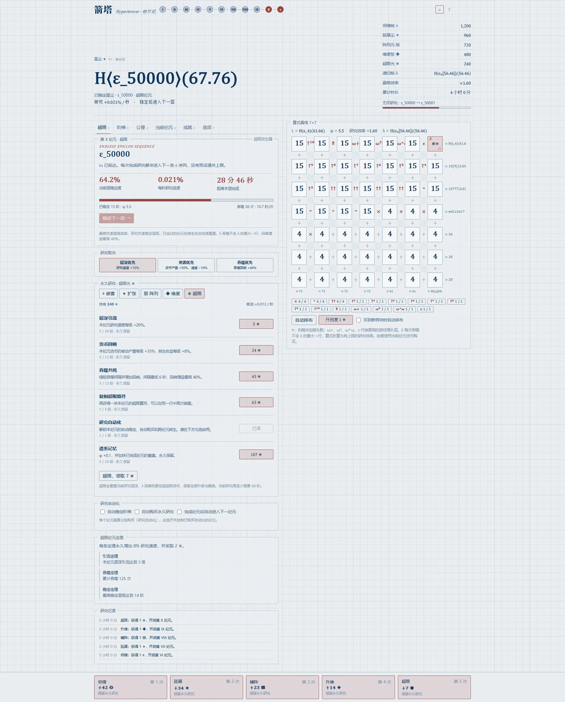

隔离演示存档预置到 ε_50000，当前层稳定度约 64.2%；主界面、超限研究与下层经营均由当前游戏实际渲染。 [查看完整原图](箭塔-完整介绍配图-20261101/极限进度原图/p1-epsilon-50000-full.png)

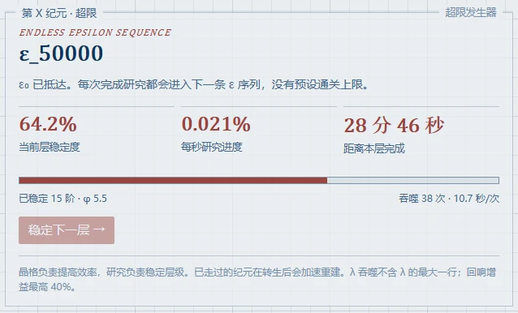

第 X 纪元仍按当前层稳定度推进到下一条 ε 序列。ε_50000 是这张演示图的预置进度，不是进入 XI 的门槛。 [查看完整原图](箭塔-完整介绍配图-20261101/极限进度原图/p1-epsilon-50000-detail.png)

隔离演示存档预置到 ε_300000，当前层稳定度约 64.2%；主界面、超限研究与下层经营均由当前游戏实际渲染。 [查看完整原图](箭塔-完整介绍配图-20261101/极限进度原图/p1-epsilon-300000-full.png)

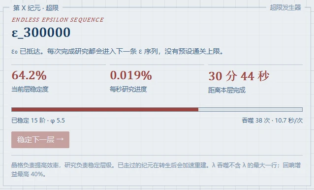

第 X 纪元仍按当前层稳定度推进到下一条 ε 序列。ε_300000 是这张演示图的预置进度，不是进入 XI 的门槛。 [查看完整原图](箭塔-完整介绍配图-20261101/极限进度原图/p1-epsilon-300000-detail.png)

### P2 极致演示：25 万与 50 万次归一

这里把 XX 的归一记录分别预置到 250000 次与 500000 次，太一遗产分别为 66000000 与 132000000。两种永久记录在同一面板呈现；蓝图库、规则卡、谜题记录和成就负责让前一轮经验进入下一轮。

归一轮数、遗产点和本轮公理各自记录不同事情。遗产研究倍率有上限，因此把记录继续增加，并不表示每个收益都会同比增加；当前轮的设计、重建和推进仍需按相应规则处理。

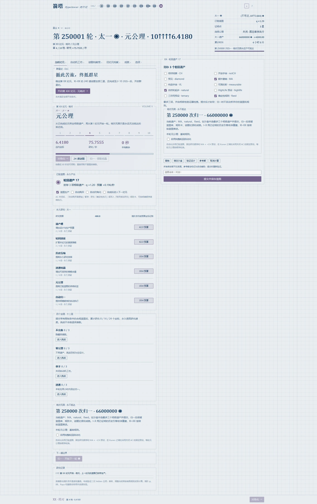

隔离演示存档预置第 250000 次归一与 66000000 太一遗产；这是 XX 永不抵达的主线界面。 [查看完整原图](箭塔-完整介绍配图-20261101/极限进度原图/p2-round-250000-full.png)

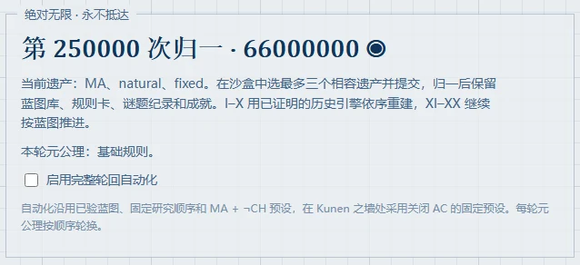

归一轮数 250000、太一遗产 66000000 与本轮公理在同一面板显示。保留蓝图库、规则卡、谜题记录和成就，再重建 I–X、推进 XI–XX。 [查看完整原图](箭塔-完整介绍配图-20261101/极限进度原图/p2-round-250000-detail.png)

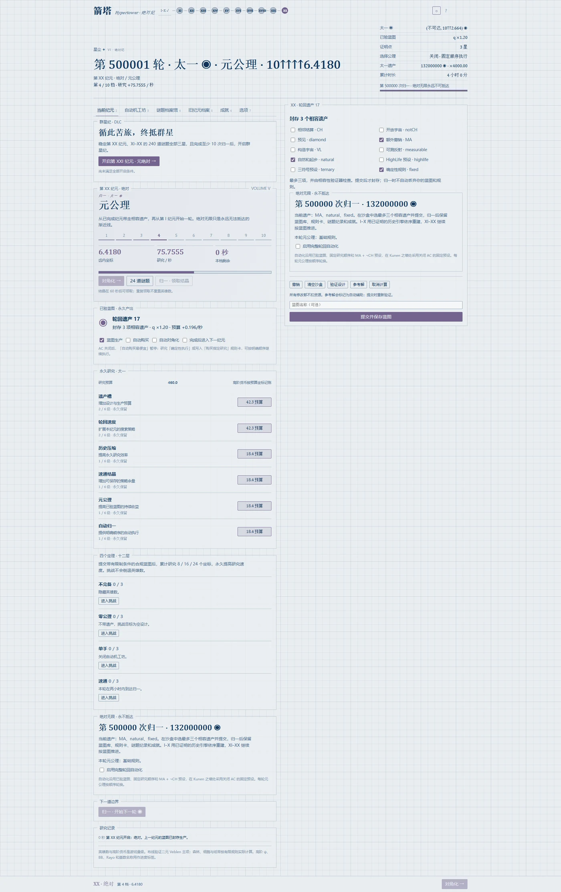

隔离演示存档预置第 500000 次归一与 132000000 太一遗产；这是 XX 永不抵达的主线界面。 [查看完整原图](箭塔-完整介绍配图-20261101/极限进度原图/p2-round-500000-full.png)

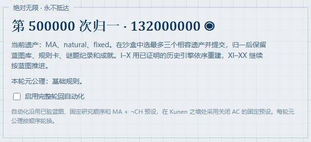

归一轮数 500000、太一遗产 132000000 与本轮公理在同一面板显示。保留蓝图库、规则卡、谜题记录和成就，再重建 I–X、推进 XI–XX。 [查看完整原图](箭塔-完整介绍配图-20261101/极限进度原图/p2-round-500000-detail.png)

### P3 极致演示：25 万圈与 100 万圈

无限循环的圈号这里分别预置为 250000 和 1000000。两份演示都从成劫展示当前圈：按该圈号重新生成星体与回声，设置稳定环，再实际积累观测并计算亮座和周天。

这两个圈号都满足 n mod 8 = 0，当前内核由此算出 m=2。它们能直观看出：圈数、茎环阶、八音树阶数、微扰塔层数分开计数，百万圈也可能遇到二阶茎环；新一圈仍要重新核对覆盖、和乐、坍缩及蒸发条件。

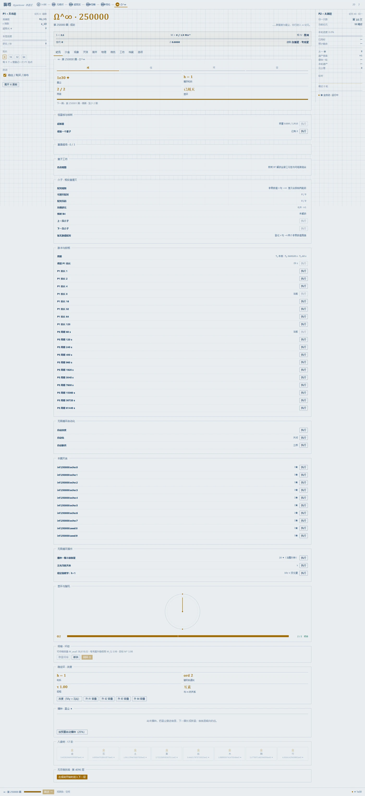

隔离演示存档预置第 250000 圈、16 阶完整八音树与第 4096 层微扰塔记录。当前圈处于成劫；本圈星体和回声由内核按圈号重新生成。 [查看完整原图](箭塔-完整介绍配图-20261101/极限进度原图/p3-250000-full.png)

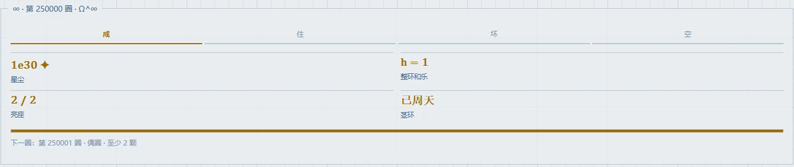

第 250000 圈的圈号、四劫、h=1、2/2 亮座与周天状态。该圈号按现有数学规则产生 m=2，下一圈仍需检查自己的圈型。 [查看完整原图](箭塔-完整介绍配图-20261101/极限进度原图/p3-250000-header.png)

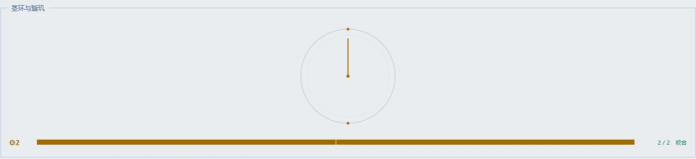

本圈的 m=2、齿轮与璇玑显示真实计算结果；圈号和茎环阶是两个不同的量，圈号上升时环阶并不逐圈递增。 [查看完整原图](箭塔-完整介绍配图-20261101/极限进度原图/p3-250000-mechanism.png)

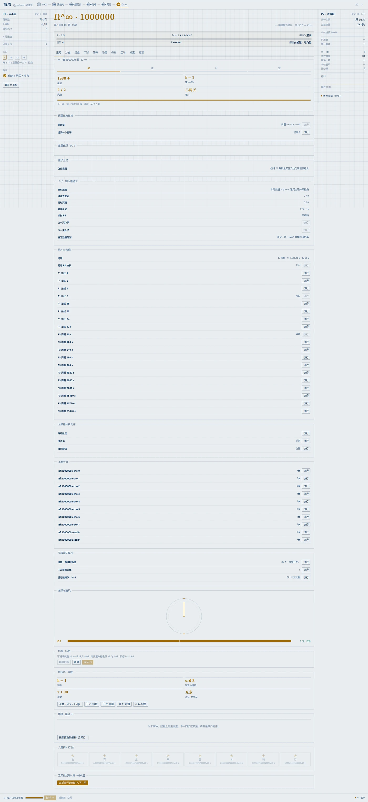

隔离演示存档预置第 1000000 圈、16 阶完整八音树与第 4096 层微扰塔记录。当前圈处于成劫；本圈星体和回声由内核按圈号重新生成。 [查看完整原图](箭塔-完整介绍配图-20261101/极限进度原图/p3-1000000-full.png)

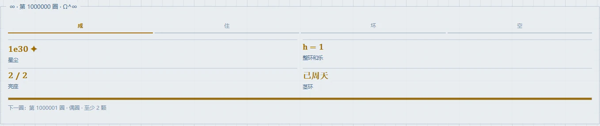

第 1000000 圈的圈号、四劫、h=1、2/2 亮座与周天状态。该圈号按现有数学规则产生 m=2，下一圈仍需检查自己的圈型。 [查看完整原图](箭塔-完整介绍配图-20261101/极限进度原图/p3-1000000-header.png)

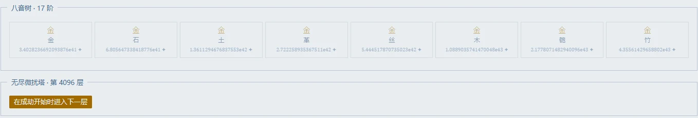

演示存档另外预置了 16 阶完整八音树，界面因此显示第 17 阶待投资；第 4096 层微扰塔是另一条长期记录，与当前第 1000000 圈分别计数。 [查看完整原图](箭塔-完整介绍配图-20261101/极限进度原图/p3-1000000-mechanism.png)

## 十、把全部纪元连起来看

### 1. 整体介绍：从制造增长，到经营一个会留下历史的宇宙

《箭塔》是一部从增量生产出发，逐步走进大数、序数、计算、集合论，再走向群星、关系与循环的长篇游戏。它的起点十分具体：购买第一台引擎，等到足够的星尘，再购买下一台。玩家最初接触的是数量、价格与产量，而旅程最终要处理的，是不同世界之间能否抵达、不同过程是否等价，以及旧世界如何成为新世界的条件。

P1 的第一段，把“增长”从生产线上搬到算式里。引擎生产星尘，折叠带来晶格，升幂引入更深入的组合，塔化与超越不断改变运算的层数。数字不再只是一个等待变大的显示值：它可以被拆成砖，重新排布，被另一种运算连接。玩家通过这些操作理解，增长并不只来自拥有更多资源，也来自让已有资源进入更合适的位置。

到了 VI–X，普通的大数表达已经成为被研究的对象。箭头可以嵌套，有限阶梯可以被对角化，阵列和维度可以再向上组织。玩家仍然有货币、升级和重置，但推进的重点逐渐从“算出多少”移向“现在处于哪种增长规则”。X 的 ε 序列既收束这段旅程，又成为一个不会立即消失的长期时钟。

P2 把这些层级背后的思想变成可操作的有限沙盒。XI 的树可能越砍越大，却沿另一种度量下降；XII 的线路要求分清参数与吸收；XIII 的森林要求考虑整个序列；XIV 的排序要求读懂最高项。玩家从观察一个庞大的结果，转为组织一份能够被验证的设计。

XV–XVII 又把“设计有效”推进到“结论凭什么成立”。一个种子运行很久不重复，不代表它永远不重复；一台机器运行很久不停机，不代表它永远不停机。发现周期、提交证书、重放验证，为玩家提供比直觉更可靠的依据。游戏在这里形成一种重要习惯：把已经知道的、暂时没有算出的、明确不能同时成立的事情分开。

XVIII–XX 则把限制放到世界本身。命题有蕴含，也有冲突；公理提供能力，也会排除另一些能力。遗产不是一份可以无限叠满的效果清单，而是一组需要相容的长期选择。归一让这段历史再次发生，但已经取得的蓝图、纪录与成就，使重演不再等于回到最初的空白。

进入 P3 时，游戏的组织方式发生了关键改变。过去的一条线变成三个同时运行的窗口：天市垣继续 ε 研究，太微垣继续历史轮回，紫微垣负责新的建设。玩家不再只是离开旧纪元、走向下一页，而是让整个过去成为当前世界的动力、时钟、材料与空间部件。

群星纪的四个有限纪元，分别打开四种新的操作。XXI 让玩家在宇宙之间航行，关注可达性与路径；XXII 让玩家构造博弈，关注值、温度与对抗；XXIII 让玩家铺设箭网，关注复合、交换与传输；XXIV 让玩家画出闭路，关注绕行、变形与洞。它们的核心动作不同，判断标准不同，也各自形成可以长期经营的结构。

观测把这些结构接到同一片天空。完成构造，意味着天体已经出现；完成观测，才意味着玩家已经认出了它的属性。望远镜、宿星、光谱、周期、闭合相位与成像，让“我造了什么”和“我知道它是什么”成为前后相连的两步。建设和观测因此需要互相跟上。

简并又为差异提供价值：不同路径抵达同一站，不同局面拥有同一值，不同箭网呈现同一个范畴，不同闭路属于同一个类。过去可能只被当作冗余的另一种解，在这里成为材料和熵；但某些纯粹改名、平移或重复又会被识别为同一态。玩家经营的不只是对象数量，还包括哪些差异应当保留、哪些等价应当合并。

恒星核与黑洞为这张结构网络加入物质和时间。保存简并会改变支撑与坍缩，解除简并可以换来输出，单值化把等价构型吸收到黑洞侧。黑洞越大，蒸发所得越多，等待也越长。电荷与角动量又分别牵连着旧 ε 引擎和新回路系统，使任何一个窗口的成长都可能改变另一个系统的边界。

最后的 ∞ 把这些关系收束成四劫循环。玩家把星尘播成新星，利用旧宇宙的回声补充天空，通过稳定链选择璇玑的步长，完成茎环覆盖，再让群星坍缩、黑洞蒸发。每圈的齿轮可能不同，因此同一套配置需要重新检查；旧纪元却继续留在底下，提供航线、博弈、网络和闭路。

于是，整部游戏形成了一条不断返回自身的轨迹：星尘启动引擎，引擎推动算式，算式走向层级，层级变成设计，设计形成历史，历史点亮群星，群星又化成星尘。起点的符号在终点重新出现，但玩家理解和操纵的对象，已经从一台生产设备扩展成整个系统。

### 2. 三个阶段的具体区别

| 比较项 | P1：I–X | P2：XI–XX | P3：XXI–∞ |
|---|---|---|---|
| 主要操作 | 购买、排式、升级、研究、重置 | 编辑有限设计、验证、保存蓝图、挑战、归一 | 建设结构、观测、调谐、连网、组织闭路与回环 |
| 最常读的状态 | 产量、晶格值、λ、研究层级、ε 下标 | 当前层与齿轮、设计结果、证书、题目星级、公理 | 激发、结构门槛、测量深度、简并谱、核质量、劫相 |
| 主要积累 | 更强的生产与运算能力 | 更有效的设计、永久研究与历史纪录 | 更丰富的结构、更深的观测与跨窗协作 |
| 碰到瓶颈时先问 | 当前缺的是资源、关键符号，还是重置升级？ | 当前设计是否满足规则，证据是否完整，公理是否相容？ | 当前缺的是结构、观测、遗骸，还是跨系统条件？ |
| 自动化逐渐承担的工作 | 采购与重复重置 | 蓝图收获、研究推进、历史轮回 | 队列、规则工坊与逐项开放的无尽循环动作 |
| 深入目标 | 优化算式与长期 ε 推进 | 全部满星、优质蓝图、不同解与归一经营 | 简并、四相、深空观测、复杂网络与微扰塔 |

阶段推进会改变当前注意力，也会改变旧资源的用途。它们通过具体接口相连，不能把所有旧货币直接混成一份通用余额。

### 3. 过去如何在后来重新出现

| 较早的对象 | 后续出现处 | 形成的具体联系 |
|---|---|---|
| I 的引擎阶链 | XXIII 的纪元范畴与“箭塔”开篇 | 生产阶次成为可映射的关系结构 |
| II 的乘法与 III 的乘方 | P3 简并开篇、XXIII 的运算关系 | 同一结果可以由不同运算产生 |
| P1 晶格 | XXIV 的晶格环面 | 行、列为两个方向提供输入，环路记录绕行 |
| X 的 ε 序列 | 三窗计时、XXI 航行、黑洞电荷 | 历史研究成为时钟与当前世界的条件 |
| XI 的九头树 | XXII 的绿色 Hackenbush 导入 | 一棵旧树成为可计算的有限博弈 |
| XIII 的彩色森林 | XXII 导入、相 III 森林选色 | 颜色与树形进入博弈及重子材料系统 |
| XIV 的排序唯一解 | P3 旧题档案 | 提醒玩家：同一个答案重复提交不产生新简并 |
| XV 的平移周期与环面 | XXIV 的环面直觉与相关联动 | 位置变化和结构变化需要分别理解 |
| XVI–XVII 的机器与证书 | 旧题整数关联、∞ 的周期证书思想 | 有限证据与未判定状态持续有用 |
| XVIII 的相容命题 | XXI 的宇宙根、按钮、开关与模态 | 单一世界中的选择，变成世界之间的可达关系 |
| XX 的遗产与归一 | XXI 根配方、P2 拍点、当值纪元供给 | 历史选择、历史节奏与当前建设相连 |
| XI–XX 的 240 道旧题 | P3 旧题能级、∞ 第 7 圈的 240 座联系 | 不同有效解为历史提供持续用途 |
| XXI 的航图 | XXII 航图对抗、XXIII 偏序、XXIV 路线环、∞ 回归航线 | 同一张图从探索对象变成多种后续结构的来源 |
| XXII 的博弈 | 简并、色材料、周期变星扩展 | 结果相同的局面与可证周期产生长期价值 |
| XXIII 的交换胶 | XXIV 群胚洞、∞ 稳定链 | 合并路径有利于相干，也可能减少可用洞 |
| XXIV 的回路与和乐 | 黑洞角动量、∞ 稳定环 | 有限环路支撑物理演化和无尽圈的步长配置 |
| 黑洞蒸发的星尘 | ∞ 播种、八音树与星尘仪器 | 上一宇宙的终结成为下一宇宙的建设资源 |

### 4. 全游戏反复出现的五个主题

**顺序有意义。** 乘方的结合、序数加法、航海卡序、路径复合与自由群字，都不能随意交换。同一批材料按不同顺序使用，可能得到不同结果；只有验证允许交换时，交换才是合法简化。

**局部变大，不代表离目标更远。** 九头蛇会复制，研究会重置，恒星会坍缩，宇宙会回环。要判断有没有进步，需要看保留的量和当前任务的正确度量，而不是只看画面上的对象是否减少。

**同一个结果，可以拥有不同历史。** 这在 P1 是算式比较，在 P2 是不同设计，在 P3 是简并。在 ∞，这些历史还可能成为星、回声与稳定链的一部分。

**验证能力本身也会成长。** 更高计算预算、更好的证书、更深的曝光、新的光谱或成像能力，都在改变玩家能确认什么。预算不够时，保留未判定比制造一个错误结论更有价值。

**自动化接管的是已经理解的重复。** 前期把采购交给自动器，中期把有效设计交给蓝图和工坊，后期再逐步组织观测与回环。新的决策来自结构变化、资源取舍和圈型改变。

### 5. 为什么四个 DLC 纪元是新的篇章

XI–XX 的主要骨架，是十个有限沙盒、题目星级、蓝图生产和归一。XXI–XXIV 的主要骨架，则是四种开放构造、天体观测、简并谱、恒星世代与跨窗耦合。四个纪元共同使用观象台，但并不因此拥有同一套核心操作。

航图要求理解可达区域和路线历史；博弈要求区分数、模糊值和温度；箭网要求处理映射、等式与相干；闭路要求识别缩约、交换子和洞。随后，∞ 才要求玩家把它们放在同一个循环里使用。

其内容规模不能只按“新增四个编号”衡量。每个编号包含建设、测量、研究、微扰和全局接口，还会在后续纪元获得新用途。这也是整篇介绍把 P3 共同规则单独展开，再逐个介绍其玩法的原因。

## 十一、术语、资源与游玩路线速查

### 1. I–∞ 纪元与主货币总表

| 阶段 | 纪元 | 名称 | 主要货币 | 核心动作 |
|---|---|---|---|---|
| P1 | I | 引擎 | ✦ 星尘 | 建立八阶生产链 |
| P1 | II | 折叠 | ◇ 折痕 | 安排数字与乘符晶格 |
| P1 | III | 升幂 | ◆ 幂晶 | 经营星图、递归核与乘方 |
| P1 | IV | 塔化 | ▲ 塔砖 | 使用幂塔与推进尖塔 |
| P1 | V | 超越 | ✧ 箭能 | 进入高阶箭头与 Ω 边界 |
| P1 | VI | 嵌套 | ◎ 坍缩核 | 研究箭头数的嵌套 |
| P1 | VII | 扩张 | ✶ 延展尘 | 对整条有限阶梯作进一步组织 |
| P1 | VIII | 阵列 | ▦ 阵列元 | 经营阵列层级 |
| P1 | IX | 维度 | ◈ 维度弦 | 研究维数本身的增长 |
| P1 | X | 超限 | ✺ 超限光 | 稳定并推进 ε 序列 |
| P2 | XI | 九头 | ⟡ 蛇鳞 | 斩树与序数晶格 |
| P2 | XII | 定点 | ⊙ 定点石 | 组织 Veblen 布线与反馈 |
| P2 | XIII | 森林 | ◍ 年轮 | 构造不允许旧树嵌入的彩色树序列 |
| P2 | XIV | 投影 | Ψ ψ 碎片 | Ω 多项式排序与标签树实验 |
| P2 | XV | 元胞 | ▣ 细胞 | 放置种子并验证有限演化 |
| P2 | XVI | 图灵 | ▤ 纸带 | 编辑机器、运行与记录停机 |
| P2 | XVII | 谕示 | ◬ 谕片 | 提交可重放的有限证书 |
| P2 | XVIII | 强迫 | ◫ 泛型 | 选择相容命题并覆盖有限约束 |
| P2 | XIX | 基数 | ℵ 阿列夫 | 经营反射塔与公理限制 |
| P2 | XX | 绝对 | ◉ 太一 | 封存遗产、归一与历史轮回 |
| P3 | XXI | 元绝对 | ⊛ 宇宙泡 | 操作卡、探索宇宙站与下钻 |
| P3 | XXII | 超现实 | ⧫ 超实 | 构造博弈、冷却与淬火 |
| P3 | XXIII | 范畴 | ⇉ 态射 | 建箭网、上胶、铺设函子与弦 |
| P3 | XXIV | 同伦 | ∮ 回路、ℌ 和乐 | 画闭路、辫织、覆叠与成像 |
| P3 | ∞ | Ω^∞ 无限循环 | ✦ 星尘 | 播种、覆盖、坍缩、蒸发与回环 |

同名星尘在开局与 ∞ 承担不同阶段的经济职责。XXIV 的储量 ℌ 与 ∞ 的整环整数 h 也必须分开：前者可以积累和支出，后者由稳定链配置计算。

### 2. 最容易混淆的进度词

| 术语 | 具体指什么 | 阅读时应注意什么 |
|---|---|---|
| 纪元 | 一组主要玩法与成长阶段 | 进入新纪元不等于所有旧系统都停止 |
| 层级、能级 | 当前纪元内部的推进位置 | P1、P2、P3 的推进方式各有规则 |
| 激发 E | 有限 P3 纪元的当前跃迁进度 | E 满仍需满足对应结构、观测与物理门槛 |
| 齿轮 | P2 层内的增长档位；也用于 ∞ 的 CRT 环结构 | 两处同名，指向不同系统 |
| 旧题星级 | XI–XX 题目完成质量，最高 3 星 | 辅助与参考解最高 2 星 |
| 观测星级 | P3 天体的信息深度 | 发现、测光、精测分别对应 I=25、400、2500 |
| 编目 | 目标达到发现门槛并进入正式观测纪录 | “登记了构造对象”不一定等于“已编目” |
| 宿亮、宿明 | 一宿规定宿星达到相应测量状态 | 需看宿星清单，不由任意新天体替代 |
| 蓝图 | 已验证、可保存并参与生产的有限设计 | 和直接推进研究条是两件相连的事 |
| 简并能级 | 按当前等价关系归为同一结果的一组构型 | 不同构型增加 g，重复态不增加 |
| 熵 | 由简并谱等来源产生的带权量 | 同时影响收益与恒星支撑，存在取舍 |
| 遗产 | XX 归一带走的长期选择与成果 | 配方数量和命题相容性都有限制 |
| 根 | XXI 一次宇宙探索的起始背景 | 换根会改变可达区域，单根不覆盖全部 547 站 |
| 恒星世代 | 恒星核坍缩后形成新一代的循环 | 不等于归一，也不等于 ∞ 回环 |
| 单值化 | 将适用等价构型永久合并到黑洞侧 | 会改变以后可用的简并材料 |
| 稳定链 | ∞ 中连接 V、XXIII、XXIV 的度与网络数据 | 配置保留后仍需适应新的 m 与箭网 |
| m | 本圈使用的 Im J 阶 | 不可直接当作完整稳定同伦群的大小 |
| h | 稳定链算出的整环和乐整数 | 非零、大小与 gcd(h,m) 分别影响不同目标 |
| 周天 | 本圈规定的覆盖条件已满足 | 普通齿轮圈与静圈的判定不同 |
| 上元 | 周天后完整命中走过全环并返回起点的深度目标 | 不要求每一圈都先等到上元 |
| 未判定 / unknown | 在当前规则和预算内没有得到结论 | 不是失败证明，也不是存在性证明 |

### 3. 重要入口与总数

| 项目 | 当前口径 |
|---|---|
| P1→P2 | 当前 X，超限引擎开启，已到 ε 序列，最佳 ε 下标至少 10 |
| P2→P3 | 当前 XX 已稳定，归一至少 10 轮，XI–XX 全题 3 星，总计 720/720 |
| XXI→XXII | XXI 稳定，并有中子星遗骸 |
| XXII→XXIII | XXII 稳定，并有夸克星遗骸 |
| XXIII→XXIV | XXIII 稳定，并形成中心黑洞 |
| XXIV→∞ | XXIV 稳定，完成过至少一次完整蒸发，当前星尘至少 1 |
| P2 题目 | 10 纪元×24 题=240 题，满星为 720 |
| XXI 宇宙 | 合法 732 站；现有卡与根可达共 547 站；默认 L 单根可达 176 站 |
| XXI 地幔 | 当前定义下共 14 种，收集目标按此口径 |
| 二十八宿 | 四象各七宿，分别对应 XXI、XXII、XXIII、XXIV |
| 有限 P3 研究 | 每纪元八项，每项最高八级 |
| 有限 P3 微扰 | 每纪元四种、各三层；同纪元最多同时叠三种 |
| 简并核树 | 四分支，各十二节点 |
| ∞ 微扰塔 | 第九圈起可开启，需按整圈规则完成回环 |

### 4. 第一次游玩的顺序建议

**第一段：I–V，先建立一套能自己运转的增长。** 每次打开新运算或新系统，先理解它如何帮助当前生产，再逐步补齐自动购买与重置投资。晶格的关键是结构，先读清一行一列怎么算，再比较排布。

**第二段：VI–X，分清算式与研究。** 观察当前研究阶段的实际要求，按货币投资长期研究，把周期性的重置接成有效循环。达到 ε₁₀ 后检查 XI 入口；是否继续冲高 ε 下标，是另一项长期选择。

**第三段：XI–XVII，先做出有效设计，再改善质量。** 读题目规则，运行一个可以理解的有限例子，确认验证器接受的是什么。保留有用蓝图，改进预算和成绩。参考解可帮助学习，但若目标是全部 720 星，需要完成非辅助的三星验证。

**第四段：XVIII–XX，注意相容性与历史保留。** 在切换命题和公理前，先看闭包与冲突。归一前确认希望带走的遗产与长期纪录。为了进入群星纪，逐项检查 XX 稳定、归一轮数和全题满星，不能只看一个“本体通关”标签。

**第五段：XXI，建立建设与观测的双循环。** 先走出几个站并完成发现，让新站真正进入经济；随后再逐步经营卡、根、航线简并和下钻。遇到站数瓶颈时检查是否需要换根，遇到跃迁瓶颈时检查指定宿星与恒星条件。

**第六段：XXII，先理解冷与热，再追求复杂局面。** 从小数值、星值与开关局面理解结果差别，再使用温度和淬火。保留能解释的好局面，分别安排登记、编目与特殊测量。

**第七段：XXIII，从能读懂的网络开始。** 先保证对象、箭和复合关系清楚，再加胶和全纪元连接。铺弦前关注映射质量与瓶颈，安装闭包与高级工具时检查外流变化。为了后面的洞与稳定链，保留对网络修改的理解。

**第八段：XXIV，先读懂字，再经营复杂闭路。** 从单钉绕行、逆字约去和交换子开始，逐步学习挂画、辫与覆叠。把三窗钉、群胚洞、环面与 VLBI 分开建立，再处理它们之间的联动。黑洞蒸发前评估等待与收益，并保留进入 ∞ 所需星尘。

**第九段：∞，每圈先检查新条件，再交给自动化。** 看 m、h、空齿、回声和种子预算；完成覆盖后决定黑洞目标，空劫安排下一圈。八音树优先解决当前最影响节奏的环节，再逐步提高循环深度与自动化覆盖。

这条路线强调先理解当前系统的基本动作。收集全部构型、追求高质量蓝图、深度简并与微扰塔，适合在基础循环稳定后继续展开。

### 5. 卡住时怎样判断问题在哪里

| 看到的现象 | 优先检查 |
|---|---|
| P1 产量很高，研究仍然不动 | 是否达到当前研究的实际门槛，相关引擎、研究与挑战状态是否正确 |
| P2 有设计，却没有预期收获 | 设计是否验证成功、蓝图是否保存或启用、当前挑战是否改变规则 |
| 题目完成却没有 3 星 | 是否用了参考或辅助路径，是否满足该题最高星条件 |
| XX 已通关，XXI 仍不可进 | 当前是否在稳定的 XX、归一是否满 10、240 题是否逐题 3 星 |
| P3 激发已满，仍不能跃迁 | 当前能级的结构、宿星、测量、持有量或恒星质量条件 |
| 构造很多，收入偏低 | 天体是否编目，测量深度、相干、质量与供给是否匹配 |
| XXI 单根地图再也不扩展 | 当前卡规则下的可达区域，以及可用根和 K 层 |
| 新解没有提高简并度 | 是否被规范化成已有态、是否达到该类型容量或缺少专门测量证据 |
| XXIII 上胶后后续能力反而变差 | 是否压缩了映射的像、填掉了所需洞，或使旧稳定链失效 |
| 黑洞产出突然暂停 | 监督边界、电荷、角动量与质量；另分清正常供给和蒸发状态 |
| ∞ 星很多却不能周天 | 齿轮是否全亮、h 是否互素；静圈则检查至少一颗发现星 |
| ∞ 周天后不能回环 | 是否已经坍缩、是否完成当前圈蒸发、是否满足本圈收束条件 |
| 自动改度报告 unknown | 当前搜索预算与网络复杂度；不能据此断言无解 |

## 附录：当前版本范围与资料依据

### A. 这份介绍采用什么口径

本文介绍的是 2026 年 11 月 1 日 D 盘恢复项目中的联调开发版本。前文的玩法、入口与计数，优先采用当前实现和规则审计；设计文档用于解释主题、结构与来源。设计中提出、但当前尚未接通的完整功能，不写成已经可玩的内容。

“完整介绍”指覆盖 I–XXIV 与 ∞ 共 25 个纪元条目、三个阶段及其联系，不代表当前游戏已完成发布验收，也不代表所有经济路线都已从全新存档自然打通。文中的“完整能级路线”列出有限 P3 的各层与主要条件，精细按钮规则仍以游戏当前面板及内核判定为准。

### B. 需要区分的实现边界

1. **星表与成就。** 宿星共 164 颗，其中设计文档明确给出 28 颗最亮星，其余 136 颗当前使用游戏插值标记；不能把这份表称作完整真实 BSC 星表。设计中的 96 条成就总表尚未逐条给全条件，本文也不宣称该总表已经全部实现。
2. **已修正的收集口径。** 732 是合法宇宙总数，547 是现有根与卡规则下跨根可达总数，14 是当前地幔种数。收集目标按用户选定的实际可达口径修正，原设计文档保留原文。
3. **仍有缺口的 P3 子系统。** 白虎、青龙之心的部分授奖与证据、双镜视直径、部分光谱和色 bin、独立星分量、非数值介子、B9 第二三元性标量及 C11 虫洞的完整差异规则，仍未全部补齐。本文没有把它们的设计终态当作现有完整功能。
4. **旧题档案。** P3 已有提交旧题多解 JSON 草稿并验证的入口，原来各纪元的完整图形沙盒没有整体移植进 P3。完整额外解计数、全量寻解表与搜索提示仍有边界，不能把候选提示当作完备搜索。
5. **数学与计算规模。** 图、路径、字长、矩阵、星表、八音树与仪器都有当前实现预算。Im J、有限偏序、有限博弈与证书有各自的精确范围；未判定就是未判定。∞ 是持续循环的玩法方向，不是程序支持任意大输入的承诺。
6. **长期经济与性能。** 部分高阶组合、全配置长期经济和在线/离线误差尚未全面验收。此前的 1.5 秒性能目标按用户决定暂缓；本文不把局部优化结果说成整局性能保证。

这些边界不改变已经介绍的主线结构，但会影响发布说明应该怎样措辞。正式发布时，可在相应内容补齐、验收后更新本附录与对应章节。

### C. 主要资料

| 资料 | 在本文中的用途 |
|---|---|
| [当前项目与 P1 基础实现](hypertower/hypertower.html) | I–V 的引擎、晶格、货币与重置机制 |
| [VI–X 超限引擎](hypertower/src/beyond.js) | 后五个 P1 纪元与 ε 序列 |
| [XI 主线](hypertower/src/era11.js)、[九头与序数工具](hypertower/src/hydra.js) | XI 的规则、基因晶格与验证 |
| [后期数学内核](hypertower/src/late-math.js)、[XII–XX 主线](hypertower/src/late-eras.js) | P2 沙盒、公理、挑战与归一 |
| [群星纪核心](hypertower/src/gr-core.js)、[基础数据](hypertower/src/gr-data.js) | 三窗、共同数据与阶段组织 |
| [XXI](hypertower/src/gr-era21.js)、[XXII](hypertower/src/gr-era22.js)、[XXIII](hypertower/src/gr-era23.js)、[XXIV](hypertower/src/gr-era24.js) | 四种建设玩法与实际跃迁要求 |
| [观象台](hypertower/src/gr-obs.js)、[简并系统](hypertower/src/gr-deg.js)、[全局系统](hypertower/src/gr-systems.js) | 观测、简并、恒星与黑洞联动 |
| [无限循环](hypertower/src/gr-inf.js)、[无尽自动化](hypertower/src/gr-inf-auto.js) | 四劫、圈型、稳定链、八音树与回环 |
| [DLC 整合设计文档，含第 10 章](hypertower/箭塔_群星纪_DLC设计文档_整合版_含第10章.md) | 群星纪主题、完整设计背景与章节关系 |
| [后端状态与规则审计](hypertower/BACKEND_STATUS.md) | 当前实现差异、可达性修正、已验证范围与剩余缺口 |
| [全纪元亮色电脑版截图索引](箭塔-全纪元电脑版截图-亮色-20261101/截图索引.html) | I–XXIV、∞ 及 X→XI、XX→XXI 的整页界面参考 |

正文中的结构示例用于解释规则，不构成唯一最优路线；费用、收益与具体预算可能随后续版本调整。介绍与阅读版应一起更新，以免两份内容出现差异。
